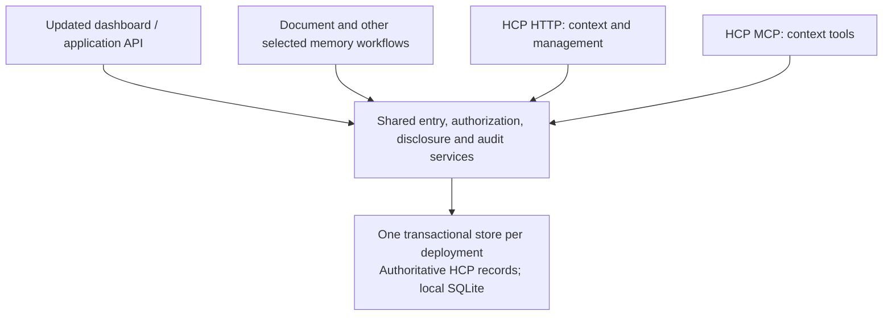

# HCP Alignment Plan

- Status: C1–C5, bounded C6 source/UI slices and C7a/C7b merged; C7b implementation and bounded live trial complete, CI qualification separate; C7c Activity implemented in PR #218, with candidate review/validation evidence in the PR; C8–C9 remain; no conformance claim
- Outcome owner: product owner; orchestrator chat `01a1b827-ae7c-7b23-9160-d7b69d0ee2b0` owns sequencing and assigns the next sole writer at activation
- Priority: future capability; does not change the assisted pilot's priority
- Risk: authorization, disclosure, persisted history, erasure, and client interoperability
- Assessment date: 2026-11-07
- Evidence: [gap analysis](gap-analysis.md), with the reviewed source revisions
- Relationship and ownership: [HCP integration reference](../../../useful/HCP_INTEGRATION.md)
- Protocol questions: [local Draft 3 adoption notes][questions]

Current sequencing is [C7a → C7b → C7c](#c7-sequence-and-activity-visibility-2026-11-22),
following the [C6 UI merge](#c6-demo-ui-merge-and-c7a-planning-2026-11-21) and
[demo-first continuation](#demo-first-continuation-2026-11-19). Earlier activation,
writer, pending/draft and freeze-time passages below are historical. The current
status and checkpoint map supersede their routing; old “C8 qualification” means
current C9. Historical C7 references retain their original bounded MCP/host scope.

Current candidate validation follows the [Product CI policy](../../../current/LOCAL_MIGRATION_CONTRACT_BASELINE.md#ci-qualification-profiles)
adopted in PR #219. Earlier checkpoint references to separate standard CI and
three qualification receipts describe their historical validation; they do not
add requirements to current C7c CI. Selected job outcomes and the final aggregate
still must pass on the final candidate. Installed-artifact evidence remains separate.

## C7 Sequence And Activity Visibility (2026-11-22)

C7a's controlled query/get implementation merged in
[PR #212](https://github.com/loyalagents/context-router/pull/212) at
`7381ba9d70a9d3597543ae033451920631fab028`. Its source evidence remains in the
[C7a brief](c7-read-brief.md) and PR; this sequencing update adds no qualification
claim. C7b's implementation and bounded live trial are now complete; its chat
`01a200ed-ae48-78f0-a7a6-31fa72e895d6` retains the separately owned worktree and
trial evidence. The original orchestrator retains sequencing.

The separately owned urgent app demo uses the existing connection. Lucas activated
C7c implementation after C7b; the scoped ownership and reviewed contract are below.
This does not reopen C6, delay the demo or authorize a new live trial.

### C7b Completion (2026-11-25)

Lucas merged [PR #217](https://github.com/loyalagents/context-router/pull/217) at
`609b00c49a470cf9d15a7db6528ab28d34a91bb8`, with final PR head
`318a2793de44674fd669997710f01b9a18f79e37`. The [C7b handoff](c7b-host-brief.md#completion-and-merge-2026-11-25)
records the successful Claude Code 2.1.299 / Sonnet 4.6 synthetic query, exact-ref
get, scope denial and denial after explicit human revocation. Receipt and provider
audit agree; owned host/browser processes stopped and retained HCP grants were
revoked. Preserve the trial roots and earlier failed-get evidence; no new live run
is needed. This does not establish subscription-token revocation.

Completion covers the bounded implementation and live acceptance. Source CI
qualification was still running at handoff and is recorded separately; this plan
does not assert all-green final CI, full C7 completion, installed-artifact
qualification, HCP conformance or personal-data approval.

### C7c: Activity And Permission Visibility

**Outcome:** a person can understand who has access, how that access changed,
and how it was used, through one readable activity timeline. Lucas activated
C7c on November 25: this step chat owns plan refinement, implementation, independent
review and publication through the existing PR #218; the original orchestrator
retains sequencing. C9 verifies this checkpoint's coverage before qualification.

**Activity baseline reviewed on 2026-11-24:** main at
`0e1c9f379c5fa799341e0f84db21affcd1f22a55` includes the demo Activity work from
PRs #215–#216. Its [session permission history](https://github.com/loyalagents/context-router/blob/0e1c9f379c5fa799341e0f84db21affcd1f22a55/docs/current/AUDIT_AND_ACCESS_HISTORY.md#demo-session-permission-activity)
interleaves dashboard permission changes with assistant requests, with readable
before/after details, expandable rows, client/date filters and exact-event links.
Use those presentation patterns as C7c's starting point; at activation, select
which components fit the chosen HCP surface and adapt their event source.

The demo records up to 50 temporary permission events per local app session.
Successful dashboard Save, advanced grant edits and revocation are covered;
restart loses these events, and CLI edits and uncertain storage acknowledgements
are outside its coverage. This is useful permission-change visibility, with no
durable HCP audit claim. Its session-clear behavior does not define HCP retention.

**Remaining HCP work:** connect readable activity to the existing durable HCP
audit, map its participants/grants/scopes and event-time facts, and close any
demonstrated coverage or presentation gaps. Grant issuance/revocation/expiry and
rule/directive changes are already recorded; basic grant history exists, while
the general HCP history view remains largely raw JSON. Reuse those events as the
source of truth instead of introducing a second permission-history store.
[Pinned §8](https://github.com/loyalagents/hcp-spec/blob/2e2939c9bebcefb3bed7bb3522231c0e4d65a315/spec/2.0-draft-3/source/s8.md)
already requires the core permission events; C8 is needed only for a concrete new
protocol finding, not as a prerequisite for this presentation work.

Internal implementation checkpoints and acceptance:

1. **Confirm HCP event coverage and mapping.** Inventory grant issuance, revocation
   and expiry, rule/directive changes and relevant entry category/purpose changes
   alongside memory changes and access activity. Reuse durable events; close
   demonstrated recording gaps with backend tests first. Map HCP participants, grant IDs and
   scope into readable rows while preserving event-time facts and truthful
   outcomes; do not fabricate historical events from current permission state or
   infer which permission a request used from chronological proximity.
2. **Adapt the Activity presentation to HCP.** Reuse the demo's readable changes,
   expandable details and event navigation where suitable. Show actor, affected
   client, time and scope: read/write actions, categories or selected entries,
   purpose and duration where relevant. Explain changes with before/after details where recorded.
   Distinguish permission granted from permission used, expiry from revocation,
   and attempted disclosure from confirmed receipt or remote erasure. Provide
   client/category/event-type/date filters and pagination over durable HCP events.
   Keep current access inspection reachable without interpreting old events as
   current access.
3. **Prove the user journey.** Focused HTTP/browser checks cover grant → read →
   access-rule change → revoke/expire, with accurate ordering, filtering, history
   retained across restart and empty/unavailable-event states. Cover management-only
   history access, final render authorization, protected sensitive details and
   credential/query-text exclusion. Preserve HCP's append-only history and current
   retention/erasure contracts; do not carry over the demo's temporary event limit
   or clear controls. Validate any new recording behavior and its acknowledged
   durability/rollback/recovery separately; finish with independent
   review and the applicable local checks/CI under the validation policy.

The work remains synthetic unless separately extended under D3/CR-Q9 prerequisites.
It adds no permissions, MCP tools, retention/erasure changes or conformance claim.
Capture adoption findings locally for C8; leave `hcp-spec` unchanged.

#### C7c Activation And Reviewed Implementation Contract (2026-11-25)

The sole writer owns the existing `codex/hcp-c7c-plan` checkout, starting at
`5473725bf35216e900f9b99b37556f5e30a67b5b`, with base
`609b00c49a470cf9d15a7db6528ab28d34a91bb8`. PR #218 is draft during implementation.
The app attachment attempt reported another chat's registration; commands use the
explicit dedicated worktree. The default demo checkout and all retained C6/C7b
trial roots are outside this assignment. No upstream changes or new live runs.

Requested coordinator/writer: Astra/xhigh. Read-only plan reviewers
`plan_authority` (gpt-6.2-astra/xhigh) and `plan_surface` (gpt-6.2-astra/high)
reviewed the starting revision. The tool accepted the reviewer settings; actual
runtime settings, including the coordinator's, are not independently observable.
Their required refinements are adopted below; fresh complete-diff reviewers follow
implementation. One writer owns source, tests, docs and publication.

- **Surface:** retain provider-rendered `GET /manage/audit`, now Activity, and
  the existing management session/final HTML authorization boundary. Reuse readable
  rows, expandable details, filters and exact links, without importing the Next.js
  demo's session store, clear controls, framework or retention limit.
  `/manage/disclosures` remains a separate aggregate view.
- **Recorded facts:** the named grant, rule/directive, classification, memory
  and disclosure events already have durable producers. No recording/schema change
  is selected. Fix old-category filtering from recategorization's recorded
  `from`/`to`. Join a row to its exact prior `grant.issued` snapshot; do not use
  current registrations, grant status, memory content or neighboring timestamps.
- **Policy relevance:** derive and explicitly label recorded grants matching the
  recorded policy scope. Replay grant issuance/revocation/expiry in append order,
  also applying the recorded expiry deadline. Use canonical selector semantics,
  including operator, categories, conditional claims and omitted versus empty
  selectors; exclude the exempt management grant. Missing facts yield no inferred
  association. This is neither evidence of effective access change nor use/delivery.
  Ignore arbitrary imported extension fields. Never infer causal revocation from
  an adjacent policy event.
- **Navigation:** oldest-first append sequence, with snapshot-bound next/newer
  pages and the existing ten-minute cursor expiry. Client/category/event-type/date
  filters remain applied and visible; reset drops the cursor. Exact `eventId`
  inspection is management-only, independent of pagination and survives restart.
  Missing events, no matches and unavailable/expired requests have distinct honest
  outcomes. Current grant/rule inspection remains reachable; grant cards label
  approved scope and explain that current rules can restrict it further.
- **Presentation privacy:** map allowlisted event fields into readable actor,
  affected client or policy scope, purpose, duration, categories and selected-entry
  facts. Show recorded before/after only; never reconstruct old memory values.
  Do not dump unknown extensions, query text, credentials or free-text request
  descriptions. Render attempts as unconfirmed and notification delivery as no
  proof of remote erasure. Detailed fields stay behind the same final authorization.
- **Tests first and evidence:** focused mapping/query tests precede changes;
  synthetic HTTPS and pinned Chromium cover grant/read/partial rule/remove/revoke/
  expiry, old/new categories, multiple grants and selector claims, exact links,
  empty/unavailable states, filters/pagination across append/restart, escaping and
  credential/query canaries. Renew actual HTML render-expiry tests when replacing
  JSON rendering; preserve separate JSON/aggregate authorization tests. Run affected
  governance/read/source consumers and maintained-doc readers. No producer change
  means existing acknowledged event durability contracts are unchanged; restart
  and interrupted-read evidence still verifies the displayed history.

Finalization is the implemented scoped journey, known findings resolved, focused
Mac/browser/persistence evidence and contributor docs ready, followed by a frozen
candidate, fresh complete-diff review and all applicable exact-candidate CI.
No full local migration gate is selected: focused affected target-Mac checks plus
existing CI supply the required source evidence. Installed artifacts, new human
host acceptance and C8/C9 qualification remain separate. Publish one cohesive PR;
do not merge automatically.

#### C7c Implementation And Review Record (2026-11-25)

The implementation retains the durable store and existing producers. Activity
uses event-time grant associations, allowlisted readable fields, snapshot pages
and exact-event inspection. Targeted tests were written first; the initial frozen
candidate `fd22d0830ecfff867958ee409a4b48198beb70e6` passed six focused Jest suites
(91 tests), eight HTTP/recovery consumer files (161 tests) and all 15 source/OAuth
browser tests on the target Mac. No live provider trial or installed artifact was
run or delivered. Contract baseline, Markdown links and maintained-document reader
checks passed; the full local migration gate was not selected under the policy.

Fresh read-only complete-diff reviewers `final_authority` (requested
gpt-6.2-astra/xhigh) and `final_surface` (requested gpt-6.2-astra/high) reviewed
the base-to-candidate diff. The tool accepted those settings; runtime settings
remain independently unverified. All findings were accepted in one correction
batch: type-gate imported extensions before audit matching; admit historical
foreign category URIs only in history filters; match beneficiary and initiator
independently without later grant facts; retain visible entry/grant filters and
exact bookmarks through sign-in; make notification and zero-import outcomes
truthful; correct stale C7b publication wording. Actual reviewed-import, HTTP,
mapping, presentation and fresh-session browser regressions reproduce the issues.

These corrections renew filtering, presentation and sign-in review and affected
local checks. Unchanged append-only producers, snapshot ordering and final HTML
authorization coverage carry forward explicitly, with their affected consumers
also exercised. The final candidate, reviewer rechecks, exact tested CI merge
identity and qualification results are recorded in
[PR #218](https://github.com/loyalagents/context-router/pull/218). The PR remains
draft until those gates pass; publication is not merge authorization. C8 owns
adoption follow-up and C9 owns broader qualification. `hcp-spec`, both specification
pins, the demo checkout and retained C6/C7b trial evidence remain unchanged.

**External review follow-up:** Lucas supplied a read-only Claude review and its
separately authorized isolated reproduction, then authorized worthwhile fixes.
The review found no blocking authorization or store-safety issue. The accepted
follow-up documents the intentional shared JSON/export client-filter semantics
and the separate raw-history privacy boundary; it corrects revocation wording
when the recorded deadline had already passed. The expired current-grant card
keeps explicit revocation available and describes its already-expired access.
The journey test now requires a successful revoke, denied subsequent read and
an independently expected event sequence; a newly issued matching grant proves
snapshot exclusion across restart. A focused API/export test pins exact expected
events for beneficiary, initiator and policy-scope matches. The stale Activity
fault-hook operation label is corrected. New wording and status assertions failed
before fixes. The existing read-only authority reviewer approved this bounded plan
with the same requested settings and observability limits recorded above.

No filter rollback, raw-history removal, speculative malformed-grant hardening
or general error-page redesign was selected. Those would change separate contracts
or address no demonstrated reachable bug. This follow-up changes presentation,
tests and documentation only; producer, storage, authorization and pagination
mechanisms are unchanged. Final delta review, affected checks and exact-candidate
CI are renewed in PR #218; unchanged earlier coverage is carried forward explicitly.

## C7b Isolated Host Preparation (2026-11-21)

This preparation record is historical; the [November 25 completion](#c7b-completion-2026-11-25)
supersedes its pending-publication and ownership wording without changing the
recorded trial scope or evidence.

C7a merged as `7381ba9d70a9d3597543ae033451920631fab028`. Its final standard/native
and three-lane migration CI passed; the [C7b brief](c7b-host-brief.md#preparation-evidence)
records the separately verified head, base and tested merge. Lucas activated C7b
in a dedicated worktree, with that chat as sole writer and read-only independent
reviewers. The orchestrator retains sequencing and publication. This activates
source preparation, synthetic disposable fixtures and the exact real host against
a local fake model. A live subscription login, model call and off-device synthetic
trial were subsequently approved through the reviewed concrete consent packet;
the actual fixture is approved and initialized. After the initial mistyped-ref
failure and reviewed semantic-check repair, the separately authorized November 25
repeat passed live query/get, scope denial, explicit human revocation and denied
access afterward. Receipt/audit verification found a clean host exit, closed
browser and no active grants. This completes the bounded C7b live handoff;
publication/CI remain with the orchestrator. Personal state, the installed app,
demo work and `hcp-spec` stay untouched.
The user prefers subscription authentication; the brief records its isolated token
and relay boundary. C8 adoption and C9 qualification remain separate obligations.

## C6 Demo UI Merge And C7a Planning (2026-11-21)

**Current activation:** Lucas subsequently authorized C7a implementation in chat
`01a20029-3e43-7d70-9e84-4dcc8acd73e7`, now sole writer/integrator in this checkout.
The original orchestrator retains sequencing and stays read-only in this checkout.
The reviewed brief and four planning files are carried forward; controlled synthetic
clients, tests/builds and disposable fixtures are selected, with no actual host/model,
personal state or upstream changes. C7b/C8/C9 remain separately gated.
Implementation and independent review are now complete; the
[local handoff](c7-read-brief.md#c7a-local-handoff) records passing focused checks,
the corrected Unicode denial defect, and remaining exact-candidate CI/host evidence.
Lucas subsequently authorized this writer to commit and publish one C7a PR and
prepare an independent Claude Code review handoff. The PR description records its
candidate and CI state. Merge/release and actual host work remain unapproved.
The implementation is published in [PR #212](https://github.com/loyalagents/context-router/pull/212).
Lucas requested fixes for its Claude review; the corrected source has fresh
independent approval. The brief records the correction scope and local evidence;
the PR description records renewed exact-candidate CI and remaining qualification.
The following merge/planning record retains its original scope.

Lucas authorized the final Claude feedback corrections and merge of
[PR #211](https://github.com/loyalagents/context-router/pull/211). It merged as
`f92260060152b6872b5732587027bd161bc4f590`, with base
`3f453e57b6139816d1daf40a1fc8715d7dd1e1ec`, final head
`8db0bf35846549a8e3a4f286662dbf6beff3dc2a` and CI test merge
`4af9eb9b03743b75ace3ffb98350c9ab7646a470`. The orchestrator verified merge parents
and the identical final tree `2da9b53e9aed77f5abe9e887bfd2bd811d029b15`.
[Standard CI](https://github.com/loyalagents/context-router/actions/runs/44943974385)
passed docs/backend/frontend/native; [migration CI attempt 1](https://github.com/loyalagents/context-router/actions/runs/44943974354)
passed with verified `ci-source`, `ci-ui`, `ci-packaging` receipts and aggregate
bound to that source/base. Vercel passed. The PR body is the final evidence record.

The final delta shows ended access/status for inactive grants and requires
`grant.issued` in HTTP and visible-browser history checks; the HTTP regression
actually revokes. The TLS prerequisite polling was formatted only. Tests-first
failure was observed before the fix; backend build and 27 affected dashboard/source
browser tests passed, as did Prettier, 162-file Markdown links, exact-base contract
comparison (41 capabilities/58 consumers) and whitespace. Fresh affected review
(requested Astra/high, actual execution unverified) approved the four-file delta;
only unaffected prior coverage carried forward. No full local migration gate was
selected. These results supersede the affected candidate hashes and pending CI
wording below, while preserving that record's historical scope.

The source UI handoff is delivered. This adds no new human acceptance, installed
artifact qualification, full C6 or HCP conformance claim. The accepted November 19
journey and deferred human Ctrl-C/full stop-reopen/expired-session/pending-form
checks remain as recorded. Broader C5/C6 capabilities remain owned.

The orchestrator assigned a sole documentation writer for [C7a planning](c7-read-brief.md)
from this clean merged base; root and reviewers remain read-only until handoff.
The brief proposes synthetic query/get, one host/version, CR-Q7/CR-Q8/N4 contracts,
tests-first checkpoints and a later bounded host activation. No runtime, host
configuration, credential/trust/client changes, model use, off-device synthetic
trial, commit/PR or upstream change is activated by this planning assignment.
`hcp-spec` stays untouched; normative/adoption pins are unchanged. C8 still owns
protocol resolution **and CR adoption**, and C9 mandatory completion/qualification.

## C6 Demo UI Activation (2026-11-19)

Lucas activated this bounded continuation in the C6 owner chat, with orchestrator
`01a1b827-ae7c-7b23-9160-d7b69d0ee2b0` retaining sequencing. Base is merged main
`3f453e57b6139816d1daf40a1fc8715d7dd1e1ec`; branch `codex/hcp-c6-demo-ui`.
The C6 coordinator is the sole writer/integrator in this checkout. Reviewers are
read-only; builds and disposable synthetic test instances belong to the writer.
No commit, PR, merge, release, installed/personal-state work, C7 or upstream change
is selected. The previous source retest sandbox stays untouched. Lucas clarified
that the existing flows are fine: prioritize a working handoff, avoid unnecessary
abstraction or a guided redesign, and iterate on visual design later.

**Selected experience:** preserve existing flows with modest consistent navigation,
readable retained entries/current and previous versions, text correction, exact
review/cancel/approve, history and grant inspection. Create/add is not selected
for new UX or acceptance; existing experimental capabilities remain reachable
without expanding their authority. Source launch continues to use the owned
initializer/provider/browser commands; improve their contributor instructions,
not process or trust mechanics.

**Risk and roles:** balanced presentation work with sensitive authority-boundary
review. Coordinator/sole writer uses Lucas's chat defaults (model/effort not
independently observable). Discovery requests `gpt-6-astra` / `high`; plan and
final boundary review request `gpt-6-astra` / `xhigh`. Tool acceptance verifies
requested configuration only, not underlying execution. No model tier was
specifically requested by Lucas.

Independent Astra/xhigh plan review approved the narrowed implementation plan
before runtime edits. The user clarification removed the proposed client script;
native loading and existing forms suffice. Requested settings were accepted by
the tool; actual model/effort remain unverified. Checkpoints:

1. Fix the small view/action contract and ownership in the source runbook. Add
   focused HTTP/browser expectations first. Extract selected management renderers
   into a pure presentation module, taking admitted snapshots and explicit form
   fields. No store, network, authority calls, credential handling or random IDs
   in presentation. Keep editor eligibility enforcement, body allowlists, session,
   CSRF, review/operation-key creation and final `managementPage`/`releaseWrite`
   checks in `http.ts`; schema, authority and composition remain unchanged.
2. Improve the existing list/detail/review/history/grant views over those snapshots. Keep
   exact JSON expandable, replacement effects and current lifecycle visible,
   unsupported targets view-only, and existing experimental governance reachable.
   Add generic browser-only denial/error recovery (same statuses, no protected
   data/redirects). Use native browser navigation/loading; add no JavaScript or
   CSP exception. OAuth/API problem contracts and OAuth presentation stay unchanged. Known committed minimal success stays distinct
   from uncertain mutation outcome.
3. Validate the integrated source candidate and publish a local handoff. Focused
   dashboard/source/writes/governance/OAuth consumer tests, final-render expiry,
   persistence/fault cases, isolation, build, and pinned real Chromium source/OAuth
   journeys cover affected behavior. Check narrow/mobile layout, keyboard focus,
   empty/denied/stale/uncertain states and no automatic POST replay. Run affected
   doc consumers/link/contract/whitespace checks. Do not run a full migration gate
   without a named new evidence gap; no such gap is selected now.

Finalization milestone for this assignment: selected journey implemented, known
review corrections resolved, focused checks passed, fresh independent complete-diff
review complete, and source runbook ready for another UI agent. Freeze code and
relevant test inputs at that point. No new human acceptance round is required to
finish implementation; a later optional human trial retains its own scope.
Exact-candidate CI remains pending until publication is requested. No installed
artifact/native qualification or full C6/conformance claim follows from this work.
Prior deferred human stop/reopen, expired-session and pending-form acceptance
remain deferred. Remaining C6 workflows, C5 gaps and C7–C9 ownership below survive.

### C6 Demo UI Source Handoff (2026-11-20)

**Publication handoff:** Lucas subsequently requested that the original
orchestrator coordinate the PR and CI. The C6 chat yielded checkout/build/runtime
ownership; the orchestrator is now the sole integrator for one cohesive PR and
exact-candidate CI. The implementation-time uncommitted, no-publication and
retained-writer statements below describe the earlier handoff, not current
authorization. Runtime and test inputs remain frozen; this publication note
changes only ownership/status. Final commit and CI identities/results will be
recorded in the PR. No automatic merge, release or upstream change is authorized.

**Approved CI follow-up:** PR #211's first UI qualification failed the existing
TLS-expiry fixture's wall-clock prerequisite after one timer wait, before the
browser rejection probe. Lucas approved bounded polling of that prerequisite;
the original expiry assertion and Chromium TLS rejection/zero-request checks
remain intact. Runtime inputs are unchanged. Renew the affected browser evidence,
review this test-only correction and run exact-candidate CI; record results in
the PR without treating the initial failed run as a pass.

**External review follow-up:** Claude approved the complete candidate and found
two non-blocking issues: revoked grant summaries could imply continuing access,
and grant-history tests accepted the empty state. The authorized correction shows
ended access for inactive grants and requires a visible `grant.issued` event in
HTTP/browser tests. The TLS wait is formatted without changing its behavior.
This supersedes the earlier presentation hash and affected test evidence below;
renew dashboard/browser checks, affected review and exact-candidate CI before
the authorized merge. The next planning task will record the merge and update
the portfolio. Generic uncertain-outcome copy remains a non-blocking observation.

The bounded source implementation is complete locally. Existing flows remain;
management presentation now has consistent Memories/Grants/History navigation,
readable content and exact proposed text, expandable full records, grant summaries,
empty states and static denial/uncertain-result recovery. No JavaScript, new API,
framework, authority/schema or launcher behavior was added. The
[source UI handoff](../../../useful/HCP_SOURCE.md#ui-contributor-handoff) gives another
agent supported launch/actions, small view inputs and file ownership.

Base and HEAD remain `3f453e57b6139816d1daf40a1fc8715d7dd1e1ec` on
`codex/hcp-c6-demo-ui`; **seven paths are uncommitted**:

- `apps/backend/src/infrastructure/hcp-experiment/http.ts` and new
  `management-presentation.ts`: route adapter and pure views.
- `apps/backend/test/local-database/hcp-experiment/dashboard.test.cjs` and
  `isolation.spec.ts`, plus `apps/web/test/hcp-source-browser.test.mjs`:
  affected HTTP/browser/isolation evidence.
- This plan and `docs/useful/HCP_SOURCE.md`: scope, evidence and contributor handoff.

Tests-first evidence was three expected failures (navigation/grant view, HTML
refusal and uncertain outcome) with 14 passes. Iteration caught and
fixed a hidden receipt caveat; the existing browser assertion was preserved.
Uncertain-error wording was clarified while preserving the existing portability
assertion against completion claims. No failing check was weakened.

Frozen runtime inputs reviewed independently: `http.ts` SHA-256
`da3019cc7ef98b3c9a44bcb89025b0c4c82744b50394b0688484c2e262c40181`;
`management-presentation.ts` SHA-256
`2c479c9e03a640bdc46c263ade6a26079dbb198f93d5b4579f4293c2b038e840`.
Fresh complete seven-path review (requested Astra/xhigh; execution unverified)
approved with no actionable findings. Later handoff prose adds evidence only;
runtime/test inputs stay frozen.

Final local evidence on Node 24.21.0 / pnpm 10.25.0:

- Backend build passed. Dashboard, source, writes, governance, OAuth and portability
  Node test files: **112/112** passed, including durable fault/reopen cases, final
  render expiry and known-committed/minimal versus uncertain outcomes.
- Pinned Playwright 1.63.0 / Chromium 153.0.8010.12 source and OAuth browser files:
  **13/13** passed, including correction/cancel/approve/history, mobile width,
  keyboard navigation, denial recovery and no pending-form replay on reopen.
- Jest HCP isolation: **2/2** passed, including real legacy-adapter refusal and the
  pure presentation/import boundary. Visual inspection of list/detail/review,
  empty grants and mobile screenshots passed in disposable automated fixtures.
- Markdown links passed against the exact base with zero unexpected violations;
  contract baseline passed with base comparison performed (41 capabilities,
  58 consumers); whitespace passed. No additional direct readers of the two edited
  documents were found. No full local migration gate was selected.

Owned test processes stopped; disposable test state was cleaned. The previous
human sandbox, installed/personal app, clients, models and OS trust were untouched.
The sibling `hcp-spec` remains clean at `5fc62a413794b5927f1251968e04381044af92c1`;
no upstream changes or target adoption occurred. No new protocol finding emerged:
this is application presentation under the existing provisional correction/release
contracts; C8 retains their normative resolution/adoption.

**Targeted checks passed; final validation pending.** Publication is not authorized,
so exact-candidate CI is pending. No new human acceptance, installed/native artifact,
full C6 or conformance qualification is claimed. Previously deferred human checks
remain deferred. This chat retains C6 ownership for the next requested UI iteration
or source trial; the original orchestrator retains sequencing and remaining
C5/C6/C7–C9 scope. No commit, PR, merge or release was created.

## Demo-First Continuation (2026-11-19)

[C6's first source slice merged in PR #209](https://github.com/loyalagents/context-router/pull/209)
at `d82b806ed9ff524d7fbbce78a3081cf1d22423c9`. Reviewed head
`90912af6482f97b59137e9d54709159423cf8575`, CI test merge
`ca6e86b561647bd312ed728e5334a71adab54286` and the merge share tree
`f77bafe2c984b69424958eda8174ae5e22f59d04`; base was
`c3c953a769596930b5b760735344f3f89626fd55`.
[Standard CI](https://github.com/loyalagents/context-router/actions/runs/43804030956)
and [migration CI attempt 1](https://github.com/loyalagents/context-router/actions/runs/43804030975)
passed, including all three qualification receipts and native CI.

The November 19 human retest in chat `01a1e333-3f77-73c3-8863-4c542a8b3beb`
passed sign-in, retained-entry inspection, cancel without save, one approved
correction, preserved history/v1, and Cmd-Q while the provider remained alive.
The user accepted this bounded source journey as enough to advance and stopped
extra testing. Human Ctrl-C and full stop/reopen persistence were **deferred**, not
passed; no human expired-session or pending-form pass is claimed. Automated evidence
retains its original scope. Cleanup preserved the synthetic sandbox; no runtime or
spec defect was found. This is partial C6, not installed-artifact or full qualification.

| Next milestone | Handoff and completion boundary |
| --- | --- |
| C6 continuation: source UI handoff delivered | Bounded navigation, retained-entry/version inspection, correction/review/history/grant views and contributor contracts merged in PR #211. Broader workflows and selected add acceptance remain owned; `/manage/person/new` exists but was outside the human correction pass. Later visual/workflow iterations require their own scope; no C7 or spec-resolution dependency for the delivered UI handoff. |
| C7a: controlled synthetic MCP reads | [Query/get implementation](c7-read-brief.md) merged in PR #212 with controlled-client evidence and provisional output/error, query-default and N4 contracts. Actual host evidence is separate; writes/report tools remain outside this slice. |
| C7b: one real host/version — complete | [Merged PR #217 and bounded live acceptance](#c7b-completion-2026-11-25): exact-host query/get, scope denial and explicit-revocation/read denial. Retain the isolated trial evidence; final CI qualification is separate. |
| C7c: activity and permission visibility | [Activated implementation](#c7c-activity-and-permission-visibility): reuse the demo Activity presentation patterns over durable HCP memory, access and permission events; close event-mapping/coverage gaps and verify retained history. Activated after completed C7b; it does not change trial evidence or block the independently owned demo. |
| C8: protocol resolution and CR adoption | Use demo/client evidence to resolve prioritized questions, produce the smallest justified spec/schema/example/check/guidance/tooling fixes, then explicitly adopt the selected revision and realign affected CR/consumer contracts and tests. Submission, upstream review/merge, and CR adoption are distinct outcomes; an issue list alone does not complete C8. |
| C9: selected capability completion and qualification | Complete remaining selected C5/C6/C7 capabilities, including C7c activity/permission coverage, close all mandatory package/profile gaps and the requirement/evidence matrix, then freeze and qualify the complete candidate. Source, installed-artifact (if selected), host, Mac and manual evidence remain distinct. |

The UI handoff is usable when another agent can run the isolated source through
documented supported actions and exercise the selected browse → edit → exact
review/cancel/approve → retained history and grant-inspection journey, with clear
loading, denial and uncertain-result states. Only selected add controls require
new add acceptance; no create-UX expansion is mandatory for this first demo.
“Optional C7” means optional for the early demo or its overlap, not optional for
final Agent Interop: retaining that target requires the complete MCP binding at C9.

An app-like **source** experience comes first. Installed Mac packaging is a separate
selected milestone if the demo needs it. C6 still owns document/model review and
apply, profile, location/category/schema, seed/demo and fresh-initialization/reset
workflows: defer these from the initial polished demo, revisit each when selected,
and complete or explicitly exclude optional workflows before C9. C5 owns its
mandatory governance/erasure/portability gaps; the orchestrator carries them into
C8 resolution and C9 completion, never silently drops them. The
[access-path inventory](gap-analysis.md#c6-current-access-path-inventory-2026-11-15)
continues to govern every expanded producer and consumer.

Exact consent, distinct management/grant authority, final data-release checks,
truthful committed-versus-uncertain outcomes and persistence remain required.
Never automatically replay an uncertain mutation. Legacy compatibility, data
conversion and migration history remain unnecessary; new HCP history is protected.
D3 erasure must be resolved and implemented before **any personal-data extension**;
CR-Q9 must be resolved and explicitly adopted before sensitive real-data exposure.
User data, models/downloads and client settings stay untouched by this plan.

Pinned §18.3 requires Provider Interop when accepting independently operated
clients. A bounded C7 host experiment is explicitly incomplete relative to that
requirement: withholding a conformance claim does not satisfy or waive it, and a
local bridge does not make the host first-party. C9 must resolve that gap before
full qualification. This plan activates no runtime, installed/native delivery,
model run, personal-data use, client setup, or upstream publication; the normative
and adoption pins remain unchanged and `hcp-spec` remains untouched.

## Outcome And Scope

Redesign Context Router directly around a deliberately selected HCP revision,
with shared entry, authorization, disclosure, and audit services. Preserve the
local application's credential separation, inference privacy, and persistence
correctness while replacing interfaces and data structures where useful.

**Accepted direction: backwards compatibility is not required for this HCP
alignment.** Existing APIs, MCP tools, schemas, preference tables, and data formats
may be replaced. Update the backend and selected application consumers together;
do not require legacy adapters, compatibility projections, parallel old/new
contracts, or deprecation windows. **All existing Context Router application data
and database migration history may be deleted for this redesign.** Start with a
fresh HCP schema; preserving, backing up, converting, or upgrading legacy data is
not a delivery requirement. Reuse components only when they simplify the HCP design.
The separate D8 decision is now **local SQLite only** for the HCP redesign,
explicitly selected by the product owner in C0. Hosted/PostgreSQL HCP support is
out of scope. This planning result removes no current runtime or CI paths.

**Optimize for the shortest path to working HCP behavior and useful adoption
findings.** Compatibility-only code, tests, migration bridges, and rollout machinery
are out of scope. C0 settles only the contracts and scope needed for C1–C3; defer
later design decisions until their capabilities need them. Use the smallest
implementation that meets the selected requirements, focused checks, and cohesive
PRs. Checkpoints organize testable progress and handoffs, not separate PRs or
repeated approval of already accepted decisions. Retain authority, privacy, and
new-store durability checks; speed comes from removing unnecessary scope.

Use this upgrade to evaluate adoption using the **current hcp-spec repository**
and identify reusable lessons for other teams. Start with its existing specification,
schemas, guides, and tooling; keep the assessment, questions, and adoption observations
in Context Router. Actively look for specification defects, unclear requirements,
missing examples, and repeated work that tooling or a skill could remove. Turn
concrete findings into focused hcp-spec fixes through the checkpoint workflow;
recording issues alone is not the intended outcome. Working HCP behavior and
reusable adoption improvements are the two outcomes of this effort. No upstream
change is required when the evidence shows none is needed.

The proposed end target is **Agent Interop plus Memory Manager**, conditional on
serving independently operated assistants and accepting model-inferred entries:

- Agent Interop comprises Core, General Context, HTTP Binding, OAuth Interop, and
  MCP over Streamable HTTP. A stdio bridge does not itself satisfy that package.
- Accepting model-inferred HCP entries requires Memory Manager.
- First-Party is an alternative only if every HCP Client is operated by the
  Provider Operator. Local installation or bridge authorship does not establish
  that relationship.
- VC Evidence, delegated authorization, and issuer-attested health/education are
  outside the proposed initial scope. Their profiles become applicable when their
  triggering features are accepted. Ordinary personal health statements alone
  do not trigger the credential profiles.

The first runtime milestone should be an isolated, synthetic, read-only HTTP
journey with explicit consent, purpose-bound disclosure, audit, and revocation.
It makes **no HCP conformance claim**. A complete HTTP-only Provider Interop
milestone is possible later, before MCP qualification, only after all requirements
of that package and any applicable profiles are evidenced.

The November 8 C2 activation follows the human merge of C1 and authorizes the
bounded consent/grant experiment below, including isolated loopback HTTPS and
fixture browser/client trust. Personal-state changes, live model runs, LAN
exposure, installed-client configuration, and releases remain outside scope.
Discarding existing CR data and migrations is an accepted implementation choice,
not a decision to reopen at each step. An upstream resolution does not silently
change the chosen spec revision.

## Test The Current Adoption Experience

Start from the reviewed hcp-spec revision recorded in the [gap analysis](gap-analysis.md):
`b764a058eac15a4cd843892e60473089b2e835bb`, with Draft 3 normative content pinned at
`2e2939c9bebcefb3bed7bb3522231c0e4d65a315`. Keep it as the first adoption baseline;
any later target change must be explicit and preserve the earlier observations.
No new hcp-spec documentation, tooling, or skills are prerequisites for beginning
the bounded adoption exercise when runtime work is authorized.

At C0 and each later checkpoint, record concise observations in this brief and
the [local questions][questions]: the task/requirement, existing source consulted,
attempt or interpretation, outcome, manual work or workaround, and remaining
impact. Distinguish source inspection from runtime evidence. Classify findings as:

- **Application adaptation:** CR behavior differs from a sufficiently clear HCP
  requirement; the implementation work belongs here.
- **Guidance or specification gap:** the existing materials leave a concrete
  question unanswered, inconsistent, or difficult to apply.
- **Tooling opportunity:** repeated implementation or validation work suggests a
  reusable aid for other teams.

First use the published materials to answer questions; do not assume every entry
in the local question list requires a spec change. A large CR change is not by
itself evidence that HCP needs revision. Evaluate adoption usability separately
from protocol conformance, memory quality, and task outcomes.

Follow the [checkpoint review workflow](#hcp-adoption-reviews-and-upstream-work)
to turn these observations into improvements. Do not build a general adoption
framework or skill in advance of demonstrated need. Before affected implementation,
record a concrete safe provisional application contract and its evidence limits.
Escalate earlier only when such a contract cannot be selected safely or the selected
capability/personal-data boundary requires resolution. Normative resolution of every
question is not a prerequisite for the synthetic demo; unresolved requirements
remain claim blockers and C8 resolution work.

This team already has the gap analysis and interpretation notes. Its observations
establish experienced-team integration friction; they do not establish unaided
newcomer onboarding. State that limitation in the C3 summary. A fresh reader trying
one bounded task using the published materials is optional if stronger onboarding
evidence becomes useful. Connect observations to the relevant fixture/test,
command, source revision, and result without introducing a new measurement system.

Keep hcp-spec sources and its separately owned checkout unchanged for C4, including
its merged implementation-directory entry. The November 9 instruction restricted
upstream publication; Lucas's November 11 instruction authorized updating existing
issue #34 with the selected permission-cache decision. His November 13 instruction
also authorized focused issue #36 with the completion contract and research evidence,
excluding slow commits. Both are published and read back. Other
proposals stay here with orchestrator ownership and revisit conditions; no spec
source edits, PRs or target changes are authorized. Future improvements remain
separate, reviewable changes with a concrete example and explicit adoption decision.

## HCP Adoption Reviews And Upstream Work

### Review At Every Checkpoint

Every C0–C9 closeout includes a lightweight **HCP adoption findings and upstream disposition**
review. The step owner records what the existing materials made straightforward,
what required interpretation or a workaround, and what repeated work could help
other implementers. Classify findings using the categories above and identify the
smallest useful application, guidance/tooling, or specification change. Explicitly
record **none** when there is no justified upstream work.

Keep detailed findings, stable question IDs, evidence, and dispositions in the
[local question record][questions]; keep checkpoint status and links in this brief.
The coordinator reconciles findings across steps and checks that closeout includes
a disposition, rather than just a list of observations:

- Record concrete findings and the smallest justified correction at each checkpoint;
  no upstream PR is mandatory at every closeout. The orchestrator owns deferred
  follow-through at C8, with an earlier trigger if a safe local contract cannot be
  chosen or a selected capability requires it.
- C8 prioritizes [#36](https://github.com/loyalagents/hcp-spec/issues/36),
  [#34](https://github.com/loyalagents/hcp-spec/issues/34), CR-Q7, CR-Q8 and
  [#38](https://github.com/loyalagents/hcp-spec/issues/38), plus feature-relevant
  questions. For each, record the concrete case, options and decision; implement
  the smallest justified upstream fix, independently review/merge it, then make
  an explicit CR adoption/new-pin decision and update affected application and
  consumer contracts with renewed evidence. Adapt CR where HCP is clear; do not
  force the protocol to match CR or invent speculative skills.
- Track **submitted**, **merged**, and **adopted by CR** separately, with links and
  owners. Nonrelevant questions may defer with an owner/revisit condition; an
  unresolved requirement of the selected capability cannot become conformance.

This workflow is a plan, not upstream-write or runtime authorization. The
orchestrator assigns the spec and CR adoption owners when those tasks activate.

**2026-11-08 selected workflow for CR-Q1/CR-Q3:** use focused GitHub issues
as the handoff to separately assigned spec work. At the user's request, published
[hcp-spec #2: in-flight read revocation](https://github.com/loyalagents/hcp-spec/issues/2)
and [hcp-spec #3: dormant expiry deadlines](https://github.com/loyalagents/hcp-spec/issues/3).
Both are open; a separate spec owner has not yet been assigned.
The CR owner supplies the pinned
clauses, reproducible timeline, selected/proposed CR behavior and acceptance tests;
the spec owner investigates and owns any resulting specification PR. The
orchestrator tracks issue resolution, PR merge and CR adoption separately. This
separates ownership of the eventual fix; it does not replace follow-through with
an unowned issue list. The [question record](spec-questions.md#issue-first-handoffs)
tracks the submitted issues and resolution boundaries. Broader checkpoint duties
above remain; that C0 handoff did not activate runtime work or change the spec pin. The later
C1 activation below leaves the pin unchanged.

### Deeper Review Checkpoints

| Pause | Required review and output |
| --- | --- |
| End of C0 / C3 (historical) | Preserve the first experiment's role/contract decisions and experienced-team adoption findings; their evidence and dispositions remain below. |
| C6 / C7 demo handoff | Capture UI and actual host friction with reproducible synthetic examples and provisional contracts. Raise only capability-specific blockers early; do not require all upstream issues to merge before independent UI/client work. |
| C8 resolution and adoption | Produce justified fixes and adopted CR realignment, with the concrete case/options/decision and affected checks. Keep upstream merge distinct from new-pin adoption; assign nonrelevant deferrals. |
| C9 closeout | Complete mandatory selected capabilities, verify materials against the adopted target, and renew affected qualification for any candidate/target change. Record final upstream statuses and owner/revisit for nonblocking follow-up. |

These reviews deepen the regular findings record. Reusable guidance or a skill is
appropriate only when demonstrated need warrants it; coordinate checks with the
existing conformance tooling rather than building a parallel framework.

### Preserve Evidence When HCP Evolves

Retain the original adoption baseline and observations. Record later guidance,
tooling, and skill revisions used at each checkpoint so their benefit can be
distinguished from the initial experience. For a merged normative change, explicitly
decide whether and when CR adopts it; record the old/new target revisions, affected
gap/requirement rows, contract/client impact, and tests/reviews to renew. Update the
current target in this brief and the handoff before dependent work proceeds.
Neither an upstream merge nor a chat transition silently changes the target.

## Proposed Architecture

Make HCP entries/versions, grants, relationships, disclosures, audit, and
idempotency records authoritative in the selected transactional store. Replace
the preference-centered model where needed; no compatibility projection or
dual-write path is required. HCP governs observable behavior, not the literal
database layout. All retained producers and consumers use the shared services
and their authority rules.

Build the isolated experiment on this model so later checkpoints extend the same
foundation. Reuse or reshape application-owned storage ports, unit-of-work
support, and shared contracts where useful. Keep one mutation authority; do not
introduce a separate authoritative database without an explicit cross-store commit
and recovery design.

D8 selects the local application with **SQLite as the only HCP adapter**. Require
fresh-schema setup, admission, persistence and recovery evidence on SQLite.
PostgreSQL HCP schema/adapter work and hosted deployment qualification are out of
scope, not an automatic follow-up. Existing hosted paths must remain isolated from
HCP stores until removed or explicitly re-scoped; C0 does not remove them or alter
CI. Old migrations may be replaced with a fresh HCP baseline when implementation
is activated; no upgrade chain from legacy CR stores is needed.

## C0 Decisions: D1–D8

The table separates accepted product direction, C0 engineering selections, and
unresolved protocol decisions. C0 selections below are preserved; the later explicit activation authorizes
their C1 portions and the bounded C2 plan below. No legacy-preservation question remains.

| Decision | Disposition and concrete choice | Remaining dependency |
| --- | --- | --- |
| D1. Draft, roles, claim | **C0 selected.** Keep normative HCP `2.0-draft-3` at `2e2939c9bebcefb3bed7bb3522231c0e4d65a315`; adoption materials at `b764a058eac15a4cd843892e60473089b2e835bb`. Target Agent Interop + Memory Manager eventually; C1–C3 is an incomplete HTTP experiment with no Part/package/profile claim. Roles below. | MCP/real assistant operators C7; inference requires C4. Individual-operator wording is CR-Q3 guidance work, not permission to claim First-Party. |
| D2. Authorization deployment | **C0 selected.** Local HTTPS Authorization Service co-located with provider, Authorization Code + PKCE, pre-registered A/B clients, independent human management credentials, no refresh/persistent grants. Accept HCP authorization details and scope requests. No hosted Auth0 dependency. | C2 must verify/pin the OAuth library and real browser/redirect flow. CR-Q4 minimum-flow ambiguity blocks a complete OAuth claim, not this selected flow. |
| D3. Data model | **C0 fixed for C1.** Native HCP JSON entry/version records with stable private IDs, per-client subject pseudonyms, per-grant refs, provider-owned provenance, separate mutable lifecycle/classification, unknown-member preservation. No legacy mapping. | Production writes, confirmations, proposal staging, inference and conflict algorithms C4; lifecycle-history question CR-Q5 before affected C4 work. |
| D4. Access paths | **C0 fixed.** Dedicated experiment composition and store root; expose only the operations listed below. No old GraphQL, MCP, imports, seeds or AI consumers may open that store. | Complete source-to-consumer bypass inventory before any production-store exposure, no later than C6. Isolation must already be tested in C1/C3. |
| D5. Revocation and copies | **CR read contract selected by the user, 2026-11-08.** Check authority at admission and immediately before release; coordinate release with revoke so no check/send gap permits disclosure. Revoke one grant, without waiting for network delivery. No endpoint/onward sharing; copies at most one hour. | CR-Q1 read clarification need not block implementation of this chosen experiment contract. CR-Q3's dormant audit deadline remains a known specification discrepancy; its local catch-up proposal and any claimed compliance must be distinguished. Runtime activation and explicit adoption of any later spec change remain separate. |
| D6. Retention and retries | **C0 fixed for experiment.** Keep all new-store records and audit across restart until explicit offline disposal of the entire isolated synthetic store. No content response cache or durable write-idempotency mechanism. | CR-Q2 before C4 durable retry/cache behavior and C5 erasure. HCP export/import remains C5 protocol work; legacy conversion is out of scope. |
| D7. Fresh schema/reset | **Accepted product choice + C0 mechanics.** All old CR data and migration history are disposable. Start a new SQLite baseline and owned synthetic root; reset only exact manifest-owned targets after stopped-owner checks, with no conversion/backup prerequisite. | Production personal/demo target inventory and installed reset integration C6; no deletion in C0. New HCP data is not covered by blanket legacy-discard permission. |
| D8. Deployment/storage | **Product owner selected in this chat: local SQLite only.** Hosted/PostgreSQL HCP support is out of scope. This shortens C1–C3 by removing a second schema/adapter/recovery journey. | No user choice remains. Adding hosted/PostgreSQL later requires new scope. Current runtime/support docs and CI are unchanged by this plan. |

The accepted breaking-contract/reset direction and D8 are user decisions. D1–D4,
D6 and the bounded D7 mechanics are evidence-backed engineering selections for
this brief. The user selected D5's read-revocation behavior; an upstream wording
clarification is separate from that application contract. Dormant expiry needs
protocol disposition for compliance with the pinned deadlines, not another
data-loss approval. Later decisions are deferred at their capability
boundary; do not turn them into prerequisites for C1.

## Historical Data And Shared Paths

Implement against a fresh HCP schema. Existing CR data and database migration
history are disposable; do not build historical conversion, compatibility tables,
backup/export prerequisites, or legacy-upgrade tests merely to preserve them.
The reset applies to identified CR application data, not unrelated files or other
applications. Test reset/initialization with isolated synthetic stores, including
that old authority and data do not reappear in the new store.

HCP-native export/import in C5 remains part of the selected protocol scope.
Persistence, truthful provenance, erasure, and recovery obligations for the new
HCP store still apply. If historical adoption is requested later, it is additional
scope: existing CR records are not HCP v1 exports, and missing grants, model facts,
confirmations, or assertion history must never be invented.

Keep document proposals in a pre-entry staging area until applied. HCP has no
`suggested` state; neither automatic activation nor invented conflict is a faithful
mapping. A direct authorized HCP create has its own entry-creation semantics.
Capture server-owned model/source metadata for new proposals where those facts
will be asserted; raw source files are not retained by the existing product.

Before sharing HCP-managed data, account for ordinary GraphQL/profile operations,
legacy MCP tools, both document-apply versions, identity/profile seed writes,
definition edits, location cascades, reset/history-clear, and import tools. The
same inventory covers legacy reads, exports, resources, and AI prompt builders.
Shared mutation rules alone cannot protect a disclosure through an old read path.
Remove, disable, or rebuild those paths before they can bypass HCP controls.
An inventory establishes coverage; it does not require keeping every old workflow.

For this HCP effort, the accepted breaking-change direction supersedes the legacy
contract-preservation, additive-transition, and compatibility-window requirements
in [interface evolution](../../../useful/INTERFACE_EVOLUTION.md). The accepted reset
also supersedes preserve-or-refuse and renewed legacy-data-loss consent requirements
for this redesign; it is not a general reset policy for later HCP data. Keep the
consumer inventory, coordinated producer/consumer changes, new-contract tests,
and filesystem/process ownership checks. No compatibility adapter is required
for a superseded interface.
Authority, disclosure, provenance, erasure, and recovery invariants still apply;
the exception does not change policy for unrelated work.

## First Experiment: C0–C3

The first proposed implementation outcome is **consent → read synthetic context →
inspect disclosure history → revoke**, through HTTP with two controlled test
clients. This section bounds the full experiment. C1/C2 are merged and C3 is activated;
no HCP package/profile claim is made.

### Scope And Boundaries

- Use two controlled HTTP test drivers with separate client identities and grants,
  one synthetic subject, and a separate human/management authority. These are test
  clients, not evidence of interoperability with real assistant hosts.
- Use seeded, clearly synthetic person-declared entries with truthful fixture
  authority/provenance, stable IDs and immutable version data. Include category,
  purpose, lifecycle/expiry, and unknown-field fixtures. Real producers, document
  ingestion, and model-inferred entries cannot invoke this incomplete slice.
- Use fresh isolated SQLite stores under the selected D8 scope. C1 initializes,
  admits, reopens, and validates the new SQLite schema through shared storage
  contracts; no PostgreSQL HCP implementation or test journey is required.
  Exercise the selected reset/fresh-start path
  against synthetic old stores; preserving their contents or migration history
  is not an acceptance criterion. The first experiment needs no personal data.
- Exercise the actual local authorization flow selected at C0, including the
  metadata/discovery it needs, explicit consent, temporary grants, and current-grant
  checks. Authentication alone cannot create authority. Provide minimal human
  consent, grant-list, disclosure-history, and revoke controls with independent
  credentials. No implicit hosted authorization dependency is introduced.
- Implement purpose/category/narrowing checks, lifecycle filtering, standing-rule
  and directive enforcement using controlled policy fixtures, query/get, own-grant
inspection, lexical ordering, quantity limits, allowlisted disclosures, and
  grant-scoped references. Context-client access remains read-only; consent and
  revocation are human-authorized management operations.
  Grant and disclosure audit is synchronous and durable. Use the explicit
  no-notification-endpoint configuration with the one-hour copy cap; revoking
  provider access does not erase copies already disclosed.

### C0 Scope Record

**Bounded implementation brief.** C1 builds the isolated durable entry foundation;
C2 adds real local consent/grants and human controls; C3 completes query/get,
disclosure history and revocation. The product owner selected a standalone C1
foundation PR, now merged, before the cohesive C2 PR. One writer integrates each
activated outcome sequentially. The selected requirement/test matrix is
[the C0 expansion of G01–G18](gap-analysis.md#c0-requirement-and-test-matrix).
It is a scoped acceptance list, not the exhaustive C9 conformance matrix.

#### Actors And Authority

| Actor | C1–C3 contract |
| --- | --- |
| Subject / Authorizing Principal / Requesting Party | One named synthetic persona. The test human acts as that persona, never as a delegate for real personal data. Internal subject URI is private; A and B receive different stable subject pseudonyms. Requesting party defaults to the subject and cannot be changed by a read request. |
| Provider / Provider Operator | Isolated local CR process; the human running the fixture is the accountable operator, with an explicit test-local identifier/name. Code author and operator are different concepts. CR-Q3 retains the individual/organization wording issue. |
| Authorization Service | Local provider component with a distinct authority role. Records affirmative consent, grant, registered client/operator and authentication strength; issues resource-bound credentials. Authentication alone grants nothing. |
| Management Client | Minimal local human consent/grant/history/revoke interface. Its independently authenticated credential has governance capacity; context scopes never create that capacity. Credentials stay out of URLs, context results and prompts. |
| Context Clients A and B | Two controlled HTTP drivers, distinct registrations, labels, credentials and grants. Their actual test operator is recorded; separate IDs do not falsely imply independent organizations. Operator-rule cases may use explicitly simulated registrations. No real-host interoperability or directive-following claim. |
| Seed actor | Test-only initializer acting under a recorded synthetic bootstrap write authority. C1 unit/storage fixtures label simulated history as such. For the C3 journey the authenticated fixture principal explicitly approves the seed statements; provider records actual run-time authority, timestamps and seed submission, then closes seed authority before read-only serving. No fabricated past consent, model identity, confirmation or authenticated assurance. |
| Assistant host / bridge / inference | Absent in C1–C3. Their operator and grant-holder mapping is fixed before C4/C7 exposure; a local bridge does not turn a remote assistant into first-party software. |

A client may hold A1/A2 grants with different categories, purposes and expiries.
Each request uses the authority represented by its presented grant; do not silently
union grants or retry under another grant after denial. Revoking A1 leaves A2's
independently authorized access intact, including any overlapping permission.
Grant scope limits access to context, not access to a service's features. Hard
isolation between internal services requires distinct client identities and
credentials; a shared client holding both grants cannot establish that isolation.
The main journey keeps A/B; an additional same-client A1/A2 fixture tests this
boundary without adding another real assistant integration.

#### Local Authorization And Operations

Use loopback-bound **HTTPS** for the AS and HTTP binding, an isolated test CA and
explicit fixture-client/browser trust with TLS verification enabled. No system
trust-store change, personal browser profile, LAN listener, hosted AS, or real
client configuration. The provider URL and issuer are explicit test configuration;
reject foreign resource/issuer, unregistered redirects, missing/incorrect PKCE,
code replay, actor substitution, and a context token on every management route.
Use S256 PKCE and exact registered redirect matching. The human login session and
management credential are separate from A/B access tokens. Consent is a distinct
screen/action with CSRF protection and request binding; no automatic approval
from login, account creation, or previous client consent.

Select `oidc-provider` v9 as the **C2 integration candidate**, not an already
qualified dependency. Its maintained upstream documents PKCE, resource indicators,
RFC 9396 authorization details, opaque tokens, persistence adapters and custom
interaction handlers ([upstream](https://github.com/panva/node-oidc-provider),
[API](https://github.com/panva/node-oidc-provider/blob/main/docs/README.md), inspected
2026-11-07). C2 pins a tested exact version and proves HCP consent/details and
shared SQLite grant authority before depending on it. No handwritten OAuth
framework and no second authoritative grant store. Library object persistence
may share the SQLite transaction boundary; token issuance must never make a grant
usable before its grant/audit commit. Failed issuance may leave a visible unused
grant, never an unrecorded usable one. If the candidate cannot meet these contracts,
record the concrete gap and review a replacement without relaxing the contracts.

Temporary grants default to four hours, never exceed 24 hours, and carry absolute
expiry. Access tokens live at most the lesser of one hour and remaining grant
life; issue no refresh tokens. Consent describes category definitions, actions,
purpose descriptions, any narrowing, client/operator, grant expiry, one-hour copy
ceiling, standing-rule exclusions, and absence of a directive-following claim.
Only `read` is issued to A/B. Persistence, provenance action, onward sharing,
legal-retention registrations and additional OAuth flows are disabled for this
slice; reject unsupported requests explicitly. Scope-only requests require the
human to select purposes; granted `authorization_details` appear in the token
response. Requesting-party/client/operator authority is server-bound.

Expose query, get, own-grant, own-grant relinquishment, human grant list/revoke,
and human audit-history inspection. Grant enumeration defaults to active and can
show revoked/expired records. The human can inspect each retrieval's entries,
versions, purpose, client, directives and copy deadline. Full disclosure-summary
aggregation/export and governance editors remain C5. Fixture-only rule/directive
changes use independent management authority and the same policy/audit boundary;
no unauthenticated test-control HTTP route. All omitted context mutation and
management capabilities are unavailable or explicitly rejected; management
credentials do not accidentally enable unfinished handlers.

Publish actual AS and protected-resource metadata and a clearly labeled
experimental capability manifest. Do **not** present an empty `conformsTo` plus
`bindings: [http]` as conformant HCP discovery: §19 links binding declarations to
complete claims and the discovery schema requires a nonempty claims array. Use
configuration for test discovery until full canonical discovery can be advertised.
C9 owns claim-bearing `/.well-known/hcp-configuration`; retain its required
`jwks_uri` even without notification endpoints. The partial manifest is an
explicit experiment limitation, not a change to §19. Selected HCP operation
responses still use `HCP-Version: 2.0`, `application/ld+json`, and the §9.7 problem
mapping; an unsupported requested version fails explicitly.

#### Entry, Policy And Storage Contracts

Persist the native JSON entry with private stable UUID URN and immutable versions
of `content`, `assertion`, `evidence` and version provenance. Subject cannot change;
classification, lifecycle and appended confirmations are separate from immutable
content versions. Preserve unknown nested members on storage serialization/reopen
and authorized whole-entry reads without assigning them authority. This is not
permission to spread unknown top-level/private fields into disclosures. C1 tests
stored v1/v2 fixtures; it does not expose a production revise operation.

Use General Context string and structured-object values. Fixtures use registered
`general_preferences` and `work_context`, stable purpose URIs with human-readable
descriptions, dimensions as hints only, empty or opaque noncredential support
evidence, and no model/issuer assertions. Location is ordinary explicit structured
content when needed, not a legacy location table or implicit scope. Use nested
unknown-member fixtures in both public content and private record metadata.
Person-declared assurance is `unverified` unless the actual setup meets §3.7;
confirmation arrays start empty unless a real fixture confirmation was recorded.
The fixture is synthetic evidence, not a claim that the real user stated its facts.

Support `narrowedTo.entryIds` internally, serialized as same-grant refs for a
Context Client reading its grant. Reject unsupported keys at issuance; an unknown
persisted restriction reaches no entry. Validate any requested category/purpose
before selection. Effective entry purposes are the intersection of assertion and
management restrictions. A grant may reach through any allowed category, but a
standing-rule denial on any category withholds the entire entry, including via
an alternative category. Rules cover existing/future grants and matched operator
namespaces; denial of all reached categories revokes the grant. Directives never
widen authority; deliver matching directives even to clients without the claim,
including own-grant responses. `deny` takes precedence over `ask-first`, then
`permit`; controlled drivers test delivery without claiming host enforcement.

Filter authorization, narrowing, purposes and active/unexpired lifecycle before
lexical scoring. Tokenize only eligible public `content.value`: the string itself
or a deterministic traversal of primitive value leaves in a structured object.
Do not index record/provenance/metadata, categories, IDs, assertion extensions or
other entry fields. Declare deterministic normalization and token-overlap scoring
with a stable private tie-break; private-field-only changes must not alter matches
or ordering. Return positive matches in descending score, no padding or
pagination, default 5 and maximum 20 total. Get uses `method: none`; query uses
`lexical`. References are unpredictable, stable for the grant/entry across restart
and versions, and different for every other grant. Only same-response relationship
targets appear, as refs. Build §7.4 disclosures by allowlist; no stored ID, subject,
status, private record/provenance, withheld counts or uncovered categories.

Set a provider copy deadline of disclosure time + one hour, shortened by any
entry validity deadline and other applicable §7.6 ceiling. Do not shorten it
merely to match grant expiry. No notification endpoint is registered. A denial
because of revocation is itself notice to that controlled client; revoke must
not claim to erase previously disclosed copies. Record/display the last possible
copy deadline and that no endpoint notification was sent.

One authoritative SQLite database holds entries/versions, actors, grants, refs,
policy and append-only audit; no independently committed audit database. Grant,
policy, expiry and revoke transitions commit with their events. Every successful
query/get, including an empty query result, durably records its retrieval ID,
entry/version/useUntil list, participants, purpose and delivered directives before
release. Record no query text or full response snapshots. Audit failure releases
no successful disclosure; transport loss after commit can leave a logged release
attempt with unknown delivery, never a claim that the recipient received bytes.
Declare synchronous durability and append-only integrity for this non-High fixture;
no response cache or automatic uncertain-mutation replay. Freeze the exact SQLite
journal/sync and filesystem settings with C1 tests; acknowledge only durable commits.

Retain all new entries/versions, authority records (including revoked/expired),
refs and audit for the experiment lifetime and across restart. Expired records
lose authority without being deleted. No audit TTL, history-clear, backup copies,
export files or background pruning in this slice. Scratch logs contain no tokens,
query text or entry payloads. At explicit teardown, stop/reap the isolated owner
and dispose of the entire manifest-owned synthetic store; this is test-resource
cleanup, not the HCP hard-delete API or permission to clear future production data.

#### Fresh Initialization And Failure Boundaries

C1 creates a versioned fresh HCP SQLite baseline in a new caller-selected owned
root with private permissions. Admission validates schema/version and owner before
serving; partial, unknown or incompatible stores fail closed without application
writes. SQLite may first replay a safely admitted hot rollback journal, changing
physical bytes; a foreign WAL-format header can transiently create empty engine
sidecars before refusal. These intrinsic engine effects confer no reset authority.
Cold/non-recovery negatives are preserved byte-for-byte. Never manually remove
journals or unproven sidecars; see [engine admission](../../../useful/LOCAL_IDENTITY_ADMIN.md#engine-admission-and-files).
The test reset command requires an exact synthetic root plus its ownership marker,
refuses symlinks/path escape/unproven or live owners, and removes only the declared
SQLite database/WAL/SHM and local experiment authority/session/key files. Never
accept an arbitrary application-support parent as a reset target. Model assets,
source documents, personal client settings and unrelated files are outside it.
A crash between disposal and initialization leaves a stopped/incomplete root
which cannot serve until a fresh initialization completes. A successful reset
uses a new store identity, credentials, refs and grants: old tokens/authority cannot
reappear. Test repeat reset and interrupted initialization; no legacy upgrade chain.

The selected CR read behavior is ordinary current-permission enforcement with a
precise release boundary: check at admission, prepare the result, recheck
current grant/policy/expiry, durably audit, then release the response. The final
check, audit and handoff must be coordinated with revoke/policy changes so a
change between check and send cannot bypass denial. After audit durability,
recheck token/grant/entry validity and the prepared copy deadline against the
current time immediately before handoff: serialization does not stop time, and a
stalled commit or sleep may cross a deadline. Deny release if any bound has
passed; never renew it to complete the request. Preserve the committed audit
attempt truthfully without claiming receipt or erasing history. Test each deadline
crossing during an audit barrier. This does not authorize holding revocation
behind a slow socket; already handed-off bytes may arrive
later. Test both orders and audit failure. The user selected this CR contract on
2026-11-08. CR-Q1 is tracked in [hcp-spec #2](https://github.com/loyalagents/hcp-spec/issues/2)
as an upstream clarification of “succeeds” in
§6.2.2, not a requirement that CR invent another permission model or await a spec
PR before implementing the selected read experiment after runtime activation.
Mutation commit/lost-reply semantics still need their C4 decision.

For dormant entry expiry, the product owner accepted this C1 application
recovery behavior on November 8: validity and authority end
at their original deadlines; reconcile overdue expiry records durably before
serving after restart, with actual append times and no automatic renewal. Grant
renewal requires new authorization; expired entry content needs an appropriate
valid revision; a stale disclosed copy must be fetched again under then-current
authority and entry validity. No pending request extends any deadline.

The unresolved CR-Q3 discrepancy is specifically the audit/status-processing
clock: §6.1.4 permits next-request recording for dormant stores, while §§8.1 and
4.2.4 impose 24-hour deadlines a stopped provider cannot meet. The catch-up
proposal cannot pass those literal deadlines during a 48-hour outage. The November 8 activation explicitly accepts this synthetic entry-recovery
experiment while spec work proceeds separately. Tests prove CR's fail-closed
recovery, not compliance with the conflicting deadlines. Grant expiry and HTTP
enforcement remain C2/C3 work.
Any affected conformance claim remains blocked until a protocol resolution is
explicitly adopted. C1 storage and the chosen CR-Q1 read contract are independent.

### Exit Evidence

Run the same selected HTTP journey and storage contracts against every adapter
in the C0 support scope:

1. The human explicitly grants temporary access to each client for its selected
   purposes/categories. Client A and B receive independent authority; no grant or
   credential can be substituted for the other's.
2. Query/get returns only permitted, active context with the required minimization,
   references, directives, quantity bound, and copy deadline. Test wrong purpose,
   unknown narrowing, standing-rule denials, expired/non-active entries, absent or
   foreign references, reference stability, concurrent policy changes, private-field
   exclusion, sparse results, and the 1/5/20 limits.
3. The human inspects durable grant/disclosure history. Every exposed management
   route rejects context-client credentials. Test reading one's own grant versus
   listing all grants, audit-history denial, and rejection of attempts to revoke
   another client's grant. These checks begin at C2/C3, not C5.
4. The human revokes A's selected grant; further reads under it fail and B retains
   only its own authority. The additional A1/A2 fixture proves revoking A1 does
   not revoke A2 or silently transfer an A1 request to A2.
   Exercise revocation races under the C0 ordering decision, expiry across
   sleep/restart, audit-write failures, and fresh-store reopening. A pass requires
   truthful history and no successful unaudited disclosure.

Record the command, fixture, revision, result, and remaining evidence for these
scenarios, then summarize adoption findings under the approach above. Completion
qualifies this bounded experiment only; later capabilities and conformance claims
retain their own gates.

## Testable Checkpoints

Backend behavior changes are tests first. Each checkpoint ends with a recorded
result and remaining evidence; these are internal checkpoints, not a required PR
count. Prefer one cohesive PR for a bounded outcome, splitting only at independently
useful, safe landing points. C0 turns the [first experiment](#first-experiment-c0c3)
into an implementation brief; C4–C9 retain the remaining alignment roadmap.
The current C6–C9 sequence supersedes the original C8 qualification numbering.
Every row also requires the [adoption review and upstream disposition](#hcp-adoption-reviews-and-upstream-work)
and a [step-chat handoff](#step-chats-and-handoffs). These supplement each row's
technical exit evidence.

| Checkpoint | Deliverable | Exit evidence and dependencies |
| --- | --- | --- |
| C0. Scope and contracts | Record D1–D8 for the first slice against the pinned baseline and role map; D5's CR read behavior is selected and the dormant-expiry acceptance distinction remains explicit. Expand gap IDs into a requirement/test matrix with build-for-C3, contract-fixed-now, deferred, and reasoned inapplicability dispositions. Record unanswered questions and manual interpretation locally. | Independently reviewed first-experiment brief covering authority, lifecycle, isolation, direct HCP contracts, selected deployments/adapters, fresh-store boundaries, and failure states. Identify blockers and their affected checkpoints without requiring advance HCP documentation/tooling improvements. |
| C1. Synthetic entry foundation | Establish a fresh HCP schema baseline, replacing old migrations where useful. Seed stable entries and immutable version data with truthful fixture provenance, lifecycle/expiry handling, unknown-field preservation, and transactional audit under the C0 contracts. | Fresh-schema setup/admission/reopen and synthetic reset tests for each selected adapter, SQLite only under D8; shared storage contracts, rollback, acknowledged durability, and unknown-field round trips. No legacy-data retention or migration-chain tests. Real producers remain excluded. Production mutation/confirmation/staging workflows follow later. Begins G06–G11/G14. |
| C2. Grants and human controls | Explicit consent, temporary grants, the selected OAuth flow, purpose/category/narrowing evaluation, standing-rule/directive enforcement, immediate provider revocation, and minimal human grant/history access. Use the no-endpoint configuration. | Two-client isolation, authentication-versus-consent, management-route rejection of context credentials, own-grant versus all-grant access, and cross-grant revocation denial. Test expiry across sleep/restart and revocation races. Persistent grants remain disabled; grant/audit records are durable and copies are capped at one hour. Begins G01–G05. |
| C3. Read-only HTTP journey | Query/get with allowlisted disclosures, grant references, lexical relevance, one quantity bound, directives, use-until, and synchronous durable disclosure history. | Complete the first experiment's two-client journey and negative/failure cases on every selected adapter. Summarize adoption friction with fixtures/revisions/results and the experienced-team limitation. No package/profile claim. Addresses G12–G14 and part of G16. |
| C4. Writes and Memory Manager | Create/revise/withdraw, immutable revisions and expected-version checks, confirmations, proposal staging, durable HTTP idempotency, valid inference provenance/confidence, symmetric conflict detection and human resolution. | Stale confirmation, rollback, committed-but-lost reply, restart/retry, changed-body conflict, concurrent revisions, both conflict arrival orders, same dimension without contradiction, and multiple unresolved conflict edges. Do not accept inferred HCP entries before this capability is ready. Addresses G06–G11/G16. |
| C5. Complete governance and portability | Remaining person-facing controls, persistent grants with separate affirmative election, any additional required OAuth flows, full standing-rule/directive editors, export/import, hard deletion, disclosure summaries, notification outcomes, and retention/recovery semantics. | Retain early governance-denial coverage; test separate persistence election and selected-flow requirements, all retained states visible to the person, import dry run/round trip, no deleted resurrection, erasure across copies/caches, and notification retry/dormancy. Implement sharing reports, including unauthorized reports, even if no sharing permissions are issued. Addresses G03–G05/G11/G14/G15. |
| C6. App handoff, synthetic demo and selected workflows | Early UI handoff over existing management/write services, then polished source demo; later selected document/model, profile, location/category/schema, seed/reset and optional installed delivery. | Shared contracts/path ownership before runtime UI; focused browser/workflow and full access-path exclusion checks; exact consent, final release, new-store history/recovery. No C7/spec-merge prerequisite. Broader selected workflows remain owned for completion by C9. Addresses G06–G15/G18. |
| C7a. Controlled HCP MCP reads | Read-only query/get over the shared authority and release services; merged PR #212. | Provisional CR-Q7 output/error, CR-Q8 query-default and N4 parsing contracts; HTTP/MCP parity and controlled-client evidence. Useful writes remain a separate extension needing committed/uncertain/retry evidence. Addresses G16–G18. |
| C7b. One selected real host — complete | [Merged bounded implementation and live trial](#c7b-completion-2026-11-25), isolated from the existing app demo. | Exact host/version, TLS/profile, credential separation, narrow grants, permitted/denied reads and revocation evidence. Final CI qualification is separate; §18.3 remains unsatisfied until complete Provider Interop. Addresses G16–G18 within the bounded experiment. |
| C7c. Activity and permission visibility | [Unified readable activity](#c7c-activity-and-permission-visibility): adapt the demo's presentation patterns to durable HCP events, with any demonstrated recording gaps closed. | Grant/rule lifecycle, memory and access events; actor/client/time/scope, filters and details; permission granted distinct from used, truthful disclosure outcomes, management-only access and history retained across restart. Activated after completed C7b; independently owned demo unaffected. Addresses G14/G15/G18. |
| C8. Spec resolution and CR adoption | Resolve #36/#34/CR-Q7/CR-Q8/#38 and feature-relevant findings; deliver smallest justified upstream fixes and explicit CR contract realignment. | Concrete cases/options/decisions; reviewed fixes; separate upstream merge and target adoption; affected app/consumer tests and review. Nonrelevant deferrals have owner/revisit; no issue-only closeout or forced protocol changes to match CR. |
| C9. Capability completion and selected-package qualification | Finish selected C5/C6/C7 work, verify C7c activity/permission coverage and close mandatory gaps; freeze candidate, close requirement/evidence matrix, independently review full diff, publish only fully supported discovery claims. | Focused local checks, all applicable exact-candidate CI, named Mac/host/manual and installed-artifact evidence if selected. §18.3 Provider Interop and applicable profiles fully satisfied; no incomplete-Part or schema-only certification. Addresses all selected requirements. |

For C3, use lexical relevance ordering and synchronous disclosure audit. When C4
adds conflict handling, favor a declared structural detector for clear typed
contradictions. Protocol correctness, memory quality, and task outcomes require
separate evidence. No vector database or universal ontology is implied.

Initially issue no onward-sharing permissions. This does not remove required
sharing-report operations or establish control over an external assistant's
copies. A client that claims to follow directives needs host enforcement; prompt
text alone is not evidence. Never put management/access/refresh credentials into
tool content or model prompts.

## Step Chats And Handoffs

Use a coordinator chat for sequencing, cross-cutting decisions, review of results,
and upstream work. Start with a C0 planning chat when chat setup is requested;
create later step chats as their inputs and dependencies become ready. The default
C0–C3 implementation order remains sequential. Independent investigation and review
can run in parallel without starting dependent implementation early. C6 UI design
can begin at its activation; implementation needs shared contracts and path ownership.
C7a/C7b allowed UI overlap under the bounded ownership/resource conditions
above, without waiting for C8 resolution of every issue. C7c has its own later
activation and handoff; it does not expand C7b or the independently owned demo.

| Role | Responsibility |
| --- | --- |
| Coordinator chat | Scope step briefs, reconcile decisions and HCP findings, check evidence and dependency readiness, and coordinate integration and upstream follow-through within the authorized scope. |
| Step chat | Own the assigned checkpoint's detailed work, tests, documentation, adoption review, and handoff. Use subagents for bounded investigation and independent review. |
| Repository records | This canonical brief and the linked gap/question records hold durable decisions, status, evidence, and open work. Each chat reads them at its starting revision; a previous conversation is not the sole source of an accepted contract. |

Assign one writer per checkout, including its plan/status edits. While the step
chat owns that checkout, the coordinator and reviewers remain read-only and send
corrections to its writer; record ownership transfer at handoff. Concurrent writers
need independently owned worktrees, isolated databases/ports/build outputs, stable
contracts, and an integration order under the [agent workflow](../../../useful/AGENT_WORKFLOW.md).
Use the coordination/reporting permissions established by the user at chat setup.

Each starting brief records the checkpoint, exact CR base commit and branch/worktree,
original HCP baseline and current target, required reading, accepted decisions and
dependencies, authorized scope/non-goals, owned paths/resources, reviewer roles,
and acceptance checks. Carry forward the speed/adoption priorities, accepted
breaking contracts and deletion of old CR data/migrations, and selected
deployments/adapters so later chats do not reintroduce preservation work or ask
again about those accepted choices. Preserve the current planning-only boundary
until runtime work is activated. For a continuing experiment PR, use its handed-off commit and
branch lineage rather than assuming the next chat starts from `main`.

Every step returns a concise handoff to the coordinator with:

- Outcome and status: complete, partial, or blocked, with the scoped deliverable.
- Exact base/head commits, branch/worktree, changed paths, PR links, and uncommitted
  state if any; identify the next writer and starting revision.
- Decisions and updated repository records, including requirement/gap IDs, the
  HCP target used, and any explicit target-adoption decision.
- Validation commands/results, reviewed candidate, review findings/dispositions,
  and remaining platform, artifact, client, or manual evidence.
- **HCP adoption findings and upstream disposition:** evidence links, proposed
  improvements or none, PR/design-discussion status, and owners/revisit conditions
  for deferred work. Do not describe submitted work as merged or adopted.
- Open questions and blockers, what they prevent, and the next checkpoint's
  prerequisites and recommended scope.

The coordinator checks this handoff against the technical and adoption exit
criteria before treating the checkpoint as complete or starting dependent work.
Chat boundaries do not dictate PR boundaries: C1–C3 may remain one cohesive
experiment PR, while hcp-spec changes receive their own focused PRs. Keep the
canonical records current without copying the whole plan into each chat or making
a new permanent process document for each handoff. Human merge and release
decisions remain separate.

## Validation, Ownership, And Finalization

At activation, name the coordinator, sole writer, reviewers, owned paths,
resource isolation, and requested versus observable model/effort settings under
the [agent workflow](../../../useful/AGENT_WORKFLOW.md). One writer owns the main
checkout. Read-only investigation and review can run concurrently; shared storage,
schema, authority, composition, UI consumers, and lockfiles need one integration
order. Review the concrete plan before runtime implementation and the complete
candidate before handoff.

Use existing local-MCP transport/tool/bridge/lifecycle tests, workflow filtering
tests, reviewed-apply and storage contracts, and local UI permission/session tests
as starting points. Replace obsolete assertions and contract baselines when the
accepted HCP requirements change; write meaningful new-contract tests first.
Retain coverage for unchanged authority, privacy, persistence, and recovery
invariants, and prove superseded paths cannot bypass them. Intentional breaking
changes do not justify weakening CI gates or dropping relevant safety coverage.
Add binding-neutral synthetic scenarios and run them through both HCP interfaces.
The gap analysis identifies inspected starting evidence; those tests were not run
as part of that source assessment and do not prove future behavior.

Follow the [validation matrix](../../../useful/AGENT_WORKFLOW.md#default-and-exceptions).
Select focused checks for each changed behavior and consumer, including real
concurrency, persistence/recovery, browser, and Mac behavior where needed. A full
local migration gate needs the policy's named evidence gap or scoped requirement;
this plan adds no automatic duplicate broad run. Exact-candidate CI remains
required when a PR is prepared. Source CI does not qualify an installed artifact.

The finalization milestone is the scoped candidate with known corrections and
affected reviews resolved, the agreed exploratory acceptance round closed or its
remaining checks explicitly assigned, and the requirement/evidence matrix ready
for qualification. Freeze source and relevant inputs then. Changed inputs renew
affected checks/reviews; carry forward only explicitly unaffected evidence.
Report outstanding platform/artifact/manual evidence without treating it as a pass.

The historical C0 checks below cover planning only. C1 requires new runtime
evidence under the scoped implementation plan and the unchanged validation policy.

## C0 Handoff Record (updated 2026-11-08)

Historical handoff and review evidence, preserved from the input patch. The later
C1 activation below supersedes its ownership and implementation-unactivated status.

- **Status:** planning result updated after user clarification. D8 is settled;
  D1–D4/D6/D7 are bounded above. D5's CR read-revocation contract is now selected,
  including a final authority check coordinated with release. CR-Q1 is upstream
  clarification work rather than a blanket read-implementation blocker. CR-Q3
  remains a deadline discrepancy: any interim long-dormancy experiment acceptance
  must explicitly be application evidence, not pinned-spec compliance. The
  issue-first split is selected: [hcp-spec #2](https://github.com/loyalagents/hcp-spec/issues/2)
  and [#3](https://github.com/loyalagents/hcp-spec/issues/3) are published and open;
  a separate spec owner remains to be assigned.
  See [proposals and upstream state](spec-questions.md#c0-adoption-review-and-dispositions).
- **Ownership/base:** C0 chat `01a1b912-344d-7f70-ba0c-bfa3c3e575b7` is the sole
  planning writer in the existing checkout on `main`, base/HEAD
  `cb9d3f9fc36a6c90dcc5bcf96dbdd33e9bf70fa2`. Only this brief, `gap-analysis.md`
  and `spec-questions.md` are changed; changes remain uncommitted. Publication of
  the two linked hcp-spec issues was explicitly authorized and completed. No branch
  switch, worktree, runtime/data/schema/test/CI change, launch or code/PR/release
  publication is authorized by this follow-up.
  The read-only sibling remains `main` at `b764a058eac15a4cd843892e60473089b2e835bb`.
- **Review profile:** sensitive/quality-first for authorization, persisted authority
  and recovery. Coordinator/writer uses this chat's configured model/effort; actual
  execution settings are not independently observable. Two bounded read-only
  investigations requested `gpt-6-astra` / `xhigh`, accepted by the spawn API;
  underlying execution is unverified. Their source findings informed D2/D3/D5/D6/D7.
  Two fresh complete-diff reviews covered authority/protocol and storage/scope/test
  evidence at the same requested settings. Both identified the same P2: unspecified
  lexical input could leak private fields through matches/order. The correction
  limits scoring to public `content.value` and adds noninterference acceptance in
  C0-R11. No other actionable findings were reported. Their initial reviewed patch
  SHA-256 was `0455e8897a37a385f67aaa18c1d2a4c4506445f3f509b05b32a50525e4ee77de`.
  Both corrected-candidate rechecks passed at patch SHA-256
  `5263551af6f427fe0f00c1e5115d71eadf2d67c6022347f8ab25c235eadfdb4d`.
  The November 8 follow-up changes grant granularity examples, CR-Q1's dependency
  disposition and the issue-first split. Those affected dimensions received
  renewed independent review; earlier approval alone did not cover them. The
  follow-up review identified a P2 expiry race across audit durability; the plan
  now requires a final time check after audit and a barrier test crossing each
  token/grant/entry/copy deadline. It also names revoked grant A1 explicitly in
  the multi-grant scenarios. The affected recheck passed at patch SHA-256
  `7183bd234baeb8658eb111f1fba9fc37df0e2c3864fc1341689b583dbfc4f9fa`.
  A bounded read-only review of both issue bodies found no material findings;
  their pinned source links/anchors were checked before publication. The later
  issue-link/status delta leaves the reviewed technical contracts unchanged.
- **Validation scope:** content-only changes to existing maintained Markdown;
  select documentation readers, repository links/anchors and whitespace under the
  existing policy. No application build, full migration gate, DB or installed-app
  run is warranted. Exact-candidate remote CI remains pending until code publication
  is requested; PR #203 evidence does not validate these new decisions.
  Node 24.21.0 / pnpm 10.25.0 preflight passed. Local results:

  | Check | Result |
  | --- | --- |
  | `node --test scripts/check-markdown-links.test.mjs scripts/print-repo-structure.test.mjs scripts/local-migration/ci-path-filters.test.mjs scripts/local-migration/check-contract-baseline.test.mjs` | 120 passed |
  | `pnpm --fail-if-no-match --filter backend exec jest --selectProjects unit --runInBand --runTestsByPath test/contracts/runtime-composition.spec.ts` | 8 passed |
  | `node --test scripts/local-migration/web-runtime-config.test.mjs` | 5 passed |
  | `pnpm --fail-if-no-match --filter local-orchestrator exec node --import tsx --test test/operator-docs.test.ts` | 1 passed |
  | `node scripts/check-markdown-links.mjs`; selected-document local anchor check | 160 Markdown files; 21 local anchors passed |
  | `MIGRATION_GATE_BASE_SHA=cb9d3f9fc36a6c90dcc5bcf96dbdd33e9bf70fa2 node scripts/local-migration/check-nonruntime.mjs`; `git diff --check` | Contract base comparison performed; whitespace passed |

  The independent scope review confirmed only three existing `100644` maintained
  Markdown content changes. Link/anchor/contract/working-tree whitespace checks
  passed again after the November 8 issue-link/status update. Carry forward the
  134 checker/consumer tests: their code, fixtures and specifically asserted
  source/doc inputs remain unchanged; the three planning documents are checked
  by the renewed link/contract scans. Both published issue bodies were read back
  and matched the reviewed drafts; their URLs and open status were verified.
  No Mac/runtime, host
  failure, browser, installed-artifact or real-client HCP behavior has been tested;
  these remain implementation/qualification evidence, not C0 passes.
- **Next writer:** the original orchestrator resumes coordination after this
  handoff and names a sole C1 writer only on runtime activation. Start from this
  exact base plus the reviewed C0 working-tree patch (or its later committed
  descendant), not an assumed clean `main`. C1's brief is C0-R08–R10/R13/R16/R17:
  tests first for the isolated native-JSON SQLite foundation, honest simulated
  fixtures, unknown-member preservation, atomic audit, init/admission/reset and
  reopen/failure checks. Keep read-release/consent work in C2/C3, with explicit
  disposition of dormant-expiry experiment acceptance at activation. Do not add
  OAuth/network composition, C4 writes, application integration or MCP as C1 side
  work. No runtime work starts in this chat; C0 retains sole planning ownership
  for this follow-up, then returns coordination to the original orchestrator.

## C1 Activation And Implementation Plan (2026-11-08)

- **Authorization:** the product owner asked C0 to return implementation to the
  orchestrator and start C1 in a new chat, including offline-expiry recovery and
  preservation of the uncommitted planning edits. This activates only C1 portions
  of C0-R08–R10/R13/R16/R17. CR-Q3 entry catch-up is accepted application behavior;
  conflicting pinned deadlines remain unresolved. C2–C8 are not activated.
- **Input/ownership:** existing checkout, `main`, base/HEAD
  `cb9d3f9fc36a6c90dcc5bcf96dbdd33e9bf70fa2`. Exactly three reviewed C0 Markdown
  edits arrived uncommitted; SHA-256 of `git diff --no-ext-diff --binary HEAD` was
  `1d0dcee16654bb1692010abb248f8d60e092e915a99a74fa54468b0ee7074de1`, verified at
  startup. This canonical directory is moved from backlog to active, retaining
  decisions, issue links and historical review evidence. C1 chat is sole writer;
  original orchestrator and reviewers remain read-only. No new worktree.
- **Profile:** sensitive/quality-first because of crash recovery, filesystem
  ownership, immutable provenance and audit. Coordinator/writer uses configured
  model/effort, not independently observable. Independent plan reviewer requested
  `gpt-6-astra` / `xhigh`; tool accepted settings, execution unverified. Final
  reviewers will be recorded with the frozen candidate.
- **Owned paths/resources:** new backend HCP experiment infrastructure and explicit
  non-listening composition, tests under the existing local-database project,
  canonical HCP records and their documentation links. Each test creates a private
  temporary sandbox and exact synthetic child root; no shared ports or personal
  state. Old runtime/migrations and `hcp-spec` sources remain unchanged. Reviewers
  own no writable resources.
- **Foundation:** native JSON immutable entry versions and stable subject/ID;
  separate current lifecycle/classification; one authoritative SQLite database for
  entries and append-only audit. Only closed simulated v1/v2 fixtures initialize
  content; no production create/revise API, OAuth, network serving or legacy mapping.
  Provider assigns provenance, unverified assurance and empty confirmations.
- **Ownership/durability:** explicit private synthetic root and exact manifest;
  a permanent coordination file serializes initialize/open/reset and holds no HCP
  authority/content. The planned SQLite ownership lease retains an exclusive OS
  lock for the entire handle, with a stopped-owner PID check before reclaim.
  The main store uses DELETE journal and EXTRA/fullfsync for admitted transactions,
  with filesystem fsync at publication/deletion. Enable fullfsync/trusted-schema
  flags before the schema-dependent synchronous pragma: initial native replay
  uses FULL + fullfsync, then sync the checked directory before admission to settle
  journal cleanup. Do not raw-open/close a live SQLite file. No WAL/SHM is expected or deleted.
  Validate pins, exact schema/version/root identity before admission. Reset never
  targets a parent, recursively deletes unknown files, or removes the lease file.
  Independent plan review passed with these incorporated conditions: a COMPLETE
  initializer marker commits with schema/identity/fixtures/audit; only matching
  root/store/inode plus that marker can finish interrupted publication. Partial
  schemas and unproven pre-manifest roots remain refused; only the test harness
  may clean its own stopped temporary sandbox. Never raw-open/close a SQLite file
  while its connection is live (POSIX lock hazard); use lstat pins. The lease
  journal is allowed and recovered only by SQLite. Ordinary close closes data,
  durably clears owner PID, then closes the lease; uncertain close retains owner.
  Reset: acquire lease/prove stopped owner, recover+validate data, close data,
  commit resetting intent with identity/inode, unlink exact data/non-hot journal,
  fsync directory, commit empty. Interrupted reset finishes only that intent.
- **Expiry:** reconcile current overdue entry lifecycle plus events atomically
  before returning an admitted handle and before internal reads. Equality expires;
  deleted/revoked win. Record actual append time and original effective expiry.
  Failure latches admission closed; restart retries once with no duplicate event,
  content revision, validity renewal or restoration of authority.
- **Finalization milestone:** the bounded C1 implementation, required focused
  checks and known review corrections complete, then freeze for full-diff review
  and final local validation. No exploratory live-app round or artifact delivery
  is planned. Exact-candidate remote CI remains required before merge; no automatic
  merge/release. C1–C3 may share one experiment PR.

| Internal checkpoint | Tests-first evidence |
| --- | --- |
| C1a. Owned store | Fresh init/admission/reopen, exact manifest/schema/permissions, symlink/escape/wrong/partial refusal, live/unproven owner and simultaneous acquisition, bounded reset/new identity, interrupted initialization/reset recovery. |
| C1b. Entries/audit | Stable IDs, immutable v1/v2/subject/provider provenance, nested JSON values/types through commit/reopen/whole-entry read, state/audit rollback and process loss before/after durable acknowledgement. |
| C1c. Offline expiry | Exact deadline, 48h stopped-process clock advance, deleted/revoked precedence, audit failure closes admission and rolls back all entries, repeat reopen adds no transition/version. |
| C1d. Isolation/closeout | Actual legacy SQLite admission rejection, dependency/composition evidence no legacy handle or experiment imports; affected docs readers/links/anchors/whitespace; independent complete-diff review. |

Validation uses pinned Node 24.21.0 / pnpm 10.25.0 (installed and preflight passed)
on Darwin arm64/macOS 15.1.1. Real SQLite/process/filesystem tests run on this Mac;
backend build supplies the compiled child fixture. New tests join existing
local-database routing without changing CI or gates. Select relevant storage and
runtime-composition consumers plus documentation checkers after promotion. No
named gap currently requires the aggregate full local migration gate. Physical
power loss, cross-boot, other hardware/OS, installed artifacts, HTTP/browser/real
hosts and package conformance are not established by C1 tests.

## C1 Checkpoint And Candidate Record (2026-11-08)

**Outcome:** scoped local C1 implementation; C2–C8 remain unactivated and
exact-candidate remote CI is pending publication. Existing app state, original
documents, model assets, personal clients and sibling `hcp-spec` were not changed.
No existing test, CI trigger/requirement, old migration or runtime adapter changed.

The first ownership/entry/expiry tests were written and run red before runtime
implementation (missing modules). Later requirements were exercised red before
their corrections: refusal without ownership writes, time advancing across a
recovery commit, terminal admission after path loss, and durability-setting order.
New tests use real SQLite and isolated stopped/reaped child processes. A page-spill
fixture observes the actual hot-journal magic before SIGKILL and verifies one
recovered expiry event per entry; this is process-loss evidence, not host-power-loss
certification. The directory-sync failure case refuses read admission.

**Candidate/review binding.** Base/HEAD remains
`cb9d3f9fc36a6c90dcc5bcf96dbdd33e9bf70fa2` on `main`; all C0+C1 work is uncommitted.
F1's complete changed-file/deletion manifest (including untracked additions) had
SHA-256 `016868d1c590fa7f203a081663ef98acc60b745af1535d3b565f4142d487fa80`.
Two fresh read-only complete-diff reviews requested `gpt-6-astra` / `xhigh`;
API acceptance was observable, underlying execution unverified. The contracts
review approved architecture, selected protocol contracts, isolation, tests and
scope with no material findings. Persistence review found:

- **P2, fixed:** initial native recovery could occur before fullfsync was enabled.
  The corrected driver enables non-schema-reading fullfsync/trusted-schema flags
  first; the synchronous pragma may then replay under FULL + fullfsync before
  applying EXTRA. Checked directory sync settles native journal cleanup before
  successful lease/data admission. Configure failures close the newly opened
  connection. Tests observe actual native settings at the relevant boundaries,
  force a hot journal, and inject post-recovery directory-sync failure.
- **P3, fixed:** the absolute “without modification” wording now distinguishes
  intrinsic native recovery from preserved cold negative states.

F2 is the corrected frozen candidate. An affected persistence/recovery and docs
recheck covers that delta; unaffected F1 architecture/protocol/isolation coverage
is carried forward explicitly. The final handoff records the exact complete
manifest and recheck outcome (a manifest cannot include its own digest).

| Validation | Result / input binding |
| --- | --- |
| Pinned toolchain and `pnpm --filter backend build` | Node 24.21.0 / pnpm 10.25.0, Darwin arm64/macOS 15.1.1; passed, including F2 recovery change. |
| HCP local-database suites, `--testPathPattern=hcp-experiment` | F2: all 35 passed across six suites, including 3 durability tests and one real hot-journal case. Targeted F2 durability/process run also passed all 14. |
| Old SQLite bootstrap, bootstrap-concurrency, coordination, unit-of-work | 102 passed on F1. Two bootstrap-concurrency tests initially hit sandbox `/bin/ps` EPERM; bounded approved rerun passed both while inspecting only their owned child PIDs. These modules/fixtures/shared helpers are unchanged by F2; carry forward. |
| Backend `runtime-composition`, `storage-composition`, `storage-dependency`, `storage-data-boundary`, `storage-unit-of-work` contracts | 100 passed on F2, renewed because dependency checks inspect the source tree. |
| `node --test scripts/check-markdown-links.test.mjs scripts/print-repo-structure.test.mjs scripts/local-migration/ci-path-filters.test.mjs scripts/local-migration/check-contract-baseline.test.mjs scripts/local-migration/web-runtime-config.test.mjs` | 125 passed on F1; checker code, fixtures and asserted documentation inputs unchanged by F2; carry forward. |
| `pnpm --filter local-orchestrator exec node --import tsx --test test/operator-docs.test.ts` | 1 passed; operator command document/CLI unchanged by F2; carry forward. |
| `node scripts/check-markdown-links.mjs`; local Markdown anchors; `git diff --check` | F2: 160 Markdown files and local anchors passed; whitespace passed. F1 checked 30 anchors before the added recovery/source references. |

[SQLite durability](https://sqlite.org/pragma.html#pragma_synchronous),
[exclusive locks](https://sqlite.org/pragma.html#pragma_locking_mode), and pinned
[3.53.4 pragma definitions](https://raw.githubusercontent.com/sqlite/sqlite/version-3.53.4/tool/mkpragmatab.tcl)
plus [pager recovery](https://raw.githubusercontent.com/sqlite/sqlite/version-3.53.4/src/pager.c)
support the selected mechanism. No named gap requires the aggregate full local
migration gate for this isolated non-listening module. Remote CI remains required
before merge; neither these passes nor earlier C0/PR evidence substitutes for it.
Physical host loss, cross-boot, other platforms/hardware, installed artifacts,
HTTP/browser/real hosts and HCP conformance remain unqualified. No PR, merge or
release was made.

**Handoff/next writer:** C1 yields after its final handoff. The original
orchestrator resumes coordination and assigns the sole next writer; no other
writer may discard the preserved C0+C1 working tree or start from clean main.
The changed paths are the new HCP composition/infrastructure/test directories,
this promoted canonical directory, portfolio/docs links, integration reference,
and the isolated-experiment section in `STORAGE_BOUNDARIES.md`. The C0 input hash,
decisions, issue links and historical reviews remain above. The sibling is clean
at `b764a058eac15a4cd843892e60473089b2e835bb` with the normative pin unchanged.
Recommend C2's selected real consent/grant/management slice with its own plan
review; C3 owns public disclosure release and C4 production writes. The C1 fixture
initializer must not become a consent shortcut. The orchestrator alone activates
that next scope; this chat does not start it. See the
[requirement dispositions](gap-analysis.md#c1-implementation-evidence-2026-11-08)
and [adoption findings](spec-questions.md#c1-adoption-findings-and-disposition-2026-11-08).

**Authorized issue follow-up, 2026-11-08:** a subagent added C1 entry-recovery
evidence to [hcp-spec #3](https://github.com/loyalagents/hcp-spec/issues/3#issuecomment-6730464600)
and created [#14](https://github.com/loyalagents/hcp-spec/issues/14) for focused
initialization/recovery durability guidance; both published texts were read back
exactly. See the [publication record](spec-questions.md#published-c1-issue-follow-up-2026-11-08)
for scope and ownership. This brief and that record are a documentation-only delta
after F2; all other 20 manifest entries match, so their evidence carries forward.
The 160-file Markdown link check, edited-document linked anchors, publication
readback and delta whitespace checks passed; reader discovery found no tests
asserting these changed passages. Exact-candidate CI remains pending. No spec
source, target, implementation scope or C2 activation changed.

## C1 Publication And Merge Before C2 (2026-11-08)

Historical publication instructions and evidence; the merged C1 baseline and
current writer are recorded in the C2 activation below.

**Product-owner direction at publication:** update the handoff, commit the preserved C0+C1
work on a `codex/` branch, open a draft PR, and run CI. Merge this foundation first,
then return to the original orchestrator for C2. This selects a standalone C1
foundation PR instead of the earlier optional shared C1–C3 PR. It authorizes
publication and qualification, not automatic merge, release, or C2 implementation.

**Source and ownership:** base is `cb9d3f9fc36a6c90dcc5bcf96dbdd33e9bf70fa2`;
publication branch is `codex/hcp-c1-foundation` in the existing checkout. The
publication chat is sole writer/integrator. It preserves the C0 input, C1 code and
tests, canonical-plan promotion, and issue records. The original C1 chat
`01a1bd8b-b244-7252-8d41-79fb915bd1a6` is separately investigating import/export
questions through GitHub issues without repository edits. That investigation
does not authorize changing this candidate or the pinned HCP target.

**Evidence carried forward:** the F2 manifest
`74bf158561bf2f509ef8f9530165306b7c53379c989face886414682bccf64dd` differs from
publication only in `docs/plans/README.md`, this brief and `spec-questions.md`.
The latter two already held the recorded issue-status follow-up; publication
extends those documents and the portfolio. All runtime/test inputs are unchanged.
The F2 implementation reviews, backend build, 35 HCP tests, 102 existing storage
tests and 100 contracts therefore retain their stated scope. Renew the affected
documentation checks and independently review this publication delta; no changed
runtime behavior requires a new local build or aggregate migration gate. The
existing applicable CI, including migration qualification, remains required on
the published candidate. Record final commit/PR head, test-merge checkout identity,
run links/results and review disposition in the PR description and final handoff
rather than committing solely to announce a pass. No installed artifact is delivered.

**Upstream work:** [#3](https://github.com/loyalagents/hcp-spec/issues/3) has C1
expiry evidence; [#14](https://github.com/loyalagents/hcp-spec/issues/14) requests
startup/recovery durability guidance. The later source-analysis questions
[#19](https://github.com/loyalagents/hcp-spec/issues/19) and
[#21](https://github.com/loyalagents/hcp-spec/issues/21) cover imported version
history and cross-provider subject identity. All four were verified open at this
publication checkpoint; no resolution or new spec revision is adopted. See the
[portability disposition](spec-questions.md#post-c1-portability-questions-2026-11-08).

**Next handoff after human merge:** the orchestrator verifies the merged revision,
CI evidence and remaining limitations, then assigns one C2 writer from that
revision. C2's scope remains real consent, temporary grants, the selected local
OAuth flow, policy evaluation, immediate revocation, and minimal human grant/history
access. Its plan must cover authenticated management versus Context Client
credentials, two-client isolation, durable grant/audit transitions and expiry across
sleep/restart. Reuse the accepted C0 contracts; fixture bootstrap authority is not
consent. C2 requires its own plan review and activation. C3 owns public disclosure
and references; C4 production writes; C5 import/export. The portability questions
do not block the selected C2 slice, while unresolved expiry wording still limits
affected conformance claims. Physical host loss, cross-boot, other-platform,
installed-artifact and real-host qualifications remain outside this C1 evidence.

## C2 Activation And Concrete Plan (2026-11-08)

**Activation and baseline.** Lucas reported merging [PR #204](https://github.com/loyalagents/context-router/pull/204)
and requested return to the orchestrator to start C2. The orchestrator verified
that human message and assigned this bounded implementation. C2 chat
`01a1bf1d-92ba-7ae3-9439-6a39e5d9ac58` owns all checkout writes, tests, branch,
documentation and publication; all investigators/reviewers are read-only. Startup
verified clean `main` = `origin/main` = `077d0a13b223d9f450e1464076e7a7a5b3ac4c05`.
Work uses `codex/hcp-c2-grants` in the same checkout. No old C0 patch is recreated.
The sibling is separately owned, clean at `5fc62a413794b5927f1251968e04381044af92c1`
on `codex/encryption-design-investigation`; only pinned Git objects are read.
Normative and adoption pins above remain unchanged.

**Merged C1 evidence (historical).** Final merged tree
`27a3b0255f578f611a05081546cc489f32efdb7d` equals reviewed head
`5c30dbb35c7876f80d651602653cf9e4c5a5c50e`. Regular
[CI](https://github.com/loyalagents/context-router/actions/runs/42554311508) and
[migration qualification](https://github.com/loyalagents/context-router/actions/runs/42554311477)
completed successfully on that head; tested merge checkout was
`75202811d77c7815aa885c7943e2d79818af4f8b`, distinct from final merge. Publication
verified source/UI/package receipts against the same head/base/checkout and
cleanup/integrity. Local C1 evidence above remains historical, not a C2 pass.

**Profile and review.** Sensitive/quality-first for credentials, affirmative
consent, transaction/recovery and race boundaries. This writer and read-only
OAuth/TLS investigators use configured defaults; underlying model/effort is not
independently observable, and no override is claimed. A fresh independent
concrete-plan review must resolve blocking findings before backend implementation.
Fresh complete-diff reviewers will cover authority/protocol/privacy and
persistence/recovery/testing/scope at finalization. Approvals bind exact inputs;
affected rechecks follow corrections.

**Plan review disposition.** Independent review of docs diff
`5f9cdca3b6fce1b8350297f804a73def1d74921925e32bddb9a77ded79fed53f`
found two blockers: same-host callbacks could receive human cookies across ports;
an unqualified custom `entryRefs` key conflicted with the pinned extension rule.
Both were corrected below. The reviewer independently verified and approved
`9033a0189f1beb1632a8ca5b1fd7d4d5648d68f989e3610dbb38765fd9d0e3bb`
before implementation, carrying forward unaffected dimensions. Settings were
inherited configured defaults, execution unverified. This is plan approval only.

### C2 Contracts And Implementation Seams

1. **Composition and authority.** Add one explicitly selected HTTPS composition
   beside the existing non-listening C1 entry point. It is never registered in
   installed/Nest/GraphQL/MCP/model roots. Serve on literal `127.0.0.1` only, with
   explicit HTTPS issuer/resource and fixed pre-registered controlled A/B client
   IDs, operator labels and exact callback URLs. Use distinct fixture hosts
   `as.hcp.test`, `client-a.hcp.test` and `client-b.hcp.test`, each resolved only by
   fixture browser mappings/Node lookup to loopback and covered by the test CA's
   leaf SANs. Cookies are host-only, never use a parent Domain; the human session
   uses a `__Host-` cookie. Ports alone cannot isolate cookies. Assert actual
   callback request headers contain no AS/human cookies or the other client's
   cookies. Each listener validates its configured Host. Both clients have the same actual
   fixture operator; alternate operator/claim cases are labelled simulated tests.
   Subject/requesting party and authorizing principal come from the owned store,
   never request fields. Retain the C1 simulated entry provenance unchanged.
2. **One store.** Extend the fresh entries schema with HCP grants, per-client
   subject pseudonyms, per-grant opaque refs, rules/directives, consent decisions,
   management authentication/session state and OAuth library objects. There is
   one `entries.sqlite` connection and checked lease; `lease.sqlite` remains
   coordination only. No migration/dual-write/second authoritative grant database.
   Incompatible earlier synthetic schemas refuse; create fresh fixtures. Preserve
   exact schema/file admission, DELETE/EXTRA/fullfsync, synchronous durable commits,
   append-only audit and stopped/reaped reset boundaries. An infrastructure-only
   authority repository receives the store's synchronous checked transaction
   closure; no raw connection escapes into HTTP or legacy consumers.
3. **OAuth candidate.** Qualify and exactly pin `oidc-provider` **9.13.3**, upstream
   tag commit `7b21c6da77f61fb66adfec72e0d8247dda7248e6`, selected from current
   [registry](https://registry.npmjs.org/oidc-provider/9.13.3) and pinned
   [defaults/hooks](https://github.com/panva/node-oidc-provider/blob/7b21c6da77f61fb66adfec72e0d8247dda7248e6/lib/helpers/defaults.js)
   inspection. Use its documented custom interactions,
   RAR hooks, resource indicators, opaque access tokens and persistence adapter.
   Enable Authorization Code, S256 PKCE and `form_post` responses only, so codes
   as well as tokens stay out of URLs. Controlled clients must verify response
   issuer and state before exchange. Disable refresh, implicit, password, device,
   client-credentials, DCR, client metadata documents, request objects/PAR,
   RP-initiated logout, userinfo and other unused flows. Require PKCE for every
   client, explicit redirect URI, zero clock tolerance and mandatory exact resource.
   Reject foreign Host/forwarded headers; do not enable proxy trust or derive the
   issuer/resource from request headers.
   Requests for unsupported actions, persistence, sharing, provenance, retention,
   notification registration, actor substitutions or unknown narrowing fail.
   Do not implement an OAuth framework. If this candidate fails a requirement,
   record the concrete failure and independently review the smallest replacement.
4. **Grant/library binding.** On affirmative consent, atomically consume the
   request-bound decision and commit the HCP grant, its refs and `grant.issued`.
   Only then save the library Grant with that exact grant UUID and finish the
   interaction. Library Grant is credential-processing state, never an independent
   authority: every Grant/code/token adapter operation rechecks the HCP record,
   bound client, issuer/resource, status and expiry. Adapter writes share the
   entries transaction boundary. Native RAR grant/source/token hooks carry the
   approved details into code/token and token response, including scope-only
   approvals. Token storage cannot widen them. Atomic code-consumption CAS rejects
   concurrent/replayed exchanges; library invalidation maps idempotently to
   retained HCP revocation plus audit, not deletion. Failed issuance may leave a
   human-visible unused grant; no usable token precedes its durable authority.
5. **Consent versus login.** Provision an independent random human credential in
   private fixture memory; persist only its verifier. It authenticates management
   bearer calls or a Secure/HttpOnly/SameSite browser session, never context access.
   Human login can establish an OAuth identity session but creates no HCP grant.
   Every authorization request must reach explicit consent, even after a prior
   grant to that client; do not load a reusable session grant. The server freezes
   the request, client/resource and policy revision. CSRF and browser/session
   binding protect login, review, approve, decline and human revoke. A review step
   selects purposes for scope-only requests and any category/entry narrowing and
   duration; no purpose is inferred from login. It displays category definitions,
   read action, purpose descriptions, client/operator, restrictions/exclusions,
   exact absolute expiry and one-hour maximum copy use, and says the clients make
   no directive-following claim. Grant expiry stops retrieval but does not shorten
   an existing copy's independent use-until (R07/§7.6); revocation ends use.
   C2 discloses no entry copies. Approval consumes that single review snapshot;
   policy/request changes or elapsed review expiry require a new review. Record
   actual approving time, `modality: browser`, and a truthful local-credential
   `acr`; do not claim MFA, external identity verification or real-person data.
6. **Duration.** Default temporary lifetime is four hours, maximum 24 hours.
   The reviewed absolute deadline is never moved forward at approval, token
   exchange, activity or restart. Token expiry is no later than one hour from
   token issuance or the grant deadline, with a current-time check after durable
   adapter writes and before returning authority. No refresh or persistent grants.
7. **Policy.** Validate each registered category, read action and absolute purpose
   URI. Entry eligibility is intersection of grant category/action/purpose and
   narrowing, assertion purposes, management purposes, current lifecycle/validity,
   and standing rules. Unknown persisted restrictions reach no entry; they are
   never silently discarded. A deny on any entry category prevents alternate
   category access. Implement exact operator IDs and domain/subdomain boundaries,
   `requires` conjunction, existing/future-grant enforcement and revocation when
   all reached categories become denied. Authenticated fixture management may
   replace rules/directives with durable set/remove events and grant revocations
   in one transaction; no unauthenticated control route or full governance editor.
   Directives only narrow: deliver every applicable directive and compute
   deny > ask-first > permit for a requested action without enlarging grant access.
   The evaluator is internal in C2; public entry query/get remains disabled.
8. **Narrowed own-grant boundary.** The minimal shared ref dependency is necessary
   for §5.2.6 now. Store unpredictable random refs unique to `(grant, entry)` in
   the grant transaction, stable across reopen/versions and distinct for A1/A2/B.
   Internal narrowing uses `entryIds`; the client-facing representation retains
   that same `narrowedTo.entryIds` key but substitutes same-grant **ref values**,
   including token authorization details and own-grant output, never private IDs.
   This satisfies §5.2.6 without inventing an unqualified custom narrowing key
   (§6.1.5.1/A.3). It is a presentation of the committed restriction, not another
   authority record. Ref values cannot be used as issuance-time private IDs;
   unknown issuance keys reject. Management retains private IDs and legible entry
   descriptions. Test exact restriction preservation, privacy and ref isolation.
   This does not activate query/get, ranking, public content or disclosure history.
9. **Controls and framing.** Implement selected `/v2/grants` GET/DELETE and
   `/v2/audit` GET plus minimal human HTML list/detail/history/revoke screens.
   Management lists active by default or all retained grants; Context Clients
   receive/relinquish only the presented grant, without union or fallback. A1
   revocation leaves A2/B intact. Distinct credential dispatch precedes operation
   authorization; alleged management scopes confer no capacity. Reject context
   tokens on every governance route, including unfinished ones; management tokens
   cannot act as context bearer tokens. Audit has opaque, bounded snapshot cursors
   valid at least 300 seconds, stable ordering and no credentials/content in the
   cursor. No invented `context.read` events or disclosure summaries. Selected HCP
   routes return version 2.0, LD+JSON success and mapped problem+JSON errors,
   including version rejection and version on 204. Publish actual AS metadata,
   protected-resource metadata and `/experiment/capabilities`, explicitly incomplete
   with no Part/profile/package claims. Canonical HCP discovery remains C8.
10. **Revocation, expiry and release.** All authority changes and events commit
    synchronously. Recheck current grant/policy/time at each admission; an atomic
    synchronous final check followed immediately by transport handoff protects
    own-grant responses without waiting for socket drain. OAuth issuance rechecks
    after awaits and persistence; a response never makes revoked authority usable.
    Failure latches store admission closed until successful reopen where outcome
    is uncertain. Before startup/read admission, reconcile overdue grants and
    entries with original effective expiry, actual append time, atomic rollback,
    prior-revoked precedence, repeat-reopen idempotence and no renewal. Test exact
    deadline, sleep-like jumps and 48-hour dormancy. This is CR recovery evidence,
    not satisfaction of the contradictory pinned 24-hour audit deadlines. Preserve
    the C3 contract of admission plus coordinated authority/policy/expiry recheck,
    durable disclosure audit and handoff, with time checked after audit for token,
    grant, entry and prepared-copy deadlines. C2 does not claim those end-to-end
    content-release races are tested.

### C2 Checkpoints, Validation And Finalization

| Checkpoint | Tests written and observed failing before implementation | Rows / exit |
| --- | --- | --- |
| C2a. Authority and policy | Real SQLite issue/audit rollback, actor binding and pseudonyms, duration, narrowing, purpose intersection, standing rules/directives, A/B/A1/A2, refs, authenticated management and audit cursors | R01/R03–R06/R13/R14; internal authority boundary only |
| C2b. OAuth and human controls | Actual HTTPS code/form-post/S256 flow, RAR and scope-only consent, login-only denial, repeated consent, CSRF/request binding, exact redirect, wrong/missing verifier, replay/concurrency, resource/issuer/actor substitution, unsupported flows, token response/storage equivalence, issuance failures | R02/R03/R13–R15/R18; qualify exact library candidate |
| C2c. Browser and recovery | Isolated browser CA trust with verification enabled; real redirect/login/review/approve/list/history/revoke; invalid CA/hostname controls; SQLite child-process crash/reopen, expiry and audit/commit failure, code/session/token persistence, revocation races and slow recipient | Renew C1 ownership/durability and R06/R13/R16/R17; no installed app or personal profile |
| C2d. Freeze and publication | Affected consumers/docs, full base-to-candidate independent review, local focused tests, all applicable exact-head CI and same-candidate qualification receipts | One cohesive draft PR; human merge/release separate; handoff yields writer |

Use Node **24.21.0**, pnpm **10.25.0** (preflight passed). Tests extend the existing
backend local-database project; ESM OAuth/process tests use the compiled actual
composition in owned child processes. Browser coverage joins the existing web
browser group where pinned Chromium is already a CI prerequisite; update its
explicit file census without changing triggers or dropping tests. Browser trust
must be isolated to a fresh fixture profile and test CA, not system trust or TLS
ignore flags. The selected mechanism is Chromium 153.0.8010.12's normal
per-profile `ServerCertificate` database, populated only after creating and
closing/reaping the owned fresh profile. Its
[schema](https://chromium.googlesource.com/chromium/src/+/refs/tags/153.0.8010.12/components/server_certificate_database/server_certificate_database.cc)
and [trust metadata](https://chromium.googlesource.com/chromium/src/+/refs/tags/153.0.8010.12/components/server_certificate_database/server_certificate_database.proto)
are a pinned internal fixture interface, not a public Playwright API. The normal
verifier then enforces chain/expiry/hostname constraints. Runtime qualification
must prove trusted success and untrusted/wrong-SAN/expired failures before relying
on it; source inspection alone is not a pass.
Every test owns its sandbox, ports, CA, browser, callbacks and child lifetimes;
reap children before cleanup. No credentials in argv, URLs, env, traces, logs or
diagnostic output. Fixture secrets travel only in private memory/IPC/HTTPS.

Apply the runtime, Mac persistence/process/composition, and docs rows of the
[validation policy](../../../useful/AGENT_WORKFLOW.md#default-and-exceptions).
Select backend build, C1+C2 SQLite/process suites, affected storage/composition/
dependency contracts, real TLS/client/browser tests, doc readers, links/anchors
and whitespace. New dependency closure must pass existing packaging/CI checks.
No named additional gap currently selects a duplicate full local migration gate.
For the new production dependency closure, also select the supported standalone
`pnpm migration:smoke:packaging` on this Mac: it adds target-native staged/offline
resolution and packaged startup evidence beyond direct fixture execution. This
does not select the full local migration gate or an installed artifact.
Existing regular CI and all applicable migration source/UI/package receipts are
required for the frozen head; record head, base and tested checkout separately.
No installed artifact, physical power-loss/cross-boot/other-hardware, real-host,
client directive/copy enforcement or HCP conformance evidence is promised.

**Finalization milestone:** C2a–c meet their scoped acceptance, known corrections
are resolved and remaining C3/deferred/manual limitations are explicit; then
freeze code/docs/dependency/test inputs, publish the draft PR and run independent
complete-diff review and required exact-candidate qualification on stable inputs.
There is no live-app exploratory acceptance round. Renew affected evidence after
fixes; carry forward only demonstrably unchanged inputs. Stop at C2, record
adoption findings/upstream disposition and recommended C3 inputs, and explicitly
yield ownership to the orchestrator. No automatic C3 activation, merge or release.

### C2 Implementation Checkpoint (2026-11-09)

**Scope:** implemented in `codex/hcp-c2-grants`, from C1 merge
`077d0a13b223d9f450e1464076e7a7a5b3ac4c05`. Targeted checks passed; final validation
pending. This is an isolated synthetic experiment, not an installed application
change, complete HTTP/OAuth profile, real-host integration or conformance claim.
The sole writer remains this C2 chat until its final handoff. C3–C8 remain inactive.

The explicit [HTTPS composition](../../../../apps/backend/src/composition/hcp-authorization.ts)
uses [authority and protocol storage](../../../../apps/backend/src/infrastructure/hcp-experiment/authority.ts)
in the checked C1 `entries.sqlite` transaction, with
[policy evaluation](../../../../apps/backend/src/infrastructure/hcp-experiment/policy.ts),
[pinned OAuth integration](../../../../apps/backend/src/infrastructure/hcp-experiment/oauth.ts)
and [human/HTTP controls](../../../../apps/backend/src/infrastructure/hcp-experiment/http.ts).
No installed root imports it. Exact schema admission rejects earlier incompatible
synthetic stores; no migration, legacy authority or second grant database was added.
Runtime credentials, protocol keys and authority remain inside the owned private
store/memory; tests send process credentials over private IPC only.

**Focused evidence before final freeze:**

- [Authority tests](../../../../apps/backend/test/local-database/hcp-experiment/authority.spec.ts)
  and [policy tests](../../../../apps/backend/test/local-database/hcp-experiment/policy.spec.ts)
  cover affirmative one-use decisions, server actors/pseudonyms, fixed expiry,
  private-ID/ref isolation, actual persisted unknown narrowing, policy rollback,
  existing/future-grant rules, directives, durable sessions and opaque audit cursors.
- [Native HTTPS tests](../../../../apps/backend/test/local-database/hcp-experiment/oauth.test.cjs)
  exercise RAR and scope-only consent, login without authority, A1/A2/B, strict
  token requests, exact resource/redirect/PKCE, replay/concurrency, CSRF, context
  versus management capacity, policy withdrawal, narrowed token/own-grant
  equivalence, metadata and mapped HCP responses.
- [Owned process tests](../../../../apps/backend/test/local-database/hcp-experiment/recovery.test.cjs)
  kill/reap and reopen the same issuer/store after review, code, token and revoke;
  delayed A1 exchange remains distinct from different-category/purpose A2.
  Barriers cover grant audit/commit loss, committed token before reply, token/grant
  time crossing during commit, 48h dormancy, reconciliation failure, revoked
  precedence and repeat-reopen idempotence. A paused own-grant recipient does not
  block durable revoke. This is not content-disclosure race evidence.
- [Actual Chromium test](../../../../apps/web/test/hcp-oauth-browser.test.mjs)
  proves a fresh profile rejects an untrusted CA, then accepts the owned CA through
  normal profile trust; wrong hostname and expired leaves still fail before HTTP.
  It completes login, separate A1/A2/B approvals, scope-only purpose selection,
  real form-post callbacks, human history and revoke. Callback headers contain no
  AS/human cookies. Browser **153.0.8010.12/r1243**, Playwright **1.63.0**, TLS
  verification enabled. Linux/browser CI remains part of final qualification.

**Independent checkpoint findings and corrections:** reviewers used requested
configured defaults; underlying execution model/effort is unverified. A stale
code-consumption snapshot could leave a concurrent winner active; duplicate
consume now commits revoke/audit before rejecting outside the transaction.
HCP §9.7 errors now carry mapped types, detail and version (invalid evidence 401,
authenticated capacity denial 403, malformed 422, unsupported version 400).
Consent copy wording now matches R07/§7.6; grant expiry does not shorten an already
disclosed copy. Grant events carry §3.9 `retrievalId` as an operation correlation
UUID without inventing `context.read`; grants also explicitly bind the synthetic
person as `requestingParty`. New tests preceded these behavioral corrections.
The independent affected recheck closed all four findings, including both
mid-read expiry mappings. It inspected code/tests and whitespace, without claiming
to have rerun runtime tests. Complete-diff review remains the frozen-candidate gate.

**Frozen complete-diff review and correction batch:** three independent readers
reviewed all 25 files at `44b448dfc15044a81f62a31a425987fbed8225ab`, against
`077d0a13b223d9f450e1464076e7a7a5b3ac4c05`. They requested strict URI admission,
revocation rollback evidence after the grant status changes, and TLS startup
cleanup. Failing-first regressions reproduced malformed purpose/operator URI
admission and a leaked same-process store lease after invalid PEM. One shared
validator now checks original URI components and percent escapes before Node URL
parsing; valid HTTPS/URN and IPv6 values retain their original spelling. This
bounded syntax policy excludes raw non-ASCII and IPvFuture hosts, rather than
claiming every scheme/host form. TLS material is validated before store acquisition.
Direct revoke tests now fail at both audit and commit boundaries, reopen, verify
state/audit rollback, retry and verify exactly one durable revocation; the policy
rollback test now reaches the post-revocation pre-commit boundary. These evidence
additions passed without changing revocation behavior. Affected independent
rechecks and corrected-candidate CI remain final gates.

**Correction validation impact:** the first frozen candidate passed all 380 local
database tests, 140 contract checks, the actual Chromium test, and supported Mac
standalone packaging smoke (Darwin arm64, pinned toolchain, staged runtime and
cleanup/integrity checks). The correction batch changes isolated C2 URI admission,
TLS construction order, tests and this evidence record. Dependencies, lockfile,
installed composition roots, packaging scripts and staged application behavior
are unchanged. Carry forward only that dependency closure and existing-root
lifecycle evidence, not a claim that the previous staged artifact contains the
correction. Renew affected Mac authority/policy, actual HTTPS/process recovery,
browser and documentation checks; run every applicable final-head CI lane and
receipt. No full local migration gate or delivered/installed artifact is selected.

**Concrete library/browser adoption findings:** v9.13.3 requires RAR types in
each client registration. Overriding `issueRefreshToken` causes its metadata to
advertise refresh even if the hook always returns false; the selected configuration
retains its native predicate, registers only authorization-code clients, omits
`offline_access`, and rejects other protocol object kinds/requests. Native resource
fallback and permissive extra token fields require bounded policy validation
before token persistence. Chromium form POSTs under `no-referrer` send
`Origin: null`; `strict-origin` retains the same-origin CSRF check and excludes
paths/query strings from referrers. These are application integration findings,
not established HCP defects. Owner: C2; revisit pinned library/browser upgrades
or C6/C7 integration. No new hcp-spec issue or source change is required by them.

**Remaining boundaries:** the existing CR-Q1/Q3/Q4 and issue-first records remain
open at the pinned target; no submitted issue is treated as adopted. C3 must add
public query/get, content allowlists/ranking, final coordinated disclosure
audit/release, entry/copy deadline races and actual disclosure history. It can
reuse the grant/ref/policy authority and the isolated consent/process fixtures.
No client copy/directive compliance, notification delivery, installed artifact,
physical power-loss/cross-boot/other-hardware or complete profile evidence is
claimed. Existing regular CI and migration source/UI/packaging receipts, renewed
focused local consumer/docs checks and complete-diff review are final gates. Their
exact head/base/tested checkout bindings belong in the PR evidence, avoiding
commits solely to announce a pass.

## C2 Final Qualification And C3 Activation (2026-11-09)

C2's candidate-era pending statements above are historical. The orchestrator
verified the human merge of [PR #205](https://github.com/loyalagents/context-router/pull/205):
base `077d0a13b223d9f450e1464076e7a7a5b3ac4c05`, reviewed head
`71d8433215009e4f2430ac6631a1f5392fb4c7ab`, final merge
`6a7db3f5531557a489e6398945b352952e0220a0`, tree
`2788e08779048e359f939079f8a0a7dd3b4043dc` equal to the reviewed head tree.
[Regular CI](https://github.com/loyalagents/context-router/actions/runs/42585776971)
and [migration qualification](https://github.com/loyalagents/context-router/actions/runs/42585776883)
passed, attempt 1; actual CI checkout was
`a0e86fcbc10dd442d57ff9ac84b2b1b03d6ff218`. All three same-attempt receipts were
verified by the orchestrator, including provenance, integrity and cleanup. C2
complete-diff reviews and correction rechecks approved. Corrected Mac build,
48 focused Jest checks (19 actual HTTPS/process cases), real Chromium journey,
65 documentation/checker tests and 160-file links passed. Earlier standalone Mac
packaging evidence carries only unchanged dependency closure/existing-root
lifecycle coverage, not a corrected installed artifact. These are C2 results,
not C3 qualification. Nine unrelated stricter local file modes remain untouched.

Lucas explicitly requested starting C3 in its own chat while retaining the
original chat as orchestrator and leaving hcp-spec unchanged. C2 yielded all
checkout ownership. Startup verified clean `main = origin/main` at the final merge
above; C3 uses `codex/hcp-c3-read-journey` in the existing checkout. The C3 chat owns
all repository writes, including this plan, tests, code, branch and publication;
orchestrator/reviewers are read-only. No new worktree. Normative target remains
`2.0-draft-3` at `2e2939c9bebcefb3bed7bb3522231c0e4d65a315`; original adoption
baseline remains `b764a058eac15a4cd843892e60473089b2e835bb`. Only pinned sibling
Git objects are read; no sibling checkout or remote mutation is permitted.

### C3 Concrete Implementation Plan

**Outcome/non-goals.** Complete authenticated synthetic seed approval → actual
HTTPS A1/A2/B consent → permitted query/get → independent human disclosure history
→ revoke A1, with independent A2/B authority. SQLite only; no compatibility work,
C4 production writes/confirmations/inference, C5 portability/erasure/notifications,
C6 installed integration, C7 MCP/real hosts or C8 claims. Preserve the user's app,
personal stores/browser/client profiles, source documents, models and system trust.

**Profile/roles.** Sensitive/quality-first for disclosure, durable authority and
concurrency. Writer uses user-configured defaults, actual model/effort unverified.
Bounded release-boundary investigator and independent plan/security reviewers
request `gpt-6-astra`/`xhigh` per the workflow; API acceptance is observable,
underlying execution unverified. Reviewers may read and return findings but never
edit. Independent concrete-plan approval precedes all backend changes; fresh
complete-diff reviews cover protocol/privacy, architecture/scope and recovery/tests.

**Independent plan approval (before backend edits).** The read-only
`c3_plan_review` reviewer approved the concrete plan on 2026-11-09 with no
blockers, against base `6a7db3f5531557a489e6398945b352952e0220a0` and the
five-Markdown-file binary diff SHA-256
`3b96fd3ee2172ded77675718a9839bbd37f9d531060ce0fafcb3fca24db43298`.
`read_boundary` independently inspected synchronous SQLite/transport ordering.
Both requested Astra/xhigh; API acceptance was observed, execution unverified.
Clarifications included capped positive maxEntries, explicit empty categories,
traceable initializer-only authority, and an immutable shorter copy lifetime for
an independent expiry test. No runtime or test changes preceded approval.

**Owned seams.** `apps/backend/src/infrastructure/hcp-experiment/`, the selected
`composition/hcp-authorization.ts`, its local-database/actual-HTTP process fixtures,
existing isolated browser suite, canonical HCP docs and affected doc readers. Add
small bootstrap/disclosure modules where needed; preserve current grant/ref/policy
services and one checked connection. No new dependency or CI trigger/gate change.

1. **Bounded truthful initialization.** Add a fresh-store pending bootstrap mode,
   distinct from unchanged C1 simulated seeding. A private initializer obtains a
   review of the exact closed synthetic fixture bundle, authenticates with the
   independent management credential and explicitly approves that bundle. Persist
   the challenge/digest, principal/client/operator, actual approval/submission times
   and bounded bootstrap write authority, then create the selected immutable
   versions and their audit in one transaction and close authority permanently.
   Record authenticated person statements only for that actual approval; simulated
   lifecycle fixture setup stays explicitly labelled. No invented confirmation,
   historical consent or model. The initializer is an in-process/private-IPC test
   capability, never an HTTP seed/write route. The HTTPS composition attaches no
   context handler until closure is durable. No automatic approval from knowing
   the credential, process startup or an old consent record. Reopen of pending initialization
   cannot serve; it may complete only through the authenticated bounded initializer.
   Keep pending bootstrap separate from the schema/lease COMPLETE marker. Only
   approved/closed mode enables C3 reads; a C1 simulated store cannot acquire that
   status on reopen. An initializer-only grant and issued/create-or-revise/revoked
   audit events commit with approval and closure, making authorizedUnder traceable
   without widening public OAuth validation.
   Review mismatch, unauthenticated approval, replay, partial commit and retained
   callback after closure must fail. Existing C1 documents remain simulated.
2. **Read request and selection.** POST `/v2/entries/query` requires nonblank query
   and absolute purpose; optional categories, purposeDescription and integer
   maxEntries (positive safe integer, default 5; cap the response at 20). GET `/v2/entries/{ref}` accepts required purpose,
   optional description and positive integer version. Reject unknown fields,
   duplicate parameters, pagination and malformed inputs. Any category/purpose
   outside read authority denies the whole query; omitted categories are the
   purpose-approved set. Explicit empty categories search nothing, with an approved
   purpose still required; duplicate categories normalize to one searched category. Context private IDs/foreign/absent/inaccessible/non-active
   refs use identical scope-denied errors. Management credentials do not become
   context credentials; unfinished management entry operations stay unavailable.
   Filter each candidate by the current grant/action/category/narrowing, current
   lifecycle/validity, assertion AND management purposes and all-category standing
   rules before scoring. Historical get checks both current eligibility and the
   selected immutable version's purposes/validity, using current classification.
3. **Deterministic minimization.** Normalize query and eligible content.value with
   Unicode NFKC, lowercase, then Unicode letter/number token runs. Score distinct
   overlapping tokens; only positive scores qualify. Structured values traverse
   sorted object keys/array order but tokenize primitive values only (no property
   names); include string/number/boolean/null leaves deterministically. Descending
   score, stable private entry-ID lexical tie-break, one total cap, no padding or
   cursor. Holding eligibility fixed, private metadata/provenance/categories/IDs
   in text and assertion extensions never contribute to matching or score; tie
   order stays fixed when private descriptive fields change.
4. **Projection/copies/directives.** Allowlist ref/version/content/assertion/evidence,
   permitted classification categories/dimension/purposes, actual version standing,
   useUntil and same-response relationship type/target refs. Preserve unknown public
   content/assertion/evidence members; withhold all other stored fields. Reuse
   unpredictable grant_refs, creating missing mappings in the same read transaction;
   refs stay stable across versions/restart and differ for A1/A2/B. No provenance or
   onwardSharing. Matching directives use every category of the actually disclosed
   entries, including withheld categories, plus category-unscoped directives even
   for empty success, with operator matching and no claim prerequisite. Copy expiry
   uses an immutable provider-selected lifetime (positive, at most 1h; default 1h),
   shortened by selected/current entry validity and applicable
   §7.6 bounds; never capped by grant expiry or renewed on delay. No credential
   content or legal-retention registrations are supported in this fixture.
5. **Precise release boundary.** Prepare a private read ticket after admission,
   without releasing bytes or exposing mutable entry records. The single process
   owns the SQLite lease and all authority mutations. One synchronous final method
   rechecks the presented token/current grant and policy plus selected entries
   through DB-bound helpers (never nested public methods that reconcile),
   serializes the allowlisted result, allocates any missing refs and durably appends
   context.read (private entry IDs in audit) in the same checked transaction. No async work inside this boundary. After
   commit, recheck the clock against token, grant, current/selected entry and the
   prepared copy deadlines immediately before invoking the transport handoff of
   pre-serialized bytes. Revoke/policy cannot interleave on this event loop; no
   separate check/send await, callback or serialization gap is permitted. Handoff
   means `res.end(bytes)`, never socket drain, finish or recipient acknowledgement.
   A changed policy revision denies the prepared response; never release stale
   directives/eligibility or silently renew its deadline. Test-only gates may pause preparation before the
   final method, and synchronous audit fault/clock hooks may stop/advance during
   commit. Test a shorter configured copy lifetime crossing during audit while
   token/grant/current and selected entry bounds remain valid, so token expiry does
   not mask the copy check. They confer no HTTP control capability or production alternate path.
6. **Audit/history.** Synchronous append before every successful query/get, including
   empty success: retrieval UUID, client/operator/principal/requesting party/provider,
   grant, purpose/description, exact private entry/version/useUntil, directives,
   categoriesSearched/maxEntries for query. Never query text/tokens/full snapshots.
   A committed context.read records an attempted disclosure, not receipt; a fixed
   application data marker and human wording make that explicit. No audit edits
   if time crosses after commit or the transport is lost. Append/commit uncertainty
   closes admission until reopen; failures release no successful body. Extend the
   independent management history UI with stable opaque pagination and all actual
   read details. Compute each grant's last possible copy deadline from all committed
   attempts conservatively; show no endpoint/no notification, no remote-erasure
   promise. This is minimal inspection, not the C5 disclosure-summary endpoint.
7. **Isolation/recovery.** Reuse DELETE/EXTRA/fullfsync, immutable versions and
   append-only audit, checked lease/file pins and stopped/reaped child ownership.
   Renew real HTTP/SQLite tests for rollback, before/after audit commit process loss,
   response loss, repeat reopen/ref/history retention and 48h entry/grant catch-up.
   Original deadlines/actual append times/atomic fail-closed reconciliation remain;
   no compliance claim for the draft's contradictory 24h deadlines. Actual HTTP
   negative tests plus dependency/store-admission checks cover old GraphQL/MCP,
   document/model/import/reset/history paths and credentials. No personal data.

| Checkpoint | Failing-first checks and exit | Requirement rows |
| --- | --- | --- |
| C3a Bootstrap | Authenticated exact-bundle approval, truthful provenance, one-use closure before serving, rollback/reopen, unchanged simulated fixtures | R08/R09/R13/R16/R17 |
| C3b Reads | Required inputs, full request denial, filter-before-ranking and private-field noninterference, sparse/empty/1/5/20, historical get, allowlist/refs/relationships/directives/copy bounds, actual HTTP | R04/R05/R07/R09–R13/R15/R18 |
| C3c Release/history | Both revoke/policy orders via controlled barriers, slow recipient independent revoke, each deadline crossed during audit, append/commit/lost-reply and kill/reopen/repeat recovery, history pagination/governance denial | R06/R07/R10/R13–R17 |
| C3d Journey/adoption/freeze | Real Chromium consent plus read/history/revoke on TLS-verified isolated profile, affected C1/C2/consumer/doc checks, deeper adoption review, complete-diff reviews and exact-candidate CI | R04–R18 within selected scope |

**Validation/finalization.** Pinned Node 24.21.0 / pnpm 10.25.0 preflight passed.
Write tests and observe relevant failures before each behavior change, then run
focused suites after it. Build backend for actual compiled HTTPS/process/browser
fixtures; run selected HCP local-database suites and affected storage/composition
contracts on this Mac. Browser uses C2's isolated CA/profile with TLS verification;
renew browser/session/callback/cookie checks. Run docs readers, link/anchor and
whitespace checks. The runtime, Mac persistence/process/composition and docs rows
apply. No dependency/installed-root/packaging changes are planned and no named gap
currently needs duplicate full local migration gate or new standalone packaging;
reassess if implementation inputs change. Full applicable regular CI and migration
source/UI/package same-attempt receipts remain required for the final head.

The agreed milestone from the activated brief is C3a–c plus the synthetic browser
journey and adoption record complete, known corrections resolved and limitations
explicit. No live-app acceptance round or installed artifact is planned. Freeze
source/test/doc inputs then; promptly commit/push a cohesive draft PR and run
independent complete-diff review and required CI on stable inputs. Renew affected
checks/reviews after corrections; identify head/base/tested merge separately.
No automatic merge/release. Hand back scoped results and explicitly yield writer
ownership; C4 requires orchestrator activation.

**Adoption review.** Consult pinned guides/examples/schemas alongside the clauses,
record which worked, concrete interpretations, repeatable fixture commands and
small reusable example/guidance/tooling/skill candidates (or explicit none).
Revisit #14 startup/recovery and truthful bootstrap/preservation examples using
C3 evidence, retaining CR-Q1/#2 and CR-Q3/#3 limitations. CR-Q4 and portability
#19/#21/#24/#25 remain later dependencies. Under Lucas's current instruction,
all proposals remain in CR, with orchestrator owner and revisit on explicit
upstream authorization; no hcp-spec publication. This is experienced-team adoption,
not unaided newcomer evidence. Issues/merges do not imply CR target adoption.

### C3 Implementation Checkpoints (2026-11-09)

Qualification is in progress; no merge-ready or conformance claim.

- **C3a:** six bootstrap tests first failed for absent pending/approval behavior;
  all six plus five existing entry tests passed after implementation. Approval
  creates initializer authority, exact fixture versions/audit and permanent closure
  atomically. C1 simulated stores retain their original truth and cannot serve C3
  reads. HTTPS refuses pending initialization without explicit private approval.
- **C3b:** five actual-HTTPS tests first failed for missing query/get and startup
  behavior, then passed. Historical constraints, relationships and human history
  increased this to eight. A later failing regression exposed cross-detail category/
  narrowing composition; intersecting the requested category with the detail that
  reaches the entry corrected it. All nine HTTP tests then passed. Relationship
  fixture targets are indices resolved to provider-owned IDs, never caller-supplied
  public authority. Public response construction is an allowlist.
- **C3c:** fifteen owned-process tests passed: both revoke/policy ordering cases;
  token, current/selected version and copy deadline crossings after audit commit,
  plus a grant-expiry case whose token expires at the same time. Grant expiry is
  enforced through that token binding; this case does not independently prove the
  explicit grant-deadline check. Three kill/reap and three injected-failure boundaries; repeat reopen;
  48-hour entry/grant reconciliation; a paused multi-megabyte recipient with prompt
  durable revoke. Immutable attempted-read events remain after uncertain handoff.
- **C3d in progress:** both isolated Chromium C2 and C3 journeys passed with normal
  profile CA verification, negative CA/hostname/expiry checks, browser consent,
  distinct A1/A2/B reads, historical get, human history and A1-only revocation.
  Six affected composition/storage contract suites passed (96 tests). The full HCP
  regression run passed (11 suites, 90 Jest tests including nested HTTPS/process
  suites), and the deeper adoption review is recorded locally. Final complete-diff
  reviews and exact-candidate CI were pending at that checkpoint. The full local migration gate and an installed
  artifact are not selected; there are no changed installed roots/dependencies.

Independent adoption review then identified three application corrections:
`context.read.data.directives` contains directive IDs; stored informational
relationships carry actual provider-recorded initializer actor/time; get checks
its entry's categories when another category in the same grant is denied.
All three received failing-first checks. The corrected bootstrap/entry/read suites
passed (3 Jest suites/13 tests, including 10 HTTP and 15 process cases), and both
Chromium journeys were renewed successfully. Earlier C1/C2 ownership, durability,
expiry, policy, OAuth and composition results carry forward: these corrections
change only relationship fixture records, read selection/audit, and their tests;
those other inputs/behaviors are unchanged. Informational relationship fixtures
accept only derivedFrom/duplicates, leaving lifecycle effects to C4.

**F1 finalization milestone reached.** The scoped implementation, synthetic browser
journey and local adoption record are complete; known corrections are resolved.
Freeze the source/test/doc candidate on `codex/hcp-c3-read-journey` for one draft PR.
The parent remains sole writer. Fresh independent complete-diff reviews request
Astra/xhigh for protocol/privacy, recovery/tests, and architecture/state boundaries;
actual execution remains unverified. Required CI, source/UI/packaging receipt
verification and final review disposition are still pending. No artifact is
delivered, no installed/manual acceptance claimed, and no automatic merge is
permitted. Physical host power loss, cross-boot, real assistant clients and client
copy compliance remain unproved and outside this synthetic C3 handoff. CR-Q1/#2
and dormant-deadline CR-Q3/#3 limitations remain explicit; C4 is unactivated.

Reproduction uses pinned Node 24.21.0 / pnpm 10.25.0, a backend build, then
`pnpm --filter backend exec jest --selectProjects local-database --runInBand --testPathPattern=hcp-experiment`
and `node --test apps/web/test/hcp-oauth-browser.test.mjs`. All fixtures own their
synthetic roots, processes, TLS authorities and browser profiles. No personal app,
client, source-document/model data or system trust is used. The parent is the sole
writer; reviewers are read-only. Candidate binding and final results will be recorded
at the freeze milestone, with affected evidence renewed after corrections.

### C3 F2 Review Corrections And Qualification Record

The frozen F1 candidate is `e6056108874b3c78dd56b283757ddccfe3b8b004`
(tree `9b7ccb2190efab9050e6ace7292cf95518ee0996`) over merged C2 base
`6a7db3f5531557a489e6398945b352952e0220a0`. Three fresh reviewers inspected
all 22 changed files. Protocol/privacy and architecture/scope approved; the
recovery/test reviewer found malformed query JSON returning 503 instead of the
pinned 422 malformed-request. That reviewer independently reran all 15 process
cases successfully. All three requested Astra/xhigh; tool acceptance was observed,
underlying execution unverified. Reviewers made no repository or upstream writes.

F2 batches the reported malformed-JSON mapping correction with malformed encoded
get-reference mapping, accurate notification/use-until wording, and the two stale
plan-status paragraphs. JSON/URI syntax exceptions are mapped only at their input
boundaries, so storage and other unexpected failures still report unavailability.
Raw-body JSON, malformed URI and human copy wording tests were observed failing
against the preceding compiled candidate. No authorization, transaction, deadline,
projection or persistence code changed after F1. Final correction review and
candidate-bound CI are tracked on [draft PR #206](https://github.com/loyalagents/context-router/pull/206).

Local evidence is a passing backend build, 35 passing C2 OAuth plus C3 HTTP/process
tests, both passing isolated Chromium journeys, the earlier affected bootstrap/entry suites, 96 composition/
storage contract tests and 65 doc/checker tests. F1 ownership/durability/expiry/
policy/bootstrap evidence carries forward because F2 changes only request parsing,
UI prose, test transport support and documentation. The final PR record identifies
its exact head/base/test-merge, review dispositions, required job outcomes and
same-attempt source/UI/packaging receipts; this section preserves freeze-time
evidence rather than asserting later CI success. Installed/manual acceptance,
physical power-loss/cross-boot and recipient-copy compliance are not supplied.
The working app, personal data and hcp-spec remain untouched. No merge/release or
C4 activation is authorized by this record.

### C3 Claude Review Follow-Up (2026-11-09)

The product owner returned a read-only Claude review of head
`41773ad87fc3a8c910f429728755467a9de82af2` against C2 base
`6a7db3f5531557a489e6398945b352952e0220a0`, then authorized N1–N3 tests/docs,
recording N4 for C7, and updating PR #206 with affected checks and CI. This C3 chat
resumes sole-writer ownership for that bounded follow-up; no merge is authorized.
The review recommended approval with no blocking findings and reported 27 passing
HTTP/process tests plus isolated probes. Its reported model was Claude Opus 5.5;
execution settings are not independently verified and effort was unverified.

- **N1:** add two HTTP regressions for explicit/omitted categories under a partial
  standing rule, unchanged active own-grant access, denial without a read event,
  and a successful allowed-category control. Record the interpretation and client
  discoverability limitation as [CR-Q8](spec-questions.md#cr-q8).
- **N2:** record the directive/withheld-category interaction as
  [CR-Q9](spec-questions.md#cr-q9), with an owner and a prerequisite before sensitive
  real-data exposure. Keep the existing synthetic behavior.
- **N3:** correct the C3c evidence above and the adoption timeline proposal:
  the grant case also crosses token expiry, so it does not isolate the explicit
  grant-deadline defense. No deadline code or recovery test is changed.
- **N4:** record [query parsing acceptance work for C7](spec-questions.md#c7-http-query-parsing-follow-up-n4).
  Parser changes, minor UI/capability text cleanup and C4 remain outside this batch.

Bootstrap approval remains an authenticated private-initializer action exercised
by the harness; this evidence does not demonstrate a person reading the bundle.
The normative/adoption pins, application source, dependencies, CI gates and
hcp-spec remain unchanged. Prior complete-diff runtime reviews and unaffected
bootstrap/browser/ownership/recovery/contract evidence carry forward on that
unchanged implementation. The added tests and documentation receive focused
validation and independent delta review; finalization freezes that corrected
delta before exact-candidate CI and renewed qualification receipts. No full local
migration gate or installed artifact is selected for this tests/docs-only change.
Final commands, results, candidate identity and review disposition belong in the
PR record; the previous head's CI does not qualify the new candidate.

## C4 Activation And Concrete Plan (2026-11-09)

**Activation/ownership.** Lucas explicitly requested C4 in a new chat, starting
with retry/erasure and lifecycle-history decisions, while retaining the original
orchestrator and leaving hcp-spec unchanged. This activates C0-R19/G06–G11/G16
and affected shared contracts; it does not resolve CR-Q2/CR-Q5 or activate C5–C8.
C4 chat `01a1c422-3178-75b0-a39c-9f621ac7458c` owns all checkout writes, including
plan/status, tests, code, branch and candidate publication. Orchestrator and
reviewers remain read-only. C3 yielded ownership. Startup verified clean
`main = origin/main = a1ad0c6c248af74f8353c26c7a86f2f43f1ee2ec`; the branch is
`codex/hcp-c4-writes-memory-manager` in the existing checkout, with no new worktree.
The nine unrelated stricter local file modes remain untouched.

**C3 final evidence, historical.** Human-merged
[PR #206](https://github.com/loyalagents/context-router/pull/206) has parents
`6a7db3f5531557a489e6398945b352952e0220a0` and
`babd602ce6a22f558e5fe09ae7f205ac0bc51945`. Merge/head/test-merge trees equal
`e16a83055e72a47d239df2b67d1d8ffebdf01f56`; CI tested
`64436200ae62006a23189949ab48c1503ff76c7f`, not the actual merge. Final
[regular CI](https://github.com/loyalagents/context-router/actions/runs/42763821329)
and [migration qualification](https://github.com/loyalagents/context-router/actions/runs/42763821321)
passed. The orchestrator verified all three attempt-1 receipt ZIP digests and
source/base/provenance bindings. Source-input SHA-256:
`886a7cbdb07b36a58c1f71752f49d2b40a0d171a953acbf20eaf9daa77f2e305`;
base manifest: `f22dc52f70b27d37caa9857b5c7dc45a9700cd0a32c9a65e5389e2017118f0e1`.
Final build, 29 HTTP/process tests, 65 documentation/checker tests, 140 affected
document links and both standing-rule mutation controls passed. Earlier unchanged
bootstrap/entry, authority/durability, OAuth, contracts and two Chromium journeys
retain only their recorded scope. Three full-diff reviews approved runtime head
`41773ad87fc3a8c910f429728755467a9de82af2`; the later tests/docs delta was
independently approved. The user-supplied Claude review reported approval and four
nonblocking findings; its model/effort was unverified. Earlier C3 pending/draft/
writer prose above describes historical freeze-time state, superseded here.
These passes do not validate C4.

**Target and boundaries.** Normative target stays `2.0-draft-3` at
`2e2939c9bebcefb3bed7bb3522231c0e4d65a315`; adoption baseline stays
`b764a058eac15a4cd843892e60473089b2e835bb`. Read pinned Git objects only in the
separately owned hcp-spec checkout, verified clean at
`5fc62a413794b5927f1251968e04381044af92c1`. No local/remote source edits, fetch,
switch, build or PR publication there. The November 11 instruction authorizes the
permission-decision update to issue #34; the November 13 instruction additionally
authorizes the focused committed-write proposal in issue #36 and resumes C4. Other
proposals stay local for the orchestrator. SQLite only; synthetic owned state and selected loopback HTTPS;
no installed/personal state, original documents/model assets, client profiles,
system trust changes, live models, off-device submissions or real-client runs.
No legacy adapters, migration chains or compatibility-only tests. C5 owns hard
deletion/full portability/governance, C6 installed application integration, C7
MCP/real hosts, C8 complete qualification. No package/profile/release claim.

**Risk and reviewers.** Sensitive/quality-first for write authority, immutable
provenance, durable retry, conflict state and recovery. Writer uses this chat's
configured defaults; actual execution settings are unverified. Bounded read-only
CR-Q2 and CR-Q5 investigators request `gpt-6-astra`/`max` under the workflow;
spawn accepted those settings, underlying execution is unverified. Independent
concrete-plan reviewer and fresh complete-diff reviewers will request
`gpt-6-astra`/`xhigh`. They own no files/resources. Plan approval must precede
dependent backend edits; investigation is not approval. Record exact reviewed
diff and dispositions here before implementation. **Current status: C4 resumed on November 13.** Lucas selected minimal successful
completion acknowledgements for known committed writes with separately authorized
response data. The changed plan requires affected independent review before its
dependent backend edits; the earlier permission-cache review carries forward.

**Initial independent plan review.** `c4_plan_review` inspected the complete
five-Markdown-file diff at SHA-256
`e2aaf3e326c626fcde5e3ee6c4825cf1524869fbea4d52e847a03a90d51f124a`, requesting
Astra/xhigh (spawn acceptance observable, execution unverified). It requested
three corrections: reject replay after later quarantine/deprecation; consume the
management operation capability without prematurely terminating its retry grant;
and explicitly allow valid revisions of expired/deprecated entries. This plan
incorporates all three, with corresponding acceptance cases. Other reviewed
authority/provenance/history/conflict/scope/validation dimensions carry forward
unchanged. The affected recheck result and exact corrected hash belong in the chat
handoff; review approval did not select the then-pending experiment decisions.
The affected recheck **conditionally approved** corrected diff SHA-256
`653704ac1de3394ceb94d454dc3934d0d1c2b335685638259ea7c9680dbc8234`, closing
all three findings with no residual technical plan blockers. Only status/review/
handoff bookkeeping followed that review at the decision-stage handoff. The
November 11 permission-cache change below is a substantive later delta with its
own affected review; the earlier approval alone does not qualify it. Underlying reviewer
execution settings remain unverified.

**November 11 affected review and publication.** The existing read-only
`c4_plan_review` reviewer approved the changed permission-cache behavior at full
working-diff SHA-256 `b5ebdce03895616a7a3fb83540b40da1b0b5937a4f5b66ccde45717f274a22af`.
It covered persistent invalidation, duplicate suppression, prepared-response
narrow/restore races, current authorization/error mapping, unaffected grants and
erasure boundaries. One nonblocking wording overclaim was corrected: denial bodies
do not disclose protected content or assert commit/rollback; this does not promise
that an already-authorized caller can infer nothing from duplicate suppression.
The corrected diff was `7399de3db8657ef689e1ce4662be288c187f0ab44a31f813869b8eb1988f3275`;
only publication/review/validation bookkeeping followed. Unaffected prior plan
review remains applicable; the later commit/reply selection comes from Lucas.
Requested reviewer settings remain Astra/xhigh, execution unverified.

Lucas's authorized issue update was posted and read back at
[hcp-spec #34](https://github.com/loyalagents/hcp-spec/issues/34#issuecomment-6817416594).
The connector lacked comment permission; authenticated GitHub CLI publication
succeeded. No issue for the second decision was published. Renewed local checks:
87 checker tests, eight backend launch-document contract tests, one operator-doc
test, 160-file Markdown links, whitespace and required contract base comparison
passed with the pinned toolchain. No runtime implementation or qualification.

**Planning validation checkpoint.** Pinned toolchain, 87 Node checker tests,
8 backend runtime-composition documentation-consumer tests and 1 orchestrator
operator-doc test passed. The 160-file Markdown link scan, whitespace and
nonruntime contract comparison against the exact C4 base passed. These checks
cover documentation only; no C4 runtime tests, build, CI, PR, artifact or conformance
qualification has occurred. Subsequent prose corrections renew links/whitespace;
checker code, fixtures and asserted runtime-document inputs are unchanged.

### C4 Contracts And Owned Seams

1. **Decision gates.** [CR-Q2](spec-questions.md#cr-q2) owns the retry/erasure
   decision table and mutation commit/reply boundary. A genuine MUST interaction
   requires an explicit experimental disposition from Lucas before dependent
   implementation; no silent tombstone acceptance or target change. Permission
   invalidation and original-request completion-only success are selected. The
   completion fallback is an explicit pin deviation, proposed in hcp-spec #36.
   Slow-commit cutoff remains a separate open normative question; C5 erasure stays
   proposed. Review the changed release contract before dependent implementation.
   [CR-Q5](spec-questions.md#cr-q5) owns immutable content versus lifecycle
   history. Settle ordinary application choices from the text and existing
   sources; keep actual protocol questions distinct from selected CR behavior.
2. **Fresh authority.** Extend C2's actual consent and opaque-token binding to
   explicitly selected write actions. Existing read grants and closed initializer
   authority remain insufficient. Every context mutation rechecks the bound
   client/operator/subject/grant and category/action/narrowing/standing rules.
   No cross-grant union. New-entry categories must each be write-authorized;
   an entry-ID-narrowed detail cannot authorize a new unknown ID. Revision does
   not change subject/classification. Management authentication permits only its
   selected governance actions; management create/edit-as-person also needs
   explicit, recorded write authorization. Controlled C4 context write grants
   use paired read/write in one detail and a single approved purpose, as bounded
   in CR-Q2; reject unsupported write-only or multi-purpose write requests without
   changing existing read-only consent. Derive scopes from actual actions. Keep
   the write-result projection separate from C3 active-only query/get selection.
3. **Write/version service.** Keep one checked `entries.sqlite` transaction for
   immutable version insertion, current state, refs, conflicts, audit and accepted
   idempotency result. Add small infrastructure modules under `hcp-experiment/`
   instead of a second authority store. Preserve schema admission and
   DELETE/EXTRA/fullfsync/recovery. Fresh incompatible synthetic schemas refuse;
   no upgrade path. Stable entry IDs; monotonic +1 version; expectedVersion
   compare-and-set with no effects on mismatch. Validate lifecycle before writes;
   deleted state cannot be revived. Under §4.2.4 a deprecated entry may leave
   that state through revision, and an expired entry through a new revision whose
   validity has not passed. Do not use the old version's expired deadline as a
   blanket revision denial. Apply new-version provenance/validity and conflict
   re-evaluation; no generic restore or credential-status bypass is added.
4. **Truthful provenance.** Provider sets authority, submitter/operator snapshot,
   assurance, recorded time, confirmations and relationship attribution. Context
   `person-declared` alone remains unverified under §3.7. An actual management
   person statement is authenticated. Confirming a model keeps its model and
   declaration type; editing while confirming makes a new person version under
   its own authority. Revision starts with empty confirmations; most recent
   disposition, not a historical nonempty list, controls confirmed standing.
   Current-version rejection prevents Context Client revision. Reject issuer/
   credential-content capabilities outside selected scope. Support opaque
   evidence without inventing verification, preserve unknown public JSON members,
   and never accept provider-owned fields as caller authority.
5. **Producer staging.** Keep unapplied proposals outside entries, refs, context
   audit and reads. Use a bounded controlled producer seam with explicit model
   version/source facts and high/medium/low confidence; no model invocation.
   Model fixtures identify themselves as controlled synthetic output and never
   claim an actual run. Applying a proposal requires current write authority and
   fresh content/version checks. Generic legacy document/import/AI paths remain
   disconnected. Enable inferred-entry acceptance only with the selected conflict
   capability complete and tested.
6. **Memory Manager.** Declare a bounded structural detector for demonstrable
   mutually exclusive typed assertions. A shared dimension alone cannot establish
   contradiction; normalize only non-URI dimensions and respect category scope.
   Evaluate both arrival orders and every relevant revision, preserving explicit
   relationship authority and provenance. Keep multiple simultaneous conflict
   edges and their version pairs/dispositions; re-evaluate provider edges after
   revisions and remove client edges unless reasserted. Apply standing, quarantine,
   same-asserter supersession and human resolution without using cross-model
   confidence as authority. The concrete contract and transition cases below
   are part of plan review before enabling the detector.
7. **Minimal human controls.** Extend the isolated management surface to inspect
   whole retained entries/current and historical content, version-bound
   confirmations, lifecycle/conflict history, and explicitly confirm/reject or
   resolve a reviewed conflict. Bind actions to the displayed version and relevant
   conflict snapshot; retain CSRF, host-only session and independent credential
   checks. No implied undo or broad dashboard integration. Full C5 governance
   editors/export remain unavailable.
8. **HTTP/recovery.** Add the pinned create/revise/withdraw and confirmation
   routes with LD+JSON/problem framing and version-conflict/idempotency-conflict
   mappings. Reuse grant-local refs and allowlisted disclosures. Preserve C3
   query/get read boundaries while adding distinct mutation commit/reply rules
   selected under CR-Q2: 201 create/revise or 200 withdraw with the fixed
   completion-only body when original-request data authorization fails after known
   commit. Read authority, not write authority, gates representation release;
   sticky invalidation still wins after narrow/restore. No generated resource
   metadata in fallback bodies or headers. Later retries retain current-authority
   checks and never receive this original-channel entitlement. No automatic replay
   after an uncertain unkeyed mutation.
   Lost-reply, concurrent same-key requests, process termination/reopen, audit/
   commit failure and authority/deadline changes are explicit acceptance cases.

### C4 Data And Transition Details For Review

Keep `entry_versions.document` immutable, including its initial provenance.
Append confirmations in a separate table keyed by entry/version with a monotonic
sequence (timestamps can tie). Assemble them on current or historical entry reads.
Move current relationships into a mutable relation table; store a canonical pair
for symmetric contradictions, asserter role/ID, current endpoint versions,
provider/client origin, optional proposal and disposition. Preserve removed/
resolved relationship details in the causal audit event. Current status remains
in `entries`; do not treat relations or the audit as a second authority for
content. One shared standing helper uses assurance and the last appended
confirmation disposition. Both disclosure and conflict evaluation use it.

The proposed mutation ledger has a unique namespace/key digest, keyed raw-body
fingerprint, operation/target binding, original status and nullable serialized response,
commit time, original authority/version/copy bounds and result eligibility metadata.
It commits with the write, never through a second handle. On effective permission
changes, durably invalidate affected receipts and drop their replay payloads while
preserving duplicate suppression and original bindings. A prepared replay must
check sticky invalidation at release, including narrow-then-restore races; the
original prepared representation obeys it too. Completion-only success on the
original request is independent of payload eligibility. Current
permission equality alone is insufficient. Unaffected grants/clients remain eligible.
Logical payload removal is not physical SQLite erasure of pages/journals or deletion
of the authoritative entry/history. Do not persist credentials or raw input.
Conditional C5 consumed markers are a planned erasure integration
contract only: C4 exposes no hard-delete endpoint or fixture shortcut pretending
to qualify physical erasure. Receipt lookup under current authority precedes
expectedVersion and conflict mutation. Unsupported/bad input rolls back without
reserving a key. Extra required transition events belong to the single operation;
“one mutation audit” does not mean dropping conflict/confirmation events.

For the structural experiment, recognize only a declared General Context object
shape: `type: "urn:context-router:exclusive-fact:v1"`, nonempty `slot` and
`setting` strings, and scalar `value` (string, boolean or finite number). Its
application meaning is one current value for that slot in that setting about the
store's subject. Two entries are comparable when they share a category and their
slot and setting match exactly. Distinct typed values then contradict; identical
values do not. Unrecognized shapes, differing slots/settings or disjoint categories
yield no automatic contradiction. Strings, prose and arbitrary other objects are
still valid General Context, with no semantic-conflict claim. Dimensions are
optional hints and never sufficient evidence. Declare the method and this limited
vocabulary in the experimental capabilities/management explanation; no universal
ontology, vector system or new normative HCP field is introduced.

Collect the full candidate pair set before changing any statuses, so the first
quarantine cannot hide the second edge. As corrected on November 14, compare each
new live candidate against other active **and conflicted** candidates, then re-evaluate all preexisting
incident conflicts even if an endpoint was quarantined. Apply in one transaction:

- Inference versus authoritative person/confirmed version: quarantine only the
  inference without overriding expired/deleted precedence. Unverified person
  versus unconfirmed inference: quarantine both. Two authoritative endpoints:
  retain states and surface the conflict.
- Two unconfirmed inferences with the same model asserter: deprecate the earlier
  provider-recorded entry and audit detected then `asserter-superseded`. Use
  transaction order to disambiguate equal recorded timestamps; no model
  confidence ranking. Different asserters use ordinary standing rules.
- Explicit person/person contradictions change no status. Issuer-attested and
  credential-content writes remain unavailable; no test fixture masquerades as
  an authorized issuer. A new relationship can only name a currently readable
  same-grant ref; a known target ID cannot bypass that restriction.
- A revision drops incident client-asserted contradictions unless reasserted and
  recomputes provider contradictions. A peer returns to active only under the
  applicable resolution rule, with no remaining quarantine reason and no higher
  lifecycle precedence. Authoritative withdrawal retains the pinned quarantine
  hold even if the edge is no longer an active contradiction. Do not infer
  endorsement from removal of an opponent.
- Confirm/reject is bound to the current version. Entry-level acceptance reviews
  every directly affected edge; apply legal peer deprecation/activation and audit
  each transition without erasing unrelated edges. Keeping both is available
  only for conflicts that changed no status and preserves the dismissed
  relationship until a revision requires evaluation again. Proposal acceptance
  requires the actual human act; storing or declining a proposal resolves nothing.

The management UI lives in the existing isolated `/manage` family: entry list,
entry/version detail with history, conflict review, confirm/reject/keep-both and
edit-as-person review. GETs inspect; POSTs require authenticated session plus CSRF.
Use private review snapshots binding actor, current version, relevant peer versions,
edge dispositions, intended action and a short fixed expiry; reject stale peer/
status changes even when content version stayed constant. The selected HCP
confirmation endpoint retains its pinned body/expectedVersion contract; the extra
browser review token is an application safeguard, not a new mandatory HCP field.
Context credentials cannot enter these controls or receive the audit. Historical
entry display labels current lifecycle separately, and audit entry filters match
either endpoint using existing opaque snapshot cursors.

Management content edits require a separate exact-body review and affirmative
write authorization, not merely the governance login. Store the bounded management
write grant and issued event before it can authorize content; bind it to that client,
target/action/categories/purpose and fixed review deadline. Consume a separate
exact-operation capability atomically with the approved content and its events;
keep the temporary grant active only until that original deadline or explicit
revocation. Consumed capability permits no new key, changed body/target or second
unkeyed execution. Same-key replay uses that original still-valid grant plus current
management authentication, without a new review or renewal. A new edit requires
fresh affirmative review and a new grant; the old operation cannot borrow it.
Management inspection remains separate governance capacity and may show retained
non-active entries. Failed or changed review creates no content. Test lost-reply
replay, new-operation refusal and expiry/revoke. The grant is visible in human
history. Confirmation without editing
uses existing governance capacity and does not create a fake content-write grant.
Controlled producer proposals remain private staged records outside HCP entries
until explicitly applied with current write authority. Model/source identity comes
from the registered synthetic producer, never an invented local model run; the
external Context Client asserter remains its unverified assertion under §3.5.

### C4 Checkpoints And Finalization

| Checkpoint | Required evidence before progression |
| --- | --- |
| C4a Decisions/plan | Pinned CR-Q2 table and CR-Q5 observable-history contract; explicit disposition of genuine contradictions; concrete data/authority/conflict/HTTP plan independently reviewed, blockers closed |
| C4b Authority and person writes | Failing-first fresh write-consent/grant/isolation tests, create/revise/withdraw, deleted-state refusal and valid expired/deprecated revision, unknown-member/provenance checks, concurrent expectedVersion and transactional audit/rollback; focused pass |
| C4c Confirmations/history/staging | Failing-first stale confirm/reject, latest disposition, no inherited endorsement, editing as new person assertion, management-only retained-state/history, staged proposals invisible and truthful controlled producer tests; focused pass |
| C4d Memory Manager | Failing-first typed contradiction and noncontradiction, both arrival orders, every standing pair in scope, multi-edge quarantine, revision/withdrawal/expiry reevaluation, human resolution and no automatic over-resolution; focused pass before inference enablement |
| C4e Durable HTTP retry/recovery | Accepted CR-Q2 cases through actual HTTPS/SQLite; concurrent identical/changed bodies, lost reply, restart, state/audit/result atomicity, current authority and every distinct time bound; known-commit original success without unauthorized data/headers, write-loss with retained read authority, uncertain commit with no false success; durable permission invalidation, prepared replay/narrow/restore race and unaffected grants; owned killed/reaped processes and no erased replay contract violation |
| C4f Journey/adoption/freeze | Isolated TLS-verified browser write consent and human review/history; affected C1–C3 and consumer/docs regressions; local adoption disposition; freeze, one draft PR, fresh full-diff review and exact-candidate CI |

Each backend increment starts with failing behavior tests and ends with targeted
results and pending final evidence. Node 24.21.0/pnpm 10.25.0 preflight passed.
Select backend build, real HCP SQLite/HTTP/process suites, affected storage/
composition/dependency contracts, isolated Chromium consent/management journey,
docs readers/links/anchors/whitespace. Apply runtime, Mac persistence/process/
composition and docs rows of the validation policy. No new dependency or installed
root is planned; no named aggregate gap currently selects a full local migration
gate or standalone package rebuild. Reassess if those inputs change. All applicable
regular CI and source/UI/package qualification receipts remain required at final
head, with base/head/actual CI test-merge and source-input bindings separate.

**Finalization milestone:** C4a–e and the scoped synthetic browser journey/adoption
record complete, all known blocking corrections and affected reviews closed,
remaining platform/artifact/manual evidence explicit. No live-app acceptance or
artifact delivery is planned. Freeze source/test/doc inputs, promptly publish one
cohesive draft PR and run independent complete-diff reviews plus exact-candidate
CI against stable inputs. Corrections renew affected evidence only. Stop at C4,
hand back decisions, evidence, adoption findings and C5 inputs, and explicitly
yield writer ownership. No automatic merge/release or C5 activation.

Carry forward C3 CR-Q8/N1 and CR-Q9/N2 limitations, N3's non-isolated grant-deadline
test, and C7's N4 HTTP parsing work without upgrading those results. C4 must
reassess the grant-deadline defense if it changes authority/deadline handling.
Bootstrap approval remains a harness action, not evidence a person read the bundle.
CR-Q1/#2 read wording and CR-Q3/#3 dormant deadlines remain unresolved at the pin.
Physical power loss/cross-boot/other hardware, installed artifacts, real clients,
recipient copy compliance and complete conformance remain unqualified.

### Historical C4 Decision-Stage Handoff

**Historical partial C4a handoff, 2026-11-11; superseded by the resumption below.** CR-Q5's bounded application history
design is selected and the earlier implementation plan was conditionally reviewed.
Lucas has now selected permission-change response-cache invalidation and authorized
an update to existing hcp-spec #34. The mutation commit versus lost/withheld reply
boundary remains undecided; its alternatives are in CR-Q2. The future C5 erasure
marker remains proposed. The permission-cache delta passed affected review. No dependent backend
implementation, tests-first execution, C4 CI or PR has started. Do not treat this
planning checkpoint as completed C4 or a conformance result.

The existing checkout remains on `codex/hcp-c4-writes-memory-manager`, base/HEAD
`a1ad0c6c248af74f8353c26c7a86f2f43f1ee2ec`, with exactly five uncommitted Markdown
changes: portfolio, this brief, gap analysis, question record and HCP integration
reference. No status-only PR is published. Preserve this patch for the cohesive
C4 outcome. The 96 documentation/checker/consumer tests and base comparison retain
their scope; final links/whitespace were renewed after behavioral plan corrections.
No runtime/artifact/CI evidence is attributed to C4. The hcp-spec checkout remains
clean at the separately owned revision above; the only remote action was the
explicitly authorized issue #34 comment linked above.

Adoption findings are the explicit retry/erasure counterexample, narrower mutation
result/purpose interpretation, and content-version versus lifecycle-history example.
Permission-cache feedback is authorized for existing hcp-spec #34; other findings
remain local with orchestrator ownership for future authorized upstream work. No
generic integration framework/skill is justified. Recommended C5 inputs are the
response/fingerprint/history erasure inventory and consumed-key decision, full
retention/export treatment, and existing dormant-deadline/portability questions.
C5 is not activated.

The original handoff yielded checkout ownership to the orchestrator. Lucas's
November 11 instruction assigns this C4 chat the bounded decision-document and
issue update; the orchestrator has no active writing turn. Runtime ownership is
not resumed. The requested documentation/issue update is complete; dependent work
still requires commit/reply selection and any review of its resulting plan delta,
preserving the working-tree plan. No cross-chat message, merge,
release, spec-source edit or target adoption is implied.

### C4 Resumption (2026-11-13)

Lucas selected the original-request completion contract in CR-Q2 and explicitly
requested resuming C4. This chat resumes sole-writer ownership of the existing
checkout; the orchestrator has no active writing turn. No new worktree or PR per
checkpoint is needed. The independently reviewed authority/history/conflict plan
carries forward except the affected completion, disclosure and recovery boundaries.
The revised contract passed affected plan review before dependent backend edits.
Read-only `c4_plan_review` approved docs diff SHA-256
`efe5fa520999a06e6b4bc764a61e110d2882f6ec0a423c8920e9c8c3ae000569` against
the C4 base. It required two clarifications, both incorporated: candidate replay
is independent of the first transmitted fallback (an explicit §9.6 deviation),
and read authorization and sticky invalidation are conjunctive. No remaining plan
blockers; requested Astra/xhigh, execution unverified. This is not runtime evidence.

The focused [hcp-spec #36](https://github.com/loyalagents/hcp-spec/issues/36) was
created through authenticated GitHub CLI after the connector returned 403, then
read back through the connector. It includes the research sources and acceptance
cases; slow-commit cutoff is explicitly excluded. No spec source or pin changed.
The selected fallback and known limitations are recorded in CR-Q2; the supplied
research is evidence, not new normative authority. The paired read/write and
single-purpose C4 grant scope remains bounded. C5–C8 are not activated.

The first C4b consent slice added tests before implementation (two failed for
missing write support, one denial case passed). All 50 focused consent, authority
and policy tests then passed on Node 24.21.0/pnpm 10.25.0. Fresh paired write grants
persist actual actions/scopes; prior read grants remain unchanged. The research
report's citations were reformatted without changing findings, and all 161 Markdown
files passed the link checker. Proceed through remaining C4b–f checkpoints. Finalization
still requires the complete diff review, scoped browser/recovery coverage and all
applicable exact-candidate CI; the historical C3 and documentation passes do not
qualify C4 runtime changes.

The next implementation slice passed 23 focused write/consent/result tests, four
native HTTPS journeys and the backend build. It covers original known-commit
completion versus current read authority, sticky payload invalidation, candidate
replay across restart, exact person-write review and version-bound confirmation.
Affected read-only reviews closed deadline-boundary, input/provenance, route,
management-review replay and confirmation-expiry findings. Reviewers inspected
source/assertions; their reports do not constitute additional executed tests.
Requested settings carried forward (Astra/xhigh plan, Astra/max retry reviewer);
actual execution settings are unverified. These are scoped approvals, not final C4.

The first combined HCP regression run passed 117/118 tests. A concurrent admission
case exposed both openers refusing on transient lease-schema read locks. A new
focused regression reproduced it before a bounded lease-acquisition wait was
added. All 21 affected process/ownership tests passed. The regression now waits
for the child to announce lease acquisition before releasing its temporary reader;
all 12 process tests passed with this synchronization. Read-only review approved
the admission-only wait; no active-owner, PID or owned-operation check was relaxed.

The next C4c/d slice connects canonical relationship rows and separate quarantine
reasons to writes, confirmations, management history and expiry. Twenty graph and
three pure-rule tests cover both arrival orders, all relevant standing combinations,
multiple reasons, no-op revision after authoritative withdrawal, same-asserter
supersession, no-status dismissal/removal and informational provenance preservation.
Affected read-only review closed the graph findings after failing regressions and
corrections. It did not execute tests or qualify inference enablement, expiry or UI.

The multi-edge interpretation is pair-local: accepting a person statement that is
quarantined by an inference does not deprecate another person statement on a separate
no-status edge. All directly affected peers are reviewed; only the status-changing
conflict is resolved by that acceptance. This conservative application reading of
§4.7/§4.7.3 preserves the person's statements and leaves the no-status conflict
surfaced. It is not new normative wording. Events record per-endpoint before/after
state; proposal extensions remain nested and cannot overwrite trusted audit data.

The focused write/graph/rule set now passes 57 tests. Source accepts external model
assertions only as unverified with explicit model identity and high/medium/low
confidence; authenticated person edits create a new assertion. Original immediate
quarantine disclosure binds the committed version, status and last causal audit
sequence; later changes to the same version cannot reuse that exception. Five real
OAuth/HTTPS journeys passed before this last model slice, including reviewed
keep-both and stale-peer refusal. Expiry integration plus existing expiry tests pass
six selected checks. These results are scoped local evidence, not complete C4
qualification. Subsequent evidence and remaining final gates are recorded below.

### C4 Local Implementation And Adoption Record (2026-11-13)

C4b–e are implemented in the isolated experiment. Fresh paired read/write consent,
person/model create/revise/withdraw, append-only version confirmations, management
history and exact person-write review, typed contradiction detection and per-edge
quarantine, private controlled-producer staging and durable keyed mutation receipts
are connected. Discovery advertises only the implemented person/model write types
and the bounded typed detector; it contains no conformance declaration. Staging
uses a fixed synthetic model/source/version and explicitly records that no model
ran. It has no public ingestion route or installed/legacy integration. Pending or
declined proposals create no HCP entry, ref or context event; apply consumes the
proposal atomically with the entry, audit and receipt under current client/grant
authority. Audit-failure/reopen and consumed-operation regressions pass.

The original known-commit result and later retry use different authority paths.
Original minimal success contains only `outcome: committed` and
`representation: not-included`; it emits no protected IDs or generated headers.
Permission changes irreversibly null affected receipt payloads and invalidate
prepared responses, while bindings continue suppressing duplicate execution.
Uncertain commit creates no successful ticket. Logical payload invalidation does
not establish physical SQLite erasure. Later grants or restored permissions never
revive an invalidated receipt. Current read authority is required in addition to
candidate eligibility; the first wire fallback is not itself the cached candidate.

Affected independent reviews closed provenance, route, management replay, pair-local
graph, causal-history and final-deadline findings. New regressions demonstrated
that opponent expiry/rejection and indirect supersession/acceptance must advance
the affected entry's causal history even when its content version/status stays
unchanged. The enclosing operation now records those transitions, preventing reuse
of an earlier own-quarantine disclosure exception. Three further failing-first
tests covered a live reviewed peer expiring before confirmation commit and an exact
person review expiring before capability issuance; their corrections are included
in the 57-test focused pass. Already-expired retained causes remain resolvable after
reconciliation. This does not decide whether a physical COMMIT crossing a deadline
should be admitted by the protocol; the known-commit response remains truthful.

The backend build and all three isolated Chromium journeys passed locally with
Node 24.21.0, pnpm 10.25.0, Playwright 1.63.0 and Chromium 153.0.8010.12/revision 1243
on this Mac. The C4 journey exercises actual write consent, exact reviewed person
create/edit, historical content inspection, model quarantine and explicit human
confirmation without changing its asserter/version, then revocation and denied
retry. TLS chain/hostname/expiry checking remains enabled; only an owned disposable
browser profile trusts the fixture CA. No personal browser, OS trust, installed app,
original document or model asset is changed. The existing C2/C3 browser journeys
also pass. All 97 selected composition/storage-dependency/package/document contract
tests pass. The combined HCP run passes all 154 tests in 17 suites, including the
19 native HTTPS/process cases invoked by `write-http.spec.ts`. All 125 selected
documentation/checker tests, the operator-document test, 161-file Markdown links
and whitespace pass. These runs used the same formatted source/test inputs and
built backend; later evidence/status prose does not change those runtime inputs.
Affected deadline review also passed without remaining blockers. The agreed freeze
milestone is reached: complete-diff review, one draft PR and exact-candidate CI
follow against the frozen candidate. Source/runtime review requests Astra/xhigh;
actual reviewer execution remains unverified. Final run links and receipts belong
in the PR rather than pass-only follow-up commits.

**Adoption disposition.** The focused issue #36 records the user-selected completion
contract and comparative evidence; #34 owns permission-cache invalidation. No other
upstream publication or spec edit is authorized by this work. Additional reusable
questions remain local for the orchestrator:

- The same-model automatic supersession rule uses the pin's literal
  `assertedBy.id` equality, even for unverified claims submitted by different
  authorized clients. Explicit client-authored `supersedes` separately requires
  submitting-client ownership as well as asserter identity. Model identity assurance
  and cross-client grouping need clarification before real-client adoption; this
  experiment does not silently strengthen or authenticate an unverified claim.
- Pair-local confirmation preserves a separate person/person no-status conflict
  when another edge caused quarantine. The test graph and before/after audit make
  the interpretation observable; detector quality and general semantic equivalence
  remain outside this structural fixture vocabulary.
- N3 was reassessed: protocol objects reject token expiry later than grant expiry,
  so legitimate context-token tests crossing grant expiry also cross token expiry.
  The explicit grant bound remains enforced but is not independently isolated by
  those tests. Do not upgrade the historical N3 evidence.
- C5 must inventory entry versions/confirmations, relationship/proposal details,
  management review bodies, staged proposal bodies, receipt candidates and binding
  fingerprints, consumed person capabilities, audit/cursor data and SQLite recovery
  remnants. Duplicate suppression and no-restoration constraints must survive the
  eventual erasure design. C4 does not implement hard deletion, purge or retention.

These findings support bounded local adoption only. CR-Q8/N1, CR-Q9/N2 and N3 carry
forward; C7's remaining HTTP parsing work, physical power loss/cross-boot/other
hardware, installed artifacts, real clients, recipient-copy compliance and full
conformance remain unqualified. No C5–C8 implementation is activated.

### C4 Final Review Corrections

[Draft PR #207](https://github.com/loyalagents/context-router/pull/207) first froze
`d4670624388e07e8daaa5d4c1a3eb042bb9863ec` against base
`a1ad0c6c248af74f8353c26c7a86f2f43f1ee2ec`. Three fresh read-only reviewers inspected
the complete 31-file diff, requesting Astra/xhigh with execution unverified. They
identified five runtime corrections, now covered by focused regressions:

- Reusable person-write capabilities bind the reviewed entry/conflict snapshot.
  After a failed content transaction and reopen, same-version confirmation or peer
  changes require a fresh review. Unchanged-state recovery and committed receipt
  replay remain allowed under their existing authority checks.
- Supplied JSON-LD context must equal the fixed protocol constant. Incompatible
  create/revise inputs fail before consuming a key; output always uses the constant.
- Subject and asserter unknown members are retained while known identity/assurance
  fields remain validated and provider-assigned.
- Sticky invalidation and current authority for the original result are checked
  before reporting an idempotency conflict. Changing a request to a still-authorized
  category cannot expose an inaccessible historical receipt; authorized mismatches
  still return 409. This also covers lifecycle denial and restored permissions.
- An explicit contradiction whose endpoint was superseded earlier in the same
  atomic write is immediately resolved, with client attribution retained. Exact
  same-version supersession applies to provider and repeated client assertions;
  other non-live endpoint pairs end without inventing automatic endorsement.

The current status/publication header was also reconciled with November 13
authorization. Failing-first cases reproduced the gaps before correction; all 66
write/graph/rule tests pass afterward, including transaction-level repeated client
contradictions with and without detector participation. All three affected rechecks
approved the corrections (authority/persistence diff SHA-256 `25b20781851f0534b2e2e7bb5bc6e39b1f7d1d3e75075c213da26bfb5b0d5896`;
graph review `3ef3b0780ab5da5ed988e5e4e34fab6a5f1b525191a804f3ab05d402dd718cde`
also includes this correction narrative). Only evidence bookkeeping follows those
reviews. The backend rebuild passed; renewed HTTPS/browser evidence binds the corrected candidate. Final links/results and
exact CI identities will be kept in the PR. Earlier 97 contract, 125 documentation
checker and operator-document passes retain their scope: no imports, dependency
graph, package closure, validator code or asserted operator instructions changed.
Links and whitespace are renewed. No installed-artifact claim, new scope activation,
spec edit or automatic merge is introduced by this correction batch.

### C4 Claude Follow-Up (2026-11-14)

Lucas authorized helpful corrections and focused hcp-spec issues after Claude's
review of `ec6eb0275b3f175b43aafdb78414142097bc2b7f`. This chat resumes sole-writer
ownership of the existing branch/checkout for one correction batch in PR #207.
The prior candidate's successful reviews and CI remain historical evidence;
they do not qualify these changes. Specification sources and pins remain unchanged.

The sensitive-work checkpoints are:

1. Independently review the affected plan; add failing regressions for truthful
   consent, quarantined conflict candidates, purpose-bound person edits and
   provenance presentation. Reviewers are read-only, using inherited configured
   model/effort (actual execution settings unverified).
2. Compare each content write with all active and conflicted candidates before
   applying status changes. Existing human dismissals, retained holds and original
   write ordering remain authoritative. This establishes the pair set before human
   review instead of recursively treating reactivation as a new assertion. Refuse
   older experimental store formats, whose graphs may lack pairs; never migrate,
   reset or repair them silently. Confirm/reject and restart regressions must prove
   no contradictory unreviewed inference becomes readable.
3. Describe requested/reviewed actions and category/reach restrictions on both
   consent pages. Select and freeze a supported purpose allowed by old and new
   statements for an explicitly reviewed person write; retain denial when none
   exists. Separate recorded standing from unverified submitted document members
   in management presentation without dropping extensions.
4. Reconcile current status references, publish focused protocol questions and
   renew affected independent reviews. Freeze after corrections and regressions
   pass, then renew build, HCP SQLite/process tests, isolated browser journeys,
   affected doc checks and all applicable exact-candidate CI/receipts. Existing
   unrelated contract coverage may carry forward only after input assessment.

The finalization milestone remains the completed correction batch with no open
blocking findings and qualified candidate evidence. No installed app, real clients,
C5 activation, automatic merge or full-conformance claim is introduced. Local
Chromium journeys are local evidence; current CI does not execute that test file.

Both affected plan reviews approved this approach. The candidate expansion closes
the live pair set before resolution: content create/revise introduces live assertions,
while later reactivation does not introduce new content or reset recorded ordering.
Schema admission version 2 refuses previous experimental graphs and their pending
reviews before application admission. No migration or silent reset is provided.
The clean-store regression verifies byte-preserving refusal. Normal SQLite journal
recovery can occur before schema validation; byte preservation of an old crashed
store's recovery files is not claimed.

The old/new purpose intersection is intentionally conservative. Unsupported,
empty or disjoint purpose sets still deny a content edit; management inspection
remains available. The selected purpose, target/category scope and expiry are
shown before approval and persisted in the review, then rechecked for issuance
and execution. The content-write grant remains separate from management login.

Protocol questions were published and verified as conflict-lifecycle
[#37](https://github.com/loyalagents/hcp-spec/issues/37) and mutation-purpose
[#38](https://github.com/loyalagents/hcp-spec/issues/38). Extension/provenance
presentation evidence extends [#29](https://github.com/loyalagents/hcp-spec/issues/29#issuecomment-6885856155).
Consent wording is an application correction under existing §6.1.6. Slow COMMIT
and the completion-only contract stay separate and unchanged.

The correction batch passed 85 focused write/graph/admission tests, the backend
build, all 173 HCP tests in 17 suites (including the wrapper executing 21 actual
write HTTPS/process cases), and all three isolated Chromium journeys. Two new
HTTPS consent/presentation regressions demonstrated failure before correction and
passed afterward. The final client-as-grantee wording and collapsed-document test
selector received affected review and renewed HTTP/browser checks. The existing
read, OAuth, authority, recovery and lifecycle regressions remain green. All 65
selected doc/checker tests and the 161-file Markdown link check passed.

Graph/admission and persistence reviewers approved the runtime delta SHA-256
`814fa74c89e63f741996b007203bf3a07df6b31c8ff341993c93ec663b96ff12`;
authority/UI approved the same delta and rechecked its final wording/selector
changes (selected-path SHA-256
`782368b45aad256e704e57d1589ec6cb01937634d86fade819ffcc9ceff73b18`).
Only schema-comment and documentation precision changed outside that UI recheck;
graph/persistence logic is unchanged. Final runtime/test delta SHA-256 is
`c03700b7f8840cc51998595697bf0d9632c0bf8a5ddd17970f9a759dbac8909c`.
All reviews were read-only; actual inherited model/effort remains unverified.

The earlier 97 composition/storage-dependency/package contract tests and operator
document test retain their scoped evidence: no package graph, import boundary,
installed composition, asserted operator-doc input or protected contract changed.
New admission/graph/authority behavior has fresh local coverage above. No named
additional aggregate gap selects a full local migration gate. The candidate is
ready for publication and exact-candidate CI/receipt validation; final identities
and results belong in PR #207 rather than a pass-only follow-up commit.

## C4 Merge And C5 Planning Ownership (2026-11-14)

Lucas requested merging C4 and planning C5, then directed coordination through the
original orchestrator and a new step chat. C4 yielded. C5 verified a clean existing
checkout on `codex/hcp-c5-governance-plan`, HEAD and local `origin/main` both
`666f9d1b5ff3dde322ad4c368b44d2f4399f203e`. There are no C5 runtime commits.
The planning owner remains this C5 chat until an explicit handoff; no cross-chat
message, publication, implementation, merge or release is authorized here.

[PR #207](https://github.com/loyalagents/context-router/pull/207) is merged. Its
base is `a1ad0c6c248af74f8353c26c7a86f2f43f1ee2ec`, reviewed head
`aaf67fcd4ed74f4d9c328277f9e43b08187b3f55`, and CI test merge
`702a46bb742d9f2ad5f4ec38c410640088571c72`. All three candidate/merge trees are
`7aef9f06d33d5316adaaeb3b7e175d16c55793ee`; C5 independently checked local
merge/head equality and the empty direct diff. The orchestrator verified successful
[regular CI](https://github.com/loyalagents/context-router/actions/runs/43653623611)
and [migration CI attempt 1](https://github.com/loyalagents/context-router/actions/runs/43653623630),
including source/UI/package receipts and input/base bindings. C5 read the matching
qualification/binding records; it did not rerun C4 tests or download/verify receipts.
Source inputs: `c07f9383aa2d43bd9179a28a3c197772799f025feda5c62d73c2583b1f2cca23`;
base manifest: `2a83072912846ec02c0047c3fe6314fc9802b400cbc08d46b914285dea7347d7`.
The preceding follow-up's 173 HCP tests/17 suites, 3 Chromium journeys, 85 focused
tests, build, 65 doc/checker tests, links and affected review results remain
historical C4 evidence. Its former pending/publication/writer text is superseded
by this record, without relabelling those results as C5 validation.

## C5 Planning And Decisions (2026-11-14)

**Scope:** Lucas now authorizes the revised C5 implementation after independent
plan approval, iterative implementation review, and relevant hcp-spec issue updates.
Hard deletion is explicitly deferred until its protocol contract is clarified;
the other selected decisions remain. Keep the existing SQLite experiment and isolated synthetic HTTPS/browser
boundaries. C6 owns installed/application integration and bypass cleanup, C7 MCP
and real clients, C8 package/profile qualification. No legacy compatibility,
conversion/migration chain, PostgreSQL HCP, personal-state operation, model run,
client configuration, OS trust change or external endpoint setup is added.
The normative/adoption pins remain exactly those in the reference baseline;
the clean sibling HEAD `5fc62a413794b5927f1251968e04381044af92c1` is not the target.
Specification source edits, revision adoption, merge, release and personal-state
operations remain outside this assignment. Relevant upstream issue creation and
updates are now explicitly authorized; the sibling checkout remains read-only.

**Ownership and risk:** the C5 coordinator is the sole plan writer/integrator;
runtime writing is assigned to one writer at a time after plan approval. All other
agents remain read-only. Sensitive/quality-first review covers authority, import
identity, durable recovery and the erasure deferral boundary.
This chat uses Lucas's configured defaults; actual execution settings are not
independently observable. Three read-only investigators were requested as
`gpt-6-astra`/`xhigh`: grants/governance, erasure/portability, and summaries/sharing/
notifications. Spawn acceptance is observable; underlying execution is unverified.
A fresh independent reviewer inspected the complete planning diff and approved
the corrected plan as recorded below; these investigations and the orchestrator's
handoff audit alone were not plan approval.

### Required Behavior And Proposed Product Decisions

The pinned §§4.2.1/4.2.6, 5.4, 6, 7.6, 8, 9.4/9.6/9.9, 13 and 18.4 are controlling.
Existing schemas and G4 clarify shapes/consent examples but do not resolve the
question record's contradictions. Required behavior is not presented for approval:
independent management authority; explicit content-write grants; separate affirmative
persistence election; current authority; immutable content versions; no silent
provenance upgrade; durable audit; no erased resurrection; and truthful outcomes.

**Lucas selected all six directions; D3 is A, defer hard deletion.** He authorizes
implementation of this revised scope after subagent plan approval and repeated
review until findings are resolved. These choices do not adopt a new spec revision
or resolve protocol questions. This bounded experiment implements the explicit
application dispositions below and reports the remaining capability/conformance gaps.

| Decision | Selected direction or pending proposal | Concrete consequence / dependency |
| --- | --- | --- |
| C5-D1 · OAuth breadth | **Selected A:** persistent grants with Authorization Code + PKCE and rotating public-client refresh tokens. Defer Device Authorization and Client Credentials unless a deployment needs them or a resolved §13.2 requires them. | The selected flow follows §13.2, but code-only support does not establish full OAuth-profile conformance. CR-Q4 remains a claim blocker until minimum/conditional support is resolved; all flow security requirements remain. |
| C5-D2 · Person corrections | **Selected B, design direction:** allow a person's separately reviewed new assertion under fresh, exact write authority even when the old asserter's purposes exclude it. Preserve principal restrictions and independently authorize response disclosure. | Current edits work when purposes intersect; this choice removes the old-asserter veto, not all authorization checks. No login bypass or rewriting another issuer's attestation. #38 remains a normative clarification; the reviewed local exception below is the selected experiment contract, not a full capability/conformance claim. |
| C5-D3 · Erasure contract | **Selected A:** defer hard-delete runtime until the audit-retention and post-deletion replay contract is clarified. Continue independent C5 work; add no purge schema, erased-ID machinery, encryption subsystem or generic erasure framework now. | §5.4.2/§18.4 capability and full Core remain incomplete. Withdrawal retains data and is not erasure. #23 tracks actual response replay; #39/CR-Q12 distinguish copied payloads from independently authored audit text. Revisit before qualifying Core or extending this experimental scope to personal data, or when the spec resolution is adopted. |
| C5-D4 · Cross-provider subject association | **Selected B:** one explicit local user attestation for the exact reviewed export, foreign subject and destination. Preserve original subject/provenance and record limited assurance separately; stronger evidence can be added later. | Different URIs may identify the same person; attestation proves neither source control nor factual truth. Every distinct subject URI must be covered by the exact import attestation; reject uncovered subjects. No silent subject rewrite, confirmation of every assertion, or blanket trust in future files. The local #21 disposition below preserves source identifiers on re-export. |
| C5-D5 · Portability policy collisions | **Selected A:** manual v2 transfer supports unambiguous category/policy cases and rejects ambiguous mappings or colliding nonidentical policy IDs. Keep interpretation separate from apply so reviewed translation can be added later when justified. | Preserve restrictions and source history; never silently discard policies or collapse categories. Show precise blockers and effects on existing data/grants. #24 still gates ambiguous mapped-policy cases; default export and unambiguous imports remain independently useful. Higher entry version alone never authorizes overwriting a held ID. |
| C5-D6 · Expired cached copies | **Selected B:** deny content replay after the original copy deadline, preserve duplicate suppression, and require a separate authorized read for a fresh copy. | This applies even while current grant and entry eligibility remain valid. Actual authority loss already denies content under both options. C4 explicitly tests exact expired-copy replay; selected C5 behavior is a substantive delta requiring affected review and explicit disposition of §9.6's original-response requirement, not a settled spec rule. Original write stays committed and is never rerun. |

D4/D5 prioritize a simple, useful initial scope without speculative identity or
translation frameworks. Import review records association evidence separately
from original assertions. Category/policy interpretation produces explicit outcomes
before atomic apply; future verification or translation must preserve these review,
provenance and authorization boundaries. Selection of these bounded cases does not
resolve the separate history, conflict-admission and chronology dependencies below.

Proposed engineering defaults: temporary grants still default to four hours (24h
maximum); no temporary refresh initially; persistent access tokens one hour and
rotated refresh tokens 30 days. HCP persistent grants have `expiresAt: null` and
last until revoked; finite refresh/OAuth-object/session expiry does not turn them
into temporary grants. Reauthorization after credential loss must not silently
reuse or widen authority. Keep no onward-sharing permission and the existing
one-hour provider copy cap even with endpoints. v1 import is optional and omitted;
manual transfer is not synchronization. Keep retained entry/history/audit until
explicit deletion; separately expire transient reviews, credentials, cursors and
delivery state only under the retention contract below. None of these defaults
waives required sharing reports, notification support or full governance.

### Retained Copies, Erasure And Recovery Design

This is a source inventory at the C4 merge, not an erasure test result. The owning
files are under `apps/backend/src/infrastructure/hcp-experiment/`. Keep the inventory
current as C5 adds copies; a table deletion alone cannot close it.

| Copy or binding | Current source / dependency | Proposed erasure treatment and acceptance |
| --- | --- | --- |
| Bootstrap bundle and content digests | `schema.ts` `fixture_bootstrap.bundle/review_digest`; `authority.ts` approval and `grant.issued.data.fixtureDigest` | Remove erased content and body-derived digests, including mixed-entry bootstrap material; retain only justified authority/completion metadata. Seed replay must never restore it. |
| Current entry, every version and confirmation | `entries`, `entry_versions.document`, `confirmations.document`; `store.ts`, `entry-state.ts` | Remove current/private/classification content and every historical version/extension/confirmation copy. Preserve no hidden historical export path. Current immutability/delete triggers need a narrow reviewed erasure transition, never a generic bypass. |
| Relationships and quarantine | `relations.document`, `quarantine_reasons`; `relationships.ts`, `conflict-graph.ts` | Remove incident content/proposals and preserve a content-free reason for any still-required peer hold. Deletion cannot implicitly endorse a quarantined peer or reorder original assertions. Test a shared graph with other unresolved edges. |
| Staging, human reviews and capabilities | `staged_proposals.document.request`; `management_reviews.document.input` and snapshot hashes; `person_write_capabilities.document` | Purge associated bodies/fingerprints/snapshots; invalidate pending/consumed review capabilities and staged apply. Review/apply already prepared before deletion cannot recreate the entry. Independent unlinked statements are not automatically inferred duplicates. |
| Retry candidates and in-memory results | `mutation_receipts.response/binding`, `writes.ts`, `authority.ts` prepared tickets | Destroy candidate and content-derived fingerprint; preserve only namespace/key consumed state sufficient to deny reuse. Erased operation never becomes a fresh create after restart, another grant or changed body. Invalidate already prepared releases at the serialized boundary. |
| Audit and content-bearing copies inside other records | `audit_events.event`: free-text reasons, graph/relationship/proposal snapshots, unknown extensions, bootstrap digest; policy text can independently repeat content | Inventory each causal copy, including multi-entry events. Proposed auditable redaction of associated payloads needs CR-Q12 disposition; preserve unrelated history and truthful redaction evidence. Do not assume §8.5 controller-log permission overrides §8.7 personal-log rules. Unlinked repeated prose is an explicit limit, not proof of universal semantic erasure. |
| Refs, narrowed grants, cursors and OAuth objects | `grant_refs`, grant/review/protocol documents, `audit_cursors.document`; schema foreign keys/immutability | Keep minimal non-content denial/attribution metadata only where justified; no dangling relation that restores access, unredacted content in cursor snapshots, or replay from stored credential objects. Preserve cursor opacity and 300s validity without replaying erased payloads. |
| SQLite and process/file copies | `schema.ts`, `store.ts`, `ownership.ts`; DELETE journal, EXTRA sync/fullfsync, memory buffers and owned files | Cover database/free pages, overflow pages, rollback journals, temporary files, crash/reopen and already prepared buffers. Never remove a hot journal manually. Enumerate exact ownership; source documents, models and personal roots remain outside the operation. |
| C5 additions | export buffers/files, import previews/staged bundles/history, notification queues/results, summary snapshots | Prefer on-demand export and bounded previews; every retained content-bearing copy needs entry dependency indexing and the same invalidation/purge owner before the feature ships. Already handed-off user/client exports cannot be recalled; disclose that boundary. No automatic provider backup is proposed. |

**Deferred design, not active architecture.** The inventory above remains a list
of concrete retained copies for the future hard-delete decision. It does not
activate per-entry indexes, purge exceptions, erased-ID tables, crypto keys,
background cleanup or a durable erasure state machine. Retain current immutability
and duplicate-suppression protections. Expiry makes transient credentials/reviews
unusable under current rules; no new retention janitor is part of this round.

When #23/#39 are resolved and erasure is activated, first evaluate one concrete
SQLite transaction under the existing admission boundary. Add durable pending
state only for a demonstrated non-atomic cleanup boundary. Keep required audit
facts distinct from optional copied payloads and independently authored repetitions;
never assume a universal semantic eraser. The future contract must preserve
unrelated records and prevent stale retries/imports restoring erased entries.
No hard-delete success endpoint, whole-store-reset substitute, or forensic claim
is delivered by the current C5 scope.

### Implementation Contracts And Dependencies

**Governance.** Use the isolated `/manage` surface plus the pinned HTTP governance
routes, not the installed dashboard. Add category/purpose editing and full rule/
directive list/set/remove controls. `expectedVersion` is required for category/
purpose changes, but does not serialize same-version policy changes: browser review
also binds classification, principal restrictions, policy revision, relevant graph,
peer versions/status and exact action. Every entry classification/principal-purpose and relevant graph/governance change
must advance the monotonic generation bound by reviews (the existing global policy
revision can suffice), or invalidate those reviews permanently. Test P → [] → P
and category restoration: unchanged final values must not revive an old review. Recheck before commit. Removing a principal
restriction (`null`) does not remove assertion restrictions; empty means no allowed
purpose. No content version is created. Append required from/to events, update
policy, invalidate affected candidates and re-evaluate relevant conflicts in one
transaction. Category changes may introduce a contradictory pair but must not
pretend the edited entry was newly authored; use original version/write ordering.
Individual rule/directive operations preserve unchanged IDs and provider-owned
creation/setBy facts; do not reuse fixture-wide replacement as an editor. Rule
removal never revives a revoked grant or invalidated receipt. Directive editor
shows that recipients receive its text, with deny/ask-first/permit behavior and
custom URI actions. CR-Q9 remains a sensitive-real-data C6/C7 blocker.

**Grants.** `oauth.ts`/`authority.ts`/`schema.ts` currently assume finite temporary
expiry; replace those assumptions explicitly, including SQL admission/recovery,
token issuance, current status, revocation and person display. Keep HCP grant
identity separate from `oidc-provider` Grant/refresh-family records and their TTLs.
Use a default-off persistence act bound to the exact authorization interaction,
separate from ordinary approval; forged POST values, login and prior consent cannot
stand in for that act. Token release follows durable grant/election audit. Rotate
refresh on every public-client use and handle consumed-token reuse, concurrent
refresh, crash/restart, failed token persistence and lost refresh replies without
duplicating authority. Any reuse-family invalidation must have a selected recovery
policy; it cannot silently revoke unrelated HCP grants. Revocation invalidates all
access/refresh evidence immediately, independent of notification. Device/client-
credentials remain an explicit deferred/claim dependency under D1/CR-Q4; implicit
and password grants are prohibited, not optional alternatives.

**Disclosure summaries and sharing.** Derive §8.6 from durable events, not current
entry classification or UI counters. Add exact offered-category/copy/directive
snapshots for query/get and content-bearing write responses before C5 category edits
can make history ambiguous. Preserve attempted delivery versus confirmed receipt;
completion-only writes and lost sockets must not falsely claim reception. Summaries
include write copies in possible entry/copy exposure; `retrievals` should count
query/get events, including empty queries, with CR-Q15 tracking the pin ambiguity.
Snapshot named client/operator facts in grant audit too, so aggregation is actually
audit-derived. Complete §8.3 client/category/event-type/date filters and JSON-LD
audit export. Controlled registration must support and label a client's declared
legal retention (record/obligation/period), show it at consent and revocation, and
include it in summaries; a declaration is not verification of a legal obligation.
This adds no real institution or legal advice. Compute per-copy cutoff under its
own grant, then the maximum across the client's
copies: notifying A1 cannot shorten an independently usable A2 copy. No-copy cases
must not invent dates. Person-visible pending/not-attempted details may supplement
the pinned notification enum without falsely calling them delivered/abandoned.

Implement `POST /v2/shares` even while onward permission is disabled. A valid,
attributable report commits `context.shared(permitted:false)` before returning 403;
an exception wrapper must not roll back that event. Bind reported refs to the
presented grant and actual prior disclosure, not IDs or another grant. Invalid
credentials are not enough to attribute an arbitrary report. After revocation the
ordinary token gate denies and protocol objects may be gone: CR-Q14 needs a separate
authenticated historical-report path or a specified limited reporting credential,
not an exception granting context access to revoked tokens. That path remains
blocked pending a reviewed disposition; valid-grant unauthorized reports can proceed.
Reports are client claims, not provider observation that sharing occurred. Duplicate
report retry handling must not silently contradict the requirement to record each
report; do not infer identity from a body hash alone.

**Notifications.** Registration/delivery use explicitly configured synthetic HTTPS
fixture endpoints and disposable trust. Validate endpoint ownership/recipient,
exact destination and address at connect time; no redirects, arbitrary URL fetches,
DNS-to-private-network escape, unbounded body/time or concurrency. Limits may bound
registration/delivery but never revocation. Commit revocation and outbox intent
atomically without network work; signing failure or queue pressure cannot delay or
reverse revocation. Persist one signed SET's exact bytes/jti before the first send;
retry that same token. Retain its verification key while delivery can recur.
After actual recorded attempts use delays of 5/10/20/40 minutes, setting next-due
from the actual attempt time; uninterrupted attempts fall at 0/5/15/35/75 minutes.
A missed wall-clock slot is never an attempt and restart never drains old slots
in a burst. Keep bounded timeout and durable attempt-count/next-due state. 202 terminates delivered; 400 terminates
abandoned with client error; other responses/connections retry. Offline time is not
fictional attempts; resume due work without resetting counts or renewing token/copy
deadlines. Outcome/audit durability failures must recover without inventing success.
Bind a job to the endpoint registration version it was created for; the immutable fixture registration below prevents endpoint replacement while
pending jobs exist. No endpoint removal/editor is part of this scope; do not
fabricate exhausted retries. Delivery uncertainty after a lost 202 remains uncertainty and the client deduplicates
the same jti. Immediate provider revocation never waits for this work.

§9.9 also says clients SHOULD reject `iat` more than 300s old: a strict fixture may
return 400 at minute 15, ending the retry sequence early under its explicit 400 rule.
Do not refresh the token on retry or call SHOULD a MUST. Test both strict-age and
documented receiver-exception fixtures; CR-Q13 requests a coherent freshness/retry/
dormancy contract. Failed/abandoned delivery and last possible copy deadline remain
visible to the person; no recipient-erasure claim follows from 202.

**Export.** Defaults include current versions in every retained state, including
soft-deleted, plus rules/directives; prior versions/audit are opt-in, and hard-deleted
entries never return. Treat `exclude=deleted` literally, not as active-only. Declare
only supported v2 entry schema; do not copy the invalid `{}` import example (#25).
Use a consistent snapshot and durable `context.exported` event with actual options
before release. Export release rechecks current management authority and the reviewed store state;
hard-delete races become acceptance work only when that capability is activated. Export preserves unknown
members, original declarations/confirmations/provenance, historical-versus-current
classification labeling and non-active states. Audit-only JSON-LD export/filtering
is also required by §8.3. Do not export OAuth credentials or make grants portable
authority; delegations, if encountered, are records only, never established grants.

**Import.** Implement validation/preview before apply, with exact export bytes,
subject association, category/policy impact, held IDs/versions and
store/policy revision bound to the review. `dryRun` changes no domain/audit state.
Apply revalidates in the same transaction; any change invalidating preview requires
a fresh preview, not silent different outcomes. Commit accepted per-entry outcomes,
required recategorization and one import audit together; storage failure rolls back
all. Preview lists rejected/skipped/imported cases and complete policy effects,
including zero imported entries with policy changes. A lost reply gets exact
operation recovery, never blind repeated policy application.

Preserve declaration/provenance/confirmations/unknowns and keep foreign assurance
labeled as the source provider's record. Same held ID with changed content is rejected
even at a higher version; metadata/assertion/evidence/history collisions also need
an explicit duplicate rule under #19. Imported `deleted` never becomes active.
Versions require validation and provenance separation from locally performed
events; do not manufacture local actions or silently discard requested history.
The bounded contracts below reject unsupported source audit and ambiguous history
explicitly; cross-provider ID authority is not solved by taking the largest number. Rule/directive collisions and category mapping
follow D5/#24; unsupported credential content/profile input is rejected honestly.
No granted access, refresh credentials, confirmations attributed to this provider,
or active delegation may be invented by import.

Import is also a **Memory Manager admission path**, not raw storage insertion.
Preview all accepted current entries against destination active/conflicted entries
and each other, including the resulting local expiry, relationships, quarantine
and peer effects. Reuse the shared detector/standing/lifecycle rules in an import-
aware transaction, with the complete accepted candidate set fixed before effects.
Commit local conflict/lifecycle events and import outcomes atomically before any
entry can be disclosed. Source provenance and imported history remain attributed
to their source; import is not a new assertion, person confirmation or local
management relationship act. Preserve imported non-active states and local expiry
precedence; never activate deleted or already-expired content. Do not treat foreign
relationship provenance, timestamps or source graph dispositions as local authority
to supersede/confirm a destination entry. Absent, rejected or erased relationship
targets cannot become live entries through an edge. Define retained unresolved
references separately from locally effective graph edges; reject/gate cases whose
semantics cannot be preserved safely.

For example, importing an active model inference Y that contradicts an existing
authoritative person statement X must evaluate and quarantine/surface the conflict;
its syntactically valid export is not authority to disclose Y as active. The reverse
arrival direction and two contradictory entries in one bundle require the same
standing outcome, independent of array order. Cross-provider same-asserter chronology
and foreign graph-history effects remain a concrete #19/#37 dependency: import
arrival time, array order or an untrusted source clock cannot invent which assertion
is newer. Before accepting those cases, select/review the chronology and relationship
admission policy with observable preview outcomes. Reject them explicitly while
unresolved; do not claim all-model/all-history import completion. Tests must cover
ambiguous ordering, missing/rejected/erased targets, expired/non-active records,
reordered batches, audit failure and kill/reopen with no partial graph exposure.

### Activated Bounded Application Contracts

The following concrete choices implement the selected decisions without waiting
for unrelated protocol work or silently presenting experiment policy as normative.
The user activated implementation and relevant issue publication after plan review.
Remaining blocked cases are named; they do not authorize broad redesign.

- **D2 correction:** only the existing exact-reviewed, one-use person-declared
  revision capability may ignore the old asserter's purpose list. The selected
  purpose must satisfy the new assertion and current principal restriction.
  Preserve category/action/target/version/body/deadline and current-graph checks;
  reject issuer-attested/credential targets. Context Client writes keep the old/new
  intersection. Original versions/provenance remain immutable and the new person
  version has no inherited confirmations. Response disclosure remains independent.
  This is the local #38 experiment disposition selected by Lucas.
- **D6 replay:** apply the original `copyUntil` to lookup and final release of
  Context Client create/revise retries. Keep existing receipt suppression and
  original-channel completion-only behavior; no new erasure marker is needed.
  Denial is not rollback. A fresh authorized read may return a new copy. This is
  an explicit local departure from literal §9.6, tracked with #34.
- **Persistence:** use a separate server-recorded election tied to the exact
  authorization interaction, then ordinary affirmative approval. Temporary remains
  default, with no refresh. Persistent HCP grants have null expiry. Configure the
  installed OAuth library to rotate every public refresh, with one-hour access and
  a fixed 30-day credential family; rotated tokens keep the family's remaining
  lifetime. The OAuth grant lives through that family while HCP authority persists
  until revoked. Lost refresh replies/partial persistence fail closed and may
  require fresh consent. Consumed-token reuse invalidates that HCP grant and its
  credential family only; unrelated grants survive. No refresh-response recovery
  framework or silent reauthorization is added.
- **Governance/reviews:** use existing transactions and a monotonic semantic
  generation (the existing global policy revision can serve) for exact human
  reviews. Advance it for semantic entry/policy/lifecycle/graph changes, not every
  credential save; restored values cannot revive old approvals. Individual policy
  CRUD preserves unchanged IDs. Classification edits preserve immutable assertion
  ordering; reuse local create/revise audit order where sufficient.
- **Summary/audit:** add small immutable disclosure facts to existing events before
  category editing, then compute summaries on demand. Include attempted read/write
  representations as possible exposure, query/get events in `retrievals`, null
  `usableUntil` for no copies, and each copy's own grant notification cutoff before
  the client maximum. No receipt claim or summary table. Filters are strict,
  inclusive RFC3339 from/to plus client/category/event type; bind normalized filters
  to existing snapshot cursors and authenticate each page. These are explicit
  CR-Q15 application interpretations pending the upstream aggregation answer.
- **Sharing:** all onward permission remains disabled. A still-valid client's
  attributable report is durably recorded as not permitted before returning 403;
  require refs tied to that grant and prior disclosure. Each submitted report is
  recorded; body equality is not proof of the same real share. Revoked/expired or
  unverifiable credentials remain denied; the CR-Q14 historical reporting path is
  explicitly incomplete, with no bypass or invented reporting authority.
- **Notifications:** optional endpoint/legal-retention fields belong to immutable
  synthetic client registration. Support exact fixture HTTPS endpoints with pinned
  CA, hostname and loopback connection address; no endpoint-edit API this round.
  Create at most one job when a human/policy/security revocation concerns a grant
  with a registered endpoint and prior possible disclosed copies. Context Client
  self-relinquishment and ordinary expiry enqueue no notification. Repeated revoke
  creates no second job. Snapshot the endpoint; reuse stored signing material,
  one sequential bounded worker, and one directly owned outbox table. Persist exact
  signed SET bytes before send; no database transaction spans HTTP. Use increasing 5/10/20/40-minute delays from actual recorded delivery attempts
  (0/5/15/35/75 only when uninterrupted), immediate terminal 202/400, and the same
  bytes after restart/uncertain acknowledgement. A crashed unrecorded attempt is
  uncertain, not a fabricated completed attempt; missed wall slots never cause
  catch-up bursts. Test outage before first send and between retries. Strict-age receiver fixtures
  may reject old tokens; a justified exception fixture covers continued retries.
  Neither outcome claims recipient erasure. Revoking expired grants remains useful
  for previously disclosed copies; revoke expired as well as active, never revive
  authority. Signing/worker failure never undoes or delays local revocation.
- **D4 association:** the reviewed import shows every distinct subject URI in the
  export envelope/current entries/versions and the destination. One explicit act
  attests that this exact displayed set refers to the person. All input URIs must
  be covered, with exact bytes and destination-state binding; there is no reusable
  alias registry. Preserve original identifiers and assurance. This permits a
  subsequent export containing previously associated source URIs without silently
  asserting new identity proof or rewriting provenance. Mixed-person input is
  refused when not attested; attestation is not source authentication.
- **D5/import boundaries:** support v2 General Context person/model records and
  unambiguous categories/policies. Reject nonidentical held-ID collisions, including
  higher versions, and nonidentical policy-ID collisions; identical records can be
  skipped. A current version may be imported without optional history; never
  fabricate missing versions. Supplied history must be complete, same-ID/subject,
  nondivergent and well formed. Initially reject nonempty source audit, foreign
  graph relationships and unrepresentable conflicted source states with explicit
  reasons; no hidden archive or silent dropping. Merge supported rules/directives
  preserving IDs, and evaluate existing destination effects before approval.
  Preview and apply evaluate local plus intra-batch conflict/expiry admission.
  Reject contradictory unconfirmed same-asserter model cases whose cross-provider
  ordering is ambiguous; array order and source timestamps do not settle it.
- **Dry run and recovery:** use a side-effect-free snapshot path that does not run
  expiry/audit reconciliation; authenticate without triggering domain writes.
  Apply revalidates the exact reviewed input/outcomes and current state in one
  transaction, including expiry changes. Accepted entries, policy effects, graph
  effects and local audit commit together. A consumed import review returns its
  recorded result only with active management authority, its original binding and
  CSRF, the exact attested subjects and an unexpired review. This is bounded
  original-review recovery, not cross-session recovery; unsupported cases are
  reported precisely. Hard-delete-specific IDs,
  fences, purge triggers and recovery states are deferred with D3.

### Testable Checkpoints And Finalization

Order is driven by data dependencies. Record the hard-deletion deferral first;
add durable disclosure facts before mutable classification editors. Implement
the selected bounded contracts below; unresolved branches stay explicitly refused.
Completion of this implementation round is not full C5/Core conformance.

| Checkpoint | Deliverable and affected seams | Required acceptance/failure evidence |
| --- | --- | --- |
| C5a · decisions and storage contracts | This plan/question/matrix; source-copy inventory; choices and blockers; independent plan review | Named actors, pre/postcommit/receipt boundaries, event facts and erasure deferral reviewed; no dependent runtime before genuine conflict decisions; docs consumers/links/whitespace |
| C5b · governance and durable disclosure facts | `schema.ts`, `authority.ts`, `entry-state.ts`, `conflict-graph.ts`, `http.ts`, `/manage` | Failing-first same-version category/purpose/policy/peer race; expectedVersion mismatch no effects; rule precedence/revoke/current+future grants; null/empty restrictions; original authored ordering; changed classification cannot rewrite past summaries; sticky candidate invalidation; CSRF/context-token denial; isolated browser review |
| C5c · persistent grants | `oauth.ts`, `policy.ts`, `authority.ts`, protocol-object storage and consent UI | Temporary default; distinct persistence act/forgery/back-navigation; null HCP expiry versus finite token/OAuth expiry; rotation reuse/concurrency; durable issuance/lost reply; revoke/refresh race; reopen and 48h dormancy; A1/A2/B unaffected authority; N3 grant-deadline evidence assessed honestly |
| C5d · summaries, reports, notifications | Shared audit projections, HTTP `/v2/disclosures`/`shares`, outbox and fixture endpoint registration | No unaudited summary facts; empty/lost-response/completion-only reads/writes; per-grant copy deadlines; unauthorized-report event survives403 and audit failure gives no false durable acceptance; foreign refs/invalid credentials; same-token 202/400/retry, strict-age and exception fixtures, no self-relinquishment/ordinary-expiry jobs, no duplicate revoke jobs, outage before/between attempts without catch-up bursts, sleep/restart/count/lastUseUntil, failure audit and immediate unthrottled revoke |
| C5e · export | Shared snapshot/audit plus `/v2/export` and management UI | All seven retained lifecycle states with synthetic fixtures; include/exclude combinations; prior versions/confirmations/extensions; deleted versus hard-deleted; concurrent category/revise; audit failure no successful export; JSON-LD audit export/filters; no credential or portable-authority leakage |
| C5f · import preview/apply | Shared import validation/outcome transaction, reviewed preview UI | v2 round trip; exact duplicate versus changed/higher/lower same ID; subject mismatch/association; mapped-policy consequences; preserved assurance/unknowns/history; imported-versus-local and intra-batch person/model conflicts in both arrival orders, reordered bundles, ambiguous same-asserter chronology, missing/rejected/erased relationship targets and expiry precedence; no active deleted import; stale preview/concurrent policy; dryRun no audit/domain changes; fail/kill/reopen and lost reply with atomic outcomes |
| C5g · hard deletion deferred | No erasure implementation, purge schema or speculative recovery framework | Verify unsupported hard-delete requests cannot claim success or fall back to withdrawal/reset; preserve current retained-history protections; track #23/#39 as missing mandatory capability |
| C5h · integrated closure | Management synthetic journey and complete requirement/adoption disposition | Consent → persistent refresh → governance → disclosure/report → export/preview/apply → restart/retry; hard-delete refusal remains explicit; early authorization denials throughout; fresh complete-diff review, scoped local evidence and exact-candidate CI after separate publication authorization |

Use backend tests first and targeted tests after each behavior change. Select real
SQLite transaction/process/recovery, native HTTPS and TLS-verified Chromium coverage
using existing `test/local-database/hcp-experiment/` and
`apps/web/test/hcp-oauth-browser.test.mjs` seams. Future new test filenames/commands
are not claimed to exist yet. Existing focused Jest `--runTestsByPath` and native
`node --test` wrappers remain starting points; build only when affected fixtures
need it. Run on the pinned Node 24.21.0/pnpm 10.25.0; actual C5 execution will need
fresh evidence for every changed runtime input.

End-of-round milestone for the authorized implementation: bounded C5b–f and the
C5h synthetic journey complete, C5g explicitly deferred, all selected contracts
covered by focused tests, review findings resolved, protocol limitations and
remaining CI/platform/manual evidence named. Freeze the candidate at that boundary. One cohesive C5 PR,
not one per checkpoint/reviewer. The activated implementation and repository workflow
cover the reviewable draft PR and exact-candidate CI; the coordinator publishes after
writer handback. Merge, release and personal-state actions remain outside scope. Final
review and all applicable exact-candidate CI follow the unchanged validation matrix.
Mac SQLite/filesystem/process evidence is required for affected behavior; a full
local migration gate needs a named aggregate gap, not habit. No installed artifact,
cross-boot/power-loss, other hardware, real client or recipient compliance evidence
is supplied by this plan. C6–C8 retain those dependencies.

**Planning review and validation, November 14.** A fresh read-only reviewer
requested Astra/xhigh (underlying execution unverified) reviewed the complete
five-document diff at `2e5f594a74b07f1c13610478f279f3e30016db5bcad8e458c6f22eed927fc381`.
It required explicit import Memory Manager admission, graph/lifecycle effects,
foreign relationship/chronology gates and failure tests; all are incorporated in
C5f and the question/matrix records. Two clarifications also landed: D2 retains
the mandatory capability blocker, and review generations prevent restored-value
races. The affected recheck **approved** corrected diff
`c613cc1258ed501666c3f67b58cafa20bf954e5c93d19056f382066ae99f75fa`, carrying forward
unaffected complete-diff coverage. Approval is for planning with its named
dependencies, not selection of D1–D6 or permission to implement. This status/evidence
paragraph is subsequent bookkeeping, with no contract change.

Pinned Node 24.21.0/pnpm 10.25.0 preflight passed. Local results:

- `node --test scripts/check-markdown-links.test.mjs scripts/print-repo-structure.test.mjs scripts/local-migration/ci-path-filters.test.mjs scripts/local-migration/check-contract-baseline.test.mjs`: **120 passed**.
- Backend `jest --selectProjects unit --runInBand --runTestsByPath test/contracts/runtime-composition.spec.ts`: **8 passed**; web runtime documentation checker: **5 passed**; orchestrator `node --import tsx --test test/operator-docs.test.ts`: **1 passed**. These are document/contract consumers, not a C5 runtime suite.
- `node scripts/check-markdown-links.mjs`: **161 Markdown files passed**;
  `git diff --check` and `scripts/local-migration/check-nonruntime.mjs` with verified
  base `666f9d1b5ff3dde322ad4c368b44d2f4399f203e` **passed**, with
  `baseComparison=performed`.

The corrected plan renewed links/whitespace and the exact-base contract comparison.
The 134 test passes carry forward only unchanged checker code, fixtures and asserted
document inputs; the delta changes HCP planning prose, not those consumers. No
runtime build/suite, C5 CI, PR, upstream publication or artifact qualification was
performed. Five planning/reference Markdown files remain uncommitted on the C5
branch at the C4 merge. The sibling spec checkout is unchanged; this chat retains
planning ownership. At that review, decisions remained proposed; the subsequent
product selections are recorded in the decision table above. Adoption findings, owners and
revisit conditions are in the [C5 question disposition](spec-questions.md#c5-planning-adoption-disposition-2026-11-14).

**Product-selection follow-up.** The independent reviewer approved the three-document
selection delta `72ebfc85827254c815e55aa2d51960ccc38e2d8528e6d55b98be9239d2cfa35a`
with no findings, explicitly carrying forward unaffected complete-diff coverage
from the corrected plan above. Requested Astra/xhigh execution remains unverified.
Pinned-toolchain preflight, the same 120 checker tests, 161-file Markdown link check,
working-tree whitespace and exact-base nonruntime contract comparison passed again.
The earlier 14 document-consumer passes retain only their unchanged-input scope;
no new runtime/CI/artifact evidence is claimed. This subsequent evidence paragraph
changes no contract; D3 and the named protocol dependencies remain unresolved.

**Activated implementation plan review.** The independent reviewer requested two
notification corrections on `cc73f57039320cebc0396101465edba8d4b1752f0761e10bd38a734616256e4d`:
exclude self-relinquishment/ordinary expiry and schedule retry backoff from actual
attempts after restart. Both are fixed. The affected recheck approved complete
plan diff `90bd538adf1453cf034e2d495a1f4e08e0b5f5937e28f58b5da151018fd5698d`, carrying
forward unchanged full-plan coverage, with no remaining blockers. Node/pnpm
preflight, 120 checker tests, 161-file links, whitespace and exact-base nonruntime
comparison passed for the activated plan; these remain planning evidence only.

**Writer handoff:** `c5_implementation` is the sole repository writer for the
approved runtime checkpoints, including tests and evidence/status updates. The
coordinator and all reviewers stay repository-read-only until explicit handback.
The coordinator owns authorized upstream issue publication. Requested writer and
reviewer model/effort is Astra/xhigh; actual execution remains unverified. No
commit, push, merge, installed-app operation or personal-state change is delegated.

**Authorized upstream questions:** published [#39](https://github.com/loyalagents/hcp-spec/issues/39)
(audit retention), [#40](https://github.com/loyalagents/hcp-spec/issues/40) (OAuth
support), [#41](https://github.com/loyalagents/hcp-spec/issues/41) (SET age/retry),
[#42](https://github.com/loyalagents/hcp-spec/issues/42) (historical sharing reports),
and [#43](https://github.com/loyalagents/hcp-spec/issues/43) (summary aggregation).
The [#23 update](https://github.com/loyalagents/hcp-spec/issues/23#issuecomment-6888869878)
records hard-delete deferral. These are questions and scope evidence, not adopted
spec changes. Later implementation findings will update existing issues where apt.

## C5 Implementation Checkpoint (2026-11-15 UTC)

The bounded C5b–f and C5h implementation is present in this candidate. **Targeted
checks passed; final validation pending.** C5g hard deletion remains explicitly
unavailable. This is an isolated synthetic SQLite/HTTPS experiment, not installed
application integration or a Core, HTTP, OAuth or package conformance claim.

The implementation adds individual rule/directive controls, same-version category
and principal-purpose edits, exact reviewed person corrections, durable disclosure
facts and summaries, attributable forbidden-sharing reports, persistent OAuth
consent with rotating refresh, a directly owned revocation outbox, and reviewed v2
export/import. All new native suites are reached by the existing local-database
Jest wrapper; no CI routing or gate requirement changed. Schema version 3 refuses
older experiment stores; there is no automatic reset or migration.

- Persistent grants use two affirmative acts, null HCP expiry, one-hour access
  credentials and a fixed 30-day OAuth family. Replaying a consumed refresh atomically
  revokes its own grant/family, including the library's destroy-before-revoke crash
  boundary. Other grants survive. Lost replies/partial saves can require fresh consent.
- D2 bypasses only the old assertion-purpose veto for an exact reviewed person
  correction. Principal restrictions, issuer/credential exclusion and representation
  authorization remain. D6 denies retry representation after the original copy
  deadline while retaining duplicate suppression and committed-write semantics.
- Audit category filters use immutable offered/search categories. Grant lifecycle
  events use issuance scope; policies without categories are global, while an explicit
  empty list is distinct. Sharing filters use `possibleCategories` from prior possible
  disclosures of those refs under the reporting grant, not current classification or
  an untrusted shared-at clock. These are local interpretations tracked in #42/#43.
- Notifications are limited to immutable fixture endpoints, a pinned owned CA,
  hostname verification and a loopback connection. Signing and delivery happen after
  local revocation commits. Exact SET bytes survive retries/restart. Actual completed
  attempts govern 5/10/20/40-minute delays; crashed unrecorded attempts are uncertain.
  Observed 202/400 remains terminal even if its body fails. Pending jobs are separate
  from the summary's delivered/abandoned/none enum. Legal retention is a client
  declaration; acknowledgement is not proof of erasure. Expired grants remain revocable.
- Export includes all seven retained lifecycle states, current principal restrictions
  on historical representations, rules/directives, and optional versions/audit. It
  exports neither OAuth credentials nor portable authority. Import preserves source
  subject/provenance/assurance/extensions and requires the exact displayed subject set
  to be attested for the exact reviewed input and destination generation. The browser
  retains exact source JSON text; object-form HTTP input is bound as parsed JSON.
- Import supports unambiguous General Context person/model cases and policy mappings.
  It refuses changed held IDs, duplicate current IDs, cross-kind/nonidentical policy
  collisions, ambiguous same-asserter chronology, foreign relationships, nonempty source
  audit/delegations and unrepresentable conflicted/revoked/suspended current states.
  Missing optional arrays are preserved and compared with their empty equivalent.
  Pure dry runs, including denied authentication, perform no reconciliation writes;
  elapsed validity is projected in memory. Reviewed apply reconciles/revalidates and
  commits all accepted entries, graph/policy effects, audit and the recoverable result
  in one transaction. A current record without optional history invents no old versions.

Independent interim reviews covered governance/D2/D6, persistence, audit/reporting and
portability; their accepted findings were reproduced and corrected with focused tests.
Corrections include authored-contradiction retention, session/live-participant commit
bounds, malformed-request admission, consumed-refresh crash atomicity, immutable
history/mapping duplicate comparisons, dry-run time projection, and checked response
handoff after serialization. Notification review found no further worker/outbox defect;
its bounded failure evidence was then completed. Fresh complete-diff review remains
required for final handoff. Requested model/effort was Astra/xhigh; actual execution
settings remain unverified.

Focused checkpoint evidence on pinned Node 24.21.0 / pnpm 10.25.0:

- Six C5 source/write suites: 96 passed before the final extra regression additions;
  later focused portability: 21 passed; governance: 20 passed; notifications: 9 passed.
- Native persistent OAuth includes real concurrent refresh, revoke interleaving,
  consumed-token destruction SIGKILL, partial-save/lost-response failures, independent
  A1/A2/B, reopen/48-hour dormancy, fixed-family expiry and response suppression.
- Native governance/report/history and portability checks: 19 passed, covering
  before-audit/before-commit/after-commit failures, SIGKILL/reopen, recovered outcomes,
  snapshot/filter binding and failed exports with no successful audit claim.
- Native notification checks: 13 passed, including uncertain acknowledgement with
  identical bytes/no invented attempts, token-persist and terminal-audit crash points,
  a stalled receiver with prompt local revocation, untrusted CA/hostname/redirect
  refusal, 202/400 oversized/stalled bodies, strict-age rejection and an explicit
  receiver exception after 48 hours. Terminal `lastUseUntil` matches durable copies.
- C5 Chromium journey passed using an owned profile and ordinary per-profile synthetic
  CA trust: separate persistence election, stale-form rejection using that browser
  session, refresh, governance, disclosure/report, exact-subject preview/apply and
  restart/re-export. No OS trust or personal browser changes. An initial browser-only
  test attempted a CSP-disallowed fetch; the final test uses ordinary UI actions and
  a verified synthetic TLS stale-form request, without changing the CSP.
- Backend builds passed at checkpoints. The outbound contract inventory additively
  classifies the new isolated HTTPS sink; contract baseline passed with base comparison
  skipped in that focused run. The final exact-base comparison below was performed.

Formatted-candidate affected validation:

- `pnpm --filter backend exec jest --runInBand test/local-database/hcp-experiment`
  ran all 23 C1–C5 suites: 240 of 241 Jest tests passed initially. The sole failure
  was the unchanged C3 no-notification-endpoint message assertion. Restoring the
  conditional message required no test change. After rebuilding, the focused
  `read.spec.ts` wrapper passed all 29 native C3 HTTP/recovery cases. Coverage from
  the other 22 suites carries forward because the correction changes only that
  management-page sentence.
- A final source-only D2 regression inserts controlled retained issuer-attested and
  credential-profile fixtures, then refuses otherwise valid reviewed corrections
  without entry/version/audit/grant changes. The same request is reviewable for a
  General Context person record. This does not add public admission of those fixtures.
  The writes and portability suites passed 74 tests after this addition; the old
  missing-target assertion was removed and import rejection remains covered.
- The aggregate includes four C5 native wrappers: governance 15, persistent OAuth 9,
  notifications 13 and portability 4 native HTTPS cases. These 41 cases are nested
  within the Jest wrapper counts; source-only/direct-adapter checks are not process
  evidence. Actual child-process kill/reopen cases are identified in their test names.
- `node --test apps/web/test/hcp-oauth-browser.test.mjs`: all four C2–C5 journeys
  passed after that text correction. The earlier C3 failure was the same unchanged
  message assertion; the other browser journeys had passed.
- Backend build passed. The unit runtime-composition contract suite passed 8 tests.
  Markdown/structure/CI-path/baseline checker tests passed 120 tests; links passed for
  161 Markdown files. `check-nonruntime.mjs` with
  `MIGRATION_GATE_BASE_SHA=666f9d1b5ff3dde322ad4c368b44d2f4399f203e` passed with
  `baseComparison=performed`; the additive outbound sink inventory remains checked.
  Changed runtime/test files pass the repository formatter and `git diff --check`.

**Final-review corrections.** Failing-first regressions reproduced three accepted
findings. Policy reads now check management authority after serialization;
classification and policy writes preserve committed success but return the existing
completion-only body if management authority expires before response handoff.
Import rejects current rejection/non-deleted lifecycle inconsistencies without
rewriting source records, while retaining valid deleted and version-bound historical
rejections. Duplicate history accepts either the retained raw source or its current
export projection; changed content, provenance, categories and purposes still fail.
No new persistence or hard-deletion behavior is added.

On pinned Node/pnpm, governance source checks passed 20 tests and corrected portability
checks passed 28. The backend build and all 31 affected native governance/portability
HTTPS cases passed, including serialization/postcommit expiry, one durable mutation,
rejected-import query/get non-disclosure, raw retry/re-export after restart and existing
crash recovery. Changed code/tests pass formatting; affected Markdown checks and
whitespace passed. Targeted checks passed; final validation pending. The coordinator
owns affected reviewer rechecks and corrected-candidate CI in the existing PR.

**Claude review follow-up.** The coordinator's two read-only assessments approved
this bounded correction plan. One writer owns implementation/tests/builds; the
coordinator owns issue updates, publication and CI. Requested model/effort remains
Astra/xhigh; underlying execution settings are unverified.

- Known committed browser confirmation/keep-both and import actions retain generic,
  content-free completion when session authority expires. Detailed import results
  are checked after JSON serialization and final HTML rendering; API import,
  confirmation and legacy policy replacement use the existing mutation handoff.
  Human grant listings use the guarded read handoff. An uncertain thrown error
  does not become success; precommit management expiry is 401 on the touched
  classification/import/keep-both/export paths, with review/entry bounds still 403.
- Consent tracks the latest immutable `rule.set`, `rule.removed`, `directive.set`
  or `directive.removed` audit sequence. Both persistence election and approval
  compare it; old pending documents without that field fail closed. Unrelated
  entry/conflict/expiry activity no longer stales consent, while changed-then-restored
  policy still does. The broad management-review generation remains unchanged.
  No new counter/schema or imported-standing behavior is introduced.
- Import history matches every explicit outcome ID, including skipped/rejected
  outcomes with their reasons intact. The event snapshots the union of accepted
  entries' final mapped categories. This is an event-level category filter, not
  a claim that every matched outcome was admitted or has the filtered category.
  Later classification changes cannot rewrite that snapshot. Recovery remains
  bound to the original active credential/binding/CSRF/subjects and review deadline.
- Valid-token reports with previously disclosed refs under that same grant record
  `permitted:false` before 403 even for a valid URI outside the grant's purposes.
  Malformed purposes, invalid credentials and foreign refs create no report event.
  Export events say `release: attempted`, including a late-withheld response;
  they do not claim receipt. The exact `?hardDelete=true` request is tested for
  Management and Context Clients: 404 outside the experiment versus 403 respectively,
  with no withdrawal, removal or audit mutation. Hard deletion stays deferred.
- Removed the unreachable import-preview branch and duplicate person-write client
  assignment; one existing-module constant now supplies the unchanged 30-day
  credential family. Notification boundary checks remain. Policy-effect duplication
  is retained because legacy replacement strips directive identity/time/setter for
  comparison while individual CRUD compares full directives. Broad-revision regex
  and empty-replacement increments are deferred as unrelated cleanup.
- The coordinator submitted bounded clarification evidence for
  [imported standing on #21](https://github.com/loyalagents/hcp-spec/issues/21#issuecomment-6890355867)
  and [outside-grant report purposes on #42](https://github.com/loyalagents/hcp-spec/issues/42#issuecomment-6890356681).
  These are proposals; the pinned draft and sibling sources are unchanged.

Failing-first source and native HTTPS regressions reproduced the accepted defects,
including final HTML rendering expiry and cross-client OAuth consent. Focused
source checks passed 68 tests before the additional classification-status assertion.
New-fixture assumptions and a TypeScript narrowing error were corrected separately;
those diagnostic failures are not counted as additional application defects.

Frozen-input validation and handback:

- Pinned Node 24.21.0/pnpm 10.25.0 and the clean backend build passed. Changed
  runtime/test files pass Prettier and whitespace checks.
- All four `hcp-oauth-browser.test.mjs` Chromium journeys passed with Playwright
  1.63.0/Chromium 153.0.8010.12, owned profiles and profile-local synthetic CA trust.
- The complete 23-suite HCP aggregate passed its first nine suites: governance
  source, governance HTTP (all four C5 native wrappers), reads, writes, write HTTP,
  OAuth, portability, authority and persistent grants. Then the Jest process exited
  with SIGSEGV before reporting the next suite, with no assertion failure or stack.
  The original log is retained. An unchanged-input aggregate retry is running at
  this source handback; the interrupted run is not a complete pass. The native
  process interruption is unexplained, and a successful retry would not diagnose it.
- Markdown/structure/CI-path/baseline checker tests passed 120 tests; links passed
  for 161 Markdown files. `check-nonruntime.mjs` with
  `MIGRATION_GATE_BASE_SHA=666f9d1b5ff3dde322ad4c368b44d2f4399f203e` passed with
  `baseComparison=performed`.
- Both independent reviewers approved the frozen runtime/test delta, conditional
  on validation and final documentation verification. Sole-writer handback freezes
  all repository/build inputs; the writer only monitors the existing isolated retry.

[PR #208](https://github.com/loyalagents/context-router/pull/208) owns the final
local retry result, reviewer rechecks and exact-candidate CI status. Pending-at-freeze
statements here are not the final PR result. Targeted checks passed; final validation
pending.

These local checks support the bounded candidate. Fresh complete-diff independent
review and all applicable exact-candidate CI are still pending; there is no merge-ready
or installed-artifact qualification claim.

No full local migration gate was run: the baseline runtime, Mac persistence/process,
browser and documentation rows are addressed by affected checks, with exact-candidate
CI still required. No installed artifact, cross-boot/power-loss, other hardware, real
client, recipient compliance, human product acceptance or full-profile evidence is
claimed. C6–C8, hard deletion, post-revocation reporting, broader import cases and
protocol resolutions remain explicitly outstanding. The coordinator owns authorized
upstream issue updates and draft-PR/CI publication after sole-writer handback.

## C5 Merge And C6 Planning Ownership (2026-11-15)

Lucas requested C6 in a new step chat, **planning only**, with the original chat
remaining orchestrator and `hcp-spec` unchanged. C5 and its agents yielded before
this transfer. Arrival verified clean `main` at
`c3c953a769596930b5b760735344f3f89626fd55`; this planning branch is
`codex/hcp-c6-application-plan`, using the existing checkout. One C6 coordinator
writes planning/status documents; investigators and reviewers remain read-only.
No C6 runtime, test implementation, launch, build, reset, installed/personal-state
operation, publication or C7/C8 activation is authorized.

Bounded C5 is human-merged in [PR #208](https://github.com/loyalagents/context-router/pull/208).
The orchestrator verified merge `c3c953a769596930b5b760735344f3f89626fd55`, parents
`666f9d1b5ff3dde322ad4c368b44d2f4399f203e` and
`f9206432c5725b9b05e9674aff6df3a8bd6a2dbe`. The reviewed head, actual merge and CI
merge `d0805c9b825db2afe5bd4cf7db0cd47b5ed84661` share tree
`41fa7bf18ef5b8b92b83adcbd4ffb2c9bfe2763c`.
[Regular CI](https://github.com/loyalagents/context-router/actions/runs/43686924781)
and [migration CI attempt 1](https://github.com/loyalagents/context-router/actions/runs/43686924767)
passed, with source/UI/packaging receipts and the combined verifier. Source input
SHA256 was `d6fe695132e500214685876051c7e9b64573fb6a6c5f0d40c29f4b11b39360d0`;
base manifest was `4e7bae573b7edb96008246b621c64c06dc7ac0a23d0982a03c632656a98a7a06`.
PR #208 owns final evidence and complete-diff/affected independent review approvals;
this is transferred C5 evidence, not a new C6 test run. Earlier C5 writer, draft,
pending and freeze passages are historical, including the checkpoint immediately above.

**Preserved negative evidence:** two local in-band HCP aggregates crashed after
9 and 17 passing suites. Both macOS reports show `EXC_BAD_ACCESS` in V8
`ClearStaleLeftTrimmedPointerVisitor` during GC, without an assertion failure;
cause is unknown and neither aggregate passed. The remaining six suites passed
54 tests in a fresh process. All 23 suites have scoped passing Mac evidence,
including four C5 native HTTPS/process wrappers; successful CI does not diagnose
the local crash. Independent review selected no additional broad local run for
that C5 candidate. Reopen investigation if affected focused tests, CI or the
application/fixture server reproduce it. No full local migration gate,
installed-artifact, cross-boot/power-loss, real-client/model, recipient-compliance
or full-profile qualification was established.

C5-D1–D6 and the final correction contracts remain selected: rotating fixed-family
refresh, exact person correction with principal restrictions and separate disclosure
authority, hard-delete deferral, exact subject attestation, unambiguous manual v2
transfer and expired-copy replay denial with duplicate suppression. Known-commit
minimal completion on the original channel and permanent permission-change receipt
invalidation remain. Restored permissions never revive invalidated receipts.

The normative target remains `2e2939c9bebcefb3bed7bb3522231c0e4d65a315`; original
adoption materials remain `b764a058eac15a4cd843892e60473089b2e835bb`. The clean
sibling `hcp-spec` at `5fc62a413794b5927f1251968e04381044af92c1` is **not** the
target. C6 planning leaves it unchanged locally and remotely, including branches,
issues/comments, builds and publication. C4/C5 issue permissions do not carry into
this assignment. Read-only pinned material research supplies planning evidence only.

## C6 Application Planning (2026-11-15)

**Proposal, not runtime activation:** one cohesive source application slice:
start an explicitly selected isolated synthetic HCP dashboard, enumerate retained
entries, review an exact person correction, approve its short-lived write authority,
save once, inspect state/version/history, then close and reopen the same store.
This is the first useful application journey inside C6; it does not complete the
C6 roadmap. The [refreshed access-path inventory and acceptance matrix](gap-analysis.md#c6-current-access-path-inventory-2026-11-15)
are part of this proposal, not runtime evidence.

### Product And Composition Recommendation

Use the existing HCP provider's same-origin `/manage` surface as the first source
dashboard. Improve its list, detail, correction review and history presentation;
add an explicit source launcher. `http.ts` already supplies this journey and
`authority.ts` supplies its authority and durable operation semantics. The new
work makes that foundation a deliberately runnable, reviewable application surface
instead of a test-harness-only experience. Do not present unchanged C5 behavior as
new C6 evidence: acceptance runs through the new launcher and actual browser.

| Choice | Recommendation and consequence |
| --- | --- |
| Delivery | Source only, owned synthetic root and browser profile. No installed menu/package integration or ordinary personal/demo slot selection. |
| UI/composition | Evolve provider-rendered `/manage`; reuse visual patterns selectively. Do not load `LocalUiApplicationModule`, Apollo, generated GraphQL hooks, legacy session transport or the ordinary Next dashboard. They bring legacy storage/MCP/model contracts into the boundary. A Next shell is a later product choice only if it provides concrete value. |
| First workflow | Human enumeration, one plain-text synthetic correction, exact approval, current/previous version and audit inspection, reopen. Enumeration includes all retained lifecycle states, visibly labeled. It is management inspection, never a bulk Context Client query. |
| Other C5 controls | Keep existing grants/revoke, confirmation/conflict, classification, rules/directives, summaries and v2 transfer controls reachable as clearly labeled experimental management pages. Their authority does not change. The first slice does not redesign them or claim all cases supported. |
| Legacy product workflows | Profile projection, document analysis/apply, form fill, smart search, schema/definition and location editing, old seeds/demo/eval import/export, reset/history clear remain absent from the HCP dashboard/composition. The inventory gives each path an explicit disposition. |
| Data | Synthetic fixtures and synthetic typed corrections only. No pasted personal data, source documents, real model calls, hosted services or external assistant setup. New HCP history persists; legacy-discard permission does not authorize its reset. |

These are recommendations for Lucas's eventual runtime activation, not new
questions about accepted breaking contracts or optional security guarantees.
Source-only is sufficient for this proposal; installed delivery, actual inference
and personal-data exposure need their own selected scope. No compatibility adapter,
legacy conversion, dual write, migration chain or backup prerequisite is proposed.
Unrelated legacy runtime and CI remain operational until separately replaced.

### Entry Point, Initialization And Recovery Contract

Proposed source command family: `pnpm --filter backend hcp-source initialize
--sandbox <absolute-path> --port <port>` and `hcp-source serve --sandbox <absolute-path>`,
using a new small CLI entrypoint, a non-listening initializer and the existing
`createSyntheticAuthorization` serving composition. These names are planned
interfaces, not commands available today. Keep initialization separate from reopen; no
implicit create-on-open, reset, fallback root or automatic legacy-store adoption.

- Require an explicit private synthetic sandbox and its HCP data child. Keep
  launcher credentials, certificate material and the owned browser profile in
  separately validated private siblings, outside the strict HCP data directory.
  Record the source instance's exact issuer/resource/port, complete synthetic A/B
  registrations (including fixed redirect origins), certificate and store identity
  for reopen. Persisted authorization configuration is compared exactly, not just
  by port; A/B may remain inactive and no callback client needs launching here.
  Do not infer installed roots from environment or user home.
- Fresh initialization uses the existing approved-fixture bootstrap mode. Show
  the exact synthetic bundle and obtain an explicit local approval, acting as the
  named synthetic persona, bound to its digest before listening. Use the non-listening store/authority path for this
  initialization; `createSyntheticAuthorization` currently listens before its
  `initialize` callback and only then attaches the request handler. Its callback
  alone is therefore not pre-listen review. Finalize the launch descriptor only
  after approved initialization; a crash in publication cannot imply readiness. The current test callback's
  automatic fixture approval is test evidence only. Do not reuse it as a human
  consent claim. Cancellation, expiry or interruption never implicitly approves
  the bundle; an unproven partial state refuses with an explanation.
- Select literal loopback and an owned `as.hcp.test` HTTPS origin. Initialization
  records the explicit configured port without binding it; `serve` alone binds
  that exact port. Preserve the issuer on reopen; a busy or mismatched port fails
  without falling back to another origin. Reuse only the already tested fixture TLS
  approach: a separate pinned Chromium profile with profile-local CA trust and
  resolver mapping, ordinary certificate verification and an explicit launcher
  action to open it. No OS trust store, hosts file, existing browser profile,
  global TLS-ignore flag or automatic dependency/model download changes.
- Generate/read the synthetic human management credential through an exact private
  file; no secret in argv, URL, environment diagnostics or stdout. The launcher
  reports the credential file path and owned origin, never its value. Preserve
  that identity and credential on reopen; never rotate them as recovery. Missing
  launch descriptor, changed registrations/credential or expired certificate
  refuses without regeneration or metadata repair. Browser sign-in still does
  not grant content-write authority.
- Reopen admits schema 3 through the existing ownership/lease checks, reuses
  retained entries/history/policy/grants, and closes bootstrap authority. Reject
  older experimental schemas, wrong roots, symlinks, incomplete setup and a live
  or unproven prior owner. Do not chmod unrelated paths, remove journals, repair
  metadata or silently dispose of a failed instance. Existing SQLite hot-journal
  recovery may precede logical admission; cold-refusal claims retain that limit.
- Close the owned browser and provider cleanly with bounded termination and reaping.
  An unclean stop requires stopped-owner proof before reopen. Preserve C5's
  durable session/review contract: valid sessions and reviews keep their original
  absolute deadlines, bindings, consumption and current-policy checks; expired
  sessions require sign-in. The launcher opens a fresh GET of the entry list,
  never restores/submits a pending POST or retries a mutation. A new edit needs a
  new exact review. Original-review recovery remains bounded by its existing
  binding/deadline; uncertain results require separate state/history inspection.
  Context grants also retain their selected C5 lifetimes; no authority renewal.
- No reset/delete command in this first launcher. A fresh instance uses a new
  explicitly owned sandbox; any later disposal/reset has its own bounded stopped-
  owner and target checks. Tests may tear down their own fixtures, never the user's
  app. Keep actual installed identity/data, documents, models and clients untouched.

The launcher must keep browser/profile ownership and store ownership distinct;
a profile failure cannot reset the database, and a running profile cannot be
modified behind its owner. Trust setup is a bounded source fixture convenience,
not an installed trust/distribution solution. Exact supporting files and ownership
receipt fields should stay small; no generic supervisor or packaging framework.

### Data And Authority Through The Journey

Reuse `managementEntries`/`managementEntry` and `audit` for authenticated human
inspection, with final authority checks after serialization/rendering. Do not
route the UI through raw `inspectEntries`, legacy repositories, SQLite handles,
Context Client query or export as a substitute listing API. Keep whole retained
entry inspection distinct from minimized grant-bound client disclosures.

For the first editor, accept plain-text General Context statements only. Structured
JSON entries and unsupported declaration/profile targets remain inspectable, with
correction unavailable in this editor. Offer correction only for the supported
active/conflicted/expired/deprecated states; deleted/suspended/revoked entries stay
inspectable without a misleading edit action. Include a clearly synthetic string
fixture for the journey, rather than assuming the existing object fixture is editable.
Never stringify an object and save the string as if its type were unchanged. Show the full exact proposed statement, old and new
assertion facts, target/current version, retained categories and principal-purpose
restrictions, selected purpose, expiry and new person provenance before approval.
Revisions replace content/assertion/evidence whole: make evidence removal, assertion
restriction changes and absence of inherited confirmations visible rather than
silently copying another asserter's facts. Preserve unknown content members unless
the reviewed new contract explicitly changes them; raw extensions never establish
provider assurance. A future richer editor must define those replacement semantics.

Call `reviewPersonWrite` then `commitReviewedPersonWrite` and `releaseWrite` through
the existing same-origin forms, session and CSRF boundary. Approval authorizes the
exact one-use person-write capability; management login alone does not. Keep the
C5-D2 exception only for this exact person revision, preserving current principal
restrictions; Context Client old/new purpose intersection remains unchanged. Bind
body, target/version, category/action/purpose, current graph/policy generation,
session, CSRF and deadline. Changed-then-restored policy cannot revive an approval.
Stale review means no mutation and a fresh review, never silent overwrite.

One transaction commits immutable version, truthful person provenance, graph/lifecycle
effects, durable audit and operation receipt. On lost reply or interrupted navigation,
do not automatically repeat the mutation. A known durable original-channel result
may say committed without protected details; an uncertain error must remain uncertain.
Offer separate authenticated state/history inspection. Displaying current state
alone cannot prove an earlier attempt rolled back. Late session/policy expiry cannot
leak entry IDs, content, history or protected redirects after final rendering.
Expired cached copies remain denied; duplicate suppression remains durable.

All retained C5 pages and `/v2` routes keep their existing boundaries. Old GraphQL,
MCP, `/api/local`, upload/AI and schema-resource URLs are absent on this origin;
legacy credentials cannot authenticate it. The current test-only synthetic producer
stays test-only and runs no model. No new public staging endpoint is introduced.

### Affected Files, Dependencies And Internal Checkpoints

One writer integrates the slice in one cohesive PR after explicit runtime activation.
Checkpoint names describe testable progress, not separate PRs or new approvals.

| Checkpoint | Files/contracts and order | Tests-first acceptance |
| --- | --- | --- |
| C6a · source admission | New backend `hcp-source` entrypoint/launcher; `composition/hcp-authorization.ts`; existing `ownership.ts`, `store.ts`, fixture bootstrap and package script only as needed. First lock explicit root/issuer/credential/profile selection. | Failing source-command tests for fresh approval, cancellation, exact reopen, wrong/live/partial roots, stable issuer and credential, no fallback, no legacy/environment root selection and no secret output; actual process/SQLite admission and cleanup. |
| C6b · person dashboard | `infrastructure/hcp-experiment/http.ts`; extract small presentation helpers only if needed; reuse authority/write/audit contracts. Rebuild listing/detail/review/history presentation; constrain the first editor. | Failing HTTP tests for all retained states and exact replacements, structured/unsupported-target refusal, full review effects, stale versions/same-version policy, CSRF and context-token denials. Final render/session-expiry checks on every changed page, including committed correction acknowledgement. |
| C6c · cohesive browser/reopen | New focused source-launcher/browser scenarios beside existing HCP tests; `apps/web/test/hcp-oauth-browser.test.mjs` supplies the pinned profile-trust pattern, not an ordinary web composition dependency. | Actual TLS Chromium fresh initialize → sign in → enumerate → review/cancel → approve once → state/history/previous version → close/reopen; valid-session reopen and expired-session sign-in; original review deadlines/consumption, no automatic POST replay, retained history and no bootstrap reseed. Negative TLS, origin, credentials and legacy endpoints. Kill before/after commit, lost reply and audit failure: no partial state or duplicate write. |
| C6d · isolation and handoff | Extend `test/local-database/hcp-experiment/isolation.spec.ts` for the exact new launcher import boundary; source contract/document readers and canonical records. No blanket HCP import exemption. | Every inventory family remains absent/excluded; actual legacy adapter refuses HCP root and renamed copied database; no old GraphQL/MCP/prompt/export path receives a store handle. Independent complete-diff review; scoped Mac evidence and all applicable exact-candidate CI. |

The new entrypoint is planned, not an existing file. Existing C5 modules are reuse
candidates, not a requirement to refactor them all. Keep `schema.ts`, dependencies,
CI mechanisms, native packaging and unrelated app composition unchanged unless a
concrete required implementation change is identified and reviewed. If source
browser launch uses Playwright already installed in the web workspace, use its pinned
executable/prerequisite without booting Next or moving that dependency by default.

Validation selection follows the [policy matrix](../../../useful/AGENT_WORKFLOW.md#default-and-exceptions):
backend tests first; focused source/HTTP/SQLite ownership, interruption and browser
checks after each behavioral change; affected Mac filesystem/process/TLS evidence
for the launcher; complete-diff independent review and exact-candidate CI for the
runtime PR. Existing HCP suites and consumer contracts renew only where affected;
use isolated resources and stable build inputs. Plan actual commands around the
existing Jest local-database wrappers and Node browser tests, checking pinned Node
24.21.0, pnpm 10.25.0 and browser prerequisites first. No full local migration gate
is selected without a named gap it closes beyond these checks and CI. New source
checks must run in existing applicable test lanes without weakening CI triggers.

Proposed implementation finalization milestone: the C6a–d journey and denials pass,
known corrections and affected reviews are resolved, a bounded source synthetic
human retest is completed or explicitly scheduled, and all matrix rows have evidence
or a named exclusion. Agree that milestone at activation, freeze the candidate,
then run applicable final gates. Source CI does not qualify an installed artifact.
Mac other-hardware, installed packaging, physical power loss/cross-boot, real models,
real hosts and recipient obligations remain explicitly unproved. C5's unexplained
local aggregate crash remains in the handoff; a recurrence requires investigation,
not relabeling as a harmless test-runner defect.

### Remaining C6 Roadmap And Adoption Disposition

After this first slice, C6 still owns selected application workflow replacement:
profile/manual entry UX, document review/apply with truthful actual producer/model
provenance, location/category/schema disposition, synthetic seed/demo workflows,
and explicit fresh-initialization/reset delivery. Each needs selection and the same
complete producer/consumer exclusion check before exposure. Old preference paths
and migration history may be removed when their affected consumers are replaced or
excluded and unrelated retained compositions have a disposition; this source slice
does not delete them merely because they are legacy. Source-only completion cannot
be called full C6 completion or installed application adoption.

Personal-data extension requires C5-D3 erasure resolution and implementation first; sensitive real-data
exposure also requires CR-Q9 resolution and explicit adoption. Actual model/document
and installed delivery are separate bounded choices. C7 owns HCP MCP, real hosts,
HTTP/MCP parity, CR-Q8 and N4; current C8 owns resolution/adoption and C9 owns
complete package/profile claims (superseding the original C8 qualification label). N3's coincident
grant/token tests still do not independently prove the grant deadline. Broader
import standing/history, post-revocation reporting, OAuth breadth and dormancy
remain limited under C5's records.

The [C6 adoption disposition](spec-questions.md#c6-planning-adoption-disposition-2026-11-15)
records pinned sources, application interpretation, owners and revisit conditions.
Existing material is sufficient for the bounded proposal; no general integration
skill or new protocol framework is justified. No upstream writes or target change
occur in C6 planning. Issue submission alone is not adoption or an eventual fix;
the orchestrator owns separately authorized follow-through.

### Planning Review And Validation

Sensitive/quality-first reasoning is used for authority, persistence and composition.
The coordinator uses the user's configured defaults; underlying model/effort is not
independently observable. Read-only source inventory requested `gpt-6-astra`/`high`;
authority/recovery investigation and fresh concrete-plan review request
`gpt-6-astra`/`xhigh`. Accepted spawn settings are observable; actual execution tiers
remain unverified. The coordinator is the sole planning writer.

**Independent review approved, no unresolved blockers.** Fresh reviewer
`plan_review` covered the complete five-file planning diff against base
`c3c953a769596930b5b760735344f3f89626fd55`, substantive diff SHA256
`8ec237a38409fb3411a7a17f73d403a42479f3d3de8de6038177d5be9ff23ed9`.
Scope: authority/privacy/provenance, composition/bootstrap, browser/store ownership,
recovery, complete producer/consumer exclusions, UI scope, acceptance and historical
evidence. Two plan inconsistencies were corrected and rechecked: retain C5's
actual persisted session/review contract instead of asserting blanket invalidation;
record a configured port during non-listening initialization and bind only in
`serve`. The inventory's source filenames preserve all six legacy tools and
route-family denials. Review approval is planning-only, not runtime activation or
implementation evidence. Final changes after that hash only record these results
and handback; substantive review coverage carries forward unchanged.

**Documentation validation:** pinned Node 24.21.0/pnpm 10.25.0 check passed. Reader
discovery searched paths, filenames and asserted status/contract wording across
apps/scripts/workflows, including constructed/basename readers and the maintained
nonruntime lane. On this docs-only working tree:

- `node --test scripts/check-markdown-links.test.mjs scripts/print-repo-structure.test.mjs scripts/local-migration/ci-path-filters.test.mjs scripts/local-migration/check-contract-baseline.test.mjs`: **120 passed**.
- Backend `jest --selectProjects unit --runInBand --runTestsByPath test/contracts/runtime-composition.spec.ts`: **8 passed**; web `web-runtime-config.test.mjs`: **5 passed**; orchestrator `node --import tsx --test test/operator-docs.test.ts`: **1 passed**.
- `node scripts/check-markdown-links.mjs`: **161 Markdown files passed**;
  `check-nonruntime.mjs` with `MIGRATION_GATE_BASE_SHA=c3c953a769596930b5b760735344f3f89626fd55`:
  **passed, baseComparison=performed**; `git diff --check`: **passed**.
  The first baseline check identified duplicate wire-contract references in the
  new inventory; replaced those with exact implementation-file pointers and
  retained every denial obligation. No registry, test or gate was weakened/changed.

Logs are `/tmp/c6-planning-doc-checkers.log`, `/tmp/c6-planning-topology.log`,
`/tmp/c6-planning-web-doc.log` and `/tmp/c6-planning-operator-doc.log`. No application
build, runtime suite, browser launch, full local gate or new CI run occurred.
All applicable exact-candidate CI remains required if this work is later published;
no PR/publication or merge readiness is claimed. These checks validate planning
records and their consumers, not C6 runtime acceptance.

**Handback:** the planning result is complete and independently reviewed; C6 runtime
and the broader roadmap remain unactivated. Five documentation files are left
uncommitted on `codex/hcp-c6-application-plan`, with HEAD still the C5 merge above:
this brief, `gap-analysis.md`, `spec-questions.md`, `docs/plans/README.md` and
`docs/useful/HCP_INTEGRATION.md`. No runtime/test/schema/dependency/CI files changed.
The sibling remains clean on `codex/encryption-design-investigation` at
`5fc62a413794b5927f1251968e04381044af92c1`; no upstream mutation or target adoption
occurred. Actual installed/personal state was not accessed or changed.

The C6 planning writer explicitly **yields checkout ownership to the original
orchestrator** on delivery of this record, including these uncommitted documents.
Investigators and the reviewer have finished and remain read-only. The next writer
must preserve this reviewed planning delta and verify checkout state before further
work. The orchestrator can read this chat/record; no cross-chat message was sent.
Lucas's explicit activation is required before implementing the proposed source
slice. No additional user-owned chat, status-only PR, release or upstream work is
created by this handback.

## C6 Implementation Activation (2026-11-15)

Lucas explicitly requested implementing the reviewed plan, then feedback from new
subagents, and a final subagent assessment of whether HCP spec issues should be
created/updated. This supersedes planning-only status and the prior ownership yield
for **C6a–d's bounded source-only synthetic dashboard slice**. The five-file reviewed
planning delta remains intact at activation (SHA256
`460bf9d47150b02decb61509768ceb7d9f85b750c6a1b135bcfa1769014e02e8`), on
`codex/hcp-c6-application-plan`, HEAD `c3c953a769596930b5b760735344f3f89626fd55`.
No unrelated changes were found.

One implementation writer, `c6_implementation`, owns source/tests/docs/build inputs
until explicit handback. The coordinator and all investigators/reviewers are
read-only during that ownership. Requested writer and fresh sensitive reviewers:
`gpt-6-astra`/`xhigh`; accepted requests are observable, actual execution settings
unverified. The coordinator remains on the user's configured defaults. Follow
backend tests-first checkpoints and preserve existing tests unless the selected
requirements change. Use isolated synthetic stores, ports and profile-local trust;
never the installed app, personal documents/state, models or client settings.

The finalization milestone is the reviewed C6a–d journey and denials implemented,
focused local source/SQLite/HTTP/browser/Mac checks passing, and accepted correction
findings resolved. Freeze then for independent complete-diff review and final
checks. A human source retest remains separately scheduled after that handoff;
automated browser evidence is not a human acceptance claim. Exact-candidate CI
remains pending until separately authorized publication; no push/PR, merge or
release is implied by this activation. A full local migration gate still needs a
named evidence gap under the policy, not an automatic duplicate run.

`hcp-spec` remains unchanged locally and remotely. The requested final adoption
subagent may inspect pinned material/current issues read-only and recommend concrete
issue text locally; publishing new issues/comments, editing specification sources
or changing the target remains unactivated. C5-D1–D6, the normative/adoption pins,
remaining C6 roadmap, C7/C8 gates and the unexplained C5 local aggregate crashes
remain in force. No installed delivery, real model/client, personal-data use or
hard-deletion implementation is added.

## C6 Source Implementation Checkpoint (2026-11-15)

The activated C6a–d first slice is implemented in the uncommitted working candidate
based on `c3c953a769596930b5b760735344f3f89626fd55`. This is partial C6, source-only
and synthetic-only. Use the [source runbook](../../../useful/HCP_SOURCE.md).
Fresh independent complete-diff and boundary reviews found four accepted corrections;
the revision below addresses them, and both affected rechecks approved the candidate
as recorded in the [reviewed handoff](#c6-reviewed-source-handoff-2026-11-15).
The final HCP issue assessment recommends no upstream update. Separately scheduled
human source retest and exact-candidate CI remain pending.
No commit, push, PR, merge, installed artifact or upstream change was made.

- C6a: `hcp-source initialize` records an explicit fixed issuer/port, full A/B
  registrations, private credential/TLS and root/store identity. Exact digest-bound
  fixture approval is non-listening; only successful durable approval publishes
  readiness. Initialization includes a string correction target and all seven
  retained lifecycle states. Reopen validates ownership/configuration, closed
  bootstrap and stable subject before listening. Cancellation/partial setup,
  changed material, busy origin, live/unproven owner and expired seven-day fixture
  TLS refuse without reset, fallback, regeneration or repair.
- C6b: same-origin management inspection lists retained states and exposes current
  and prior content versions with current lifecycle/classification, provenance,
  concise history and expandable raw documents/audit. The text editor rejects
  structured/unsupported targets. Exact review states old/new assertion and evidence
  effects, retained principal restrictions, selected purpose and deadline. Existing
  review/commit/release services preserve one-use authority, immutable history and
  duplicate suppression. The saved HTML is rendered before the final release check;
  late expiry yields content-free known-commit acknowledgement.
- C6c: `hcp-source open` uses pinned existing Chromium with a separately leased
  private profile and profile-local CA trust. It verifies the independent Chromium
  lock before reading profile trust. The pinned launch supplies `about:blank`, then
  the helper installs same-origin page routing and opens a fresh entry-list GET.
  No profile-preference rewriting or automatic POST replay was introduced. Tests
  observe the real source CLI's request trace with persisted last-tab restoration
  and explicit startup-URL settings. Normal browser close uses the pinned 30-second
  graceful bound, owned group termination and reaping; uncertain partial startup
  refuses. Browser and provider lifetimes remain separate.
- C6d: the source command has an exact isolation allowance; no new blanket import
  exemption. The real source origin denies legacy GraphQL/MCP/local-admin, analysis,
  PDF, upload and dashboard route families, including both old apply versions,
  reset and history-clear requests. Existing old-adapter HCP-store and renamed-copy
  denials are renewed. Only the additive source OpenSSL/browser sink declarations
  and exact sink census were added to the contract registry; no gate, CI trigger,
  dependency, schema or unrelated composition was changed.

Tests-first evidence includes missing-launcher failure, structured/view-only and
replacement-presentation failures, absent expired-fixture failure, historical-view
presentation failure, and the final saved-page encoded-entry-link leak before the
renderer correction. An initial saved-page assertion incorrectly expected HTTP 200;
the existing 201 contract was retained. A raw-ID assertion initially missed URL
encoding; its corrected encoded-ID assertion reproduced the actual leak before the
runtime change. The browser fixture initially named the wrong session table; it
was corrected to `human_sessions`, with no production schema change. A proposed
startup-preference value assertion failed although the observed request trace was
already exactly one GET; that implementation-mirroring assertion and speculative
preference rewriting were discarded, retaining observable no-replay coverage.

Local validation uses Node 24.21.0/pnpm 10.25.0, existing frozen dependencies and
Playwright 1.63.0/Chromium 153.0.8010.12. Restricted loopback binding initially failed
with EPERM; bounded approved execution of owned synthetic fixtures passed. The
backend build passed. Focused local-database validation passed **7 suites / 76 tests**
(source wrapper, isolation, writes, write consent/result, expiry and ownership).
The standalone source/dashboard run passed **17 tests**, including actual source
kill/reap/reopen, interrupted initialization, policy changed-then-restored,
foreign/expired/stale review, audit rollback, pre-commit kill and post-commit lost
reply with one durable version/audit and duplicate suppression. These are scoped
results, not a new aggregate migration-gate pass. The final source delta passed **7 source tests** and the corrected combined C4/C5/C6
HTTP consumer run passed **67 tests**, including the 11 dashboard cases. The combined
browser run passed **6 scenarios**; the final source-browser-only delta passed **2**,
including a separately launched live Chromium holding the same owned profile.
A real persisted pending-review tab with restore-on-startup mode 1 and an explicit
startup-URL mode 4 each produced exactly one observed entry-list GET, no automatic
POST. A separate explicit original-review recovery request succeeded without renewed
authority. TLS-negative probes reached no HTTP handler.

The first consumer run correctly caught test-only C6 instrumentation shadowing the
older `commitWrite` fault phase; the wrapper now activates only for its explicitly
armed new operation. All old barrier/deadline assertions passed unchanged afterward.
The C5 browser also caught current categories becoming hidden when raw history was
collapsed; explicit current classification facts fixed that presentation omission.
The topology checker caught raw PATH access outside named config loaders; the same
minimal OpenSSL environment now comes from `config/hcp-source-tools.ts`, preserving
the existing checker unchanged. A new expired-bootstrap test initially swapped a
clock function after the store had captured it; correcting the test's clock closure
proved expiry refusal without a runtime change.

Final documentation/contract evidence: **120 checker tests**, **8 runtime topology
tests**, **7 web routing/configuration tests**, web test census, **162 Markdown files**,
`git diff --check`, and `check-nonruntime.mjs` with the exact C5 base and
**baseComparison=performed** all passed. The latter is only its contract comparison,
not a runtime qualification receipt. No CI or full local aggregate gate was run.
Source-only environment-loader extraction leaves rendered pages, authority, storage
and browser inputs unchanged; the final source tests renew its affected execution,
and unaffected HTTP/browser evidence carries forward explicitly.

Evidence is under `/private/tmp/c6-implementation-evidence/`; the frozen handoff
includes `candidate-manifest.json` (every changed/untracked file), exact commands,
results and `cleanup.json`. No task-matching processes or C6 fixture directories
remain. Four C2 fixture directories created November 9 predate this task and were
left untouched. Logs/screenshots and backend build outputs are retained. `source-entry.png` received coordinator visual inspection for readability
and clipping; this is not human application acceptance. All fixtures are owned
synthetic roots, with no installed/personal state, documents, model or client changes.

The validation matrix selects focused Mac filesystem/process/TLS/SQLite/browser
checks plus required future exact-candidate CI. No named gap requires the full local
migration gate for this slice; its command and requirements remain intact. C5's two
unexplained aggregate V8 crashes remain unresolved historical evidence and are not
relabelled. Other hardware, installed packaging, physical loss/cross-boot, actual
models/hosts, real-data erasure and full HCP package/profile conformance are unproved.
D3 and CR-Q9 remain gates before their stated personal/sensitive extensions; C7/C8
and the remaining C6 workflow roadmap are unactivated.

**First frozen handback (historical):** `c6_implementation` yielded write/build ownership to the original
coordinator after writing the candidate manifest. Fresh independent agents may now
review the complete base-to-working-tree diff and all untracked additions. The
coordinator owns subsequent corrections and review bookkeeping. Targeted checks
passed; final validation pending. No new publication or upstream-write authorization
is inferred from this handback.

## C6 Independent Review Correction Checkpoint (2026-11-15)

Fresh complete-diff and security/persistence/browser reviewers assessed all 24
first-candidate files and build/evidence identities. Requested configurations were
Astra/xhigh for both code reviewers and Astra/high for the separate issue assessor;
the coordinator accepted those requests, and actual execution tiers remain
unverified. The reviewers did not implement the candidate. Four accepted findings
required one bounded correction batch; no runtime HTTP, authority or store behavior
was otherwise changed:

1. Removed the permanent browser test's unconditional Mac-only screenshot path.
   The already captured local visual-QA artifact remains external evidence.
2. The actual CLI-open test child now receives only PATH and the already validated
   pinned `LOCAL_UI_BROWSER_EXECUTABLE`. A validation run used an owned nondefault
   executable shim pointing to the existing pinned Chromium, with the parent default
   browser-cache selection empty. Recorded shim invocations show the real CLI
   children used it; no download or personal-cache mutation occurred.
3. Browser-initiated Chromium shutdown can disconnect the protocol before child
   reaping. After the existing pinned Playwright 30-second close bound, the helper
   keeps its lease while awaiting ESRCH under a separate **five-second monotonic
   deadline**. It never signals a PID from the ownership record. A still-live/reused
   PID refuses; asynchronous CLI close errors use the bounded safe error reporter.
   A closed lease is written only after stopped proof; the lease lock is released
   on refusal while its durable ownership facts remain.
4. A rejected launch before returning a context retains an unproven `starting`
   lease even for an already trusted profile. No stopped-child guarantee is inferred
   from Playwright launch rejection. The next open refuses before profile-trust
   access or a second launch; there is no reset, lock deletion or repair.

Three tests failed against the first frozen runtime before these changes: actual
browser-initiated CLI shutdown exited 1 with an unhandled stack; a simulated
still-live recorded PID exposed the same unsafe async failure; and a launch
rejection permitted a subsequent trust read and launch. Their failure log is
retained. The first correction run exposed a new-test assumption comparing the
per-request `exportedAt` timestamp; the tests now validate its ISO shape and compare
all stable export fields without changing runtime export behavior. The full revised
source-browser suite passed **5 scenarios**, including all three new regressions
and the existing source journey/TLS checks. Browser and provider lifetimes remain
separate, and exact reopen still begins with a fresh entry-list GET.

The revised backend build, **7 source CLI tests**, **12 isolation/ownership tests**,
**8 topology tests**, **120 documentation/contract checker tests**, web test census,
Markdown links and exact-C5-base contract comparison also passed. No contract
registry, CI trigger or requirement was changed in this correction batch. The
original **67 HTTP tests**, unaffected write/consent/result/expiry portions of the
**76-test local-database result**, and four existing C2–C5 browser scenarios carry
forward: their HTTP, authority, persistence, fixture and browser-harness inputs
are byte-identical to the first reviewed manifest. The affected source CLI and new
browser helper have the renewed checks above. No full local gate or unrelated
aggregate was rerun; historical unexplained C5 aggregate V8 crashes remain open.

The [postimplementation adoption disposition](spec-questions.md#c6-postimplementation-adoption-disposition-2026-11-15)
recommends **no new HCP issue or comment update**. Existing #36 rendering/minimal
completion and #38 correction evidence already cover the selected protocol
questions. Source launcher/browser/UX work adds no new ambiguity; D3 and CR-Q9
remain unresolved. No upstream source, issue, comment, branch or publication changed.

The revised candidate remains partial C6 and source/synthetic-only. Evidence is
recorded separately in `candidate-manifest-r2.json` and `handoff-r2.json` under the
same temporary evidence directory; the original manifest and review evidence are
immutable. The following handoff supersedes this checkpoint's pending reviewer
rechecks. Human source acceptance and exact-candidate CI remain pending.

## C6 Reviewed Source Handoff (2026-11-15)

**C6a–d's bounded source-only synthetic slice is implemented and independently
reviewed, with no unresolved review blockers.** This is partial C6; use the
[source runbook](../../../useful/HCP_SOURCE.md). Both fresh reviewers approved
the corrected 25-file candidate on `codex/hcp-c6-application-plan`, based on
`c3c953a769596930b5b760735344f3f89626fd55`. Their approval binds to
`candidate-manifest-r2.json`, SHA256
`24adb169cbc65c6abd0ab825cc84de35b73a98519d7a26366bc83f7cf43c4c50`.

- `c6_final_review` covered the complete base-to-candidate architecture,
  correctness, compatibility, tests, UI, documentation and scope; its affected
  recheck closed both CI portability findings and covered the added test helper.
- `c6_boundary_review` covered security, filesystem/profile ownership, TLS,
  authorization, persistence and recovery; its real CLI probe exposed the natural
  browser-close race, and its affected recheck closed both lifecycle findings.
- Both independently verified candidate/build/evidence hashes. Their first reviews
  carry forward only for unchanged inputs; rechecks cover all seven R2 changes.
  Requested Astra/xhigh configurations were accepted; actual execution tiers
  remain unverified. The separate Astra/high issue assessor's recommendation is
  recorded in the [adoption disposition](spec-questions.md#c6-postimplementation-adoption-disposition-2026-11-15):
  **no new HCP issue/comment update**, with no upstream mutation or target adoption.

Evidence remains under `/private/tmp/c6-implementation-evidence/` in the immutable
first/R2 manifests and handoffs. Review reports are
`/private/tmp/c6-complete-diff-review-r2.md` and
`/private/tmp/c6-boundary-review-20261115/review-r2.json`; the issue assessment is
`/private/tmp/c6-spec-issue-assessment.md`. The R2 handoff lists exact commands,
log hashes, failed-first evidence, passing focused checks and unaffected coverage.
No C6 fixture roots or matching test processes remain. Only logs, the synthetic QA
image, the owned browser-selection shim and built source outputs are retained.

After approval, the coordinator changes only status, evidence and ownership text
in this brief, the portfolio, gap analysis and HCP integration reference. The final
manifest records those four documentation deltas; source, tests, build outputs,
requirements and approved review coverage remain unchanged. Documentation links,
exact-base contract comparison and whitespace are checked again for that handoff.

**Targeted checks passed; final validation pending.** Human synthetic-source retest
and all applicable exact-candidate CI remain required before their respective
acceptance/readiness claims. No commit, push, PR, merge, release, installed artifact
or personal-state change occurred. The historical C5 aggregate V8 crashes remain
unexplained; other hardware, host power loss/cross-boot, real models/clients,
personal/sensitive data, D3/CR-Q9 resolution and full package/profile conformance
remain outside this evidence. Broader C6 and C7/C8 are not activated.

The coordinator and implementation/review agents **yield checkout and build
ownership to the original orchestrator** with all 25 changed/new files uncommitted
and HEAD unchanged. Preserve this reviewed candidate; no follow-on implementation
or publication is inferred from the handback. No cross-chat message was sent.

## C6 External Review Follow-Up (2026-11-15)

Lucas supplied Claude Code's independent review and requested disposition and PR
fixes. This activates one bounded correction/publication round after the prior
handoff. The original 25-file manifest was verified unchanged before work. No
matching open PR or published branch existed; publish the corrected source slice
as one draft PR, retain required exact-candidate CI, and do not merge automatically.
The coordinator is sole writer/integrator on the same branch. Independent concrete
plan review requested Astra/xhigh and approved graceful cancellation with persistent
signal handlers; actual execution tier remains unverified. A fresh implementation
review follows the frozen correction candidate. Earlier approvals/evidence carry
forward only where relevant inputs remain unchanged.

Review dispositions and checkpoints:

- **Accepted startup cancellation defect:** register handlers before asynchronous
  browser open; coalesce repeated SIGINT/SIGTERM while launch/close settles. Close
  via the existing owned helper and stopped-process proof, suppress premature open
  success, and retain unproven state on genuine launch rejection. Failed-first
  real CLI tests cover both signals during fresh and trusted startup; assert clean
  exit, closed lease, reaped browser, exact reopen and unchanged retained state.
- **Accepted shutdown and usage defects:** serve shutdown rejects through the
  sanitized reporter; malformed commands/options print static usage before state
  access, without echoing arguments. Both have failed-first real CLI tests.
- **Accepted test gaps:** legacy-route probes require exact absent-route responses
  for GET/POST and unauthenticated, signed-in cookie and human bearer requests.
  Model-inferred string eligibility is exercised through actual client write,
  then person correction. Independently varied retained declaration/profile cases
  remain view-only and reject forged editor submissions.
- **Correction to the review:** `reviewPersonWrite` calls `personGrant`, which
  already rejects issuer-attested and unsupported-profile targets. The text-only
  restriction belongs to this editor; narrowing the general person-write API to
  strings is unnecessary and would change its broader contract. No authority,
  persistence or TLS admission rule is weakened.
- **Accepted documentation fixes:** reconcile stale pending-review/candidate text;
  document terminal credential handling, strict Finder-metadata refusal, graceful
  startup cancellation, terminal stop/Chromium Quit, and the lack of supported
  browser recovery from an unproven startup record. Window-close behavior remains
  a human-retest item. Hostname/partial trust-setup refusals remain conservative;
  no automatic repair, root-allowlist exception or metadata deletion is added.

Finalization milestone: new/affected source, browser, HTTP and ownership checks
pass; fresh independent review resolves required findings; documentation readers,
links and exact-base checks pass; then freeze, commit and publish for all applicable
exact-candidate CI. Focused target-Mac evidence is selected under the validation
matrix, with no new gap requiring a full local migration-gate run. Human source
acceptance, installed/other-hardware/physical-loss qualification, C5's unexplained
aggregate V8 crashes, D3/CR-Q9 and broader C6/C7/C8 limits remain explicit. This
application-only review creates no new HCP issue or target-adoption requirement.

**Local correction checkpoint:** pinned Node 24.21.0/pnpm 10.25.0 backend build
passed; **22 source/dashboard tests**, **9 source-browser scenarios**, **20
ownership/isolation/topology tests**, **120 documentation/contract checker tests**,
browser test census, 162 Markdown files and exact-C5-base contract/whitespace checks
passed. Six new CLI failures were reproduced against the prior runtime before the
fix (four startup-signal cases, usage and serve-close reporting). Initial restricted
loopback EPERM results were environmental refusals, not behavior evidence; the
bounded owned-fixture reruns reproduced the actual defects. New eligibility and
authenticated route-absence checks pass without authority/HTTP/store changes.
Repeated signals during both startup and close are covered. Existing natural-close,
live/reused-PID refusal and unproven-launch refusals still pass.

Evidence and the frozen manifest are under `/private/tmp/c6-claude-followup-evidence/`.
Earlier unchanged source-admission/HTTP/authority/store and C2–C5 consumer coverage
is retained with file/build hash comparison; affected CLI, source browser, test
instrumentation and documentation are renewed above.

**Follow-up source review approved:** fresh `claude_followup_final` covered the
complete 25-file candidate with explicit unchanged-coverage checks. Its one P2
finding was a new test-ordering race: repeated shutdown signals could precede
activation of the test's live-PID probe. The corrected test waits for a bounded IPC
acknowledgement and handles early child exit. All nine browser scenarios passed;
the final elapsed-clock placement was renewed with the affected case. No production
code changed in that correction. Approval binds to manifest SHA256
`1e831490334fbb28f7bdecad630135a418375ab6833125618a54f6c24baca7d9`, with no remaining
findings. Requested Astra/xhigh was accepted; actual execution tier is unverified.
The report is `/private/tmp/c6-claude-followup-final-review-approved.md`.
Only this approval bookkeeping follows the reviewed manifest before commit;
source/tests/builds and requirements are unchanged. Exact-candidate CI will be
recorded on the authorized draft PR; human source retest remains pending. No merge,
installed delivery, personal-state change or upstream-spec mutation is authorized
by this source-review approval.

## Feedback And Maintenance

The [local questions][questions] own initial clarifications and adoption findings.
Use the current spec before improving it, following the adoption approach above.
Keep CR's rollout, contract changes, reset scope, and qualification
evidence here.

Use the [checkpoint workflow](#hcp-adoption-reviews-and-upstream-work) for focused
hcp-spec PRs, larger design questions, and explicit deferrals. Reusable scenarios,
tool descriptors, binding examples, adoption guidance, and integration skills
should follow demonstrated needs. The coordinator tracks follow-through and target
adoption in the existing records; accepted upstream work triggers the affected
requirement/test reassessment.

When activated, promote this canonical brief through the [portfolio](../../README.md)
instead of copying it into a second plan. After delivery, distill implemented
behavior into current docs/runbooks and retire superseded planning prose.

[questions]: spec-questions.md
