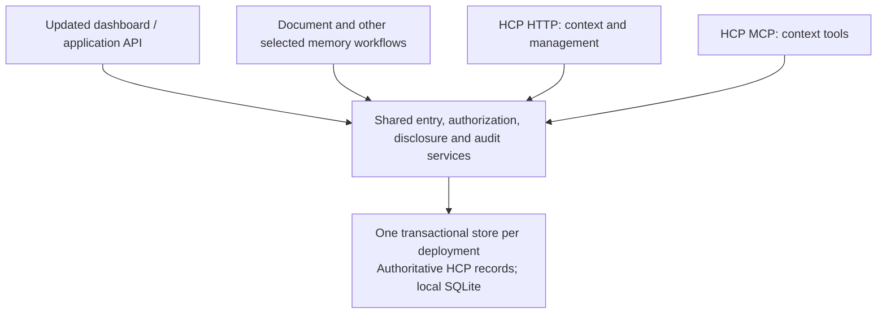

# HCP Alignment Plan

- Status: C1 implemented and locally reviewed; C0+C1 draft PR/CI authorized, merge before C2 handoff; C2–C8 unactivated; no conformance claim
- Outcome owner: product owner; orchestrator chat `01a1b827-ae7c-7b23-9160-d7b69d0ee2b0`; publication chat `01a1be37-9d90-7262-bd11-6fba45636347` is sole checkout writer; original C1 chat continues only the separate import/export issue investigation
- Priority: future capability; does not change the assisted pilot's priority
- Risk: authorization, disclosure, persisted history, erasure, and client interoperability
- Assessment date: 2026-11-07
- Evidence: [gap analysis](gap-analysis.md), with the reviewed source revisions
- Relationship and ownership: [HCP integration reference](../../../useful/HCP_INTEGRATION.md)
- Protocol questions: [local Draft 3 adoption notes][questions]

## Outcome And Scope

Redesign Context Router directly around a deliberately selected HCP revision,
with shared entry, authorization, disclosure, and audit services. Preserve the
local application's credential separation, inference privacy, and persistence
correctness while replacing interfaces and data structures where useful.

**Accepted direction: backwards compatibility is not required for this HCP
alignment.** Existing APIs, MCP tools, schemas, preference tables, and data formats
may be replaced. Update the backend and selected application consumers together;
do not require legacy adapters, compatibility projections, parallel old/new
contracts, or deprecation windows. **All existing Context Router application data
and database migration history may be deleted for this redesign.** Start with a
fresh HCP schema; preserving, backing up, converting, or upgrading legacy data is
not a delivery requirement. Reuse components only when they simplify the HCP design.
The separate D8 decision is now **local SQLite only** for the HCP redesign,
explicitly selected by the product owner in C0. Hosted/PostgreSQL HCP support is
out of scope. This planning result removes no current runtime or CI paths.

**Optimize for the shortest path to working HCP behavior and useful adoption
findings.** Compatibility-only code, tests, migration bridges, and rollout machinery
are out of scope. C0 settles only the contracts and scope needed for C1–C3; defer
later design decisions until their capabilities need them. Use the smallest
implementation that meets the selected requirements, focused checks, and cohesive
PRs. Checkpoints organize testable progress and handoffs, not separate PRs or
repeated approval of already accepted decisions. Retain authority, privacy, and
new-store durability checks; speed comes from removing unnecessary scope.

Use this upgrade to evaluate adoption using the **current hcp-spec repository**
and identify reusable lessons for other teams. Start with its existing specification,
schemas, guides, and tooling; keep the assessment, questions, and adoption observations
in Context Router. Actively look for specification defects, unclear requirements,
missing examples, and repeated work that tooling or a skill could remove. Turn
concrete findings into focused hcp-spec fixes through the checkpoint workflow;
recording issues alone is not the intended outcome. Working HCP behavior and
reusable adoption improvements are the two outcomes of this effort. No upstream
change is required when the evidence shows none is needed.

The proposed end target is **Agent Interop plus Memory Manager**, conditional on
serving independently operated assistants and accepting model-inferred entries:

- Agent Interop comprises Core, General Context, HTTP Binding, OAuth Interop, and
  MCP over Streamable HTTP. A stdio bridge does not itself satisfy that package.
- Accepting model-inferred HCP entries requires Memory Manager.
- First-Party is an alternative only if every HCP Client is operated by the
  Provider Operator. Local installation or bridge authorship does not establish
  that relationship.
- VC Evidence, delegated authorization, and issuer-attested health/education are
  outside the proposed initial scope. Their profiles become applicable when their
  triggering features are accepted. Ordinary personal health statements alone
  do not trigger the credential profiles.

The first runtime milestone should be an isolated, synthetic, read-only HTTP
journey with explicit consent, purpose-bound disclosure, audit, and revocation.
It makes **no HCP conformance claim**. A complete HTTP-only Provider Interop
milestone is possible later, before MCP qualification, only after all requirements
of that package and any applicable profiles are evidenced.

The November 8 activation authorizes only the isolated C1 implementation and
owned synthetic reset/recovery tests. It does not authorize personal-state changes,
live model runs, network exposure, client configuration, or releases.
Discarding existing CR data and migrations is an accepted implementation choice,
not a decision to reopen at each step. An upstream resolution does not silently
change the chosen spec revision.

## Test The Current Adoption Experience

Start from the reviewed hcp-spec revision recorded in the [gap analysis](gap-analysis.md):
`b764a058eac15a4cd843892e60473089b2e835bb`, with Draft 3 normative content pinned at
`2e2939c9bebcefb3bed7bb3522231c0e4d65a315`. Keep it as the first adoption baseline;
any later target change must be explicit and preserve the earlier observations.
No new hcp-spec documentation, tooling, or skills are prerequisites for beginning
the bounded adoption exercise when runtime work is authorized.

At C0 and each later checkpoint, record concise observations in this brief and
the [local questions][questions]: the task/requirement, existing source consulted,
attempt or interpretation, outcome, manual work or workaround, and remaining
impact. Distinguish source inspection from runtime evidence. Classify findings as:

- **Application adaptation:** CR behavior differs from a sufficiently clear HCP
  requirement; the implementation work belongs here.
- **Guidance or specification gap:** the existing materials leave a concrete
  question unanswered, inconsistent, or difficult to apply.
- **Tooling opportunity:** repeated implementation or validation work suggests a
  reusable aid for other teams.

First use the published materials to answer questions; do not assume every entry
in the local question list requires a spec change. A large CR change is not by
itself evidence that HCP needs revision. Evaluate adoption usability separately
from protocol conformance, memory quality, and task outcomes.

Follow the [checkpoint review workflow](#hcp-adoption-reviews-and-upstream-work)
to turn these observations into improvements. Do not build a general adoption
framework or skill in advance of demonstrated need. Resolve blocking ambiguities
before implementing affected behavior, continue independent work, and never weaken
requirements merely to preserve the experiment's schedule.

This team already has the gap analysis and interpretation notes. Its observations
establish experienced-team integration friction; they do not establish unaided
newcomer onboarding. State that limitation in the C3 summary. A fresh reader trying
one bounded task using the published materials is optional if stronger onboarding
evidence becomes useful. Connect observations to the relevant fixture/test,
command, source revision, and result without introducing a new measurement system.

Keep hcp-spec unchanged for this documentation phase, including its already merged
implementation-directory entry. Future improvements are separate, reviewable
changes with the smallest concrete example and an explicit target-revision decision.

## HCP Adoption Reviews And Upstream Work

### Review At Every Checkpoint

Every C0–C8 closeout includes an **HCP adoption findings and upstream disposition**
review. The step owner records what the existing materials made straightforward,
what required interpretation or a workaround, and what repeated work could help
other implementers. Classify findings using the categories above and identify the
smallest useful application, guidance/tooling, or specification change. Explicitly
record **none** when there is no justified upstream work.

Keep detailed findings, stable question IDs, evidence, and dispositions in the
[local question record][questions]; keep checkpoint status and links in this brief.
The coordinator reconciles findings across steps and checks that closeout includes
a disposition, rather than just a list of observations:

- For a concrete reusable correction or aid within the activated scope, prepare,
  validate, and open a focused hcp-spec PR as part of closeout. Documentation,
  examples, tooling, skills, and specification corrections are eligible; logging
  the need alone is not the normal endpoint. Any nonblocking deferral needs a
  reason, an owner, and a checkpoint or condition for revisiting it.
- For unresolved semantics or larger protocol additions, record the concrete case
  and obtain a separate design decision before changing requirements. A focused
  issue or proposal can carry that discussion; CR-specific complexity alone does
  not justify expanding the protocol.
- Track **submitted**, **merged**, and **adopted by CR** separately, with links and
  responsible owners. An open nonblocking upstream review need not hold up
  independent CR work. A blocker stays attached to the dependent capability until
  the ambiguity and target decision are resolved.

This is the closeout workflow for activated work. Documenting it now does not
activate implementation or make changes in hcp-spec.

**2026-11-08 selected workflow for CR-Q1/CR-Q3:** use focused GitHub issues
as the handoff to separately assigned spec work. At the user's request, published
[hcp-spec #2: in-flight read revocation](https://github.com/loyalagents/hcp-spec/issues/2)
and [hcp-spec #3: dormant expiry deadlines](https://github.com/loyalagents/hcp-spec/issues/3).
Both are open; a separate spec owner has not yet been assigned.
The CR owner supplies the pinned
clauses, reproducible timeline, selected/proposed CR behavior and acceptance tests;
the spec owner investigates and owns any resulting specification PR. The
orchestrator tracks issue resolution, PR merge and CR adoption separately. This
separates ownership of the eventual fix; it does not replace follow-through with
an unowned issue list. The [question record](spec-questions.md#issue-first-handoffs)
tracks the submitted issues and resolution boundaries. Broader checkpoint duties
above remain; that C0 handoff did not activate runtime work or change the spec pin. The later
C1 activation below leaves the pin unchanged.

### Deeper Review Checkpoints

| Pause | Required review and output |
| --- | --- |
| End of C0 | Check whether the existing materials establish the first experiment's roles, deployment, and required behavior. Resolve blockers for the selected slice, turn understood reusable corrections into focused upstream PRs, and record decisions deferred to later capabilities. |
| End of C3 | Review the completed synthetic journey and adoption evidence. Produce justified examples, guidance, tooling, or an initial integration skill from the working path. Record the experienced-team limitation and the disposition of each candidate improvement; no skill is required without a demonstrated reusable need. |
| End of C7 | Review actual binding/client interoperability and what another team needs to reproduce and validate it. Reconcile outstanding upstream findings and resolve issues affecting the selected package before C8 qualification. |
| C8 closeout | Verify that reusable materials match the selected normative target and demonstrated behavior. Record final upstream statuses and any nonblocking follow-up with owner/revisit condition. A finding that changes the candidate or target renews affected qualification under the existing freeze/evidence rules. |

These pauses deepen the regular review; blockers can be raised at any time.
An integration skill should guide scope selection, gap analysis, implementation,
and validation through proven guidance and normative references. Extend it as later
checkpoints supply evidence, and coordinate validation tooling with HCP's planned
conformance suite.

### Preserve Evidence When HCP Evolves

Retain the original adoption baseline and observations. Record later guidance,
tooling, and skill revisions used at each checkpoint so their benefit can be
distinguished from the initial experience. For a merged normative change, explicitly
decide whether and when CR adopts it; record the old/new target revisions, affected
gap/requirement rows, contract/client impact, and tests/reviews to renew. Update the
current target in this brief and the handoff before dependent work proceeds.
Neither an upstream merge nor a chat transition silently changes the target.

## Proposed Architecture

Make HCP entries/versions, grants, relationships, disclosures, audit, and
idempotency records authoritative in the selected transactional store. Replace
the preference-centered model where needed; no compatibility projection or
dual-write path is required. HCP governs observable behavior, not the literal
database layout. All retained producers and consumers use the shared services
and their authority rules.

Build the isolated experiment on this model so later checkpoints extend the same
foundation. Reuse or reshape application-owned storage ports, unit-of-work
support, and shared contracts where useful. Keep one mutation authority; do not
introduce a separate authoritative database without an explicit cross-store commit
and recovery design.

D8 selects the local application with **SQLite as the only HCP adapter**. Require
fresh-schema setup, admission, persistence and recovery evidence on SQLite.
PostgreSQL HCP schema/adapter work and hosted deployment qualification are out of
scope, not an automatic follow-up. Existing hosted paths must remain isolated from
HCP stores until removed or explicitly re-scoped; C0 does not remove them or alter
CI. Old migrations may be replaced with a fresh HCP baseline when implementation
is activated; no upgrade chain from legacy CR stores is needed.

## C0 Decisions: D1–D8

The table separates accepted product direction, C0 engineering selections, and
unresolved protocol decisions. C0 selections below are preserved; the later explicit activation authorizes
only their C1 portions. No legacy-preservation question remains.

| Decision | Disposition and concrete choice | Remaining dependency |
| --- | --- | --- |
| D1. Draft, roles, claim | **C0 selected.** Keep normative HCP `2.0-draft-3` at `2e2939c9bebcefb3bed7bb3522231c0e4d65a315`; adoption materials at `b764a058eac15a4cd843892e60473089b2e835bb`. Target Agent Interop + Memory Manager eventually; C1–C3 is an incomplete HTTP experiment with no Part/package/profile claim. Roles below. | MCP/real assistant operators C7; inference requires C4. Individual-operator wording is CR-Q3 guidance work, not permission to claim First-Party. |
| D2. Authorization deployment | **C0 selected.** Local HTTPS Authorization Service co-located with provider, Authorization Code + PKCE, pre-registered A/B clients, independent human management credentials, no refresh/persistent grants. Accept HCP authorization details and scope requests. No hosted Auth0 dependency. | C2 must verify/pin the OAuth library and real browser/redirect flow. CR-Q4 minimum-flow ambiguity blocks a complete OAuth claim, not this selected flow. |
| D3. Data model | **C0 fixed for C1.** Native HCP JSON entry/version records with stable private IDs, per-client subject pseudonyms, per-grant refs, provider-owned provenance, separate mutable lifecycle/classification, unknown-member preservation. No legacy mapping. | Production writes, confirmations, proposal staging, inference and conflict algorithms C4; lifecycle-history question CR-Q5 before affected C4 work. |
| D4. Access paths | **C0 fixed.** Dedicated experiment composition and store root; expose only the operations listed below. No old GraphQL, MCP, imports, seeds or AI consumers may open that store. | Complete source-to-consumer bypass inventory before any production-store exposure, no later than C6. Isolation must already be tested in C1/C3. |
| D5. Revocation and copies | **CR read contract selected by the user, 2026-11-08.** Check authority at admission and immediately before release; coordinate release with revoke so no check/send gap permits disclosure. Revoke one grant, without waiting for network delivery. No endpoint/onward sharing; copies at most one hour. | CR-Q1 read clarification need not block implementation of this chosen experiment contract. CR-Q3's dormant audit deadline remains a known specification discrepancy; its local catch-up proposal and any claimed compliance must be distinguished. Runtime activation and explicit adoption of any later spec change remain separate. |
| D6. Retention and retries | **C0 fixed for experiment.** Keep all new-store records and audit across restart until explicit offline disposal of the entire isolated synthetic store. No content response cache or durable write-idempotency mechanism. | CR-Q2 before C4 durable retry/cache behavior and C5 erasure. HCP export/import remains C5 protocol work; legacy conversion is out of scope. |
| D7. Fresh schema/reset | **Accepted product choice + C0 mechanics.** All old CR data and migration history are disposable. Start a new SQLite baseline and owned synthetic root; reset only exact manifest-owned targets after stopped-owner checks, with no conversion/backup prerequisite. | Production personal/demo target inventory and installed reset integration C6; no deletion in C0. New HCP data is not covered by blanket legacy-discard permission. |
| D8. Deployment/storage | **Product owner selected in this chat: local SQLite only.** Hosted/PostgreSQL HCP support is out of scope. This shortens C1–C3 by removing a second schema/adapter/recovery journey. | No user choice remains. Adding hosted/PostgreSQL later requires new scope. Current runtime/support docs and CI are unchanged by this plan. |

The accepted breaking-contract/reset direction and D8 are user decisions. D1–D4,
D6 and the bounded D7 mechanics are evidence-backed engineering selections for
this brief. The user selected D5's read-revocation behavior; an upstream wording
clarification is separate from that application contract. Dormant expiry needs
protocol disposition for compliance with the pinned deadlines, not another
data-loss approval. Later decisions are deferred at their capability
boundary; do not turn them into prerequisites for C1.

## Historical Data And Shared Paths

Implement against a fresh HCP schema. Existing CR data and database migration
history are disposable; do not build historical conversion, compatibility tables,
backup/export prerequisites, or legacy-upgrade tests merely to preserve them.
The reset applies to identified CR application data, not unrelated files or other
applications. Test reset/initialization with isolated synthetic stores, including
that old authority and data do not reappear in the new store.

HCP-native export/import in C5 remains part of the selected protocol scope.
Persistence, truthful provenance, erasure, and recovery obligations for the new
HCP store still apply. If historical adoption is requested later, it is additional
scope: existing CR records are not HCP v1 exports, and missing grants, model facts,
confirmations, or assertion history must never be invented.

Keep document proposals in a pre-entry staging area until applied. HCP has no
`suggested` state; neither automatic activation nor invented conflict is a faithful
mapping. A direct authorized HCP create has its own entry-creation semantics.
Capture server-owned model/source metadata for new proposals where those facts
will be asserted; raw source files are not retained by the existing product.

Before sharing HCP-managed data, account for ordinary GraphQL/profile operations,
legacy MCP tools, both document-apply versions, identity/profile seed writes,
definition edits, location cascades, reset/history-clear, and import tools. The
same inventory covers legacy reads, exports, resources, and AI prompt builders.
Shared mutation rules alone cannot protect a disclosure through an old read path.
Remove, disable, or rebuild those paths before they can bypass HCP controls.
An inventory establishes coverage; it does not require keeping every old workflow.

For this HCP effort, the accepted breaking-change direction supersedes the legacy
contract-preservation, additive-transition, and compatibility-window requirements
in [interface evolution](../../../useful/INTERFACE_EVOLUTION.md). The accepted reset
also supersedes preserve-or-refuse and renewed legacy-data-loss consent requirements
for this redesign; it is not a general reset policy for later HCP data. Keep the
consumer inventory, coordinated producer/consumer changes, new-contract tests,
and filesystem/process ownership checks. No compatibility adapter is required
for a superseded interface.
Authority, disclosure, provenance, erasure, and recovery invariants still apply;
the exception does not change policy for unrelated work.

## First Experiment: C0–C3

The first proposed implementation outcome is **consent → read synthetic context →
inspect disclosure history → revoke**, through HTTP with two controlled test
clients. This section bounds the full experiment. Only C1 is activated; C2/C3 remain
future work and no HCP package/profile claim is made.

### Scope And Boundaries

- Use two controlled HTTP test drivers with separate client identities and grants,
  one synthetic subject, and a separate human/management authority. These are test
  clients, not evidence of interoperability with real assistant hosts.
- Use seeded, clearly synthetic person-declared entries with truthful fixture
  authority/provenance, stable IDs and immutable version data. Include category,
  purpose, lifecycle/expiry, and unknown-field fixtures. Real producers, document
  ingestion, and model-inferred entries cannot invoke this incomplete slice.
- Use fresh isolated SQLite stores under the selected D8 scope. C1 initializes,
  admits, reopens, and validates the new SQLite schema through shared storage
  contracts; no PostgreSQL HCP implementation or test journey is required.
  Exercise the selected reset/fresh-start path
  against synthetic old stores; preserving their contents or migration history
  is not an acceptance criterion. The first experiment needs no personal data.
- Exercise the actual local authorization flow selected at C0, including the
  metadata/discovery it needs, explicit consent, temporary grants, and current-grant
  checks. Authentication alone cannot create authority. Provide minimal human
  consent, grant-list, disclosure-history, and revoke controls with independent
  credentials. No implicit hosted authorization dependency is introduced.
- Implement purpose/category/narrowing checks, lifecycle filtering, standing-rule
  and directive enforcement using controlled policy fixtures, query/get, own-grant
  inspection, lexical ordering, quantity limits, allowlisted disclosures, and
  grant-scoped references. Context-client access remains read-only; consent and
  revocation are human-authorized management operations.
  Grant and disclosure audit is synchronous and durable. Use the explicit
  no-notification-endpoint configuration with the one-hour copy cap; revoking
  provider access does not erase copies already disclosed.

### C0 Scope Record

**Bounded implementation brief.** C1 builds the isolated durable entry foundation;
C2 adds real local consent/grants and human controls; C3 completes query/get,
disclosure history and revocation. One writer integrates these sequentially in a
cohesive experiment PR when authorized. The selected requirement/test matrix is
[the C0 expansion of G01–G18](gap-analysis.md#c0-requirement-and-test-matrix).
It is a scoped acceptance list, not the exhaustive C8 conformance matrix.

#### Actors And Authority

| Actor | C1–C3 contract |
| --- | --- |
| Subject / Authorizing Principal / Requesting Party | One named synthetic persona. The test human acts as that persona, never as a delegate for real personal data. Internal subject URI is private; A and B receive different stable subject pseudonyms. Requesting party defaults to the subject and cannot be changed by a read request. |
| Provider / Provider Operator | Isolated local CR process; the human running the fixture is the accountable operator, with an explicit test-local identifier/name. Code author and operator are different concepts. CR-Q3 retains the individual/organization wording issue. |
| Authorization Service | Local provider component with a distinct authority role. Records affirmative consent, grant, registered client/operator and authentication strength; issues resource-bound credentials. Authentication alone grants nothing. |
| Management Client | Minimal local human consent/grant/history/revoke interface. Its independently authenticated credential has governance capacity; context scopes never create that capacity. Credentials stay out of URLs, context results and prompts. |
| Context Clients A and B | Two controlled HTTP drivers, distinct registrations, labels, credentials and grants. Their actual test operator is recorded; separate IDs do not falsely imply independent organizations. Operator-rule cases may use explicitly simulated registrations. No real-host interoperability or directive-following claim. |
| Seed actor | Test-only initializer acting under a recorded synthetic bootstrap write authority. C1 unit/storage fixtures label simulated history as such. For the C3 journey the authenticated fixture principal explicitly approves the seed statements; provider records actual run-time authority, timestamps and seed submission, then closes seed authority before read-only serving. No fabricated past consent, model identity, confirmation or authenticated assurance. |
| Assistant host / bridge / inference | Absent in C1–C3. Their operator and grant-holder mapping is fixed before C4/C7 exposure; a local bridge does not turn a remote assistant into first-party software. |

A client may hold A1/A2 grants with different categories, purposes and expiries.
Each request uses the authority represented by its presented grant; do not silently
union grants or retry under another grant after denial. Revoking A1 leaves A2's
independently authorized access intact, including any overlapping permission.
Grant scope limits access to context, not access to a service's features. Hard
isolation between internal services requires distinct client identities and
credentials; a shared client holding both grants cannot establish that isolation.
The main journey keeps A/B; an additional same-client A1/A2 fixture tests this
boundary without adding another real assistant integration.

#### Local Authorization And Operations

Use loopback-bound **HTTPS** for the AS and HTTP binding, an isolated test CA and
explicit fixture-client/browser trust with TLS verification enabled. No system
trust-store change, personal browser profile, LAN listener, hosted AS, or real
client configuration. The provider URL and issuer are explicit test configuration;
reject foreign resource/issuer, unregistered redirects, missing/incorrect PKCE,
code replay, actor substitution, and a context token on every management route.
Use S256 PKCE and exact registered redirect matching. The human login session and
management credential are separate from A/B access tokens. Consent is a distinct
screen/action with CSRF protection and request binding; no automatic approval
from login, account creation, or previous client consent.

Select `oidc-provider` v9 as the **C2 integration candidate**, not an already
qualified dependency. Its maintained upstream documents PKCE, resource indicators,
RFC 9396 authorization details, opaque tokens, persistence adapters and custom
interaction handlers ([upstream](https://github.com/panva/node-oidc-provider),
[API](https://github.com/panva/node-oidc-provider/blob/main/docs/README.md), inspected
2026-11-07). C2 pins a tested exact version and proves HCP consent/details and
shared SQLite grant authority before depending on it. No handwritten OAuth
framework and no second authoritative grant store. Library object persistence
may share the SQLite transaction boundary; token issuance must never make a grant
usable before its grant/audit commit. Failed issuance may leave a visible unused
grant, never an unrecorded usable one. If the candidate cannot meet these contracts,
record the concrete gap and review a replacement without relaxing the contracts.

Temporary grants default to four hours, never exceed 24 hours, and carry absolute
expiry. Access tokens live at most the lesser of one hour and remaining grant
life; issue no refresh tokens. Consent describes category definitions, actions,
purpose descriptions, any narrowing, client/operator, grant expiry, one-hour copy
ceiling, standing-rule exclusions, and absence of a directive-following claim.
Only `read` is issued to A/B. Persistence, provenance action, onward sharing,
legal-retention registrations and additional OAuth flows are disabled for this
slice; reject unsupported requests explicitly. Scope-only requests require the
human to select purposes; granted `authorization_details` appear in the token
response. Requesting-party/client/operator authority is server-bound.

Expose query, get, own-grant, own-grant relinquishment, human grant list/revoke,
and human audit-history inspection. Grant enumeration defaults to active and can
show revoked/expired records. The human can inspect each retrieval's entries,
versions, purpose, client, directives and copy deadline. Full disclosure-summary
aggregation/export and governance editors remain C5. Fixture-only rule/directive
changes use independent management authority and the same policy/audit boundary;
no unauthenticated test-control HTTP route. All omitted context mutation and
management capabilities are unavailable or explicitly rejected; management
credentials do not accidentally enable unfinished handlers.

Publish actual AS and protected-resource metadata and a clearly labeled
experimental capability manifest. Do **not** present an empty `conformsTo` plus
`bindings: [http]` as conformant HCP discovery: §19 links binding declarations to
complete claims and the discovery schema requires a nonempty claims array. Use
configuration for test discovery until full canonical discovery can be advertised.
C8 owns claim-bearing `/.well-known/hcp-configuration`; retain its required
`jwks_uri` even without notification endpoints. The partial manifest is an
explicit experiment limitation, not a change to §19. Selected HCP operation
responses still use `HCP-Version: 2.0`, `application/ld+json`, and the §9.7 problem
mapping; an unsupported requested version fails explicitly.

#### Entry, Policy And Storage Contracts

Persist the native JSON entry with private stable UUID URN and immutable versions
of `content`, `assertion`, `evidence` and version provenance. Subject cannot change;
classification, lifecycle and appended confirmations are separate from immutable
content versions. Preserve unknown nested members on storage serialization/reopen
and authorized whole-entry reads without assigning them authority. This is not
permission to spread unknown top-level/private fields into disclosures. C1 tests
stored v1/v2 fixtures; it does not expose a production revise operation.

Use General Context string and structured-object values. Fixtures use registered
`general_preferences` and `work_context`, stable purpose URIs with human-readable
descriptions, dimensions as hints only, empty or opaque noncredential support
evidence, and no model/issuer assertions. Location is ordinary explicit structured
content when needed, not a legacy location table or implicit scope. Use nested
unknown-member fixtures in both public content and private record metadata.
Person-declared assurance is `unverified` unless the actual setup meets §3.7;
confirmation arrays start empty unless a real fixture confirmation was recorded.
The fixture is synthetic evidence, not a claim that the real user stated its facts.

Support `narrowedTo.entryIds` internally, serialized as same-grant refs for a
Context Client reading its grant. Reject unsupported keys at issuance; an unknown
persisted restriction reaches no entry. Validate any requested category/purpose
before selection. Effective entry purposes are the intersection of assertion and
management restrictions. A grant may reach through any allowed category, but a
standing-rule denial on any category withholds the entire entry, including via
an alternative category. Rules cover existing/future grants and matched operator
namespaces; denial of all reached categories revokes the grant. Directives never
widen authority; deliver matching directives even to clients without the claim,
including own-grant responses. `deny` takes precedence over `ask-first`, then
`permit`; controlled drivers test delivery without claiming host enforcement.

Filter authorization, narrowing, purposes and active/unexpired lifecycle before
lexical scoring. Tokenize only eligible public `content.value`: the string itself
or a deterministic traversal of primitive value leaves in a structured object.
Do not index record/provenance/metadata, categories, IDs, assertion extensions or
other entry fields. Declare deterministic normalization and token-overlap scoring
with a stable private tie-break; private-field-only changes must not alter matches
or ordering. Return positive matches in descending score, no padding or
pagination, default 5 and maximum 20 total. Get uses `method: none`; query uses
`lexical`. References are unpredictable, stable for the grant/entry across restart
and versions, and different for every other grant. Only same-response relationship
targets appear, as refs. Build §7.4 disclosures by allowlist; no stored ID, subject,
status, private record/provenance, withheld counts or uncovered categories.

Set a provider copy deadline of disclosure time + one hour, shortened by any
entry validity deadline and other applicable §7.6 ceiling. Do not shorten it
merely to match grant expiry. No notification endpoint is registered. A denial
because of revocation is itself notice to that controlled client; revoke must
not claim to erase previously disclosed copies. Record/display the last possible
copy deadline and that no endpoint notification was sent.

One authoritative SQLite database holds entries/versions, actors, grants, refs,
policy and append-only audit; no independently committed audit database. Grant,
policy, expiry and revoke transitions commit with their events. Every successful
query/get, including an empty query result, durably records its retrieval ID,
entry/version/useUntil list, participants, purpose and delivered directives before
release. Record no query text or full response snapshots. Audit failure releases
no successful disclosure; transport loss after commit can leave a logged release
attempt with unknown delivery, never a claim that the recipient received bytes.
Declare synchronous durability and append-only integrity for this non-High fixture;
no response cache or automatic uncertain-mutation replay. Freeze the exact SQLite
journal/sync and filesystem settings with C1 tests; acknowledge only durable commits.

Retain all new entries/versions, authority records (including revoked/expired),
refs and audit for the experiment lifetime and across restart. Expired records
lose authority without being deleted. No audit TTL, history-clear, backup copies,
export files or background pruning in this slice. Scratch logs contain no tokens,
query text or entry payloads. At explicit teardown, stop/reap the isolated owner
and dispose of the entire manifest-owned synthetic store; this is test-resource
cleanup, not the HCP hard-delete API or permission to clear future production data.

#### Fresh Initialization And Failure Boundaries

C1 creates a versioned fresh HCP SQLite baseline in a new caller-selected owned
root with private permissions. Admission validates schema/version and owner before
serving; partial, unknown or incompatible stores fail closed without application
writes. SQLite may first replay a safely admitted hot rollback journal, changing
physical bytes; a foreign WAL-format header can transiently create empty engine
sidecars before refusal. These intrinsic engine effects confer no reset authority.
Cold/non-recovery negatives are preserved byte-for-byte. Never manually remove
journals or unproven sidecars; see [engine admission](../../../useful/LOCAL_IDENTITY_ADMIN.md#engine-admission-and-files).
The test reset command requires an exact synthetic root plus its ownership marker,
refuses symlinks/path escape/unproven or live owners, and removes only the declared
SQLite database/WAL/SHM and local experiment authority/session/key files. Never
accept an arbitrary application-support parent as a reset target. Model assets,
source documents, personal client settings and unrelated files are outside it.
A crash between disposal and initialization leaves a stopped/incomplete root
which cannot serve until a fresh initialization completes. A successful reset
uses a new store identity, credentials, refs and grants: old tokens/authority cannot
reappear. Test repeat reset and interrupted initialization; no legacy upgrade chain.

The selected CR read behavior is ordinary current-permission enforcement with a
precise release boundary: check at admission, prepare the result, recheck
current grant/policy/expiry, durably audit, then release the response. The final
check, audit and handoff must be coordinated with revoke/policy changes so a
change between check and send cannot bypass denial. After audit durability,
recheck token/grant/entry validity and the prepared copy deadline against the
current time immediately before handoff: serialization does not stop time, and a
stalled commit or sleep may cross a deadline. Deny release if any bound has
passed; never renew it to complete the request. Preserve the committed audit
attempt truthfully without claiming receipt or erasing history. Test each deadline
crossing during an audit barrier. This does not authorize holding revocation
behind a slow socket; already handed-off bytes may arrive
later. Test both orders and audit failure. The user selected this CR contract on
2026-11-08. CR-Q1 is tracked in [hcp-spec #2](https://github.com/loyalagents/hcp-spec/issues/2)
as an upstream clarification of “succeeds” in
§6.2.2, not a requirement that CR invent another permission model or await a spec
PR before implementing the selected read experiment after runtime activation.
Mutation commit/lost-reply semantics still need their C4 decision.

For dormant entry expiry, the product owner accepted this C1 application
recovery behavior on November 8: validity and authority end
at their original deadlines; reconcile overdue expiry records durably before
serving after restart, with actual append times and no automatic renewal. Grant
renewal requires new authorization; expired entry content needs an appropriate
valid revision; a stale disclosed copy must be fetched again under then-current
authority and entry validity. No pending request extends any deadline.

The unresolved CR-Q3 discrepancy is specifically the audit/status-processing
clock: §6.1.4 permits next-request recording for dormant stores, while §§8.1 and
4.2.4 impose 24-hour deadlines a stopped provider cannot meet. The catch-up
proposal cannot pass those literal deadlines during a 48-hour outage. The November 8 activation explicitly accepts this synthetic entry-recovery
experiment while spec work proceeds separately. Tests prove CR's fail-closed
recovery, not compliance with the conflicting deadlines. Grant expiry and HTTP
enforcement remain C2/C3 work.
Any affected conformance claim remains blocked until a protocol resolution is
explicitly adopted. C1 storage and the chosen CR-Q1 read contract are independent.

### Exit Evidence

Run the same selected HTTP journey and storage contracts against every adapter
in the C0 support scope:

1. The human explicitly grants temporary access to each client for its selected
   purposes/categories. Client A and B receive independent authority; no grant or
   credential can be substituted for the other's.
2. Query/get returns only permitted, active context with the required minimization,
   references, directives, quantity bound, and copy deadline. Test wrong purpose,
   unknown narrowing, standing-rule denials, expired/non-active entries, absent or
   foreign references, reference stability, concurrent policy changes, private-field
   exclusion, sparse results, and the 1/5/20 limits.
3. The human inspects durable grant/disclosure history. Every exposed management
   route rejects context-client credentials. Test reading one's own grant versus
   listing all grants, audit-history denial, and rejection of attempts to revoke
   another client's grant. These checks begin at C2/C3, not C5.
4. The human revokes A's selected grant; further reads under it fail and B retains
   only its own authority. The additional A1/A2 fixture proves revoking A1 does
   not revoke A2 or silently transfer an A1 request to A2.
   Exercise revocation races under the C0 ordering decision, expiry across
   sleep/restart, audit-write failures, and fresh-store reopening. A pass requires
   truthful history and no successful unaudited disclosure.

Record the command, fixture, revision, result, and remaining evidence for these
scenarios, then summarize adoption findings under the approach above. Completion
qualifies this bounded experiment only; later capabilities and conformance claims
retain their own gates.

## Testable Checkpoints

Backend behavior changes are tests first. Each checkpoint ends with a recorded
result and remaining evidence; these are internal checkpoints, not a required PR
count. Prefer one cohesive PR for a bounded outcome, splitting only at independently
useful, safe landing points. C0 turns the [first experiment](#first-experiment-c0c3)
into an implementation brief; C4–C8 retain the remaining alignment roadmap.
Every row also requires the [adoption review and upstream disposition](#hcp-adoption-reviews-and-upstream-work)
and a [step-chat handoff](#step-chats-and-handoffs). These supplement each row's
technical exit evidence.

| Checkpoint | Deliverable | Exit evidence and dependencies |
| --- | --- | --- |
| C0. Scope and contracts | Record D1–D8 for the first slice against the pinned baseline and role map; D5's CR read behavior is selected and the dormant-expiry acceptance distinction remains explicit. Expand gap IDs into a requirement/test matrix with build-for-C3, contract-fixed-now, deferred, and reasoned inapplicability dispositions. Record unanswered questions and manual interpretation locally. | Independently reviewed first-experiment brief covering authority, lifecycle, isolation, direct HCP contracts, selected deployments/adapters, fresh-store boundaries, and failure states. Identify blockers and their affected checkpoints without requiring advance HCP documentation/tooling improvements. |
| C1. Synthetic entry foundation | Establish a fresh HCP schema baseline, replacing old migrations where useful. Seed stable entries and immutable version data with truthful fixture provenance, lifecycle/expiry handling, unknown-field preservation, and transactional audit under the C0 contracts. | Fresh-schema setup/admission/reopen and synthetic reset tests for each selected adapter, SQLite only under D8; shared storage contracts, rollback, acknowledged durability, and unknown-field round trips. No legacy-data retention or migration-chain tests. Real producers remain excluded. Production mutation/confirmation/staging workflows follow later. Begins G06–G11/G14. |
| C2. Grants and human controls | Explicit consent, temporary grants, the selected OAuth flow, purpose/category/narrowing evaluation, standing-rule/directive enforcement, immediate provider revocation, and minimal human grant/history access. Use the no-endpoint configuration. | Two-client isolation, authentication-versus-consent, management-route rejection of context credentials, own-grant versus all-grant access, and cross-grant revocation denial. Test expiry across sleep/restart and revocation races. Persistent grants remain disabled; grant/audit records are durable and copies are capped at one hour. Begins G01–G05. |
| C3. Read-only HTTP journey | Query/get with allowlisted disclosures, grant references, lexical relevance, one quantity bound, directives, use-until, and synchronous durable disclosure history. | Complete the first experiment's two-client journey and negative/failure cases on every selected adapter. Summarize adoption friction with fixtures/revisions/results and the experienced-team limitation. No package/profile claim. Addresses G12–G14 and part of G16. |
| C4. Writes and Memory Manager | Create/revise/withdraw, immutable revisions and expected-version checks, confirmations, proposal staging, durable HTTP idempotency, valid inference provenance/confidence, symmetric conflict detection and human resolution. | Stale confirmation, rollback, committed-but-lost reply, restart/retry, changed-body conflict, concurrent revisions, both conflict arrival orders, same dimension without contradiction, and multiple unresolved conflict edges. Do not accept inferred HCP entries before this capability is ready. Addresses G06–G11/G16. |
| C5. Complete governance and portability | Remaining person-facing controls, persistent grants with separate affirmative election, any additional required OAuth flows, full standing-rule/directive editors, export/import, hard deletion, disclosure summaries, notification outcomes, and retention/recovery semantics. | Retain early governance-denial coverage; test separate persistence election and selected-flow requirements, all retained states visible to the person, import dry run/round trip, no deleted resurrection, erasure across copies/caches, and notification retry/dormancy. Implement sharing reports, including unauthorized reports, even if no sharing permissions are issued. Addresses G03–G05/G11/G14/G15. |
| C6. Application integration and cleanup | Rebuild selected dashboard, document, profile, seed, location, and reset workflows around the HCP model; update their APIs and consumers together. Remove or disable superseded interfaces, storage paths, and old database migrations. Earlier checkpoints must already enforce D4 before shared-store exposure. | New application-contract and workflow tests, including read/write bypass checks across the complete inventory; every selected adapter, fresh initialization/reset, persistence and recovery. No legacy-contract, data-preservation, or historical-conversion requirement. Addresses G06–G15/G18. |
| C7. HCP MCP and clients | Modern transport, discovery, HCP tools, output/error schemas, and setup for selected clients. Replace existing tools or bridges where useful. | HTTP/MCP semantic parity, new client-contract tests, credential isolation, uncertain-write behavior, and real supported-host interoperability. Old-client compatibility is not an exit criterion. Keep host-side copy use/directive obligations distinct from provider conformance. Addresses G16–G18. |
| C8. Selected-package qualification | Freeze the candidate, close the requirement/evidence matrix, independently review the full diff, and publish only fully supported discovery claims. | Focused local evidence, all applicable exact-candidate CI, and explicitly named Mac, installed-artifact, and manual evidence. No claim for an incomplete Part; no schema-only certification. Addresses all selected requirements. |

For C3, use lexical relevance ordering and synchronous disclosure audit. When C4
adds conflict handling, favor a declared structural detector for clear typed
contradictions. Protocol correctness, memory quality, and task outcomes require
separate evidence. No vector database or universal ontology is implied.

Initially issue no onward-sharing permissions. This does not remove required
sharing-report operations or establish control over an external assistant's
copies. A client that claims to follow directives needs host enforcement; prompt
text alone is not evidence. Never put management/access/refresh credentials into
tool content or model prompts.

## Step Chats And Handoffs

Use a coordinator chat for sequencing, cross-cutting decisions, review of results,
and upstream work. Start with a C0 planning chat when chat setup is requested;
create later step chats as their inputs and dependencies become ready. The default
C0–C3 implementation order remains sequential. Independent investigation and review
can run in parallel without starting dependent implementation early.

| Role | Responsibility |
| --- | --- |
| Coordinator chat | Scope step briefs, reconcile decisions and HCP findings, check evidence and dependency readiness, and coordinate integration and upstream follow-through within the authorized scope. |
| Step chat | Own the assigned checkpoint's detailed work, tests, documentation, adoption review, and handoff. Use subagents for bounded investigation and independent review. |
| Repository records | This canonical brief and the linked gap/question records hold durable decisions, status, evidence, and open work. Each chat reads them at its starting revision; a previous conversation is not the sole source of an accepted contract. |

Assign one writer per checkout, including its plan/status edits. While the step
chat owns that checkout, the coordinator and reviewers remain read-only and send
corrections to its writer; record ownership transfer at handoff. Concurrent writers
need independently owned worktrees, isolated databases/ports/build outputs, stable
contracts, and an integration order under the [agent workflow](../../../useful/AGENT_WORKFLOW.md).
Use the coordination/reporting permissions established by the user at chat setup.

Each starting brief records the checkpoint, exact CR base commit and branch/worktree,
original HCP baseline and current target, required reading, accepted decisions and
dependencies, authorized scope/non-goals, owned paths/resources, reviewer roles,
and acceptance checks. Carry forward the speed/adoption priorities, accepted
breaking contracts and deletion of old CR data/migrations, and selected
deployments/adapters so later chats do not reintroduce preservation work or ask
again about those accepted choices. Preserve the current planning-only boundary
until runtime work is activated. For a continuing experiment PR, use its handed-off commit and
branch lineage rather than assuming the next chat starts from `main`.

Every step returns a concise handoff to the coordinator with:

- Outcome and status: complete, partial, or blocked, with the scoped deliverable.
- Exact base/head commits, branch/worktree, changed paths, PR links, and uncommitted
  state if any; identify the next writer and starting revision.
- Decisions and updated repository records, including requirement/gap IDs, the
  HCP target used, and any explicit target-adoption decision.
- Validation commands/results, reviewed candidate, review findings/dispositions,
  and remaining platform, artifact, client, or manual evidence.
- **HCP adoption findings and upstream disposition:** evidence links, proposed
  improvements or none, PR/design-discussion status, and owners/revisit conditions
  for deferred work. Do not describe submitted work as merged or adopted.
- Open questions and blockers, what they prevent, and the next checkpoint's
  prerequisites and recommended scope.

The coordinator checks this handoff against the technical and adoption exit
criteria before treating the checkpoint as complete or starting dependent work.
Chat boundaries do not dictate PR boundaries: C1–C3 may remain one cohesive
experiment PR, while hcp-spec changes receive their own focused PRs. Keep the
canonical records current without copying the whole plan into each chat or making
a new permanent process document for each handoff. Human merge and release
decisions remain separate.

## Validation, Ownership, And Finalization

At activation, name the coordinator, sole writer, reviewers, owned paths,
resource isolation, and requested versus observable model/effort settings under
the [agent workflow](../../../useful/AGENT_WORKFLOW.md). One writer owns the main
checkout. Read-only investigation and review can run concurrently; shared storage,
schema, authority, composition, UI consumers, and lockfiles need one integration
order. Review the concrete plan before runtime implementation and the complete
candidate before handoff.

Use existing local-MCP transport/tool/bridge/lifecycle tests, workflow filtering
tests, reviewed-apply and storage contracts, and local UI permission/session tests
as starting points. Replace obsolete assertions and contract baselines when the
accepted HCP requirements change; write meaningful new-contract tests first.
Retain coverage for unchanged authority, privacy, persistence, and recovery
invariants, and prove superseded paths cannot bypass them. Intentional breaking
changes do not justify weakening CI gates or dropping relevant safety coverage.
Add binding-neutral synthetic scenarios and run them through both HCP interfaces.
The gap analysis identifies inspected starting evidence; those tests were not run
as part of that source assessment and do not prove future behavior.

Follow the [validation matrix](../../../useful/AGENT_WORKFLOW.md#default-and-exceptions).
Select focused checks for each changed behavior and consumer, including real
concurrency, persistence/recovery, browser, and Mac behavior where needed. A full
local migration gate needs the policy's named evidence gap or scoped requirement;
this plan adds no automatic duplicate broad run. Exact-candidate CI remains
required when a PR is prepared. Source CI does not qualify an installed artifact.

The finalization milestone is the scoped candidate with known corrections and
affected reviews resolved, the agreed exploratory acceptance round closed or its
remaining checks explicitly assigned, and the requirement/evidence matrix ready
for qualification. Freeze source and relevant inputs then. Changed inputs renew
affected checks/reviews; carry forward only explicitly unaffected evidence.
Report outstanding platform/artifact/manual evidence without treating it as a pass.

The historical C0 checks below cover planning only. C1 requires new runtime
evidence under the scoped implementation plan and the unchanged validation policy.

## C0 Handoff Record (updated 2026-11-08)

Historical handoff and review evidence, preserved from the input patch. The later
C1 activation below supersedes its ownership and implementation-unactivated status.

- **Status:** planning result updated after user clarification. D8 is settled;
  D1–D4/D6/D7 are bounded above. D5's CR read-revocation contract is now selected,
  including a final authority check coordinated with release. CR-Q1 is upstream
  clarification work rather than a blanket read-implementation blocker. CR-Q3
  remains a deadline discrepancy: any interim long-dormancy experiment acceptance
  must explicitly be application evidence, not pinned-spec compliance. The
  issue-first split is selected: [hcp-spec #2](https://github.com/loyalagents/hcp-spec/issues/2)
  and [#3](https://github.com/loyalagents/hcp-spec/issues/3) are published and open;
  a separate spec owner remains to be assigned.
  See [proposals and upstream state](spec-questions.md#c0-adoption-review-and-dispositions).
- **Ownership/base:** C0 chat `01a1b912-344d-7f70-ba0c-bfa3c3e575b7` is the sole
  planning writer in the existing checkout on `main`, base/HEAD
  `cb9d3f9fc36a6c90dcc5bcf96dbdd33e9bf70fa2`. Only this brief, `gap-analysis.md`
  and `spec-questions.md` are changed; changes remain uncommitted. Publication of
  the two linked hcp-spec issues was explicitly authorized and completed. No branch
  switch, worktree, runtime/data/schema/test/CI change, launch or code/PR/release
  publication is authorized by this follow-up.
  The read-only sibling remains `main` at `b764a058eac15a4cd843892e60473089b2e835bb`.
- **Review profile:** sensitive/quality-first for authorization, persisted authority
  and recovery. Coordinator/writer uses this chat's configured model/effort; actual
  execution settings are not independently observable. Two bounded read-only
  investigations requested `gpt-6-astra` / `xhigh`, accepted by the spawn API;
  underlying execution is unverified. Their source findings informed D2/D3/D5/D6/D7.
  Two fresh complete-diff reviews covered authority/protocol and storage/scope/test
  evidence at the same requested settings. Both identified the same P2: unspecified
  lexical input could leak private fields through matches/order. The correction
  limits scoring to public `content.value` and adds noninterference acceptance in
  C0-R11. No other actionable findings were reported. Their initial reviewed patch
  SHA-256 was `0455e8897a37a385f67aaa18c1d2a4c4506445f3f509b05b32a50525e4ee77de`.
  Both corrected-candidate rechecks passed at patch SHA-256
  `5263551af6f427fe0f00c1e5115d71eadf2d67c6022347f8ab25c235eadfdb4d`.
  The November 8 follow-up changes grant granularity examples, CR-Q1's dependency
  disposition and the issue-first split. Those affected dimensions received
  renewed independent review; earlier approval alone did not cover them. The
  follow-up review identified a P2 expiry race across audit durability; the plan
  now requires a final time check after audit and a barrier test crossing each
  token/grant/entry/copy deadline. It also names revoked grant A1 explicitly in
  the multi-grant scenarios. The affected recheck passed at patch SHA-256
  `7183bd234baeb8658eb111f1fba9fc37df0e2c3864fc1341689b583dbfc4f9fa`.
  A bounded read-only review of both issue bodies found no material findings;
  their pinned source links/anchors were checked before publication. The later
  issue-link/status delta leaves the reviewed technical contracts unchanged.
- **Validation scope:** content-only changes to existing maintained Markdown;
  select documentation readers, repository links/anchors and whitespace under the
  existing policy. No application build, full migration gate, DB or installed-app
  run is warranted. Exact-candidate remote CI remains pending until code publication
  is requested; PR #203 evidence does not validate these new decisions.
  Node 24.21.0 / pnpm 10.25.0 preflight passed. Local results:

  | Check | Result |
  | --- | --- |
  | `node --test scripts/check-markdown-links.test.mjs scripts/print-repo-structure.test.mjs scripts/local-migration/ci-path-filters.test.mjs scripts/local-migration/check-contract-baseline.test.mjs` | 120 passed |
  | `pnpm --fail-if-no-match --filter backend exec jest --selectProjects unit --runInBand --runTestsByPath test/contracts/runtime-composition.spec.ts` | 8 passed |
  | `node --test scripts/local-migration/web-runtime-config.test.mjs` | 5 passed |
  | `pnpm --fail-if-no-match --filter local-orchestrator exec node --import tsx --test test/operator-docs.test.ts` | 1 passed |
  | `node scripts/check-markdown-links.mjs`; selected-document local anchor check | 160 Markdown files; 21 local anchors passed |
  | `MIGRATION_GATE_BASE_SHA=cb9d3f9fc36a6c90dcc5bcf96dbdd33e9bf70fa2 node scripts/local-migration/check-nonruntime.mjs`; `git diff --check` | Contract base comparison performed; whitespace passed |

  The independent scope review confirmed only three existing `100644` maintained
  Markdown content changes. Link/anchor/contract/working-tree whitespace checks
  passed again after the November 8 issue-link/status update. Carry forward the
  134 checker/consumer tests: their code, fixtures and specifically asserted
  source/doc inputs remain unchanged; the three planning documents are checked
  by the renewed link/contract scans. Both published issue bodies were read back
  and matched the reviewed drafts; their URLs and open status were verified.
  No Mac/runtime, host
  failure, browser, installed-artifact or real-client HCP behavior has been tested;
  these remain implementation/qualification evidence, not C0 passes.
- **Next writer:** the original orchestrator resumes coordination after this
  handoff and names a sole C1 writer only on runtime activation. Start from this
  exact base plus the reviewed C0 working-tree patch (or its later committed
  descendant), not an assumed clean `main`. C1's brief is C0-R08–R10/R13/R16/R17:
  tests first for the isolated native-JSON SQLite foundation, honest simulated
  fixtures, unknown-member preservation, atomic audit, init/admission/reset and
  reopen/failure checks. Keep read-release/consent work in C2/C3, with explicit
  disposition of dormant-expiry experiment acceptance at activation. Do not add
  OAuth/network composition, C4 writes, application integration or MCP as C1 side
  work. No runtime work starts in this chat; C0 retains sole planning ownership
  for this follow-up, then returns coordination to the original orchestrator.

## C1 Activation And Implementation Plan (2026-11-08)

- **Authorization:** the product owner asked C0 to return implementation to the
  orchestrator and start C1 in a new chat, including offline-expiry recovery and
  preservation of the uncommitted planning edits. This activates only C1 portions
  of C0-R08–R10/R13/R16/R17. CR-Q3 entry catch-up is accepted application behavior;
  conflicting pinned deadlines remain unresolved. C2–C8 are not activated.
- **Input/ownership:** existing checkout, `main`, base/HEAD
  `cb9d3f9fc36a6c90dcc5bcf96dbdd33e9bf70fa2`. Exactly three reviewed C0 Markdown
  edits arrived uncommitted; SHA-256 of `git diff --no-ext-diff --binary HEAD` was
  `1d0dcee16654bb1692010abb248f8d60e092e915a99a74fa54468b0ee7074de1`, verified at
  startup. This canonical directory is moved from backlog to active, retaining
  decisions, issue links and historical review evidence. C1 chat is sole writer;
  original orchestrator and reviewers remain read-only. No new worktree.
- **Profile:** sensitive/quality-first because of crash recovery, filesystem
  ownership, immutable provenance and audit. Coordinator/writer uses configured
  model/effort, not independently observable. Independent plan reviewer requested
  `gpt-6-astra` / `xhigh`; tool accepted settings, execution unverified. Final
  reviewers will be recorded with the frozen candidate.
- **Owned paths/resources:** new backend HCP experiment infrastructure and explicit
  non-listening composition, tests under the existing local-database project,
  canonical HCP records and their documentation links. Each test creates a private
  temporary sandbox and exact synthetic child root; no shared ports or personal
  state. Old runtime/migrations and `hcp-spec` sources remain unchanged. Reviewers
  own no writable resources.
- **Foundation:** native JSON immutable entry versions and stable subject/ID;
  separate current lifecycle/classification; one authoritative SQLite database for
  entries and append-only audit. Only closed simulated v1/v2 fixtures initialize
  content; no production create/revise API, OAuth, network serving or legacy mapping.
  Provider assigns provenance, unverified assurance and empty confirmations.
- **Ownership/durability:** explicit private synthetic root and exact manifest;
  a permanent coordination file serializes initialize/open/reset and holds no HCP
  authority/content. The planned SQLite ownership lease retains an exclusive OS
  lock for the entire handle, with a stopped-owner PID check before reclaim.
  The main store uses DELETE journal and EXTRA/fullfsync for admitted transactions,
  with filesystem fsync at publication/deletion. Enable fullfsync/trusted-schema
  flags before the schema-dependent synchronous pragma: initial native replay
  uses FULL + fullfsync, then sync the checked directory before admission to settle
  journal cleanup. Do not raw-open/close a live SQLite file. No WAL/SHM is expected or deleted.
  Validate pins, exact schema/version/root identity before admission. Reset never
  targets a parent, recursively deletes unknown files, or removes the lease file.
  Independent plan review passed with these incorporated conditions: a COMPLETE
  initializer marker commits with schema/identity/fixtures/audit; only matching
  root/store/inode plus that marker can finish interrupted publication. Partial
  schemas and unproven pre-manifest roots remain refused; only the test harness
  may clean its own stopped temporary sandbox. Never raw-open/close a SQLite file
  while its connection is live (POSIX lock hazard); use lstat pins. The lease
  journal is allowed and recovered only by SQLite. Ordinary close closes data,
  durably clears owner PID, then closes the lease; uncertain close retains owner.
  Reset: acquire lease/prove stopped owner, recover+validate data, close data,
  commit resetting intent with identity/inode, unlink exact data/non-hot journal,
  fsync directory, commit empty. Interrupted reset finishes only that intent.
- **Expiry:** reconcile current overdue entry lifecycle plus events atomically
  before returning an admitted handle and before internal reads. Equality expires;
  deleted/revoked win. Record actual append time and original effective expiry.
  Failure latches admission closed; restart retries once with no duplicate event,
  content revision, validity renewal or restoration of authority.
- **Finalization milestone:** the bounded C1 implementation, required focused
  checks and known review corrections complete, then freeze for full-diff review
  and final local validation. No exploratory live-app round or artifact delivery
  is planned. Exact-candidate remote CI remains required before merge; no automatic
  merge/release. C1–C3 may share one experiment PR.

| Internal checkpoint | Tests-first evidence |
| --- | --- |
| C1a. Owned store | Fresh init/admission/reopen, exact manifest/schema/permissions, symlink/escape/wrong/partial refusal, live/unproven owner and simultaneous acquisition, bounded reset/new identity, interrupted initialization/reset recovery. |
| C1b. Entries/audit | Stable IDs, immutable v1/v2/subject/provider provenance, nested JSON values/types through commit/reopen/whole-entry read, state/audit rollback and process loss before/after durable acknowledgement. |
| C1c. Offline expiry | Exact deadline, 48h stopped-process clock advance, deleted/revoked precedence, audit failure closes admission and rolls back all entries, repeat reopen adds no transition/version. |
| C1d. Isolation/closeout | Actual legacy SQLite admission rejection, dependency/composition evidence no legacy handle or experiment imports; affected docs readers/links/anchors/whitespace; independent complete-diff review. |

Validation uses pinned Node 24.21.0 / pnpm 10.25.0 (installed and preflight passed)
on Darwin arm64/macOS 15.1.1. Real SQLite/process/filesystem tests run on this Mac;
backend build supplies the compiled child fixture. New tests join existing
local-database routing without changing CI or gates. Select relevant storage and
runtime-composition consumers plus documentation checkers after promotion. No
named gap currently requires the aggregate full local migration gate. Physical
power loss, cross-boot, other hardware/OS, installed artifacts, HTTP/browser/real
hosts and package conformance are not established by C1 tests.

## C1 Checkpoint And Candidate Record (2026-11-08)

**Outcome:** scoped local C1 implementation; C2–C8 remain unactivated and
exact-candidate remote CI is pending publication. Existing app state, original
documents, model assets, personal clients and sibling `hcp-spec` were not changed.
No existing test, CI trigger/requirement, old migration or runtime adapter changed.

The first ownership/entry/expiry tests were written and run red before runtime
implementation (missing modules). Later requirements were exercised red before
their corrections: refusal without ownership writes, time advancing across a
recovery commit, terminal admission after path loss, and durability-setting order.
New tests use real SQLite and isolated stopped/reaped child processes. A page-spill
fixture observes the actual hot-journal magic before SIGKILL and verifies one
recovered expiry event per entry; this is process-loss evidence, not host-power-loss
certification. The directory-sync failure case refuses read admission.

**Candidate/review binding.** Base/HEAD remains
`cb9d3f9fc36a6c90dcc5bcf96dbdd33e9bf70fa2` on `main`; all C0+C1 work is uncommitted.
F1's complete changed-file/deletion manifest (including untracked additions) had
SHA-256 `016868d1c590fa7f203a081663ef98acc60b745af1535d3b565f4142d487fa80`.
Two fresh read-only complete-diff reviews requested `gpt-6-astra` / `xhigh`;
API acceptance was observable, underlying execution unverified. The contracts
review approved architecture, selected protocol contracts, isolation, tests and
scope with no material findings. Persistence review found:

- **P2, fixed:** initial native recovery could occur before fullfsync was enabled.
  The corrected driver enables non-schema-reading fullfsync/trusted-schema flags
  first; the synchronous pragma may then replay under FULL + fullfsync before
  applying EXTRA. Checked directory sync settles native journal cleanup before
  successful lease/data admission. Configure failures close the newly opened
  connection. Tests observe actual native settings at the relevant boundaries,
  force a hot journal, and inject post-recovery directory-sync failure.
- **P3, fixed:** the absolute “without modification” wording now distinguishes
  intrinsic native recovery from preserved cold negative states.

F2 is the corrected frozen candidate. An affected persistence/recovery and docs
recheck covers that delta; unaffected F1 architecture/protocol/isolation coverage
is carried forward explicitly. The final handoff records the exact complete
manifest and recheck outcome (a manifest cannot include its own digest).

| Validation | Result / input binding |
| --- | --- |
| Pinned toolchain and `pnpm --filter backend build` | Node 24.21.0 / pnpm 10.25.0, Darwin arm64/macOS 15.1.1; passed, including F2 recovery change. |
| HCP local-database suites, `--testPathPattern=hcp-experiment` | F2: all 35 passed across six suites, including 3 durability tests and one real hot-journal case. Targeted F2 durability/process run also passed all 14. |
| Old SQLite bootstrap, bootstrap-concurrency, coordination, unit-of-work | 102 passed on F1. Two bootstrap-concurrency tests initially hit sandbox `/bin/ps` EPERM; bounded approved rerun passed both while inspecting only their owned child PIDs. These modules/fixtures/shared helpers are unchanged by F2; carry forward. |
| Backend `runtime-composition`, `storage-composition`, `storage-dependency`, `storage-data-boundary`, `storage-unit-of-work` contracts | 100 passed on F2, renewed because dependency checks inspect the source tree. |
| `node --test scripts/check-markdown-links.test.mjs scripts/print-repo-structure.test.mjs scripts/local-migration/ci-path-filters.test.mjs scripts/local-migration/check-contract-baseline.test.mjs scripts/local-migration/web-runtime-config.test.mjs` | 125 passed on F1; checker code, fixtures and asserted documentation inputs unchanged by F2; carry forward. |
| `pnpm --filter local-orchestrator exec node --import tsx --test test/operator-docs.test.ts` | 1 passed; operator command document/CLI unchanged by F2; carry forward. |
| `node scripts/check-markdown-links.mjs`; local Markdown anchors; `git diff --check` | F2: 160 Markdown files and local anchors passed; whitespace passed. F1 checked 30 anchors before the added recovery/source references. |

[SQLite durability](https://sqlite.org/pragma.html#pragma_synchronous),
[exclusive locks](https://sqlite.org/pragma.html#pragma_locking_mode), and pinned
[3.53.4 pragma definitions](https://raw.githubusercontent.com/sqlite/sqlite/version-3.53.4/tool/mkpragmatab.tcl)
plus [pager recovery](https://raw.githubusercontent.com/sqlite/sqlite/version-3.53.4/src/pager.c)
support the selected mechanism. No named gap requires the aggregate full local
migration gate for this isolated non-listening module. Remote CI remains required
before merge; neither these passes nor earlier C0/PR evidence substitutes for it.
Physical host loss, cross-boot, other platforms/hardware, installed artifacts,
HTTP/browser/real hosts and HCP conformance remain unqualified. No PR, merge or
release was made.

**Handoff/next writer:** C1 yields after its final handoff. The original
orchestrator resumes coordination and assigns the sole next writer; no other
writer may discard the preserved C0+C1 working tree or start from clean main.
The changed paths are the new HCP composition/infrastructure/test directories,
this promoted canonical directory, portfolio/docs links, integration reference,
and the isolated-experiment section in `STORAGE_BOUNDARIES.md`. The C0 input hash,
decisions, issue links and historical reviews remain above. The sibling is clean
at `b764a058eac15a4cd843892e60473089b2e835bb` with the normative pin unchanged.
Recommend C2's selected real consent/grant/management slice with its own plan
review; C3 owns public disclosure release and C4 production writes. The C1 fixture
initializer must not become a consent shortcut. The orchestrator alone activates
that next scope; this chat does not start it. See the
[requirement dispositions](gap-analysis.md#c1-implementation-evidence-2026-11-08)
and [adoption findings](spec-questions.md#c1-adoption-findings-and-disposition-2026-11-08).

**Authorized issue follow-up, 2026-11-08:** a subagent added C1 entry-recovery
evidence to [hcp-spec #3](https://github.com/loyalagents/hcp-spec/issues/3#issuecomment-6730464600)
and created [#14](https://github.com/loyalagents/hcp-spec/issues/14) for focused
initialization/recovery durability guidance; both published texts were read back
exactly. See the [publication record](spec-questions.md#published-c1-issue-follow-up-2026-11-08)
for scope and ownership. This brief and that record are a documentation-only delta
after F2; all other 20 manifest entries match, so their evidence carries forward.
The 160-file Markdown link check, edited-document linked anchors, publication
readback and delta whitespace checks passed; reader discovery found no tests
asserting these changed passages. Exact-candidate CI remains pending. No spec
source, target, implementation scope or C2 activation changed.

## C1 Publication And Merge Before C2 (2026-11-08)

**Latest product-owner direction:** update the handoff, commit the preserved C0+C1
work on a `codex/` branch, open a draft PR, and run CI. Merge this foundation first,
then return to the original orchestrator for C2. This selects a standalone C1
foundation PR instead of the earlier optional shared C1–C3 PR. It authorizes
publication and qualification, not automatic merge, release, or C2 implementation.

**Source and ownership:** base is `cb9d3f9fc36a6c90dcc5bcf96dbdd33e9bf70fa2`;
publication branch is `codex/hcp-c1-foundation` in the existing checkout. The
publication chat is sole writer/integrator. It preserves the C0 input, C1 code and
tests, canonical-plan promotion, and issue records. The original C1 chat
`01a1bd8b-b244-7252-8d41-79fb915bd1a6` is separately investigating import/export
questions through GitHub issues without repository edits. That investigation
does not authorize changing this candidate or the pinned HCP target.

**Evidence carried forward:** the F2 manifest
`74bf158561bf2f509ef8f9530165306b7c53379c989face886414682bccf64dd` differs from
publication only in `docs/plans/README.md`, this brief and `spec-questions.md`.
The latter two already held the recorded issue-status follow-up; publication
extends those documents and the portfolio. All runtime/test inputs are unchanged.
The F2 implementation reviews, backend build, 35 HCP tests, 102 existing storage
tests and 100 contracts therefore retain their stated scope. Renew the affected
documentation checks and independently review this publication delta; no changed
runtime behavior requires a new local build or aggregate migration gate. The
existing applicable CI, including migration qualification, remains required on
the published candidate. Record final commit/PR head, test-merge checkout identity,
run links/results and review disposition in the PR description and final handoff
rather than committing solely to announce a pass. No installed artifact is delivered.

**Upstream work:** [#3](https://github.com/loyalagents/hcp-spec/issues/3) has C1
expiry evidence; [#14](https://github.com/loyalagents/hcp-spec/issues/14) requests
startup/recovery durability guidance. The later source-analysis questions
[#19](https://github.com/loyalagents/hcp-spec/issues/19) and
[#21](https://github.com/loyalagents/hcp-spec/issues/21) cover imported version
history and cross-provider subject identity. All four were verified open at this
publication checkpoint; no resolution or new spec revision is adopted. See the
[portability disposition](spec-questions.md#post-c1-portability-questions-2026-11-08).

**Next handoff after human merge:** the orchestrator verifies the merged revision,
CI evidence and remaining limitations, then assigns one C2 writer from that
revision. C2's scope remains real consent, temporary grants, the selected local
OAuth flow, policy evaluation, immediate revocation, and minimal human grant/history
access. Its plan must cover authenticated management versus Context Client
credentials, two-client isolation, durable grant/audit transitions and expiry across
sleep/restart. Reuse the accepted C0 contracts; fixture bootstrap authority is not
consent. C2 requires its own plan review and activation. C3 owns public disclosure
and references; C4 production writes; C5 import/export. The portability questions
do not block the selected C2 slice, while unresolved expiry wording still limits
affected conformance claims. Physical host loss, cross-boot, other-platform,
installed-artifact and real-host qualifications remain outside this C1 evidence.

## Feedback And Maintenance

The [local questions][questions] own initial clarifications and adoption findings.
Use the current spec before improving it, following the adoption approach above.
Keep CR's rollout, contract changes, reset scope, and qualification
evidence here.

Use the [checkpoint workflow](#hcp-adoption-reviews-and-upstream-work) for focused
hcp-spec PRs, larger design questions, and explicit deferrals. Reusable scenarios,
tool descriptors, binding examples, adoption guidance, and integration skills
should follow demonstrated needs. The coordinator tracks follow-through and target
adoption in the existing records; accepted upstream work triggers the affected
requirement/test reassessment.

When activated, promote this canonical brief through the [portfolio](../../README.md)
instead of copying it into a second plan. After delivery, distill implemented
behavior into current docs/runbooks and retire superseded planning prose.

[questions]: spec-questions.md
