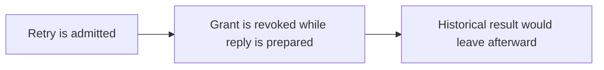

# Focused revision plan for HCP PR 49

**Status: revised decision guide, 2026-11-26. This is a proposal for review, not an adopted contract.**

The recommendation is to narrow #49 to a truthful answer on the original response
path after a known successful write, plus only the retry safeguards needed to keep
that rule coherent. Put the larger recovery choices in a dependent #34 batch. Do
not relax the existing authorized-replay guarantee in one paragraph while leaving
another paragraph promising it.

The cards below are **decisions to assess, not nineteen new required features**.
Some retain existing guarantees, some remove prescriptions, some correct examples,
and some identify product decisions that are still open. They separate three costs
that the earlier discussion mixed together: remembering that a write happened,
retaining its response body, and recovering an identifier after a lost reply.

## How to read the recommendations

Each card gives the problem, a visual, and four attributed views. The numbered
arrows show the problematic scenario, not the recommended implementation.

- **Coordinator** is my recommendation after considering the reviews. It is not
  Lucas's approval. I favor admission-time token expiry checking (P07), current
  eligibility as the public minimum for optional bodies (P08), and a distinguishable
  409 for an outstanding key (P09). The fresh subagent disagrees on all three.
- **Fresh subagent** is `revision_options_advice`, a read-only independent review
  requested as `gpt-6.2-astra` / `xhigh`. The tool accepted those settings; the actual
  runtime model and effort were not independently observable. It read the proposal,
  both Claude reviews, spec base `b790561…` and PR head `38d0c73…`. No agent's vote
  constitutes approval or evidence that a proposal was implemented.
- **Review A** is the first attachment, titled *Review of the focused revision plan
  for HCP PR #49* (`abad20f2…`). Its finding labels are F1–F10 and R1–R8.
- **Review B** is the second attachment, titled *Design review: focused revision
  plan for HCP PR #49* (`4da5e435…`). Its finding labels are 1–10 and R1–R6.

Both Claude reviews assessed the earlier proposal with SHA-256
`ba125cd07ad790ce6b679c1a61d7132974ada429697a6f357eced7038823e4a4`.
That reviewed version is preserved separately. Their recommendations are not
presented as reviews of this revision. Where they make no separate recommendation,
the card says so. The fresh agent's P08 advice also supplies the distinct
copy-deadline question now separated into P17. Follow-up advice supplies the
separate P18 restored-authority and P19 key-binding cards.

**Already selected:** Lucas accepted HTTP 200 for identifier-free completion in
the later A4 discussion. Do not ask again. The older 201 experiment remains a
historical observation. Whole-query denial after partial standing-rule denial and
the explicit current write purpose / authorized empty future-purpose choices are
also selected, but belong to their existing later batches.

**Still unchanged:** the application target is normative Draft 3
`2e2939c9bebcefb3bed7bb3522231c0e4d65a315`, with adoption-material baseline
`b764a058eac15a4cd843892e60473089b2e835bb`. The reviewed spec candidate is
`38d0c73c9b04541b1df0901600f0bc161ae82bc6`. This document changes no runtime,
schema or adoption pin; it does not claim the existing PRs implement the revision.

## Terms used in the cards

| Term | Meaning here |
| --- | --- |
| Original reply | The reply to the request that actually performed the write, on its still-usable response path. A later retry is a new request. |
| Completion only | Exactly `{"outcome":"committed","representation":"not-included"}` after known successful durable completion. No entry identifier, content, version or resource-specific headers. |
| Ordinary result | The operation's normal, role-correct result, with only what current disclosure rules permit. |
| Ref | A Context Client's grant-scoped handle needed to get, revise or withdraw a particular entry. It is not the management identifier. |
| Key | The client-supplied HTTP duplicate-suppression identity. It is not a credential and cannot restore revoked authority. |
| Token versus grant | A token presents authentication evidence with its own expiry; a grant is the underlying authorization. Refreshing evidence cannot undo grant revocation. |
| Current eligibility | The applicable permission, purpose, lifecycle and copy deadline tests pass now. This alone does not remember every past permission change. |
| Permanent invalidation | An affected prepared/retained result stays ineligible after a permission change, even if access is later restored. This need not dictate a cache-deletion algorithm. |

## Decision index

| ID | Question | Status |
| --- | --- | --- |
| [P01](#p01) | How much belongs in PR 49? | Scope proposal |
| [P02](#p02) | What happens when a save commits before revocation? | Retain central rule |
| [P03](#p03) | Must providers retain full response bodies? | Recommended relaxation |
| [P04](#p04) | Can a client recover the new entry reference? | Product decision |
| [P05](#p05) | Who may learn that an earlier write succeeded? | Product decision |
| [P06](#p06) | What if revocation happens while a retry reply is prepared? | Privacy boundary decision |
| [P07](#p07) | What if only the access token expires mid-request? | Product decision |
| [P08](#p08) | Does temporary narrowing permanently cancel a prepared result? | Product decision |
| [P09](#p09) | How should a retry report that the outcome is not ready? | HTTP binding decision |
| [P10](#p10) | Which failures prove that nothing was saved? | Clarification with bounded semantics |
| [P11](#p11) | Can a retry recreate something the person erased? | Existing erasure dependency |
| [P12](#p12) | Can a client rely on keys for withdrawal? | HTTP follow-up decision |
| [P13](#p13) | What must a client preserve to retry safely? | HTTP guidance and identity rule |
| [P14](#p14) | Use the accepted success status and record changed decisions | 200 accepted; other changes remain proposals |
| [P15](#p15) | Guarantee durable outcomes without choosing the database design | Retain outcome; simplify prescription |
| [P16](#p16) | Keep examples, terminology and comparisons accurate | Editorial and binding work |
| [P17](#p17) | Can a retry confirm success after the old copy expires? | Change to a selected CR policy |
| [P18](#p18) | After permission is restored, may a retry say only “saved”? | Change to a selected CR policy |
| [P19](#p19) | Can a replacement grant turn an old key into a new write? | Retain essential replay safeguard in #49 |

## P01 — How much belongs in PR 49?

**Status:** Scope proposal.

**1. Problem.** The current proposal combines the original reply with a broader redesign of historical recovery. Decisions about references, permission history and erasure can hold up a useful completion fix.

**2. Visual of the problem.**

| View | Recommendation |
| --- | --- |
| **3. Coordinator** | Narrow #49 to original completion and the minimum amendment preventing unauthorized replay. Keep the broader recovery redesign explicitly owned under #34; do not leave contradictory replay text behind. |
| **4. Fresh subagent** | Narrow #49 to original completion and essential replay safeguards. Keep the existing authorized-replay guarantee until #34 deliberately replaces it; settle recovery, erasure interactions and client promises in that dependent batch. |
| **5. Review A** | Fix the identified gaps in #49; split original completion (#36) from retry work (#34) if the recovery decisions cannot be settled together. |
| **6. Review B** | Narrow the combined Core and HTTP contract. Defer receipts and other additions; the review does not explicitly require separate PRs. |

**Practical consequence:** C8 owns both parts and their landing order. Splitting work does not remove the retry obligations or establish adoption.

**Review trace:** A opening and smallest contract; B verdict and smallest contract.

## P02 — What happens when a save commits before revocation?

**Status:** Retain central rule.

**1. Problem.** A save can succeed before its grant is revoked, while its response is still being prepared. Returning the entry leaks protected data; saying the save failed misstates the durable outcome.

**2. Visual of the problem.**

| View | Recommendation |
| --- | --- |
| **3. Coordinator** | On the usable original channel, require the ordinary result when eligible and the exact completion-only acknowledgement otherwise. Never acknowledge an uncertain commit, dry-run or failed operation as saved. |
| **4. Fresh subagent** | Ordinary role-correct output if releasable; otherwise exact identifier-free completion on the usable original path after known durable success and audit. Import means completed processing, not that every item imported. Dry runs, an audit append alone and unknown commits do not qualify. |
| **5. Review A** | Keep the exact original-channel acknowledgement, with ordinary output where releasable, including non-dry-run import in scope. It gives no separate recommendation on per-item import outcomes. |
| **6. Review B** | Keep the same original-channel split and exclusions. Separately proposes permanent cancellation of a prepared ordinary result after relevant permission changes. |

**Practical consequence:** Completion remains {"outcome":"committed","representation":"not-included"}, without entry identifiers or resource headers. No new endpoint or execution authority.

**Review trace:** A smallest contract; B Core rules 1–2.

## P03 — Must providers retain full response bodies?

**Status:** Recommended relaxation.

**1. Problem.** Remembering that a write happened prevents duplicates. Requiring the complete historical response additionally stores personal content and carries disclosure-expiry obligations.

**2. Visual of the problem.**

| View | Recommendation |
| --- | --- |
| **3. Coordinator** | Retain the existing bounded HTTP duplicate guarantee, with optional historical bodies. Keep the 24-hour minimum for now and distinguish this from reference recovery in P04. Do not require a record of every read or every API call. |
| **4. Fresh subagent** | Allow optional full bodies, retaining bounded durable state for duplicate suppression through overlap and restart and for the selected reference guarantee. Keep at least 24 hours after commit for keyed HTTP create/revise and supported withdrawal; do not expand this to MCP, import or unkeyed calls. |
| **5. Review A** | Remove mandatory saved bodies, but settle reference recovery at the same time. Keep the existing 24-hour key window and create/revise support. |
| **6. Review B** | Remove mandatory saved bodies and label the loss of guaranteed reference recovery. Keep the existing 24-hour floor and create/revise key support. |

**Practical consequence:** A provider still needs sufficient durable duplicate and authorization information. This changes an existing HTTP promise; it is not merely an editorial cleanup.

**Review trace:** A F1 and obligation table; B findings 6 and obligation table.

## P04 — Can a client recover the new entry reference?

**Status:** Product decision.

**1. Problem.** A client loses the create reply. A later answer of only 'saved' gives no dependable way to identify that entry for get, revise or withdraw. Query rediscovery is best-effort.

**2. Visual of the problem.**

| View | Recommendation |
| --- | --- |
| **3. Coordinator** | Favor deterministic reference recovery in #34 when the original create could disclose the identifier and the same authorization remains eligible now. A small reference result can avoid a full body archive; do not require a new endpoint. Define purpose, lifecycle and role limits first, and do not let later widening upgrade a write-only result. |
| **4. Fresh subagent** | Guarantee reference recovery on an exact create retry only if the original create could disclose it and the same grant remains eligible. Allow an eligible ordinary result or a small reference result. Write-only clients get completion; later widening cannot upgrade it. Management clients retain their own scoped identifier rules. Settle in #34. |
| **5. Review A** | Add R4 and require a reference result for an exact create retry when the caller can currently read the entry. Write-only callers receive completion; broader reference authority is a separate choice. |
| **6. Review B** | Accept effect-only recovery for #49 and record the loss of the old guarantee. Defer a reference receipt; query rediscovery is best-effort, not a replacement guarantee. |

**Practical consequence:** This is a real disagreement. Stable references are not necessarily recomputable. A receipt adds authorization and schema work; no receipt shape is approved yet.

**Review trace:** A F1 and R4; B finding 6 and R4.

## P05 — Who may learn that an earlier write succeeded?

**Status:** Product decision.

**1. Problem.** A grant still exists, but the person removes its access to the category of an earlier write. Checking only whether the grant is alive differs from checking whether it still authorizes that historical information.

**2. Visual of the problem.**

| View | Recommendation |
| --- | --- |
| **3. Coordinator** | Retain a defined current-authorization test for historical outcomes, not just 'grant is alive'. Avoid rerunning consumed execution conditions. Do not depend on an undefined write-purpose field; coordinate that part with #38. |
| **4. Fresh subagent** | A live grant alone is insufficient. Require applicable current action, target/category and standing restrictions over both attempted and historical scope; use purpose only where actually bound. Do not rerun consumed preconditions. Give opaque denial when authority cannot be established; #38 owns the new explicit field. |
| **5. Review A** | For content-free completion/conflict/pending, require only the same client and capacity and original authorization still in force. Category, target and purpose checks are considered unnecessary. |
| **6. Review B** | Authorize the presented operation excluding consumed preconditions, then match the key. It rejects a separate historical-result check and would not require historical-operation authority merely to reveal a mismatch. |

**Practical consequence:** A and B differ. Confirming a previously unknown durable outcome is information. R2 changes the earlier CR denial policy and needs an explicit disposition.

**Review trace:** A F3 and R2; B finding 4 and R2.

## P06 — What if revocation happens while a retry reply is prepared?

**Status:** Privacy boundary decision.

**1. Problem.** A retry can be authorized when it arrives and lose authority before its completion, conflict or pending result leaves the provider. These responses reveal historical state even without entry content.

**2. Visual of the problem.**

| View | Recommendation |
| --- | --- |
| **3. Coordinator** | Require authority at the defined release boundary for revealing retry responses, but do not prescribe an after-serialization hook or a second pipeline. Keep the original known-commit exception distinct. |
| **4. Fresh subagent** | Order every key-revealing decision against effective authority changes at the provider's release decision. If revocation wins, deny. This includes completion, conflict, pending and reference results, without prescribing a serialization callback or waiting for remote receipt. |
| **5. Review A** | Recheck grant status before answering a retry. Keep the handoff-time disclosure rule only for content-bearing replies; rejects the mandated serialization hook for metadata. |
| **6. Review B** | Authorize retries at admission; only content-bearing replies follow the read-release rule. A non-content retry may finish after intervening revocation under this proposal. |

**Practical consequence:** Removing a pipeline prescription is an implementation simplification. Letting admitted retries reveal information after revocation is a separate change to the observable guarantee.

**Review trace:** A F4; B finding 3.

## P07 — What if only the access token expires mid-request?

**Status:** Product decision.

**1. Problem.** A token is valid when a request arrives and the write commits, but expires before the reply. The underlying grant remains valid. This is different from using an expired token for a new request.

**2. Visual of the problem.**

| View | Recommendation |
| --- | --- |
| **3. Coordinator** | Favor checking token lifetime at admission for this expiry-only case, while independently checking grant status and applicable disclosure authority at release. Record the deliberate change from the stricter CR boundary; new expired-token requests still fail. |
| **4. Fresh subagent** | Keep CR's stricter cutoff: expiry before release permits only identifier-free original completion after a known commit. A revealing retry needs refreshed evidence under the same still-authorized grant. Reject expired credentials on every new request; refreshing a revoked grant restores nothing. |
| **5. Review A** | Check token lifetime at admission and grant/disclosure rules when content is released. Other protocols support considering this choice but do not decide HCP's policy. |
| **6. Review B** | Check token lifetime at admission and grant status on every request. Its separate admission-only metadata policy would remove another release check for content-free retries. |

**Practical consequence:** This recommendation is not adopted. Token expiry, token revocation, grant revocation and a refreshed token under the same live grant must not be conflated.

**Review trace:** A R1; B R1.

## P08 — Does temporary narrowing permanently cancel a prepared result?

**Status:** Product decision.

**1. Problem.** Permissions narrow, then return before release. Current permission checks now pass, but permanent invalidation also requires remembering the intervening change. Mandated cache deletion adds another implementation constraint.

**2. Visual of the problem.**

| View | Recommendation |
| --- | --- |
| **3. Coordinator** | Do not universalize CR's permission-history policy merely to land #49. Favor current eligibility as the public minimum unless a person-facing permanent-cancellation promise is explicitly selected. Preserve CR's stronger selected behavior until adoption resolves compatibility. |
| **4. Fresh subagent** | Keep permanent ineligibility of prepared/retained ordinary output after an effective permission change, including restoration, expressed as eligibility rather than mandatory deletion. This is separate from minimal completion after restoration (P18), which the subagent favors once Lucas supersedes CR’s selected denial. |
| **5. Review A** | For saved content returned on a retry, current disclosure rules and the original copy deadline suffice; permanent invalidation may remain CR policy. The review does not separately decide whether an original prepared response may revive after narrowing and restoration. |
| **6. Review B** | Keep permanent ineligibility after a relevant permission change, but express it as a predicate. A policy epoch may enforce it; mandatory payload deletion moves to guidance or CR policy. |

**Practical consequence:** A and B recommend different observable guarantees. An epoch still needs durable ordering. Neither optional caching nor encrypted storage automatically answers this policy question.

**Review trace:** A F7 and R6; B finding 5 and Core rule 2.

## P09 — How should a retry report that the outcome is not ready?

**Status:** HTTP binding decision.

**1. Problem.** A second request arrives while the first is running or being recovered. Executing it again is unsafe, but returning a terminal body-mismatch error gives the client the wrong next action.

**2. Visual of the problem.**

| View | Recommendation |
| --- | --- |
| **3. Coordinator** | Allow bounded waiting. Favor a distinguishable HTTP 409 for a known outstanding operation, and 503 with Retry-After when the provider temporarily cannot establish the key’s outcome during recovery, including after restart with no operation still running. Never reexecute while uncertain. An unrecoverable outcome is a failed recovery guarantee, not permission to treat the key as fresh. Do not misuse subject-unavailable or add a Core-wide task service. |
| **4. Fresh subagent** | Allow bounded waiting, then use HTTP 503 with Retry-After for both overlap and unresolved recovery. Reserve 409 idempotency-conflict for proven mismatch. Specify the HTTP problem response without inventing a Core error or misusing subject-unavailable; never execute twice while uncertain. |
| **5. Review A** | Use a binding-level 503 with Retry-After for pending execution and unresolved recovery. Rejects a new Core error and prefers 503 over the plan's 409. |
| **6. Review B** | Fold pending into unknown outcome: wait or return 503 with Retry-After. Calls a new pending error unnecessary because the client action is the same. |

**Practical consequence:** Status alone does not define safe retry. The IETF draft recommends 409 for outstanding keys; it is not an adopted RFC. HCP already uses 409 for other problem types.

**Review trace:** A F5(b), R3; B finding 7, R3.

## P10 — Which failures prove that nothing was saved?

**Status:** Clarification with bounded semantics.

**1. Problem.** A rejection before execution, an uncertain connection failure, and a denial of a later retry do not tell the same story. Treating every error as rollback can cause a fresh-key duplicate.

**2. Visual of the problem.**

| View | Recommendation |
| --- | --- |
| **3. Coordinator** | Specify confirmed no-effect rejection for the current attempt separately from uncertain outcome and historical-result denial. Never let a later denial imply the original write failed. Map unresolved failures without claiming universal rollback for every error. |
| **4. Fresh subagent** | A confirmed pre-write rejection or verified rollback proves no change by that attempt and leaves a fresh key unconsumed. A recovery denial cannot answer the original outcome; transport failure/503 leaves it unknown. Import may have per-item outcomes. Status class alone does not prove original rollback. |
| **5. Review A** | Add a Core rule that an error on create/revise/withdraw means that request changed nothing; use binding-level 503 for uncertainty. This needs careful separation of current attempt and earlier operation. |
| **6. Review B** | State that Core 4xx on a first attempt means no change; use 503/transport failure for unknown outcome and explain that retry denials leave the original outcome unrecovered. |

**Practical consequence:** Keep confirmed rollback versus crash uncertainty in acceptance tests. JMAP's no-change error rule has an explicit partial-failure exception; it is not an unconditional precedent.

**Review trace:** A F5(a) and smallest contract; B client flow and finding 7.

## P11 — Can a retry recreate something the person erased?

**Status:** Existing erasure dependency.

**1. Problem.** If hard erasure removes the key record as well as the entry, an ordinary retry can look new. Keeping a key marker avoids that, but the marker itself can retain personal metadata.

**2. Visual of the problem.**

| View | Recommendation |
| --- | --- |
| **3. Coordinator** | Keep non-resurrection as the desired guarantee, but resolve permitted markers and wire behavior with #23/#39 before claiming a portable erasure-safe retry contract. Do not assume a content-free marker is exempt. The interim example must state its no-erasure scope. |
| **4. Fresh subagent** | Require non-resurrection during the promised interval. Do not exempt client-chosen keys or digests from erasure automatically. #23/#39 must demonstrate compatible retention or safe refusal before the combined hard-delete/retry guarantee can be qualified. |
| **5. Review A** | A hard-deleted operation must not make its key unused. Keep client/key/grant, discard body digest, and deny reuse; decide with #23 or at least warn clients. |
| **6. Review B** | Require at-most-once across hard deletion and deny reuse until #23/#39 settle marker contents and wire behavior. Adds an explicit product decision for that invariant. |

**Practical consequence:** Both identify a real gap, but neither proposed marker is already approved. The client cannot generally observe intervening erasure. This remains a gate before personal-data expansion.

**Review trace:** A F6 and R7; B finding 1 and R5.

## P12 — Can a client rely on keys for withdrawal?

**Status:** HTTP follow-up decision.

**1. Problem.** Create/revise must accept keys, but withdrawal only SHOULD. Sending the header does not tell an independent client whether it will suppress a duplicate withdrawal or duplicate audit event.

**2. Visual of the problem.**

| View | Recommendation |
| --- | --- |
| **3. Coordinator** | Do not silently raise SHOULD to MUST inside the completion fix. Resolve uniform support versus an explicit pre-write support contract in #34. When support is unknown, a lost withdrawal outcome stays uncertain; no blind retry assumption. |
| **4. Fresh subagent** | Favor MUST honor supplied keys for soft withdrawal in #34, excluding hard delete. If SHOULD remains, clients without independently known support must treat a lost result as uncertain and avoid automatic retry. Do not add a general discovery feature to #49. |
| **5. Review A** | Make DELETE key acceptance mandatory, arguing that it reuses create/revise machinery; otherwise define the unkeyed retry result clearly. |
| **6. Review B** | Either make DELETE key acceptance mandatory or explicitly state that a denied unkeyed retry leaves the outcome unknown. |

**Practical consequence:** Uniform support improves portability but is a stronger provider obligation. Cheap reuse cannot be assumed for every independent backend.

**Review trace:** A F8 and R8; B finding 8.

## P13 — What must a client preserve to retry safely?

**Status:** HTTP guidance and identity rule.

**1. Problem.** Re-serializing the same JSON can change its bytes and trigger a conflict. A disconnected client also cannot observe the successful commit time from which server retention is measured.

**2. Visual of the problem.**

| View | Recommendation |
| --- | --- |
| **3. Coordinator** | Keep exact-byte matching in the HTTP binding, not Core. Tell clients to preserve method, target, key and bytes before sending, measure conservatively from first send, and stop well inside the guaranteed window. Do not claim this resolves erasure. |
| **4. Fresh subagent** | Preserve method, exact target, key and identical UTF-8 bytes before first send, then retry under the same grant. Stop comfortably inside 24 hours from first dispatch, allowing delivery time. The provider floor begins at commit; a fresh key cannot safely recover a lost result. |
| **5. Review A** | Keep exact bytes; document the client duty and first-send window. A first-sent header with rejection of stale retries is a possible later alternative, not required now. |
| **6. Review B** | Keep exact bytes as a client duty; preserve bytes before sending and stop well inside the window. Do not add a new first-sent mechanism in #49. |

**Practical consequence:** Existing different-body conflicts need one portable equality definition. This does not mandate raw-body storage or a JSON canonicalization framework.

**Review trace:** A F10 and obligation table; B minor notes and obligation table.

## P14 — Use the accepted success status and record changed decisions

**Status:** 200 accepted; other changes remain proposals.

**1. Problem.** Earlier CR records used 201 for minimal create/revise and denied some retries. New text proposes 200 and wider minimal recovery. Without explicit old-to-new records, readers can mistake a proposal for an adopted policy.

**2. Visual of the problem.**

| View | Recommendation |
| --- | --- |
| **3. Coordinator** | Record the old/new behavior and its authority. Use 200 for minimal completion: Lucas already accepted A4 in chat. Keep changed expiry/narrowing recovery explicitly proposed; do not ask again for the settled status choice. |
| **4. Fresh subagent** | 200 is already selected by Lucas for minimal completion. Preserve ordinary operation-specific success statuses, including 201 where applicable, and keep the dated C4 observation intact. Record the later selection as superseding that minimal-response mapping; do not poll again. |
| **5. Review A** | Its earlier review leaned to 200, but this review asks Lucas to decide R5 rather than treating that preference as approval. Its smallest retry contract also says to return the original success status. It lacks the later A4 approval context; do not present it as unqualified agreement on every status mapping. |
| **6. Review B** | Also supports 200 and the proposed minimal-recovery direction, but asks that the three earlier policy changes be named and approved. |

**Practical consequence:** No runtime behavior or adopted pin has changed. C5's ban on expired content can remain intact even if an authorized content-free acknowledgement is later approved.

**Review trace:** A F2 and R5; B finding 2 and R6.

## P15 — Guarantee durable outcomes without choosing the database design

**Status:** Retain outcome; simplify prescription.

**1. Problem.** Entry, audit and key information may live in different systems. Requiring one transaction across them excludes recoverable designs, while acknowledging success before required history is durable makes the promise false.

**2. Visual of the problem.**

| View | Recommendation |
| --- | --- |
| **3. Coordinator** | Require known durable success, required audit before acknowledgement, and duplicate protection through recovery. Let providers choose transactions, journals or recovery designs. One mutation event is not proof of client receipt; #43 still owns copy accounting. |
| **4. Fresh subagent** | Keep known committed success, durable required audit, recoverable duplicate suppression and no repeated mutation events. Let providers choose transactions or journals. Provider events do not prove remote delivery or use; copy accounting remains #43. |
| **5. Review A** | Keep existing audit durability and at-most-once outcomes; replace cross-store transaction prescriptions with the plan's observable guarantees. The review does not propose a new receipt guarantee. |
| **6. Review B** | Keep existing audit-before-acknowledgement and the plan's outcome-based durability wording; do not mandate transaction layout or new retry mutation events. |

**Practical consequence:** The audit guarantee already exists in HCP. Removing a storage prescription does not weaken it or settle the unknown physical-COMMIT boundary.

**Review trace:** A obligation table; B obligation table; both support the plan's durability direction.

## P16 — Keep examples, terminology and comparisons accurate

**Status:** Editorial and binding work.

**1. Problem.** Incomplete examples and overstated analogies can make independent teams implement different contracts. Application-specific wording can also look like a universal protocol requirement.

**2. Visual of the problem.**

| View | Recommendation |
| --- | --- |
| **3. Coordinator** | Use public protocol terms and complete the affected MCP completion example and its error boundary; preserve the disconnect warning. Add Solid WAC and OASIS Repeatable Requests with limits. Keep CR-only mechanics in adoption notes. Add no encryption architecture or generic conformance framework. |
| **4. Fresh subagent** | Show the entire successful pinned-MCP envelope, with resultType outside the identical structured/JSON-text HCP value, and retain the disconnect warning. Correct bounded comparator claims. Keep unrelated descriptors, tooling and encryption architecture out of #49. |
| **5. Review A** | Correct OData's identifier caveat, add Repeatable Requests and Solid WAC, clean CR terminology, and keep the MCP warning/resultType fix. Its repeated claim that retention inherently conflicts with E2E storage is not adopted here. |
| **6. Review B** | Correct comparator gaps and application-specific vocabulary. It makes no separate new MCP-envelope or encryption-design proposal in this review. |

**Practical consequence:** These edits explain the chosen contract; they must not introduce hidden requirements or claim that another protocol settles HCP's revocation timing.

**Review trace:** A F9–F10 and obligation table; B findings 9–10 and implementation-choice discussion.

## P17 — Can a retry confirm success after the old copy expires?

**Status:** Change to a selected CR policy.

**1. Problem.** The old result has a useUntil deadline. CR currently denies recovery after that deadline. A client may still be authorized to learn that its write succeeded, even though returning the old content is forbidden. Treating those as the same permission can leave a lost reply permanently uncertain.

**2. Visual of the problem.**

| View | Recommendation |
| --- | --- |
| **3. Coordinator** | Allow completion-only recovery after copy expiry when the same original authorization still permits the historical fact and the key remains protected. Never replay expired content or renew its deadline. Record this as a deliberate change to C5, requiring Lucas’s selection. |
| **4. Fresh subagent** | Permit this relaxation only if Lucas explicitly revises the selected denial after useUntil; keep the existing rule until then. The subagent accepts minimal recovery for copy-only expiry under unchanged historical authority as that separate choice. |
| **5. Review A** | Supports completion after copy expiry, but requires a decision row naming the earlier denial being reversed. Do not return expired ordinary content. |
| **6. Review B** | Supports completion after copy expiry and explicitly identifies it as reversing C5. Ordinary replay still requires an unexpired original copy. |

**Practical consequence:** No extra response-body retention is needed. The person’s copy deadline still stops content reuse; the new permission is only to recover the fact of a completed write.

**Review trace:** A F2(b) and optional-replay discussion; B finding 2 and R6; fresh subagent P08.

## P18 — After permission is restored, may a retry say only “saved”?

**Status:** Change to a selected CR policy.

**1. Problem.** Consider a keyed revision whose response was lost and whose old body was discarded after a permission change. CR’s selected rule still denies recovery when the same grant later regains sufficient authority. That is stricter than withholding the old body: the client may be authorized to learn that the revision succeeded without receiving old content.

**2. Visual of the problem.**

| View | Recommendation |
| --- | --- |
| **3. Coordinator** | Favor identifier-free completion when the same original authorization again covers the historical operation and target, within the protected key window. Explicitly supersede the selected generic denial only after Lucas chooses this change. This choice does not by itself revive the body, return its ref or renew a copy deadline; P08 separately decides optional-body eligibility. |
| **4. Fresh subagent** | Favor identifier-free completion under restored, sufficient original authority. Its earlier advice to preserve generic 403 was pending approval, not a substantive preference for permanent denial. The invalidated body/ref are not returned by this retry and useUntil is not renewed. A separately authorized read may still use a previously known ref. |
| **5. Review A** | Supports minimal recovery after narrowing/restoration under its simpler same-live-original-authorization rule, and asks that the reversal of the earlier CR denial be explicit. Its ordinary-body rule is a separate, more permissive proposal in P08. |
| **6. Review B** | Supports minimal recovery under current attempted-operation authority, with consumed preconditions excluded. Explicitly labels the old generic-denial policy as reversed, while retaining permanent ineligibility of the old ordinary body. |

**Practical consequence:** All four views support at least confirming success in this revision scenario, with different authority predicates. For a create, Review A’s P04 reference rule may require more than identifier-free completion. Lucas still needs to select the policy reversal; it requires no old response body.

**Review trace:** A F2(c), F3 and R2; B finding 2, finding 4 and R2; fresh subagent P18 clarification.

## P19 — Can a replacement grant turn an old key into a new write?

**Status:** Retain essential replay safeguard in #49.

**1. Problem.** If an implementation treats grant identity as part of the key lookup namespace, a replacement grant can make the same client’s consumed key appear unused. That can execute the write twice or reveal the earlier outcome under the wrong authority. A key identifies an attempted operation; it is not permission to recover it.

**2. Visual of the problem.**

| View | Recommendation |
| --- | --- |
| **3. Coordinator** | Within the protected window, scope key identity to provider/subject instance, authenticated client and capacity; bind it separately to original grant or management authority, operation, target and exact UTF-8 bytes. A replacement grant gets opaque denial, with no revealed match/conflict/outcome and no new execution. Specify the result, not DB columns or lookup order. |
| **4. Fresh subagent** | Keep this as minimum #49 precedence. Replacement authority cannot inherit the outcome, trigger a revealing conflict or run the consumed key as fresh. Enforce original binding without mandating storage of raw bytes, database layout or an implementation-specific lookup sequence. |
| **5. Review A** | Retains the client/capacity key namespace and original authorization binding. A new grant cannot recover the old operation or make the consumed key fresh. This is a retained safeguard rather than a proposed new receipt service. |
| **6. Review B** | Explicitly keeps subject-instance/client/capacity namespace and original-authority/operation/target/bytes binding. Its pipeline denies a key bound to another grant before returning match or conflict. |

**Practical consequence:** A replacement credential is not a replay bypass. This is scoped to the same client/capacity and retained key window, not a promise to detect identical writes by unrelated clients forever.

**Review trace:** A smallest HTTP contract and obligation table; B finding 4 and smallest HTTP contract rules 2–4; fresh subagent P19.

## Recommended scope and sequence

### Checkpoint 1 — agree the bounded contract

Review the cards as connected choices, not nineteen separate implementation tasks.
The smallest useful #49 includes P02's original response rule, P14's selected HTTP
mapping, P15's existing durability guarantees, and the affected portion of P16, plus P19’s key-binding safeguard.
It must also make clear that a later request gains no original-channel entitlement:
new invalid credentials fail; no retry releases an ineligible result or repeats a
known commit. Within the protected window, the provider/subject-instance, client
and capacity define key identity; original authority is a separate binding. The
same consumed key under replacement authority must be denied, not treated as new. That is a precedence clarification, not permission to remove base
§9.6's existing eligible-result guarantee without a replacement decision.

For that small PR, settle P07 and the original-response portion of P08, or explicitly
preserve the candidate's stricter behavior. The coordinator's preferred relaxations
are not authorization to override earlier CR choices. No body-retention relaxation
lands ahead of the P04 recovery decision. Existing uncertainty in replay/erasure
must remain visible as a dependency; splitting PRs does not solve it.

The dependent #34 batch owns P03–P06, the retry portion of P08, P09–P13, P17 and P18. P13’s exact-byte identity is already part of P19
in the first fix; the later batch owns its fuller client-preservation/window guidance.
Its first decision is whether clients must recover the new identifier. That choice
determines the minimum retained state; it does not inherently require the entire
old body. Then select authority, pending response and optional-body rules together.
P11 cannot be called solved merely by writing “deny”: a provider needs an
erasure-compatible way to recognize or safely refuse the consumed-key retry.

### Checkpoint 2 — revise the selected spec candidate

The C8 sole writer edits owning sources and affected schemas, examples and generator
in the isolated spec worktree, after genuine contract decisions are selected. A
small #49 and an independently useful dependent #34 change may use separate PRs;
review checkpoints do not each need a PR. Keep public text useful to independent
implementers; application experiments and choices remain in CR.

Run the spec's current checks, including `make check`, `make pages`, generated
artifact consistency, affected positive/negative examples, links and whitespace.
Confirm Draft 2 remains unchanged. Obtain fresh independent complete-diff reviews
for authority/privacy/durability and adoption/architecture, followed by applicable
exact-candidate CI and human upstream review/merge. Do not merge automatically.

### Checkpoint 3 — adapt CR tests first

Revise the dependent CR #221 patch against the selected contract. Change assertions
only where requirements changed, before runtime edits. Focus on affected HTTP
writes, management flows, persistence and consumer behavior; no new MCP write tools
are activated by this plan. Public MCP completion examples and portable consumer
fixtures do not substitute for C9's remaining runtime binding duties.

For original completion, cover ordinary/minimal output, known success then
revocation, token expiry according to the chosen cutoff, audit durability, unknown
commit, lost channel, import outcomes and dry-run exclusion. The first adoption
also tests P19: the same consumed key under replacement authority gets opaque
denial and zero new effects, while its original operation/target/exact-byte binding
remains enforced. For the later recovery
batch, add its selected reference guarantee, optional-body modes, copy expiry,
permission narrowing/restoration, refreshed evidence, different grants, denied
historical scope, concurrent first uses, pending responses, exact-byte mismatch,
crash/restart, confirmed rollback and no second mutation audit. Add erasure recovery
only with its resolved contract and real implementation; do not weaken the assertion
to hide a resurrection path. No storage rewrite is justified simply to demonstrate
that providers may choose a different storage design.

### Checkpoint 4 — explicit adoption and handoff

A dependent CR patch may be prepared before the upstream merge. Only after human
spec merge, verify the actual merged delta, record old/new normative and materials
pins, update affected requirement/evidence rows, and renew affected consumer and
persistence evidence. Freeze the CR candidate for fresh complete-diff reviews and
all applicable exact-candidate Product CI under the
[validation policy](../../../useful/AGENT_WORKFLOW.md#validation-and-context-discipline).
Do not recreate the retired duplicate gate or run broad local gates without a named
evidence gap. No new live host trial is needed for this planning step.

The handoff records issue dispositions, spec PR/merge, CR PR/adoption pin,
tests/reviews and owned remaining work. Submitted, merged and adopted are distinct.

## What the protocol comparisons establish

These sources describe independently implementable client/provider contracts. They
support narrower lessons, not a vote for importing an entire API or database design.
No Stripe or Google API comparison is used as design justification here.

| Source | Useful comparison | Limit |
| --- | --- | --- |
| [Solid Protocol](https://solid.github.io/specification/protocol) and [WAC](https://solid.github.io/web-access-control-spec/) | Independent applications and storage providers; conditional PUT can use a client-known URI; Append permission is independent of Read, with advice to avoid identifier leakage to append-only agents. | HCP's grant-scoped ref is not a client-chosen URI. Solid does not supply this HCP keyed recovery or revocation-cutoff contract. The cited material is a Community Group draft, not a W3C Recommendation. |
| [JMAP RFC 8620 §5.3](https://www.rfc-editor.org/rfc/rfc8620.html#section-5.3) | Defines observable per-object atomicity and returns server identifiers; state/sync supports recovery without specifying the database layout. | Request-local creation IDs are not durable HCP idempotency keys. Method errors generally mean no changes, but `serverPartialFail` is an explicit exception; do not infer universal rollback from every error. |
| [Matrix transaction identifiers](https://spec.matrix.org/v1.18/client-server-api/#transaction-identifiers) | Duplicate identity scoped to device/endpoint survives token refresh; typical send responses identify the event. | Re-login changes the namespace. Its duplicate-response wording and authorization model do not settle HCP's historical-result or revocation rules. |
| [OData 4.01](https://docs.oasis-open.org/odata/odata/v4.01/os/part1-protocol/odata-v4.01-os-part1-protocol.html), §§11.4.1.5 and 8.3.4 | A write can succeed without the requested projected body; successful persistence and response representation are separate. | A minimal create still identifies the entity. Projection failure is not grant revocation, so it is not a precedent for HCP's exact identifier-free acknowledgement. |
| [OASIS Repeatable Requests CS01](https://docs.oasis-open.org/odata/repeatable-requests/v1.0/cs01/repeatable-requests-v1.0-cs01.html) | Optional support, a defined repeatability window and stale first-send rejection; reduced response bodies can limit storage burden. | Committee Specification 01, not an OASIS Standard. Its default repeat-response rules, optional support and wire fields differ; it does not decide HCP's in-flight revocation case. |
| [IMAP4rev2 APPEND](https://www.rfc-editor.org/rfc/rfc9051.html#section-6.3.12) and [COPY](https://www.rfc-editor.org/rfc/rfc9051.html#section-6.4.7) | Successful writes can withhold UID response information from callers lacking the required destination read/select access. | Separates success from identifier authority; it does not settle mid-request revocation. This is an RFC comparison, not a claimed verified Git repository. |
| [HTTP Idempotency-Key draft 09 §2.7](https://www.ietf.org/archive/id/draft-ietf-httpapi-idempotency-key-header-09.html#section-2.7) and [RFC 9110 §15.6.4](https://www.rfc-editor.org/rfc/rfc9110.html#section-15.6.4) | The draft uses 409 for an outstanding request; RFC 9110 defines 503 for temporary service inability with optional Retry-After. | The draft is work in progress. Neither status makes arbitrary POST retries safe; clients still need the same-key contract. This is the evidence for the coordinator's P09 preference, not consensus. |

The comparisons do not prove that every provider must retain every response, that
stable refs can always be recomputed after losing their mapping, that full-body
retention is inherently incompatible with end-to-end encryption, or that a policy
epoch needs no durable ordering. Those claims would overstate the evidence.

## Explicit follow-up ownership

| Work | Owner and revisit trigger |
| --- | --- |
| Broader replay and identifier recovery (#34) | C8 protocol/adoption owner; before relaxing mandatory eligible-result replay or claiming the new portable recovery behavior. |
| General in-flight read ordering / slow physical COMMIT (#2) | C8 authority owner; before expanded release or qualification claims. This does not remove the need to select the bounded write/retry cutoff. |
| Copy accounting and summaries (#43) | C8 audit owner; before complete summary/Core claims. A provider event is not proof of receipt or use. |
| Hard deletion, key metadata and audit erasure (#23/#39; D3) | C8 protocol owner with C9 capability owner; resolve and implement before any personal-data extension, and before claiming combined hard-delete/retry safety. |
| Mutation purpose and person corrections (#38) | C8 next contract batch; preserve Lucas's selected explicit current purpose and authorized empty future-purpose direction. Do not assume the new field exists yet. |
| MCP descriptors and omitted query categories (CR-Q7/Q8) | C8 binding batch after write contracts settle; preserve whole-query denial. Full runtime binding evidence remains C9. |
| Sensitive directive disclosure (CR-Q9) | C8 privacy owner; resolve and adopt before sensitive real data. |
| Status endpoints, MCP/import keys, client-chosen IDs or general discovery additions | C8 adoption owner only when a demonstrated client need activates a scoped proposal. P04 does not automatically require a new endpoint. |
| Encryption architecture | Separately owned spec work; no changes to its checkout or design. |
| Remaining mandatory capabilities and full binding/profile evidence, including §18.3 Provider Interop | C9 owner assigned by the orchestrator. Narrowing #49 does not remove any obligation or make a local bridge sufficient. |

These roles remain responsibilities of the C8 step owner until explicitly handed
off. Preserve personal/demo state, installed application, client settings, model
assets and retained C6/C7b evidence. No original adoption observation is rewritten
as if the later contract existed then.

## Validation of this planning revision

For this documentation-only revision, check link/anchor integrity, whitespace,
affected document readers, all card attributions and the interactive decision
view. Runtime tests and new CI qualification belong to a future implemented
candidate. Old green CI is evidence only for the old candidate, not this proposal.

Planning review: fresh read-only `revised_guide_review` requested Astra/high; the
tool accepted the settings, with runtime model/effort unobservable. It closed all
material attribution and scope findings after corrections, including P18/P19 and
their assigned checks. Markdown link validation passed across 169 files; card
completeness and whitespace checks passed. The companion comparison exercised all
19 selections with four recommendations at desktop and narrow widths, without
runtime errors or content overflow. These checks validate the planning materials,
not the proposed protocol behavior.
