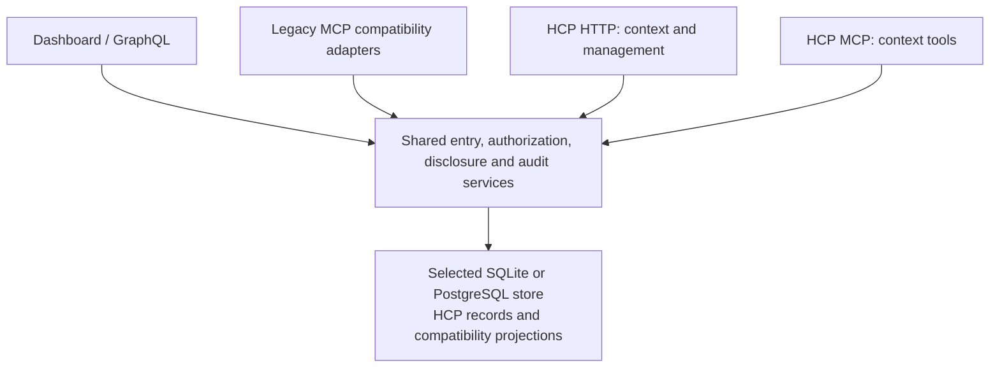

# HCP Alignment Plan

- Status: documented proposal; implementation is not activated
- Outcome owner: product owner; assign a coordinator and sole writer at activation
- Priority: future capability; does not change the assisted pilot's priority
- Risk: authorization, disclosure, persisted history, erasure, and client compatibility
- Assessment date: 2026-11-07
- Evidence: [gap analysis](gap-analysis.md), with the reviewed source revisions
- Relationship and ownership: [HCP integration reference](../../../useful/HCP_INTEGRATION.md)
- Protocol questions: [local Draft 3 adoption notes][questions]

## Outcome And Scope

Align Context Router with a deliberately selected HCP revision while preserving
the local application's credential, inference, persistence, and supported-client
boundaries. Add HCP interfaces backed by shared entry, authorization, disclosure,
and audit services. Existing application views can remain where their behavior
can be represented faithfully.

Use this upgrade to evaluate adoption using the **current hcp-spec repository**
and identify reusable lessons for other teams. Start with its existing specification,
schemas, guides, and tooling; keep the assessment, questions, and adoption observations
in Context Router. Improve hcp-spec only when concrete findings justify a focused change.
Reusable HCP improvements are an explicit outcome of this work alongside application
alignment, with a review and disposition at every checkpoint.

The proposed end target is **Agent Interop plus Memory Manager**, conditional on
serving independently operated assistants and accepting model-inferred entries:

- Agent Interop comprises Core, General Context, HTTP Binding, OAuth Interop, and
  MCP over Streamable HTTP. A stdio bridge does not itself satisfy that package.
- Accepting model-inferred HCP entries requires Memory Manager.
- First-Party is an alternative only if every HCP Client is operated by the
  Provider Operator. Local installation or bridge authorship does not establish
  that relationship.
- VC Evidence, delegated authorization, and issuer-attested health/education are
  outside the proposed initial scope. Their profiles become applicable when their
  triggering features are accepted. Ordinary personal health statements alone
  do not trigger the credential profiles.

The first runtime milestone should be an isolated, synthetic, read-only HTTP
journey with explicit consent, purpose-bound disclosure, audit, and revocation.
It makes **no HCP conformance claim**. A complete HTTP-only Provider Interop
milestone is possible later, before MCP qualification, only after all requirements
of that package and any applicable profiles are evidenced.

This plan authorizes no runtime work, personal-data migration, reset, live model
run, new network exposure, third-party client configuration, or release. It does
not change the chosen spec revision when an upstream question is resolved.

## Test The Current Adoption Experience

Start from the reviewed hcp-spec revision recorded in the [gap analysis](gap-analysis.md):
`b764a058eac15a4cd843892e60473089b2e835bb`, with Draft 3 normative content pinned at
`2e2939c9bebcefb3bed7bb3522231c0e4d65a315`. Keep it as the first adoption baseline;
any later target change must be explicit and preserve the earlier observations.
No new hcp-spec documentation, tooling, or skills are prerequisites for beginning
the bounded adoption exercise when runtime work is authorized.

At C0 and each later checkpoint, record concise observations in this brief and
the [local questions][questions]: the task/requirement, existing source consulted,
attempt or interpretation, outcome, manual work or workaround, and remaining
impact. Distinguish source inspection from runtime evidence. Classify findings as:

- **Application adaptation:** CR behavior differs from a sufficiently clear HCP
  requirement; the implementation work belongs here.
- **Guidance or specification gap:** the existing materials leave a concrete
  question unanswered, inconsistent, or difficult to apply.
- **Tooling opportunity:** repeated implementation or validation work suggests a
  reusable aid for other teams.

First use the published materials to answer questions; do not assume every entry
in the local question list requires a spec change. A large CR change is not by
itself evidence that HCP needs revision. Evaluate adoption usability separately
from protocol conformance, memory quality, and task outcomes.

Follow the [checkpoint review workflow](#hcp-adoption-reviews-and-upstream-work)
to turn these observations into improvements. Do not build a general adoption
framework or skill in advance of demonstrated need. Resolve blocking ambiguities
before implementing affected behavior, continue independent work, and never weaken
requirements merely to preserve the experiment's schedule.

This team already has the gap analysis and interpretation notes. Its observations
establish experienced-team integration friction; they do not establish unaided
newcomer onboarding. State that limitation in the C3 summary. A fresh reader trying
one bounded task using the published materials is optional if stronger onboarding
evidence becomes useful. Connect observations to the relevant fixture/test,
command, source revision, and result without introducing a new measurement system.

Keep hcp-spec unchanged for this documentation phase, including its already merged
implementation-directory entry. Future improvements are separate, reviewable
changes with the smallest concrete example and an explicit target-revision decision.

## HCP Adoption Reviews And Upstream Work

### Review At Every Checkpoint

Every C0–C8 closeout includes an **HCP adoption findings and upstream disposition**
review. The step owner records what the existing materials made straightforward,
what required interpretation or a workaround, and what repeated work could help
other implementers. Classify findings using the categories above and identify the
smallest useful application, guidance/tooling, or specification change. Explicitly
record **none** when there is no justified upstream work.

Keep detailed findings, stable question IDs, evidence, and dispositions in the
[local question record][questions]; keep checkpoint status and links in this brief.
The coordinator reconciles findings across steps and checks that closeout includes
a disposition, rather than just a list of observations:

- For a concrete reusable correction or aid within the activated scope, prepare,
  validate, and open a focused hcp-spec PR as part of closeout. Documentation,
  examples, tooling, skills, and specification corrections are eligible; logging
  the need alone is not the normal endpoint. Any nonblocking deferral needs a
  reason, an owner, and a checkpoint or condition for revisiting it.
- For unresolved semantics or larger protocol additions, record the concrete case
  and obtain a separate design decision before changing requirements. A focused
  issue or proposal can carry that discussion; CR-specific complexity alone does
  not justify expanding the protocol.
- Track **submitted**, **merged**, and **adopted by CR** separately, with links and
  responsible owners. An open nonblocking upstream review need not hold up
  independent CR work. A blocker stays attached to the dependent capability until
  the ambiguity and target decision are resolved.

This is the closeout workflow for activated work. Documenting it now does not
activate implementation or make changes in hcp-spec.

### Deeper Review Checkpoints

| Pause | Required review and output |
| --- | --- |
| End of C0 | Check whether the existing materials establish the first experiment's roles, deployment, and required behavior. Resolve blockers for the selected slice, turn understood reusable corrections into focused upstream PRs, and record decisions deferred to later capabilities. |
| End of C3 | Review the completed synthetic journey and adoption evidence. Produce justified examples, guidance, tooling, or an initial integration skill from the working path. Record the experienced-team limitation and the disposition of each candidate improvement; no skill is required without a demonstrated reusable need. |
| End of C7 | Review actual binding/client interoperability and what another team needs to reproduce and validate it. Reconcile outstanding upstream findings and resolve issues affecting the selected package before C8 qualification. |
| C8 closeout | Verify that reusable materials match the selected normative target and demonstrated behavior. Record final upstream statuses and any nonblocking follow-up with owner/revisit condition. A finding that changes the candidate or target renews affected qualification under the existing freeze/evidence rules. |

These pauses deepen the regular review; blockers can be raised at any time.
An integration skill should guide scope selection, gap analysis, implementation,
and validation through proven guidance and normative references. Extend it as later
checkpoints supply evidence, and coordinate validation tooling with HCP's planned
conformance suite.

### Preserve Evidence When HCP Evolves

Retain the original adoption baseline and observations. Record later guidance,
tooling, and skill revisions used at each checkpoint so their benefit can be
distinguished from the initial experience. For a merged normative change, explicitly
decide whether and when CR adopts it; record the old/new target revisions, affected
gap/requirement rows, compatibility impact, and tests/reviews to renew. Update the
current target in this brief and the handoff before dependent work proceeds.
Neither an upstream merge nor a chat transition silently changes the target.

## Proposed Architecture

Prefer authoritative HCP entry/version, grant, relationship, disclosure, audit,
and idempotency records inside the selected existing transactional store. Keep
preference tables as compatibility projections where useful, updated in the same
transaction through one mutation authority. HCP governs observable behavior, not
the literal database layout.

A thin adapter is useful for the isolated experiment. Independently writable
metadata beside existing preference rows would drift when another application
path changed the memory. Replacing the preference model wholesale is another
option, but has a broader UI and migration impact; choose it only if the reviewed
mapping shows compatibility projections add more complexity than they remove.
Do not introduce a separate authoritative database without an explicit cross-store
commit and recovery design.

Extend the existing application-owned storage ports and shared contracts. Local
SQLite schema admission/upgrades and PostgreSQL/Prisma migrations are distinct
responsibilities. Neither adapter is retired by this plan.

## Decisions Before Runtime Work

| Decision | Proposed direction and remaining question | Needed before |
| --- | --- | --- |
| D1. Draft, roles, and claim | Start from the recorded adoption baseline and select the package/profile list. Identify the person operating the instance, provider, assistant host, bridge, inference component, and requesting party. Investigate operator ambiguities through CR-Q3 in the [local notes][questions]; raise a focused upstream question only where the existing materials do not settle the required behavior. | C0; any grant or public claim |
| D2. Authorization deployment | Preserve local/offline operation and authority separation. Evaluate a maintained OAuth implementation with the required HCP details; hosted Auth0 is not an implicit local dependency. Select supported flows and local discovery/metadata behavior; CR-Q3/CR-Q4 remain open. | C0/C2 |
| D3. Entry mapping | Freeze actor/grant identity and provenance contracts before the kernel. Define content wrappers, categories, purposes, location semantics, proposal staging, and legacy representability. | C0/C1 |
| D4. Shared-data boundary | Inventory old reads and writes. Either adapt each access path for HCP-managed records or exclude those records; preserve supported consumers through reviewed transitions. | Before any shared production-store exposure, not merely C6 |
| D5. Revocation and copies | Define authorization/commit/disclosure ordering, expiry during sleep, and notification recovery. Use a truthful no-endpoint/short-copy configuration for the first experiment if appropriate; resolve CR-Q1 before the affected concurrency behavior. | C0/C2, before first disclosure |
| D6. Retention and retries | Settle retention and cleanup for data persisted by the first experiment at C0. Record future erasure/replay boundaries across versions, audit snapshots, idempotency responses, backups, and recovery. Resolve create → erase → retry and changed-authority replay through CR-Q2 before introducing the affected behavior or caches; no silent resurrection. | C0 for experiment retention; before C4 durable idempotency/content caches and affected erasure/replay behavior |
| D7. Historical adoption | Preserve or refuse incompatibility by default. Faithfully adopt representable records; retain others as legacy or obtain a genuinely new person declaration. A designated reset release needs its own bounded decision and consent. | C0/C6 |

These are decisions to settle at activation, not assumed approvals. Record their
dispositions in this brief and update the gap rows they affect. Keep initial
questions and adoption evidence in the [local notes][questions]; link any later
upstream discussion from that single record.

## Historical Data And Shared Paths

Existing CR records are not HCP v1 exports. Source labels, numeric confidence,
acceptance history, or demo format versions do not prove complete HCP provenance.
Do not invent historical model identifiers, grants, confirmations, or revisions.
Record any migration/submission performed now with truthful current attribution.

Keep unrepresentable records explicitly outside HCP-managed entries until an
appropriate adoption path is chosen. A person can deliberately make a fresh
statement with current provenance. Generic migration approval or confirmation of
an inference must not relabel its original asserter or declaration type. Preserve
the distinction between that new assertion and its legacy source.

Keep document proposals in a pre-entry staging area until applied. HCP has no
`suggested` state; neither automatic activation nor invented conflict is a faithful
mapping. A direct authorized HCP create has its own entry-creation semantics.
Capture server-owned model/source metadata for new proposals where those facts
will be asserted; raw source files are not retained by the existing product.

Before sharing HCP-managed data, account for ordinary GraphQL/profile operations,
legacy MCP tools, both document-apply versions, identity/profile seed writes,
definition edits, location cascades, reset/history-clear, and import tools. The
same inventory covers legacy reads, exports, resources, and AI prompt builders.
Shared mutation rules alone cannot protect a disclosure through an old read path.
This is a product security/compatibility decision; HCP's interface contract does
not by itself describe the guarantees of a separately labeled legacy interface.

Preserve wire shapes where possible, but do not promise unchanged overwrite,
delete, or visibility semantics for HCP-managed records. Follow
[interface evolution](../../../useful/INTERFACE_EVOLUTION.md), with a supported
consumer inventory, migration window, and recovery plan. Scope refusal or
exclusion before exposure; do not silently downgrade records for compatibility.

## First Experiment: C0–C3

The first proposed implementation outcome is **consent → read synthetic context →
inspect disclosure history → revoke**, through HTTP with two controlled test
clients. This section bounds that future experiment; implementation remains
unactivated and no HCP package/profile claim is made.

### Scope And Boundaries

- Use two controlled HTTP test drivers with separate client identities and grants,
  one synthetic subject, and a separate human/management authority. These are test
  clients, not evidence of interoperability with real assistant hosts.
- Use seeded, clearly synthetic person-declared entries with truthful fixture
  authority/provenance, stable IDs and immutable version data. Include category,
  purpose, lifecycle/expiry, and unknown-field fixtures. Real producers, document
  ingestion, and model-inferred entries cannot invoke this incomplete slice.
- Use a fresh isolated SQLite store and an isolated PostgreSQL database through
  shared storage contracts. C1 must initialize, admit, reopen, and validate the new
  SQLite schema, and set up/migrate the fresh PostgreSQL database. Existing personal
  and demo stores remain untouched; preserve-or-refuse schema behavior stays in force.
- Exercise the actual local authorization flow selected at C0, including the
  metadata/discovery it needs, explicit consent, temporary grants, and current-grant
  checks. Authentication alone cannot create authority. Provide minimal human
  consent, grant-list, disclosure-history, and revoke controls with independent
  credentials. No implicit hosted authorization dependency is introduced.
- Implement purpose/category/narrowing checks, lifecycle filtering, standing-rule
  and directive enforcement using controlled policy fixtures, query/get, own-grant
  inspection, lexical ordering, quantity limits, allowlisted disclosures, and
  grant-scoped references. Context-client access remains read-only; consent and
  revocation are human-authorized management operations.
  Grant and disclosure audit is synchronous and durable. Use the explicit
  no-notification-endpoint configuration with the one-hour copy cap; revoking
  provider access does not erase copies already disclosed.

### C0 Scope Record

C0 produces the concrete implementation brief and requirement/test matrix for this
experiment. Each selected requirement receives a disposition and a test or later
checkpoint; document inapplicable requirements with their reason. Use these three
dispositions to separate early implementation from necessary design:

| Disposition | Required treatment for this experiment |
| --- | --- |
| Build for C3 | Implement and test the included storage, authorization, query/get, human controls, and audit behavior above. Disabled operations must be unavailable or explicitly rejected. |
| Fix the contract in C0 | Settle actor/grant identity, provenance/version representation, purpose/category semantics, revocation ordering, isolation, and the retention rules for data this experiment persists before dependent implementation. Record the future mutation, erasure/retry, and compatibility boundaries; resolve their open questions before the affected capability or durable content cache is introduced. |
| Defer while disabled | Keep production create/revise/withdraw and confirmation workflows, document staging, inference/conflict detection, persistent grants, additional OAuth flows, full governance editors, notification delivery, export/import/hard-delete operations, compatibility projections, historical migration, MCP, and real-host qualification in their later checkpoints. Standing-rule/directive enforcement and the included human controls remain required now. |

Deferral changes this experiment's delivery scope only. It does not waive any
requirement of the eventual package or enable an unsupported feature. C0 resolves
D1–D7 for the slice, records remaining decisions with their dependencies, and obtains
independent review before runtime work. Preserve the pinned adoption baseline;
resolve blocking ambiguities before implementing affected behavior.

### Exit Evidence

Run the same selected HTTP journey and storage contracts against both adapters:

1. The human explicitly grants temporary access to each client for its selected
   purposes/categories. Client A and B receive independent authority; no grant or
   credential can be substituted for the other's.
2. Query/get returns only permitted, active context with the required minimization,
   references, directives, quantity bound, and copy deadline. Test wrong purpose,
   unknown narrowing, standing-rule denials, expired/non-active entries, absent or
   foreign references, reference stability, concurrent policy changes, private-field
   exclusion, sparse results, and the 1/5/20 limits.
3. The human inspects durable grant/disclosure history. Every exposed management
   route rejects context-client credentials. Test reading one's own grant versus
   listing all grants, audit-history denial, and rejection of attempts to revoke
   another client's grant. These checks begin at C2/C3, not C5.
4. The human revokes A; further A reads fail and B retains only its own authority.
   Exercise revocation races under the C0 ordering decision, expiry across
   sleep/restart, audit-write failures, and fresh-store reopening. A pass requires
   truthful history and no successful unaudited disclosure.

Record the command, fixture, revision, result, and remaining evidence for these
scenarios, then summarize adoption findings under the approach above. Completion
qualifies this bounded experiment only; later capabilities and conformance claims
retain their own gates.

## Testable Checkpoints

Backend behavior changes are tests first. Each checkpoint ends with a recorded
result and remaining evidence; these are internal checkpoints, not a required PR
count. Prefer one cohesive PR for a bounded outcome, splitting only at independently
useful, safe landing points. C0 turns the [first experiment](#first-experiment-c0c3)
into an implementation brief; C4–C8 retain the remaining alignment roadmap.
Every row also requires the [adoption review and upstream disposition](#hcp-adoption-reviews-and-upstream-work)
and a [step-chat handoff](#step-chats-and-handoffs). These supplement each row's
technical exit evidence.

| Checkpoint | Deliverable | Exit evidence and dependencies |
| --- | --- | --- |
| C0. Scope and contracts | Resolve D1–D7 for the first slice against the recorded adoption baseline and role map. Expand gap IDs into a requirement/test matrix with build-for-C3, contract-fixed-now, deferred, and reasoned inapplicability dispositions. Record unanswered questions and manual interpretation locally. | Independently reviewed first-experiment brief covering authority, lifecycle, isolation, compatibility, migration, and failure states. Identify blockers and their affected checkpoints without requiring advance HCP documentation/tooling improvements. |
| C1. Synthetic entry foundation | Seed stable entries and immutable version data with truthful fixture provenance, lifecycle/expiry handling, unknown-field preservation, and transactional audit under the C0 contracts. | Fresh SQLite initialization/schema admission/reopen and PostgreSQL setup; shared storage contracts, rollback, acknowledged durability, and unknown-field round trips. Real producers remain excluded. Production mutation/confirmation/staging workflows follow later. Begins G06–G11/G14. |
| C2. Grants and human controls | Explicit consent, temporary grants, the selected OAuth flow, purpose/category/narrowing evaluation, standing-rule/directive enforcement, immediate provider revocation, and minimal human grant/history access. Use the no-endpoint configuration. | Two-client isolation, authentication-versus-consent, management-route rejection of context credentials, own-grant versus all-grant access, and cross-grant revocation denial. Test expiry across sleep/restart and revocation races. Persistence remains disabled; copies are capped at one hour. Begins G01–G05. |
| C3. Read-only HTTP journey | Query/get with allowlisted disclosures, grant references, lexical relevance, one quantity bound, directives, use-until, and synchronous durable disclosure history. | Complete the first experiment's two-client journey and negative/failure cases on both adapters. Summarize adoption friction with fixtures/revisions/results and the experienced-team limitation. No package/profile claim. Addresses G12–G14 and part of G16. |
| C4. Writes and Memory Manager | Create/revise/withdraw, immutable revisions and expected-version checks, confirmations, proposal staging, durable HTTP idempotency, valid inference provenance/confidence, symmetric conflict detection and human resolution. | Stale confirmation, rollback, committed-but-lost reply, restart/retry, changed-body conflict, concurrent revisions, both conflict arrival orders, same dimension without contradiction, and multiple unresolved conflict edges. Do not accept inferred HCP entries before this capability is ready. Addresses G06–G11/G16. |
| C5. Complete governance and portability | Remaining person-facing controls, persistent grants with separate affirmative election, any additional required OAuth flows, full standing-rule/directive editors, export/import, hard deletion, disclosure summaries, notification outcomes, and retention/recovery semantics. | Retain early governance-denial coverage; test separate persistence election and selected-flow requirements, all retained states visible to the person, import dry run/round trip, no deleted resurrection, erasure across copies/caches, and notification retry/dormancy. Implement sharing reports, including unauthorized reports, even if no sharing permissions are issued. Addresses G03–G05/G11/G14/G15. |
| C6. Existing consumers and data adoption | Integrate the complete producer/consumer inventory and the chosen historical migration policy. Earlier checkpoints must already enforce D4 before shared-store exposure. | Synthetic migration dry runs, legacy contracts, profile/document/seed/location/reset bypass tests, both storage adapters, schema admission and supported upgrade/recovery. Personal migration requires a separately scoped activation. Addresses G06–G15/G18. |
| C7. HCP MCP and clients | Modern transport, discovery, HCP tools, output/error schemas, and supported bridge/client migration. | HTTP/MCP semantic parity, old client regression tests, credential isolation, uncertain-write behavior, and real supported-host interoperability. Keep host-side copy use/directive obligations distinct from provider conformance. Addresses G16–G18. |
| C8. Selected-package qualification | Freeze the candidate, close the requirement/evidence matrix, independently review the full diff, and publish only fully supported discovery claims. | Focused local evidence, all applicable exact-candidate CI, and explicitly named Mac, installed-artifact, and manual evidence. No claim for an incomplete Part; no schema-only certification. Addresses all selected requirements. |

For C3, use lexical relevance ordering and synchronous disclosure audit. When C4
adds conflict handling, favor a declared structural detector for clear typed
contradictions. Protocol correctness, memory quality, and task outcomes require
separate evidence. No vector database or universal ontology is implied.

Initially issue no onward-sharing permissions. This does not remove required
sharing-report operations or establish control over an external assistant's
copies. A client that claims to follow directives needs host enforcement; prompt
text alone is not evidence. Never put management/access/refresh credentials into
tool content or model prompts.

## Step Chats And Handoffs

Use a coordinator chat for sequencing, cross-cutting decisions, review of results,
and upstream work. Start with a C0 planning chat when chat setup is requested;
create later step chats as their inputs and dependencies become ready. The default
C0–C3 implementation order remains sequential. Independent investigation and review
can run in parallel without starting dependent implementation early.

| Role | Responsibility |
| --- | --- |
| Coordinator chat | Scope step briefs, reconcile decisions and HCP findings, check evidence and dependency readiness, and coordinate integration and upstream follow-through within the authorized scope. |
| Step chat | Own the assigned checkpoint's detailed work, tests, documentation, adoption review, and handoff. Use subagents for bounded investigation and independent review. |
| Repository records | This canonical brief and the linked gap/question records hold durable decisions, status, evidence, and open work. Each chat reads them at its starting revision; a previous conversation is not the sole source of an accepted contract. |

Assign one writer per checkout, including its plan/status edits. While the step
chat owns that checkout, the coordinator and reviewers remain read-only and send
corrections to its writer; record ownership transfer at handoff. Concurrent writers
need independently owned worktrees, isolated databases/ports/build outputs, stable
contracts, and an integration order under the [agent workflow](../../../useful/AGENT_WORKFLOW.md).
Use the coordination/reporting permissions established by the user at chat setup.

Each starting brief records the checkpoint, exact CR base commit and branch/worktree,
original HCP baseline and current target, required reading, accepted decisions and
dependencies, authorized scope/non-goals, owned paths/resources, reviewer roles,
and acceptance checks. Preserve the current planning-only boundary until runtime
work is activated. For a continuing experiment PR, use its handed-off commit and
branch lineage rather than assuming the next chat starts from `main`.

Every step returns a concise handoff to the coordinator with:

- Outcome and status: complete, partial, or blocked, with the scoped deliverable.
- Exact base/head commits, branch/worktree, changed paths, PR links, and uncommitted
  state if any; identify the next writer and starting revision.
- Decisions and updated repository records, including requirement/gap IDs, the
  HCP target used, and any explicit target-adoption decision.
- Validation commands/results, reviewed candidate, review findings/dispositions,
  and remaining platform, artifact, client, or manual evidence.
- **HCP adoption findings and upstream disposition:** evidence links, proposed
  improvements or none, PR/design-discussion status, and owners/revisit conditions
  for deferred work. Do not describe submitted work as merged or adopted.
- Open questions and blockers, what they prevent, and the next checkpoint's
  prerequisites and recommended scope.

The coordinator checks this handoff against the technical and adoption exit
criteria before treating the checkpoint as complete or starting dependent work.
Chat boundaries do not dictate PR boundaries: C1–C3 may remain one cohesive
experiment PR, while hcp-spec changes receive their own focused PRs. Keep the
canonical records current without copying the whole plan into each chat or making
a new permanent process document for each handoff. Human merge and release
decisions remain separate.

## Validation, Ownership, And Finalization

At activation, name the coordinator, sole writer, reviewers, owned paths,
resource isolation, and requested versus observable model/effort settings under
the [agent workflow](../../../useful/AGENT_WORKFLOW.md). One writer owns the main
checkout. Read-only investigation and review can run concurrently; shared storage,
schema, authority, composition, UI consumers, and lockfiles need one integration
order. Review the concrete plan before runtime implementation and the complete
candidate before handoff.

Extend existing local-MCP transport/tool/bridge/lifecycle tests, workflow filtering
tests, reviewed-apply and storage contracts, and local UI permission/session tests.
Add binding-neutral synthetic scenarios and run them through both HCP interfaces.
The gap analysis identifies inspected starting evidence; those tests were not run
as part of that source assessment and do not prove future behavior.

Follow the [validation matrix](../../../useful/AGENT_WORKFLOW.md#default-and-exceptions).
Select focused checks for each changed behavior and consumer, including real
concurrency, persistence/recovery, browser, and Mac behavior where needed. A full
local migration gate needs the policy's named evidence gap or scoped requirement;
this plan adds no automatic duplicate broad run. Exact-candidate CI remains
required when a PR is prepared. Source CI does not qualify an installed artifact.

The finalization milestone is the scoped candidate with known corrections and
affected reviews resolved, the agreed exploratory acceptance round closed or its
remaining checks explicitly assigned, and the requirement/evidence matrix ready
for qualification. Freeze source and relevant inputs then. Changed inputs renew
affected checks/reviews; carry forward only explicitly unaffected evidence.
Report outstanding platform/artifact/manual evidence without treating it as a pass.

This documentation-only proposal requires links, consistency, whitespace, and
affected documentation-reader checks; it does not require launching or migrating
the application. Implementation remains unactivated after those checks pass.

## Feedback And Maintenance

The [local questions][questions] own initial clarifications and adoption findings.
Use the current spec before improving it, following the adoption approach above.
Keep CR's rollout, compatibility, data mapping, and qualification evidence here.

Use the [checkpoint workflow](#hcp-adoption-reviews-and-upstream-work) for focused
hcp-spec PRs, larger design questions, and explicit deferrals. Reusable scenarios,
tool descriptors, binding examples, adoption guidance, and integration skills
should follow demonstrated needs. The coordinator tracks follow-through and target
adoption in the existing records; accepted upstream work triggers the affected
requirement/test reassessment.

When activated, promote this canonical brief through the [portfolio](../../README.md)
instead of copying it into a second plan. After delivery, distill implemented
behavior into current docs/runbooks and retire superseded planning prose.

[questions]: spec-questions.md
