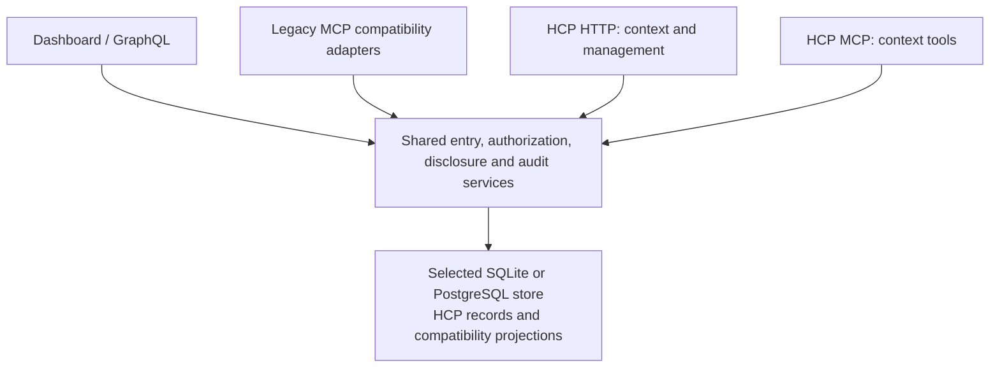

# HCP Alignment Plan

- Status: documented proposal; implementation is not activated
- Outcome owner: product owner; assign a coordinator and sole writer at activation
- Priority: future capability; does not change the assisted pilot's priority
- Risk: authorization, disclosure, persisted history, erasure, and client compatibility
- Assessment date: 2026-11-07
- Evidence: [gap analysis](gap-analysis.md), with the reviewed source revisions
- Relationship and ownership: [HCP integration reference](../../../useful/HCP_INTEGRATION.md)
- Protocol questions: [local Draft 3 adoption notes][questions]

## Outcome And Scope

Align Context Router with a deliberately selected HCP revision while preserving
the local application's credential, inference, persistence, and supported-client
boundaries. Add HCP interfaces backed by shared entry, authorization, disclosure,
and audit services. Existing application views can remain where their behavior
can be represented faithfully.

Use this upgrade to evaluate how well the **current hcp-spec repository** supports
another team's adoption. Start with its existing specification, schemas, guides,
and tooling; keep the assessment, questions, and adoption observations in Context
Router. Improve hcp-spec only when concrete findings justify a focused change.

The proposed end target is **Agent Interop plus Memory Manager**, conditional on
serving independently operated assistants and accepting model-inferred entries:

- Agent Interop comprises Core, General Context, HTTP Binding, OAuth Interop, and
  MCP over Streamable HTTP. A stdio bridge does not itself satisfy that package.
- Accepting model-inferred HCP entries requires Memory Manager.
- First-Party is an alternative only if every HCP Client is operated by the
  Provider Operator. Local installation or bridge authorship does not establish
  that relationship.
- VC Evidence, delegated authorization, and issuer-attested health/education are
  outside the proposed initial scope. Their profiles become applicable when their
  triggering features are accepted. Ordinary personal health statements alone
  do not trigger the credential profiles.

The first runtime milestone should be an isolated, synthetic, read-only HTTP
journey with explicit consent, purpose-bound disclosure, audit, and revocation.
It makes **no HCP conformance claim**. A complete HTTP-only Provider Interop
milestone is possible later, before MCP qualification, only after all requirements
of that package and any applicable profiles are evidenced.

This plan authorizes no runtime work, personal-data migration, reset, live model
run, new network exposure, third-party client configuration, or release. It does
not change the chosen spec revision when an upstream question is resolved.

## Test The Current Adoption Experience

Start from the reviewed hcp-spec revision recorded in the [gap analysis](gap-analysis.md):
`b764a058eac15a4cd843892e60473089b2e835bb`, with Draft 3 normative content pinned at
`2e2939c9bebcefb3bed7bb3522231c0e4d65a315`. Keep it as the first adoption baseline;
any later target change must be explicit and preserve the earlier observations.
No new hcp-spec documentation, tooling, or skills are prerequisites for beginning
the bounded adoption exercise when runtime work is authorized.

At C0 and each later checkpoint, record concise observations in this brief and
the [local questions][questions]: the task/requirement, existing source consulted,
attempt or interpretation, outcome, manual work or workaround, and remaining
impact. Distinguish source inspection from runtime evidence. Classify findings as:

- **Application adaptation:** CR behavior differs from a sufficiently clear HCP
  requirement; the implementation work belongs here.
- **Guidance or specification gap:** the existing materials leave a concrete
  question unanswered, inconsistent, or difficult to apply.
- **Tooling opportunity:** repeated implementation or validation work suggests a
  reusable aid for other teams.

First use the published materials to answer questions; do not assume every entry
in the local question list requires a spec change. A large CR change is not by
itself evidence that HCP needs revision. Evaluate adoption usability separately
from protocol conformance, memory quality, and task outcomes.

At C3, summarize what the existing materials enabled, where interpretation or
manual work was needed, which questions remain, and which focused upstream
improvements the evidence supports. Do not build a general adoption framework or
skill in advance of that evidence. A real blocker can be raised earlier: resolve
the ambiguity before implementing the affected behavior, continue independent
work, and never weaken requirements merely to preserve the experiment's schedule.

Keep hcp-spec unchanged for this documentation phase, including its already merged
implementation-directory entry. Future improvements are separate, reviewable
changes with the smallest concrete example and an explicit target-revision decision.

## Proposed Architecture

Prefer authoritative HCP entry/version, grant, relationship, disclosure, audit,
and idempotency records inside the selected existing transactional store. Keep
preference tables as compatibility projections where useful, updated in the same
transaction through one mutation authority. HCP governs observable behavior, not
the literal database layout.

A thin adapter is useful for the isolated experiment. Independently writable
metadata beside existing preference rows would drift when another application
path changed the memory. Replacing the preference model wholesale is another
option, but has a broader UI and migration impact; choose it only if the reviewed
mapping shows compatibility projections add more complexity than they remove.
Do not introduce a separate authoritative database without an explicit cross-store
commit and recovery design.

Extend the existing application-owned storage ports and shared contracts. Local
SQLite schema admission/upgrades and PostgreSQL/Prisma migrations are distinct
responsibilities. Neither adapter is retired by this plan.

## Decisions Before Runtime Work

| Decision | Proposed direction and remaining question | Needed before |
| --- | --- | --- |
| D1. Draft, roles, and claim | Start from the recorded adoption baseline and select the package/profile list. Identify the person operating the instance, provider, assistant host, bridge, inference component, and requesting party. Investigate operator ambiguities through CR-Q3 in the [local notes][questions]; raise a focused upstream question only where the existing materials do not settle the required behavior. | C0; any grant or public claim |
| D2. Authorization deployment | Preserve local/offline operation and authority separation. Evaluate a maintained OAuth implementation with the required HCP details; hosted Auth0 is not an implicit local dependency. Select supported flows and local discovery/metadata behavior; CR-Q3/CR-Q4 remain open. | C0/C2 |
| D3. Entry mapping | Freeze actor/grant identity and provenance contracts before the kernel. Define content wrappers, categories, purposes, location semantics, proposal staging, and legacy representability. | C0/C1 |
| D4. Shared-data boundary | Inventory old reads and writes. Either adapt each access path for HCP-managed records or exclude those records; preserve supported consumers through reviewed transitions. | Before any shared production-store exposure, not merely C6 |
| D5. Revocation and copies | Define authorization/commit/disclosure ordering, expiry during sleep, and notification recovery. Use a truthful no-endpoint/short-copy configuration for the first experiment if appropriate; resolve CR-Q1 before the affected concurrency behavior. | C0/C2, before first disclosure |
| D6. Retention and retries | Design erasure across versions, audit snapshots, idempotency responses, backups, and recovery. Resolve create → erase → retry and changed-authority replay through CR-Q2; no silent resurrection. | C0, before content-bearing durable caches |
| D7. Historical adoption | Preserve or refuse incompatibility by default. Faithfully adopt representable records; retain others as legacy or obtain a genuinely new person declaration. A designated reset release needs its own bounded decision and consent. | C0/C6 |

These are decisions to settle at activation, not assumed approvals. Record their
dispositions in this brief and update the gap rows they affect. Keep initial
questions and adoption evidence in the [local notes][questions]; link any later
upstream discussion from that single record.

## Historical Data And Shared Paths

Existing CR records are not HCP v1 exports. Source labels, numeric confidence,
acceptance history, or demo format versions do not prove complete HCP provenance.
Do not invent historical model identifiers, grants, confirmations, or revisions.
Record any migration/submission performed now with truthful current attribution.

Keep unrepresentable records explicitly outside HCP-managed entries until an
appropriate adoption path is chosen. A person can deliberately make a fresh
statement with current provenance. Generic migration approval or confirmation of
an inference must not relabel its original asserter or declaration type. Preserve
the distinction between that new assertion and its legacy source.

Keep document proposals in a pre-entry staging area until applied. HCP has no
`suggested` state; neither automatic activation nor invented conflict is a faithful
mapping. A direct authorized HCP create has its own entry-creation semantics.
Capture server-owned model/source metadata for new proposals where those facts
will be asserted; raw source files are not retained by the existing product.

Before sharing HCP-managed data, account for ordinary GraphQL/profile operations,
legacy MCP tools, both document-apply versions, identity/profile seed writes,
definition edits, location cascades, reset/history-clear, and import tools. The
same inventory covers legacy reads, exports, resources, and AI prompt builders.
Shared mutation rules alone cannot protect a disclosure through an old read path.
This is a product security/compatibility decision; HCP's interface contract does
not by itself describe the guarantees of a separately labeled legacy interface.

Preserve wire shapes where possible, but do not promise unchanged overwrite,
delete, or visibility semantics for HCP-managed records. Follow
[interface evolution](../../../useful/INTERFACE_EVOLUTION.md), with a supported
consumer inventory, migration window, and recovery plan. Scope refusal or
exclusion before exposure; do not silently downgrade records for compatibility.

## Testable Checkpoints

Backend behavior changes are tests first. Each checkpoint ends with a recorded
result and remaining evidence; these are internal checkpoints, not a required PR
count. Prefer one cohesive PR for a bounded outcome, splitting only at independently
useful, safe landing points. C0 defines the concrete first implementation scope.

| Checkpoint | Deliverable | Exit evidence and dependencies |
| --- | --- | --- |
| C0. Scope and contracts | Resolve D1–D7 for the first slice against the recorded adoption baseline and role map. Use existing HCP materials to expand the gap IDs into a requirement-to-implementation/test matrix, recording unanswered questions and manual interpretation locally. | Independent plan review of authority, lifecycle, compatibility, migration, and failure states. Identify genuine blockers and their affected checkpoints; raise focused questions when needed, without requiring advance HCP documentation/tooling improvements or unrelated editorial fixes. |
| C1. Synthetic entry kernel | Stable entries, immutable versions, expected-version checks, truthful provenance, confirmations, staging, lifecycle, and transactional audit. Use valid synthetic actor/grant fixtures under the C0 contract. | Concurrent writers, stale confirmation, rollback, acknowledged durability, and unknown-field round trips on SQLite/PostgreSQL. No real producer can invoke this incomplete kernel; no later backfilling of fictional authorization. Addresses G06–G11/G14. |
| C2. Grants and human controls | Consent, temporary/persistent grants, OAuth integration, purpose/category evaluation, standing rules/directives, immediate provider revocation, and usable human grant/audit access. Choose notification registration/delivery or the experiment's explicit no-endpoint policy. | Two-client isolation, authentication-versus-consent, separate persistence election, expiry across sleep/restart, wrong purpose/unknown narrowing, and revocation races across slow bodies and running work. No-endpoint copies are capped at one hour; complete applicable notification behavior remains required for the eventual claim. Addresses G01–G05. |
| C3. Read-only HTTP journey | Query/get with allowlisted disclosures, grant references, relevance, one quantity bound, directives, use-until, and durable disclosure history. Keep all data synthetic and isolated. | Consent → retrieve → inspect history → revoke, with two clients. Test foreign/absent refs, private-field exclusion, categories/purpose, sparse results and 1/5/20 limits, reference stability, expiry and concurrent policy changes. Summarize the existing materials' adoption usability and evidence-backed improvement candidates. No package/profile claim. Addresses G12–G14 and part of G16. |
| C4. Writes and Memory Manager | Create/revise/withdraw, durable HTTP idempotency, valid inference provenance/confidence, symmetric conflict detection and human resolution. | Committed-but-lost reply, restart/retry, changed-body conflict, concurrent revisions, both conflict arrival orders, same dimension without contradiction, and multiple unresolved conflict edges. Do not accept inferred HCP entries before this capability is ready. Addresses G07–G11/G16. |
| C5. Complete governance and portability | Person-facing capabilities, export/import, hard deletion, disclosure summaries, notification outcomes, and retention/recovery semantics. | Governance rejected for context clients; all retained states visible to the person; import dry run and round trip; no deleted-entry resurrection; erasure across retained copies/caches; notification retry and dormant-provider recovery. Implement sharing reports, including unauthorized reports, even if no sharing permissions are issued. Addresses G04/G05/G11/G14/G15. |
| C6. Existing consumers and data adoption | Integrate the complete producer/consumer inventory and the chosen historical migration policy. Earlier checkpoints must already enforce D4 before shared-store exposure. | Synthetic migration dry runs, legacy contracts, profile/document/seed/location/reset bypass tests, both storage adapters, schema admission and supported upgrade/recovery. Personal migration requires a separately scoped activation. Addresses G06–G15/G18. |
| C7. HCP MCP and clients | Modern transport, discovery, HCP tools, output/error schemas, and supported bridge/client migration. | HTTP/MCP semantic parity, old client regression tests, credential isolation, uncertain-write behavior, and real supported-host interoperability. Keep host-side copy use/directive obligations distinct from provider conformance. Addresses G16–G18. |
| C8. Selected-package qualification | Freeze the candidate, close the requirement/evidence matrix, independently review the full diff, and publish only fully supported discovery claims. | Focused local evidence, all applicable exact-candidate CI, and explicitly named Mac, installed-artifact, and manual evidence. No claim for an incomplete Part; no schema-only certification. Addresses all selected requirements. |

For the first implementation, favor lexical relevance ordering, synchronous
disclosure audit, and a declared structural conflict detector for clear typed
contradictions. Protocol correctness, memory quality, and task outcomes require
separate evidence. No vector database or universal ontology is implied.

Initially issue no onward-sharing permissions. This does not remove required
sharing-report operations or establish control over an external assistant's
copies. A client that claims to follow directives needs host enforcement; prompt
text alone is not evidence. Never put management/access/refresh credentials into
tool content or model prompts.

## Validation, Ownership, And Finalization

At activation, name the coordinator, sole writer, reviewers, owned paths,
resource isolation, and requested versus observable model/effort settings under
the [agent workflow](../../../useful/AGENT_WORKFLOW.md). One writer owns the main
checkout. Read-only investigation and review can run concurrently; shared storage,
schema, authority, composition, UI consumers, and lockfiles need one integration
order. Review the concrete plan before runtime implementation and the complete
candidate before handoff.

Extend existing local-MCP transport/tool/bridge/lifecycle tests, workflow filtering
tests, reviewed-apply and storage contracts, and local UI permission/session tests.
Add binding-neutral synthetic scenarios and run them through both HCP interfaces.
The gap analysis identifies inspected starting evidence; those tests were not run
as part of that source assessment and do not prove future behavior.

Follow the [validation matrix](../../../useful/AGENT_WORKFLOW.md#default-and-exceptions).
Select focused checks for each changed behavior and consumer, including real
concurrency, persistence/recovery, browser, and Mac behavior where needed. A full
local migration gate needs the policy's named evidence gap or scoped requirement;
this plan adds no automatic duplicate broad run. Exact-candidate CI remains
required when a PR is prepared. Source CI does not qualify an installed artifact.

The finalization milestone is the scoped candidate with known corrections and
affected reviews resolved, the agreed exploratory acceptance round closed or its
remaining checks explicitly assigned, and the requirement/evidence matrix ready
for qualification. Freeze source and relevant inputs then. Changed inputs renew
affected checks/reviews; carry forward only explicitly unaffected evidence.
Report outstanding platform/artifact/manual evidence without treating it as a pass.

This documentation-only proposal requires links, consistency, whitespace, and
affected documentation-reader checks; it does not require launching or migrating
the application. Implementation remains unactivated after those checks pass.

## Feedback And Maintenance

The [local questions][questions] own initial clarifications and adoption findings.
Use the current spec before improving it, following the adoption approach above.
Keep CR's rollout, compatibility, data mapping, and qualification evidence here.

As concrete evidence reveals reusable needs, propose focused hcp-spec clarifications,
synthetic scenarios, complete tool descriptors, binding examples, or adoption
guidance. Coordinate tooling with its forthcoming conformance suite. A later
skill should route to proven guidance and the normative text. Accepted upstream
changes trigger reassessment; adopt a new target revision explicitly.

When activated, promote this canonical brief through the [portfolio](../../README.md)
instead of copying it into a second plan. After delivery, distill implemented
behavior into current docs/runbooks and retire superseded planning prose.

[questions]: spec-questions.md
